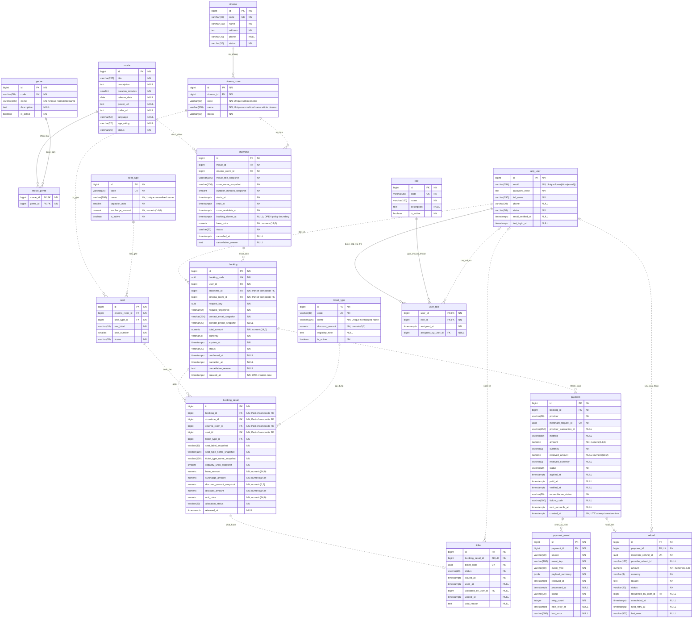
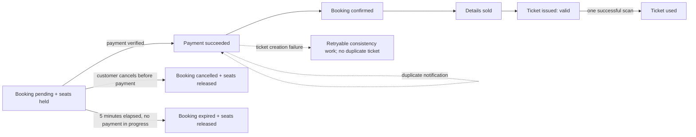

# Database Design — Hệ thống quản lý rạp chiếu phim và đặt vé online

## 1. Tổng quan Database

Database lưu trữ dữ liệu cho các nghiệp vụ: quản lý phim và thể loại; quản lý rạp, phòng và sơ đồ ghế; lập lịch chiếu; giữ ghế và đặt vé; thanh toán online; phát hành và soát vé; tra cứu lịch sử và báo cáo doanh thu.

Hệ thống sử dụng **PostgreSQL**, lưu nguồn dữ liệu chính xác về ghế đang được giữ/bán, trạng thái đơn và giao dịch. Frontend chỉ hiển thị kết quả từ API; trạng thái trên trình duyệt không có giá trị xác nhận thanh toán hoặc quyền sở hữu ghế.

## 1.1. Phạm vi, giả định và trạng thái quyết định

Tài liệu này là thiết kế khái niệm/lô-gic, không phải SQL DDL và không tuyên bố rằng mọi chức năng đã được triển khai.

| Phạm vi | Nội dung |
|---|---|
| **CONFIRMED — MVP/demo** | Một chi nhánh được vận hành ban đầu; quản lý phim/thể loại, phòng/ghế, suất chiếu, giữ ghế 5 phút, booking, thanh toán của cổng được chọn, phát hành và soát vé, tài khoản và vai trò cơ bản. |
| **PROPOSED — sẵn sàng mở rộng** | Có entity `Cinema` và khóa ngoại từ `CinemaRoom`; mã phòng được duy nhất trong từng chi nhánh. Demo chỉ seed một `Cinema`. |
| **CONFIRMED — chính sách nền** | Booking pending giữ ghế trong 5 phút; hủy trước thanh toán giải phóng ghế; không hủy sau thanh toán và không hoàn tiền trong demo. |
| **CONFIRMED — bán vé** | Không áp dụng cutoff cố định 10/15/30 phút trước giờ chiếu. Demo cho phép bán sát giờ bắt đầu; mốc đóng bán cuối cùng cần được nhóm chốt trước khi triển khai. |
| **OUT OF SCOPE — DEMO** | Hủy suất do rạp, hoàn tiền tự động/thủ công, đối soát khoản thanh toán thành công đến muộn sau khi ghế đã được bán lại, thành viên/loyalty, khuyến mãi phức tạp, báo cáo phân tích nâng cao và phân quyền theo chi nhánh. |
| **OPEN** | Cổng thanh toán cụ thể, cửa sổ soát vé, quy tắc đủ điều kiện vé trẻ em/sinh viên, cách bán ghế Couple và mốc đóng bán tối thiểu. |

`PaymentEvent` được giữ để ghi nhận callback lặp và bảo toàn lịch sử tích hợp. `Refund` được giữ ở mức cấu trúc mở rộng và traceability, nhưng không phải luồng demo. Các đoạn mô tả xử lý nâng cao trong tài liệu là ràng buộc an toàn dữ liệu hoặc hướng phát triển sau này, không phải cam kết MVP.



## 2. Nguyên tắc thiết kế Database

1. Ưu tiên toàn vẹn dữ liệu: PK, FK, UNIQUE, CHECK và exclusion constraint bảo vệ những quy tắc database có thể thực thi.
2. Bảng danh mục được chuẩn hóa; thông tin chốt tại lúc mua như giá và tên hiển thị được lưu snapshot có chủ đích để giữ lịch sử.
3. Phân biệt ba vòng đời: **booking** là đơn hàng, **payment** là lần giao dịch với cổng, **ticket** là quyền vào rạp sau khi đơn được xác nhận.
4. Việc giữ/bán ghế được quyết định theo cặp `(showtime_id, seat_id)`. `Seat.status` chỉ mô tả tình trạng vật lý của ghế.
5. Các thao tác nhiều bảng phải nằm trong transaction; không giữ transaction database trong lúc gọi API cổng thanh toán.
6. Dữ liệu tài chính và vé đã phát hành không bị xóa theo cascade. Hủy hoặc hoàn là chuyển trạng thái, vẫn giữ lịch sử.
7. Lưu mốc thời gian bằng `timestamptz`; backend truyền UTC, giao diện hiển thị múi giờ `Asia/Ho_Chi_Minh`. PostgreSQL không lưu lại tên múi giờ gốc trong giá trị `timestamptz`.
8. Dùng tên bảng/cột `snake_case` không dấu, số ít; class C# dùng PascalCase. Entity `User` ánh xạ thành `app_user`, tránh tên SQL `user`.
9. Trạng thái dùng `varchar` + CHECK, ánh xạ enum trong C#. Không dùng PostgreSQL enum ở bản đầu để việc thêm/bỏ trạng thái qua migration đơn giản hơn.
10. Quyền thay đổi dữ liệu đi qua backend. Migration dùng tài khoản riêng; tài khoản runtime không có quyền sửa schema.

## 3. Danh sách Entity

| Entity        | Bảng PostgreSQL   | Vai trò                                                                 |
| ------------- | ------------------ | ------------------------------------------------------------------------ |
| Movie         | `movie`          | Thông tin và trạng thái quản lý phim                               |
| Genre         | `genre`          | Danh mục thể loại dùng chung                                         |
| MovieGenre    | `movie_genre`    | Quan hệ nhiều–nhiều giữa phim và thể loại                        |
| Cinema        | `cinema`         | Chi nhánh/rạp vật lý; demo seed một bản ghi                         |
| CinemaRoom    | `cinema_room`    | Phòng chiếu thuộc một chi nhánh                                      |
| Seat          | `seat`           | Vị trí ghế vật lý trong phòng                                      |
| SeatType      | `seat_type`      | Loại ghế và phụ thu hiện hành                                      |
| TicketType    | `ticket_type`    | Nhóm khách/loại vé và chính sách giảm giá hiện hành           |
| Showtime      | `showtime`       | Lịch chiếu, khoảng chiếm dụng phòng, giá cơ sở                  |
| Booking       | `booking`        | Đơn đặt ghế, hạn giữ, tổng tiền và chủ đơn                  |
| BookingDetail | `booking_detail` | Từng ghế trong đơn, giá đã chốt, trạng thái giữ/bán          |
| Ticket        | `ticket`         | Vé phát hành cho một chi tiết đơn                                 |
| Payment       | `payment`        | Một lần thử thanh toán, kết quả thu tiền và đối soát          |
| User          | `app_user`       | Tài khoản và hồ sơ tối thiểu                                      |
| Role          | `role`           | Danh mục vai trò                                                       |
| UserRole      | `user_role`      | Gán nhiều vai trò cho tài khoản                                     |
| PaymentEvent  | `payment_event`  | Bổ sung: nhận và xử lý idempotent thông báo/đối soát từ cổng |
| Refund        | `refund`         | Bổ sung: theo dõi một yêu cầu hoàn toàn bộ cho một payment      |

`PaymentEvent` và `Refund` được bổ sung vì một cột trạng thái trên Payment không đủ để phân biệt thông báo lặp và kết quả tích hợp chưa rõ. `Refund` chỉ là cấu trúc chuẩn bị cho tương lai; refund không thuộc MVP. Không thêm bảng tồn kho ghế theo suất trong phiên bản này: `BookingDetail` cùng unique index có điều kiện đảm nhiệm giữ/bán ghế.

## 4. Thiết kế Entity Movie

### 4.1. Các thuộc tính

| Cột                 | Kiểu / ràng buộc                           | Ý nghĩa                                                           |
| -------------------- | --------------------------------------------- | ------------------------------------------------------------------- |
| `id`               | ID, PK                                        | Định danh phim                                                    |
| `title`            | `varchar(255)` NN                           | Tên hiển thị; được phép trùng giữa các phim               |
| `description`      | `text` NULL                                 | Tóm tắt nội dung                                                 |
| `duration_minutes` | `smallint` NN, CHECK > 0                    | Thời lượng nội dung phim                                        |
| `release_date`     | `date` NULL                                 | Ngày phát hành                                                   |
| `poster_url`       | `text` NULL                                 | URL ảnh; backend kiểm tra định dạng                            |
| `trailer_url`      | `text` NULL                                 | URL trailer                                                         |
| `language`         | `varchar(50)` NULL                          | Ngôn ngữ gốc                                                     |
| `age_rating`       | `varchar(20)` NULL                          | Nhãn phân loại; không suy ra điều kiện tuổi chỉ từ chuỗi |
| `status`           | `varchar(20)` NN, DEFAULT `'coming_soon'` | `coming_soon`, `now_showing`, `ended`, `archived`           |

### 4.2. Quy tắc nghiệp vụ và quan hệ

- Một phim có 0..N thể loại khi đang soạn; khi công bố để bán vé phải có ít nhất một thể loại, thời lượng, ngày phát hành và nhãn phân loại phù hợp. Backend kiểm tra điều kiện công bố.
- Quan hệ `Movie` N–N `Genre` qua `MovieGenre`; `Movie` 1–N `Showtime`.
- Tên phim không phải khóa tự nhiên: phim làm lại hoặc khác năm có thể trùng tên.
- Sửa thời lượng không tự thay đổi lịch các suất đã lập. `Showtime` lưu thời gian và snapshot riêng.
- Phim đã có suất chiếu được ẩn/lưu trữ bằng trạng thái; không xóa mất lịch sử.
- Không tự đổi trạng thái phim chỉ dựa vào `release_date`; quản trị viên quản lý việc hiển thị theo lịch vận hành.

## 5. Thiết kế Entity Genre

| Cột            | Kiểu / ràng buộc          | Ý nghĩa                                      |
| --------------- | ---------------------------- | ---------------------------------------------- |
| `id`          | ID, PK                       | Định danh thể loại                         |
| `code`        | `varchar(30)` NN, UQ       | Mã ổn định, ví dụ`ACTION`, `COMEDY`  |
| `name`        | `varchar(100)` NN          | Tên hiển thị                                |
| `description` | `text` NULL                | Mô tả thể loại                             |
| `is_active`   | `boolean` NN, DEFAULT true | Có cho phép gán mới/lọc công khai không |

Tên không trùng sau `lower(btrim(name))` bằng unique expression index. Đổi tên tại một bản ghi áp dụng cho danh mục phim; không đổi `code` sau khi đã dùng. Thể loại đang được phim tham chiếu không được xóa; có thể ngừng sử dụng cho lần gán mới bằng `is_active = false`.

## 6. Thiết kế Entity MovieGenre

| Cột         | Kiểu / ràng buộc                         | Ý nghĩa  |
| ------------ | ------------------------------------------- | ---------- |
| `movie_id` | `bigint` NN, PK ghép, FK → `movie.id` | Phim       |
| `genre_id` | `bigint` NN, PK ghép, FK → `genre.id` | Thể loại |

Khóa chính `(movie_id, genre_id)` ngăn một phim bị gán cùng thể loại hai lần. Không cần cột ID tự tăng, danh sách ID dạng chuỗi hoặc mảng genre trên `movie`.

## 7. Thiết kế Entity Cinema

`Cinema` đại diện cho một chi nhánh vật lý. Mô hình này không làm demo thành hệ thống chuỗi: dữ liệu seed ban đầu chỉ có một cinema, nhưng phòng, lịch chiếu và các bản ghi nghiệp vụ đã có đường truy nguyên về chi nhánh qua `CinemaRoom`.

| Cột | Kiểu / ràng buộc | Ý nghĩa |
|---|---|---|
| `id` | ID, PK | Định danh chi nhánh |
| `code` | `varchar(30)` NN, UQ | Mã chi nhánh ổn định, duy nhất toàn hệ thống |
| `name` | `varchar(150)` NN | Tên hiển thị chi nhánh |
| `address` | `text` NN | Địa chỉ vật lý |
| `phone` | `varchar(30)` NULL | Số liên hệ nếu có |
| `status` | `varchar(20)` NN, DEFAULT `'active'` | `active`, `inactive` |

Tên và mã không được rỗng; `code` duy nhất sau chuẩn hóa. Không xóa cinema đã có phòng, suất, booking hoặc giao dịch; dùng `inactive`. Quan hệ `Cinema 1 — N CinemaRoom` là bắt buộc ở phía phòng. Booking, ticket và payment không lặp `cinema_id`: chi nhánh được truy nguyên không mơ hồ qua `Booking → Showtime → CinemaRoom → Cinema`, và các composite FK tiếp tục bảo vệ phòng/suất/ghế.

MVP không hỗ trợ chuyển booking giữa chi nhánh, giá hoặc tồn kho dùng chung, phân quyền staff theo chi nhánh, hoặc báo cáo hợp nhất/nâng cao. Những chức năng đó cần quy tắc ứng dụng bổ sung trong tương lai.

### 7.1. Thiết kế Entity CinemaRoom

| Cột       | Kiểu / ràng buộc                      | Ý nghĩa                                  |
| ---------- | ---------------------------------------- | ------------------------------------------ |
| `id`     | ID, PK                                   | Phòng chiếu                              |
| `cinema_id` | `bigint` NN, FK → `cinema.id`        | Chi nhánh sở hữu phòng |
| `code`   | `varchar(20)` NN                       | Mã ổn định, duy nhất trong chi nhánh, ví dụ `ROOM_01` |
| `name`   | `varchar(100)` NN                      | Tên hiển thị, duy nhất sau chuẩn hóa trong chi nhánh |
| `status` | `varchar(20)` NN, DEFAULT `'active'` | `active`, `maintenance`, `inactive`  |

Sức chứa là **giá trị tính từ ghế**, không lưu thêm `capacity` có thể lệch: tổng số ghế là số vị trí; sức chứa người là `SUM(seat_type.capacity_units)`; số chỗ đang khai thác chỉ tính ghế `active`.

Phòng chỉ nhận lịch/bán vé mới khi cả phòng và cinema đều `active`. `UNIQUE(cinema_id, code)` và unique tên đã chuẩn hóa theo `cinema_id` cho phép các chi nhánh dùng cùng mã phòng. Chuyển sang bảo trì phải kiểm tra các suất sắp tới và xử lý theo nghiệp vụ trước; không chỉ đổi trạng thái để bỏ qua vé đã bán. Không xóa phòng đã có suất chiếu.

## 8. Thiết kế Entity Seat

| Cột               | Kiểu / ràng buộc                      | Ý nghĩa                                 |
| ------------------ | ---------------------------------------- | ----------------------------------------- |
| `id`             | ID, PK                                   | Ghế vật lý                             |
| `cinema_room_id` | `bigint` NN, FK → `cinema_room.id`  | Phòng sở hữu ghế                      |
| `seat_type_id`   | `bigint` NN, FK → `seat_type.id`    | Loại ghế                                |
| `row_label`      | `varchar(10)` NN                       | Ký hiệu hàng, chuẩn hóa chữ hoa     |
| `seat_number`    | `smallint` NN, CHECK > 0               | Số ghế trong hàng                      |
| `status`         | `varchar(20)` NN, DEFAULT `'active'` | `active`, `maintenance`, `inactive` |

- `UNIQUE(cinema_room_id, row_label, seat_number)` ngăn hai ghế cùng vị trí. `UNIQUE(id, cinema_room_id)` phục vụ FK ghép chống chọn ghế sai phòng.
- `Seat.status` không có `booked` hay `sold`; cùng một ghế có thể bán cho nhiều suất khác nhau.
- Đề xuất ghế Couple là **một đơn vị bán không tách rời**, `capacity_units = 2`, một booking detail và một vé cho cả cặp. Nhóm phải đổi mô hình nếu muốn phát hành hai vé/áp dụng hai loại vé khác nhau trên cùng cặp ghế.
- Khi phòng đã có suất được công bố, khóa cấu trúc sơ đồ ghế của phòng: không thêm/xóa/chuyển phòng/đổi nhãn/đổi loại ghế. Thay đổi cấu trúc cần đóng các suất chưa chiếu và lập phiên bản phòng mới; phòng cũ giữ lịch sử. Thay đổi tình trạng bảo trì phải khóa các suất liên quan và xử lý đơn bị ảnh hưởng trước.
- Khi đã có lịch sử booking, ghế không được chuyển sang phòng khác hoặc tái sử dụng ID cho vị trí khác.

## 9. Thiết kế Entity SeatType

| Cột                 | Kiểu / ràng buộc                         | Ý nghĩa                                  |
| -------------------- | ------------------------------------------- | ------------------------------------------ |
| `id`               | ID, PK                                      | Loại ghế                                 |
| `code`             | `varchar(30)` NN, UQ                      | `STANDARD`, `VIP`, `COUPLE`          |
| `name`             | `varchar(100)` NN                         | Tên loại ghế, duy nhất sau chuẩn hóa |
| `capacity_units`   | `smallint` NN, DEFAULT 1, CHECK IN (1, 2) | Số người trên đơn vị bán           |
| `surcharge_amount` | `numeric(14,0)` NN, DEFAULT 0, CHECK >= 0 | Phụ thu bằng VND trên một đơn vị bán |
| `is_active`        | `boolean` NN, DEFAULT true                | Cho phép dùng cho cấu hình mới        |

Giữ entity riêng vì loại ghế có thuộc tính giá và sức chứa. Không thay đổi `capacity_units` của loại đã có ghế được đưa vào lịch chiếu; tạo loại mới khi thay đổi ý nghĩa. Thay đổi phụ thu chỉ áp dụng booking mới; đơn đang giữ hoặc đã mua dùng snapshot.

## 10. Thiết kế Entity TicketType

| Cột                 | Kiểu / ràng buộc            | Ý nghĩa                                     |
| -------------------- | ------------------------------ | --------------------------------------------- |
| `id`               | ID, PK                         | Loại vé                                     |
| `code`             | `varchar(30)` NN, UQ         | `ADULT`, `CHILD`, `STUDENT`             |
| `name`             | `varchar(100)` NN            | Tên hiển thị, duy nhất sau chuẩn hóa    |
| `discount_percent` | `numeric(5,2)` NN, DEFAULT 0 | CHECK từ 0 đến 100                         |
| `eligibility_note` | `text` NULL                  | Điều kiện xuất trình giấy tờ/áp dụng |
| `is_active`        | `boolean` NN, DEFAULT true   | Được chọn cho đơn mới                  |

**Chính sách giá đề xuất:** giảm theo phần giá cơ sở; không giảm phụ thu ghế. Backend quyết định loại vé đủ điều kiện, không tin mức giảm do client gửi. Với Couple, bản đầu chỉ dùng Adult để tránh gán một loại vé cho hai khách có điều kiện khác nhau.

Có thể triển khai bản đầu chỉ với `ADULT` giảm 0%. Danh mục không thay thế việc kiểm tra điều kiện thực tế khi vào rạp. Không lưu giấy tờ cá nhân vào bảng này.

## 11. Thiết kế Entity Showtime

| Cột                          | Kiểu / ràng buộc                     | Ý nghĩa                                                               |
| ----------------------------- | --------------------------------------- | ----------------------------------------------------------------------- |
| `id`                        | ID, PK                                  | Suất chiếu                                                            |
| `movie_id`                  | `bigint` NN, FK → `movie.id`       | Phim                                                                    |
| `cinema_room_id`            | `bigint` NN, FK → `cinema_room.id` | Phòng                                                                  |
| `movie_title_snapshot`      | `varchar(255)` NN                     | Tên phim tại thời điểm lập lịch                                  |
| `room_name_snapshot`        | `varchar(100)` NN                     | Tên phòng trên lịch/vé                                             |
| `duration_minutes_snapshot` | `smallint` NN, CHECK > 0              | Thời lượng dùng khi lập lịch                                      |
| `starts_at`                 | `timestamptz` NN                      | Giờ bắt đầu suất                                                   |
| `ends_at`                   | `timestamptz` NN                      | Giờ kết thúc, gồm phần đệm/trailer nếu có                      |
| `room_available_at`         | `timestamptz` NN                      | Thời điểm phòng có thể nhận suất tiếp theo, gồm dọn phòng   |
| `booking_closes_at`         | `timestamptz` NULL                    | Mốc đóng booking/thanh toán nếu nhóm chốt; NULL nghĩa không có cutoff trước giờ bắt đầu |
| `base_price`                | `numeric(14,0)` NN, CHECK > 0          | Giá cơ sở bằng VND cho một người |
| `status`                    | `varchar(20)` NN, DEFAULT `'draft'` | `draft`, `scheduled`, `in_progress`, `completed`, `cancelled` |
| `cancelled_at`              | `timestamptz` NULL                    | Thời điểm hủy                                                       |
| `cancellation_reason`       | `text` NULL                           | Lý do bắt buộc khi hủy                                              |

- CHECK khi có mốc: `booking_closes_at <= starts_at`; luôn có `starts_at < ends_at <= room_available_at`. `booking_closes_at` không được dùng để áp đặt mặc định 10/15/30 phút; giá trị NULL cho phép bán đến trước giờ bắt đầu. Backend còn kiểm tra độ dài suất đủ cho `duration_minutes_snapshot`.
- `UNIQUE(id, cinema_room_id)` phục vụ FK ghép. Phim và phòng phải tồn tại; phòng active, phim không archived khi công bố suất.
- Khoảng chiếm dụng phòng là `[starts_at, room_available_at)`, gồm cả thời gian dọn phòng. Mục 26 quy định exclusion constraint.
- Chỉ `scheduled` và chưa tới hạn đóng bán mới được tạo booking. `draft` chưa bán nhưng vẫn giữ chỗ trong lịch phòng.
- Sau khi có booking đầu tiên, không đổi phim/phòng/các mốc thời gian/snapshot. Đổi lịch phải hủy suất và tạo suất khác, xử lý đơn cũ theo chính sách.
- Có thể điều chỉnh `base_price` cho đơn mới bằng thao tác có kiểm soát; không sửa giá trong booking đã tạo. Hủy suất phải đồng bộ với các đơn và giao dịch theo mục 31.

## 12. Thiết kế Entity Booking

| Cột                       | Kiểu / ràng buộc                                 | Ý nghĩa                                                                           |
| -------------------------- | --------------------------------------------------- | ----------------------------------------------------------------------------------- |
| `id`                     | ID, PK                                              | Định danh nội bộ                                                                |
| `booking_code`           | `uuid` NN, UQ                                     | Mã tra cứu công khai, backend sinh ngẫu nhiên                                  |
| `user_id`                | `bigint` NN, FK → `app_user.id`                | Chủ đơn                                                                          |
| `showtime_id`            | `bigint` NN                                       | Suất chiếu                                                                        |
| `cinema_room_id`         | `bigint` NN                                       | Cột kỹ thuật phục vụ FK ghép                                                  |
| `request_key`            | `uuid` NN                                         | Khóa idempotency khi tạo đơn                                                    |
| `request_fingerprint`    | `varchar(64)` NN                                  | SHA-256 của dữ liệu đặt chuẩn hóa để phát hiện cùng key khác nội dung |
| `contact_email_snapshot` | `varchar(254)` NN                                 | Email nhận thông tin tại thời điểm mua                                        |
| `contact_phone_snapshot` | `varchar(20)` NULL                                | Số điện thoại liên hệ nếu có                                                |
| `total_amount`           | `numeric(14,0)` NN, CHECK > 0                      | Tổng giá đã chốt bằng VND của mọi detail |
| `currency`               | `varchar(3)` NN, DEFAULT `'VND'`, CHECK = 'VND' | Tiền tệ đơn                                                                     |
| `expires_at`             | `timestamptz` NN                                  | Hạn giữ ghế cố định                                                           |
| `status`                 | `varchar(20)` NN, DEFAULT `'pending'`           | `pending`, `confirmed`, `expired`, `cancelled`                              |
| `confirmed_at`           | `timestamptz` NULL                                | Thời điểm xác nhận mua                                                         |
| `cancelled_at`           | `timestamptz` NULL                                | Thời điểm hủy                                                                   |
| `cancellation_reason`    | `text` NULL                                       | Lý do khi hủy                                                                     |
| `created_at`             | `timestamptz` NN, DEFAULT `CURRENT_TIMESTAMP`    | Thời điểm backend tạo booking, không phải thời điểm thanh toán; lưu theo UTC |

- `UNIQUE(user_id, request_key)`: gửi lại cùng yêu cầu trả cùng đơn; cùng key khác fingerprint trả lỗi, không âm thầm nhận dữ liệu mới.
- FK `(showtime_id, cinema_room_id)` → `showtime(id, cinema_room_id)`; UQ `(id, showtime_id, cinema_room_id)` làm khóa đích cho detail.
- Tạo booking, ít nhất một detail và toàn bộ quyền giữ ghế trong **một transaction**. Sau khi lấy đủ khóa, đọc `clock_timestamp()` làm thời điểm tạo thực tế, gán tường minh vào `created_at` và tính hạn giữ là 5 phút kể từ mốc này. Nếu `booking_closes_at` đã được nhóm chốt thì lấy mốc sớm hơn; nếu NULL thì không áp dụng cutoff bổ sung. Từ chối nếu đã quá giờ bắt đầu hoặc không còn thời gian giữ hợp lệ.
- Nội dung ghế, loại vé và giá được đóng băng sau khi tạo đơn. Muốn thay đổi, hủy đơn pending và tạo đơn mới; không tái mở đơn expired/cancelled.
- `total_amount = SUM(booking_detail.unit_price)` của toàn bộ detail gốc, kể cả sau khi released. Backend bảo đảm trong transaction; CHECK một hàng không tính được tổng bảng con.
- Một lần thanh toán thất bại không nhất thiết hủy booking: còn hạn thì có thể thử lại. Hết hạn hoặc khách hủy mới giải phóng ghế.
- Customer chỉ được hủy booking của chính mình khi `status = 'pending'`, chưa có Payment `succeeded` được áp dụng và không có Payment attempt `created`, `pending` hoặc `unknown`. Backend phải khóa theo thứ tự `Showtime → Booking → Payment attempts` (các Payment theo `id` tăng dần), đọc lại mọi trạng thái sau khi khóa, rồi chuyển Booking `cancelled` và toàn bộ detail `held` sang `released` trong cùng transaction. Không hủy một phần, không cho hủy `confirmed`, `expired` hoặc booking của người khác. Nếu có attempt chưa có kết quả chắc chắn, từ chối hủy và giữ allocation.
- Trạng thái hoàn tiền thuộc Payment/Refund; `cancelled` không đồng nghĩa đã hoàn tiền.

## 13. Thiết kế Entity BookingDetail

| Cột                          | Kiểu / ràng buộc                          | Ý nghĩa                             |
| ----------------------------- | -------------------------------------------- | ------------------------------------- |
| `id`                        | ID, PK                                       | Chi tiết đặt một đơn vị ghế   |
| `booking_id`                | `bigint` NN                                | Đơn sở hữu                        |
| `showtime_id`               | `bigint` NN                                | Suất, phục vụ uniqueness theo ghế |
| `cinema_room_id`            | `bigint` NN                                | Phòng, phục vụ FK ghép            |
| `seat_id`                   | `bigint` NN                                | Ghế vật lý                         |
| `ticket_type_id`            | `bigint` NN, FK → `ticket_type.id`      | Loại vé được áp dụng           |
| `seat_label_snapshot`       | `varchar(30)` NN                           | Nhãn ghế khi đặt, ví dụ A10     |
| `seat_type_name_snapshot`   | `varchar(100)` NN                          | Tên loại ghế khi đặt             |
| `ticket_type_name_snapshot` | `varchar(100)` NN                          | Tên loại vé khi đặt              |
| `capacity_units_snapshot`   | `smallint` NN, CHECK IN (1, 2)             | Số người trên đơn vị ghế      |
| `base_amount`               | `numeric(14,0)` NN, CHECK > 0                | Giá cơ sở suất × số người bằng VND |
| `surcharge_amount`          | `numeric(14,0)` NN, CHECK >= 0               | Phụ thu ghế bằng VND trên đơn vị bán |
| `discount_percent_snapshot` | `numeric(5,2)` NN, CHECK BETWEEN 0 AND 100 | Tỷ lệ giảm đã áp dụng          |
| `discount_amount`           | `numeric(14,0)` NN, CHECK >= 0               | Số tiền giảm bằng VND sau làm tròn |
| `unit_price`                | `numeric(14,0)` NN, CHECK >= 0               | Giá cuối cùng bằng VND của đơn vị bán; được phép bằng 0 (decision OQ-06, Option B) |
| `allocation_status`         | `varchar(20)` NN, DEFAULT `'held'`       | `held`, `sold`, `released`      |
| `released_at`               | `timestamptz` NULL                         | Thời điểm giải phóng             |

### 13.1. Quy tắc giá

```text
base_amount     = showtime.base_price × capacity_units_snapshot
surcharge_amount = seat_type.surcharge_amount
discount_amount = round(base_amount × discount_percent_snapshot / 100, 0)
unit_price      = base_amount + surcharge_amount - discount_amount
booking.total_amount = tổng unit_price của các detail
```

CHECK cùng hàng: `discount_amount <= base_amount`, công thức làm tròn giảm giá và công thức `unit_price`. **Quyết định OQ-06 (đã chốt — Option B):** `unit_price >= 0` — một detail được phép có giá 0 (ví dụ giảm 100% trên detail đó), nhưng `booking.total_amount > 0` nên booking gồm toàn vé giá 0 (tổng 0) vẫn bị chặn ở mức booking; booking tổng 0 nằm ngoài phạm vi MVP. MVP không cần hệ thống quản lý khuyến mãi hay luồng giảm 100% hoàn chỉnh — hỗ trợ mức database cho detail giá 0 không đồng nghĩa triển khai luồng vé miễn phí; backend vẫn tính và kiểm tra giá từ dữ liệu server, không tin giá/tổng do client gửi. Các giá trị snapshot được backend tính từ danh mục đang có hiệu lực trong transaction tạo booking.

### 13.2. Quan hệ và phân bổ ghế

- Mỗi detail biểu diễn đúng một đơn vị ghế; không có `quantity` tùy ý. Ghế Couple vẫn là một detail có `capacity_units_snapshot = 2`.
- `UNIQUE(booking_id, seat_id)` ngăn lặp một ghế trong đơn.
- FK `(booking_id, showtime_id, cinema_room_id)` → `booking(id, showtime_id, cinema_room_id)`.
- FK `(seat_id, cinema_room_id)` → `seat(id, cinema_room_id)`.
- Hai FK ghép trên cùng FK của Booking bảo đảm ghế thuộc đúng phòng của suất, không chỉ bảo đảm từng ID tồn tại.
- Partial unique index `(showtime_id, seat_id) WHERE allocation_status IN ('held', 'sold')` ngăn hai đơn giữ/bán cùng ghế.
- `pending` → tất cả detail `held`; `confirmed` → tất cả `sold`; `expired/cancelled` → tất cả `released`. Backend thực thi đồng bộ trong transaction.
- Không xóa detail khi giải phóng ghế; lịch sử giá và lựa chọn vẫn còn. Vé liên kết trực tiếp với detail này.

## 14. Thiết kế Entity Ticket

| Cột                     | Kiểu / ràng buộc                            | Ý nghĩa                            |
| ------------------------ | ---------------------------------------------- | ------------------------------------ |
| `id`                   | ID, PK                                         | Vé                                  |
| `booking_detail_id`    | `bigint` NN, UQ, FK → `booking_detail.id` | Mỗi detail tối đa một vé        |
| `ticket_code`          | `uuid` NN, UQ                                | Mã vé ngẫu nhiên do backend tạo |
| `status`               | `varchar(20)` NN, DEFAULT `'valid'`        | `valid`, `used`, `voided`      |
| `issued_at`            | `timestamptz` NN                             | Thời điểm phát hành             |
| `used_at`              | `timestamptz` NULL                           | Thời điểm soát vé thành công  |
| `validated_by_user_id` | `bigint` NULL, FK → `app_user.id`         | Nhân viên soát vé                |
| `voided_at`            | `timestamptz` NULL                           | Thời điểm vô hiệu hóa          |
| `void_reason`          | `text` NULL                                  | Lý do vô hiệu hóa                |

Quan hệ `BookingDetail` 1–0..1 `Ticket`: pending chưa có vé, xác nhận thanh toán mới tạo vé. Không lặp lại `booking_id`, `showtime_id`, `seat_id`, `ticket_type_id` trên Ticket vì truy được qua detail.

QR chứa mã vé ngẫu nhiên hoặc payload có chữ ký do backend tạo; không chứa dữ liệu thẻ hay thông tin cá nhân. Không cần lưu ảnh QR. Tra cứu vé trong tài khoản vẫn phải kiểm tra quyền chủ đơn; mã UUID không thay thế phân quyền.

Soát vé dùng cập nhật có điều kiện `valid → used` trong transaction, ghi nhân viên/thời gian; chỉ chấp nhận nếu đúng một hàng được đổi. Cửa sổ soát vé là **OPEN** (mốc 30 phút chỉ là đề xuất, không phải quyết định). Trong MVP không có customer cancellation sau payment, nên không có luồng tự chuyển vé đã mua sang `voided`; trạng thái `voided` chỉ được giữ cho một workflow quản trị tương lai.

## 15. Thiết kế Entity Payment

### 15.1. Thuộc tính

| Cột                        | Kiểu / ràng buộc                                 | Ý nghĩa                                                                       |
| --------------------------- | --------------------------------------------------- | ------------------------------------------------------------------------------- |
| `id`                      | ID, PK                                              | Một lần thử thanh toán                                                      |
| `booking_id`              | `bigint` NN, FK → `booking.id`                 | Đơn cần thanh toán                                                          |
| `provider`                | `varchar(30)` NN                                  | Mã cổng; lựa chọn cổng cụ thể chưa chốt                                |
| `merchant_request_id`     | `uuid` NN, UQ                                     | Mã yêu cầu/idempotency gửi cổng                                            |
| `provider_transaction_id` | `varchar(150)` NULL                               | Mã giao dịch cổng trả về                                                   |
| `method`                  | `varchar(50)` NULL                                | Phương thức do cổng xác nhận                                              |
| `amount`                  | `numeric(14,0)` NN, CHECK > 0                       | Số tiền dự kiến bằng VND, bằng tổng đơn |
| `currency`                | `varchar(3)` NN, DEFAULT `'VND'`, CHECK = 'VND' | Tiền tệ yêu cầu                                                             |
| `received_amount`         | `numeric(18,2)` NULL, CHECK >= 0                  | Số tiền thực thu đã xác minh; giữ cả trường hợp lệch                |
| `received_currency`       | `varchar(3)` NULL                                 | Tiền tệ thực thu sau chuẩn hóa                                             |
| `status`                  | `varchar(20)` NN, DEFAULT `'created'`           | `created`, `pending`, `unknown`, `succeeded`, `failed`, `cancelled` |
| `applied_at`              | `timestamptz` NULL                                | Lần thanh toán này đã được dùng để xác nhận đơn                  |
| `paid_at`                 | `timestamptz` NULL                                | Thời điểm cổng ghi nhận thu tiền                                          |
| `verified_at`             | `timestamptz` NULL                                | Thời điểm backend xác minh kết quả                                        |
| `reconciliation_status`   | `varchar(20)` NN, DEFAULT `'none'`              | `none`, `needs_review`, `refund_required`, `resolved`                   |
| `failure_code`            | `varchar(100)` NULL                               | Mã lỗi đã lọc dữ liệu nhạy cảm                                         |
| `next_reconcile_at`       | `timestamptz` NULL, DEFAULT now()                 | Lịch khôi phục/truy vấn lại giao dịch chưa rõ                           |
| `created_at`              | `timestamptz` NN, DEFAULT `CURRENT_TIMESTAMP`    | Thời điểm tạo payment attempt trong hệ thống, không nhất thiết là lúc gateway xử lý; lưu theo UTC |

### 15.2. Tính duy nhất và ghi nhận tiền

- `UNIQUE(provider, provider_transaction_id)` khi mã không NULL; mã chưa có để NULL, không dùng chuỗi rỗng.
- Partial UQ `(booking_id)` khi `status IN ('created', 'pending', 'unknown')`: một đơn có tối đa một lần thử chưa biết kết quả dứt điểm. Muốn thử mới phải đóng lần cũ theo kết quả đã xác minh.
- Partial UQ `(booking_id) WHERE applied_at IS NOT NULL`: chỉ một lần thu được dùng phát hành vé cho đơn. `applied_at` không bị xóa khi hoàn tiền.
- **Không đặt UNIQUE theo `status = 'succeeded'` trên booking.** Cổng có thể thu tiền hai lần từ các lần thử khác nhau; phải lưu được cả hai, chỉ áp dụng một lần, lần còn lại cần hoàn/đối soát.
- `succeeded` là đã xác minh cổng thu tiền, không tự có nghĩa đơn được xác nhận. Tiền về muộn, sai số tiền hoặc sai tiền tệ vẫn được ghi nhận và chuyển xử lý đối soát.
- `applied_at IS NOT NULL` đòi hỏi `status = 'succeeded'`, số tiền/tiền tệ nhận bằng yêu cầu. Liên hệ với Booking và phát hành vé được kiểm tra trong transaction.
- Không lưu PAN, CVV, mật khẩu, secret cổng hoặc toàn bộ payload chưa lọc. Payment chỉ lưu định danh và dữ liệu cần đối soát.

### 15.3. PaymentEvent — sự kiện cổng và đối soát

| Cột                | Kiểu / ràng buộc                                   | Ý nghĩa                                               |
| ------------------- | ----------------------------------------------------- | ------------------------------------------------------- |
| `id`              | ID, PK                                                | Sự kiện nhận/xác minh                               |
| `payment_id`      | `bigint` NN, FK → `payment.id`                   | Lần thanh toán đã nhận diện                       |
| `source`          | `varchar(20)` NN, CHECK IN ('webhook', 'reconcile') | Thông báo chủ động hoặc truy vấn cổng           |
| `event_key`       | `varchar(200)` NN                                   | ID sự kiện cổng hoặc fingerprint chuẩn hóa        |
| `event_type`      | `varchar(50)` NN                                    | Loại kết quả thanh toán/hoàn tiền                 |
| `payload_summary` | `jsonb` NN, DEFAULT '{}'                            | Dữ liệu đã lọc, không lưu secret/thông tin thẻ |
| `received_at`     | `timestamptz` NN, DEFAULT now()                     | Lúc nhận dữ liệu                                    |
| `processed_at`    | `timestamptz` NULL                                  | Lúc áp dụng thành công                             |
| `status`          | `varchar(20)` NN, DEFAULT `'received'`            | `received`, `processed`, `failed`                 |
| `retry_count`     | `integer` NN, DEFAULT 0, CHECK >= 0                 | Số lần xử lý lại                                   |
| `next_retry_at`   | `timestamptz` NULL, DEFAULT now()                   | Xử lý ngay khi mới nhận; sau đó là lịch retry   |
| `last_error`      | `varchar(500)` NULL                                 | Lỗi đã lọc                                          |

UQ `(payment_id, event_key)`. Nếu cổng không có event ID, fingerprint phải bao gồm loại sự kiện, mã giao dịch và kết quả; không chỉ dùng mã giao dịch vì trạng thái có thể thay đổi. Với refund, bao gồm cả mã yêu cầu hoàn. Backend adapter chọn quy tắc theo đặc tả cổng được tích hợp.

Chỉ nhận sự kiện vào bảng này sau khi xác minh chữ ký/nguồn, tài khoản merchant và nhận diện payment. Thông báo không hợp lệ/không nhận diện được đi vào log vận hành đã lọc để tra soát, không tự tạo booking/payment. Sự kiện đã nhận phải được lưu bền vững trước khi báo đã nhận thành công cho cổng. Worker áp dụng sự kiện và đánh dấu processed cùng transaction với thay đổi nghiệp vụ; rollback thì sự kiện vẫn còn để retry.

### 15.4. Refund — yêu cầu hoàn toàn bộ (OUT OF SCOPE — DEMO)

Entity này được giữ để không phải redesign khi nhóm bổ sung refund. Demo không cho customer cancellation sau payment, không tạo yêu cầu refund và không chạy worker hoàn tiền. Các thuộc tính dưới đây là data-model readiness, không phải chức năng MVP.

| Cột                     | Kiểu / ràng buộc                       | Ý nghĩa                                                         |
| ------------------------ | ----------------------------------------- | ----------------------------------------------------------------- |
| `id`                   | ID, PK                                    | Yêu cầu hoàn                                                   |
| `payment_id`           | `bigint` NN, UQ, FK → `payment.id`   | Bản đầu: tối đa một yêu cầu hoàn toàn bộ/payment       |
| `merchant_refund_id`   | `uuid` NN, UQ                           | Khóa idempotency hoàn tiền                                     |
| `provider_refund_id`   | `varchar(150)` NULL                     | Mã hoàn từ cổng; tra cùng provider của Payment              |
| `amount`               | `numeric(18,2)` NN, CHECK > 0           | Số tiền thực thu cần hoàn                                    |
| `currency`             | `varchar(3)` NN                         | Tiền tệ thực thu                                               |
| `reason`               | `text` NN                               | Hủy suất, thu trùng, tiền về sau hết hạn...                |
| `status`               | `varchar(20)` NN, DEFAULT `'pending'` | `pending`, `unknown`, `succeeded`, `failed`               |
| `requested_by_user_id` | `bigint` NULL, FK → `app_user.id`    | NULL nếu hệ thống tự yêu cầu                                |
| `completed_at`         | `timestamptz` NULL                      | Lúc cổng xác nhận hoàn thành                                |
| `next_retry_at`        | `timestamptz` NULL, DEFAULT now()       | Gửi ngay khi mới tạo; sau đó là lịch gửi/đối soát lại |
| `last_error`           | `varchar(500)` NULL                     | Lỗi đã lọc                                                    |

Chỉ hoàn payment đã xác minh `succeeded`; amount/currency bằng số thực thu, backend kiểm tra khi tạo. Nếu sai tiền tệ, không xác định được giao dịch hoặc điều kiện hoàn chưa rõ thì giữ `needs_review`, không tự gửi yêu cầu sai. Retry dùng lại cùng `merchant_refund_id`; timeout chuyển `unknown` và truy vấn cổng trước, không tạo yêu cầu hoàn mới. Chỉ chuyển `succeeded` sau xác nhận từ cổng. Payment vẫn `succeeded` để bảo toàn việc từng thu tiền; kết quả hoàn nằm ở Refund.

Khi hoàn thành, chuyển đối soát Payment thành `resolved`. Hoàn do thu trùng không hủy vé hợp lệ được thanh toán bởi Payment khác. Nghiệp vụ hoàn đơn đã xác nhận phải hủy đơn/vé trước khi tạo Refund theo mục 31. Khi gặp lại cùng nghĩa vụ hoàn, dùng Refund đã có và giữ nguyên `merchant_refund_id`; không đổi succeeded thành pending hoặc resolved thành refund_required vì một thông báo thanh toán cũ. Có thể INSERT với `ON CONFLICT (payment_id) DO NOTHING`, rồi đọc lại và đối chiếu yêu cầu đã lưu.

## 16. Thiết kế Entity User

| Cột                  | Kiểu / ràng buộc                      | Ý nghĩa                                                              |
| --------------------- | ---------------------------------------- | ---------------------------------------------------------------------- |
| `id`                | ID, PK                                   | Tài khoản, bảng`app_user`                                         |
| `email`             | `varchar(254)` NN                      | Email đăng nhập                                                     |
| `password_hash`     | `text` NN                              | Hash do thư viện xác thực chuẩn tạo; không lưu mật khẩu gốc |
| `full_name`         | `varchar(150)` NN                      | Tên hiển thị                                                        |
| `phone`             | `varchar(20)` NULL                     | Số liên hệ; không mặc định là duy nhất                        |
| `status`            | `varchar(20)` NN, DEFAULT `'active'` | `active`, `locked`, `deactivated`                                |
| `email_verified_at` | `timestamptz` NULL                     | Mốc xác minh email nếu triển khai                                  |
| `last_login_at`     | `timestamptz` NULL                     | Lần đăng nhập thành công gần nhất                              |

Unique expression index trên `lower(btrim(email))`; backend đăng nhập và đăng ký dùng cùng quy tắc chuẩn hóa. Đây là chính sách tài khoản của ứng dụng, không coi các biến thể dấu chấm/dấu cộng của nhà cung cấp email là cùng một địa chỉ.

User sở hữu booking, có các role qua UserRole, có thể xuất hiện là nhân viên soát vé/người yêu cầu hoàn. Không xóa tài khoản kéo theo đơn và thanh toán. Khi đóng tài khoản, vô hiệu hóa đăng nhập; việc ẩn danh dữ liệu cần chính sách lưu trữ riêng và xử lý cả các snapshot liên hệ.

Thiết kế xác thực tối thiểu chưa gồm refresh token, quên mật khẩu và khóa tạm theo số lần đăng nhập. Nếu chọn ASP.NET Core Identity, ánh xạ/bổ sung các trường và bảng theo Identity ngay từ migration đầu, không tạo đồng thời hai bộ User/Role độc lập. Token xác thực có lưu trữ phải được băm và quản lý thời hạn riêng.

## 17. Thiết kế Entity Role

| Cột            | Kiểu / ràng buộc          | Ý nghĩa                          |
| --------------- | ---------------------------- | ---------------------------------- |
| `id`          | ID, PK                       | Vai trò                           |
| `code`        | `varchar(30)` NN, UQ       | Mã backend dùng kiểm tra quyền |
| `name`        | `varchar(100)` NN          | Tên hiển thị                    |
| `description` | `text` NULL                | Mô tả phạm vi                   |
| `is_active`   | `boolean` NN, DEFAULT true | Có được cấp/áp dụng không  |

| Mã seed đề xuất | Phạm vi                                                              |
| ------------------- | --------------------------------------------------------------------- |
| `CUSTOMER`        | Xem phim/lịch; đặt và xem đơn/vé của chính mình             |
| `STAFF`           | Tra cứu hỗ trợ theo quyền; soát vé                              |
| `MANAGER`         | **PROPOSED:** quản lý phim, lịch, phòng/ghế và xem báo cáo; không mặc nhiên quản trị tài khoản/phân quyền |
| `ADMIN`           | Quản lý tài khoản, cấp vai trò và cấu hình toàn hệ thống  |

Role là nhóm quyền, không phải bảng chứa quyền truy cập dữ liệu tự động. Backend thực thi policy và quyền sở hữu tài nguyên. Đăng ký công khai chỉ cấp CUSTOMER; thay đổi role cần quyền quản trị, không nhận role tùy ý từ request đăng ký. Không đổi `code` đã được policy dùng; bản đầu không có màn hình tạo role động mà chưa định nghĩa quyền tương ứng.

Trong business-system-design.md, `CUSTOMER`, `STAFF`, `MANAGER` và `ADMIN` được xem là các actor tương ứng với database Role cùng mã. `MANAGER` có actor riêng ở mức **PROPOSED** vì danh mục role đã mô tả trách nhiệm vận hành khác với Staff và Admin; danh sách use case/quyền cuối cùng vẫn là **OPEN**. Một User có thể có nhiều role, nên việc có actor Manager không loại trừ quyền Customer hoặc Staff của cùng tài khoản.

## 18. Thiết kế Entity UserRole

| Cột                    | Kiểu / ràng buộc                            | Ý nghĩa                                         |
| ----------------------- | ---------------------------------------------- | ------------------------------------------------- |
| `user_id`             | `bigint` NN, PK ghép, FK → `app_user.id` | Người được cấp                              |
| `role_id`             | `bigint` NN, PK ghép, FK → `role.id`     | Vai trò                                          |
| `assigned_at`         | `timestamptz` NN, DEFAULT now()              | Thời điểm cấp                                 |
| `assigned_by_user_id` | `bigint` NULL, FK → `app_user.id`         | Người cấp; NULL cho đăng ký/seed hệ thống |

PK `(user_id, role_id)` ngăn gán trùng. Một nhân viên có thể đồng thời là khách hàng. Thu hồi role bằng xóa liên kết; backend phải làm hết hiệu lực quyền trong phiên/token theo cơ chế xác thực được chọn. Bản đầu không giữ lịch sử role bị thu hồi; nếu cần kiểm toán thì ghi audit event trước khi thay đổi.

## 19. Thiết kế Relationships

Mỗi FK bắt buộc ở phía con tương ứng đúng một bản ghi cha; phía cha có thể chưa có bản ghi con. Ngoại lệ booking phải có ít nhất một detail được bảo đảm bởi transaction nghiệp vụ.

| Principal → Dependent             | Cardinality                    | FK phía con                                     | Bắt buộc                |
| ---------------------------------- | ------------------------------ | ------------------------------------------------ | ------------------------- |
| Movie → MovieGenre                | 1 → 0..N                      | `movie_id`                                     | Có                       |
| Genre → MovieGenre                | 1 → 0..N                      | `genre_id`                                     | Có                       |
| Cinema → CinemaRoom               | 1 → 0..N                      | `cinema_id`                                     | Có                       |
| CinemaRoom → Seat                 | 1 → 0..N                      | `cinema_room_id`                               | Có                       |
| SeatType → Seat                   | 1 → 0..N                      | `seat_type_id`                                 | Có                       |
| Movie → Showtime                  | 1 → 0..N                      | `movie_id`                                     | Có                       |
| CinemaRoom → Showtime             | 1 → 0..N                      | `cinema_room_id`                               | Có                       |
| User → Booking                    | 1 → 0..N                      | `user_id`                                      | Có                       |
| Showtime → Booking                | 1 → 0..N                      | `(showtime_id, cinema_room_id)`                | Có                       |
| Booking → BookingDetail           | 1 → 1..N theo nghiệp vụ     | `(booking_id, showtime_id, cinema_room_id)`    | Có                       |
| Seat → BookingDetail              | 1 → 0..N qua các suất/đơn | `(seat_id, cinema_room_id)`                    | Có                       |
| TicketType → BookingDetail        | 1 → 0..N                      | `ticket_type_id`                               | Có                       |
| BookingDetail → Ticket            | 1 → 0..1                      | `booking_detail_id` + UQ                       | Có nếu Ticket tồn tại |
| Booking → Payment                 | 1 → 0..N                      | `booking_id`                                   | Có                       |
| Payment → PaymentEvent            | 1 → 0..N                      | `payment_id`                                   | Có                       |
| Payment → Refund                  | 1 → 0..1                      | `payment_id` + UQ                              | Có nếu Refund tồn tại |
| User → UserRole; Role → UserRole | Mỗi phía 1 → 0..N           | `user_id`; `role_id`                         | Có                       |
| User → Ticket/Refund/UserRole     | 1 → 0..N                      | Nhân viên soát/người yêu cầu/người cấp | Không                    |

Hai quan hệ nhiều–nhiều là Movie–Genre và User–Role. Các entity nghiệp vụ khác dùng 1–N hoặc 1–0..1. Booking–Seat được biểu diễn bằng BookingDetail có dữ liệu giá và phân bổ nên cần entity riêng.

## 20. Thiết kế Primary Key

- Các bảng độc lập dùng `bigint GENERATED ALWAYS AS IDENTITY PRIMARY KEY`; C# dùng `long`. ID dùng join nội bộ, không mang ý nghĩa nghiệp vụ và không giả định liên tục.
- `movie_genre`: PK `(movie_id, genre_id)`; `user_role`: PK `(user_id, role_id)`.
- `booking_code`, `ticket_code`, `merchant_request_id`, `merchant_refund_id` dùng UUID ngẫu nhiên do backend sinh và UNIQUE. UUID công khai không thay thế kiểm tra quyền.
- Không lấy tên phim, email hoặc mã giao dịch cổng làm PK: chúng là dữ liệu có quy tắc riêng hoặc thuộc hệ thống bên ngoài.
- Không cấp ID bằng `MAX(id) + 1`.

## 21. Thiết kế Foreign Key

### 21.1. Quy tắc chung

Các FK đơn theo mục 19 tham chiếu PK `id`; mọi cột FK cùng kiểu `bigint`. Tất cả ID bất biến, mặc định `ON UPDATE RESTRICT`. Quy tắc xóa cụ thể ở mục 28.

### 21.2. Chuỗi FK ghép chống đặt ghế sai phòng

```text
showtime:       UNIQUE (id, cinema_room_id)
seat:           UNIQUE (id, cinema_room_id)
booking:        UNIQUE (id, showtime_id, cinema_room_id)

booking(showtime_id, cinema_room_id)
    → showtime(id, cinema_room_id)

booking_detail(booking_id, showtime_id, cinema_room_id)
    → booking(id, showtime_id, cinema_room_id)

booking_detail(seat_id, cinema_room_id)
    → seat(id, cinema_room_id)
```

Các cột đều NN; tránh việc NULL làm một phần FK ghép không được kiểm tra. Hai booking có thể tham chiếu cùng ghế ở các suất khác nhau; ràng buộc giữ/bán cùng suất do partial unique index đảm nhiệm.

Khi dùng EF Core, cấu hình alternate key cho các UQ đích và composite FK tương ứng; không để convention sinh thêm cột FK ẩn không đúng mô hình. Không cần FK đơn trùng chức năng nếu FK ghép đã bao phủ quan hệ.

## 22. Thiết kế Data Type

| Dữ liệu                   | PostgreSQL        | C# dự kiến     | Quy tắc                                                                                              |
| --------------------------- | ----------------- | ---------------- | ----------------------------------------------------------------------------------------------------- |
| ID/FK                       | `bigint`        | `long`         | IDENTITY cho PK đơn                                                                                 |
| Mã công khai/idempotency  | `uuid`          | `Guid`         | Ngẫu nhiên, không dùng để suy ra thứ tự                                                       |
| Tên/mã/email/trạng thái | `varchar(n)`    | `string`       | Độ dài theo bảng; NN không thay CHECK chuỗi rỗng                                               |
| Mô tả/URL/hash            | `text`          | `string`       | Backend giới hạn độ dài request phù hợp                                                        |
| Tiền VND định giá       | `numeric(14,0)` | `decimal`      | Giá trị nguyên đồng, kiểm tra trước khi ghi để tránh làm tròn đầu vào ngoài ý muốn |
| Tiền thực thu/hoàn       | `numeric(18,2)` | `decimal`      | Giữ được bất thường cần đối soát; không tự áp dụng nếu khác giá đơn               |
| Tỷ lệ giảm               | `numeric(5,2)`  | `decimal`      | Từ 0 đến 100                                                                                       |
| Thời lượng/số ghế      | `smallint`      | `short`        | Giới hạn dương theo nghiệp vụ                                                                   |
| Ngày phát hành           | `date`          | `DateOnly`     | Không có giờ/múi giờ                                                                             |
| Mốc thời gian             | `timestamptz`   | `DateTime` UTC | Chuyển múi giờ khi hiển thị, không lưu chuỗi ngày giờ                                       |
| Cờ hoạt động            | `boolean`       | `bool`         | Không dùng chuỗi true/false                                                                        |
| Tóm tắt sự kiện         | `jsonb`         | JSON DTO         | Chỉ dữ liệu tích hợp thay đổi theo cổng; các khóa/tiền/trạng thái vẫn là cột          |

Dùng encoding UTF-8 cho tiếng Việt; PostgreSQL không cần `NVARCHAR`. Không dùng kiểu SQL Server `DATETIME2`, `NVARCHAR(MAX)` hoặc SQL Server `rowversion`. Chốt phiên bản EF Core/Npgsql tương thích trước khi triển khai; các bảng và ràng buộc ở đây không phụ thuộc việc dùng class nối tường minh.

## 23. Thiết kế Constraints

| Ràng buộc                                              | Vị trí                                             | Cách thực thi                                                              |
| -------------------------------------------------------- | ---------------------------------------------------- | ---------------------------------------------------------------------------- |
| PK duy nhất, không NULL                                | Mọi bảng                                           | PRIMARY KEY                                                                  |
| Tham chiếu bản ghi hợp lệ                            | Các FK mục 19, 21                                  | FOREIGN KEY                                                                  |
| Mã danh mục/mã công khai không trùng               | Genre, phòng, loại ghế/vé, Role, Booking, Ticket | UNIQUE                                                                       |
| Tên danh mục/email không trùng sau chuẩn hóa       | Genre, phòng, SeatType, TicketType, User            | UNIQUE index trên`lower(btrim(...))`                                      |
| Ghế không trùng vị trí                              | Seat                                                 | UQ`(cinema_room_id, row_label, seat_number)`                               |
| Một ghế một lần trong đơn                          | BookingDetail                                        | UQ`(booking_id, seat_id)`                                                  |
| Một detail tối đa một vé                            | Ticket                                               | UQ`booking_detail_id`                                                      |
| Một ghế tối đa một phân bổ đang hiệu lực/suất | BookingDetail                                        | Partial UQ cho held/sold                                                     |
| Một payment được áp dụng/booking                   | Payment                                              | Partial UQ`applied_at IS NOT NULL`                                         |
| Một payment chưa rõ kết quả/booking                 | Payment                                              | Partial UQ cho created/pending/unknown                                       |
| Một sự kiện được tiếp nhận một lần/payment     | PaymentEvent                                         | UQ`(payment_id, event_key)`                                                |
| Một yêu cầu hoàn toàn bộ/payment                   | Refund                                               | UQ`payment_id`                                                             |
| Phòng không trùng lịch                               | Showtime                                             | EXCLUDE GiST, mục 26                                                        |
| Giá, thời lượng và số ghế hợp lệ                | Các cột số                                        | CHECK + NN                                                                   |
| Trạng thái thuộc tập cho phép                       | Mọi cột trạng thái                               | CHECK IN (...), không chỉ enum trong C#                                    |
| Thời gian giữ hợp lệ                                 | Booking                                              | CHECK`expires_at > created_at`; giới hạn theo suất do backend kiểm tra |
| Kết thúc và dọn phòng hợp lệ                      | Showtime                                             | CHECK các mốc tại mục 11                                                 |
| Giá detail nhất quán                                  | BookingDetail                                        | CHECK công thức mục 13                                                    |

### 23.1. Nhất quán giữa trạng thái và timestamp

Các CHECK cùng hàng cần có khi viết schema:

- Showtime: trạng thái cancelled tương đương có `cancelled_at` và lý do không rỗng; trạng thái khác không có hai giá trị này.
- Booking: confirmed phải có `confirmed_at`; pending/expired không có; cancelled có thể giữ `confirmed_at` nếu từng được xác nhận. Cancelled tương đương có `cancelled_at` và lý do, không xóa mốc xác nhận lịch sử.
- BookingDetail: released tương đương `released_at IS NOT NULL`.
- Ticket: valid không có mốc dùng/hủy; used có `used_at`, `validated_by_user_id` và không có mốc hủy; voided có `voided_at`, `void_reason` và không có mốc dùng. Mô hình hiện tại không void vé đã used.
- Payment: succeeded đòi hỏi `paid_at`, `verified_at`, `received_amount`, `received_currency` và `provider_transaction_id` đều có giá trị; applied đòi hỏi succeeded và số tiền/tiền tệ khớp. Các mã chuỗi nếu có phải khác rỗng.
- PaymentEvent: processed tương đương có `processed_at`.
- Refund: succeeded tương đương có `completed_at`.

Khi viết CHECK với cột nullable phải dùng `IS NULL`/`IS NOT NULL` tường minh; một biểu thức trả NULL không làm CHECK thất bại. CHECK không thay thế kiểm tra dữ liệu ở bảng khác. [Nguồn PostgreSQL Constraints](https://www.postgresql.org/docs/18/ddl-constraints.html).

## 24. Thiết kế Status

| Entity              | Trạng thái và chuyển đổi chính                                                                           | Điều kiện                                                                                      |
| ------------------- | --------------------------------------------------------------------------------------------------------------- | ------------------------------------------------------------------------------------------------- |
| Movie               | coming_soon → now_showing → ended → archived                                                                 | Theo quản lý danh mục; có thể khôi phục để tái chiếu qua thao tác quản trị          |
| CinemaRoom / Seat   | active ↔ maintenance; active/maintenance → inactive; inactive → active                                       | Chỉ thay đổi sau khi xử lý lịch/đơn bị ảnh hưởng                                      |
| Showtime            | draft → scheduled → in_progress → completed; draft/scheduled → cancelled                                    | Bán khi scheduled, chưa đóng bán; bản đầu không xử lý hủy suất đang chiếu          |
| Booking             | pending → confirmed / expired / cancelled                                                                      | Confirm chỉ bởi payment hợp lệ; confirmed không bị customer hủy trong demo                 |
| BookingDetail       | held → sold hoặc released; sold → released                                                                   | Đi cùng trạng thái booking; released không tái kích hoạt                                  |
| Ticket              | valid → used hoặc voided                                                                                      | Vé used/voided là kết thúc trong phạm vi bản đầu                                          |
| Payment             | created → pending/unknown/succeeded/failed/cancelled; pending/unknown → succeeded/failed/cancelled            | Timeout luôn là unknown; cancelled/failed chỉ khi có kết quả đủ chắc chắn               |
| Payment ngoại lệ  | failed/cancelled → succeeded                                                                                   | Chỉ bởi kết quả thu tiền muộn đã xác minh; không được bỏ qua khoản tiền có thật |
| Payment đối soát | none → needs_review/refund_required; needs_review → refund_required/resolved; refund_required → resolved     | Không tự resolved khi refund chưa thành công                                                 |
| PaymentEvent        | received → processed/failed; failed → received để retry                                                     | Worker idempotent, có lịch retry                                                                |
| Refund              | pending → succeeded/failed/unknown; unknown → succeeded/failed; failed → pending khi được phép thử lại | Retry cùng logical request; không gửi lại khi kết quả còn unknown                          |
| User                | active ↔ locked; active/locked → deactivated; deactivated → active                                           | Theo quyền quản trị và xác minh chủ tài khoản                                             |

`CHECK IN` chỉ giới hạn tập trạng thái; backend thực thi **đường chuyển trạng thái** bằng câu lệnh có điều kiện và khóa transaction. Không cho API CRUD tổng quát sửa trực tiếp `payment.status`, `booking.status` hay trạng thái vé. Callback thất bại tới sau thành công không hạ Payment từ succeeded về failed.

Nếu có bằng chứng thu tiền thành công ở lần thử khác trong khi một payment còn pending/unknown, vẫn ghi nhận succeeded. Các lần thử đang mở được truy vấn/hủy ngoài transaction; chúng không được dùng phát hành thêm vé nếu về thành công sau đó.

## 25. Quy tắc toàn vẹn dữ liệu

| Quy tắc                                   | Database đảm bảo                   | Backend/worker đảm bảo                                                                                          |
| ------------------------------------------ | ------------------------------------- | ------------------------------------------------------------------------------------------------------------------ |
| Ghế thuộc đúng phòng của suất       | Chuỗi FK ghép                       | Kiểm tra thêm phòng/ghế đang khai thác                                                                       |
| Không giữ/bán trùng ghế               | Partial unique index                  | Tạo/giải phóng cả nhóm ghế trong transaction                                                                 |
| Không trùng lịch phòng                 | Exclusion constraint                  | Kiểm tra trước để báo lỗi dễ hiểu, gồm thời gian dọn phòng                                            |
| Booking có ghế và tổng tiền đúng    | FK, CHECK từng dòng                 | Ít nhất một detail; tính tổng; đóng băng nội dung sau tạo                                                |
| Giá lịch sử không đổi theo danh mục | Các cột snapshot                    | Không tính lại đơn cũ; không cho endpoint sửa snapshot                                                     |
| Chỉ phát hành khi đã thu đúng tiền | UQ detail/vé và UQ payment applied  | Xác minh cổng, hạn giữ, booking pending, suất đang bán; đổi toàn bộ trạng thái trong một transaction |
| Sự kiện lặp không phát hành lại     | UQ sự kiện và vé                  | Worker xử lý lại an toàn, không hạ trạng thái đã thành công                                            |
| Không dùng vé hai lần                  | UPDATE có điều kiện + khóa hàng | Kiểm tra suất, cửa sổ soát, quyền Staff và booking                                                          |
| Không hoàn trùng                        | UQ payment/refund, merchant_refund_id | Dùng khóa idempotency cổng, đối soát timeout                                                                 |
| Quyền xem/sửa đơn                      | FK User xác định chủ sở hữu     | Authorization trên mọi API; không suy quyền từ việc biết mã đơn                                          |

Các ràng buộc liên bảng về trạng thái và tổng tiền được thực thi bởi **service transaction**, chưa tuyên bố là CHECK database. Nếu sau này cho phép nhiều dịch vụ/SQL ghi trực tiếp, phải bổ sung stored procedure hoặc constraint trigger phù hợp trước khi mở quyền ghi.

Báo cáo phân biệt: giá trị booking confirmed là giá trị bán vé; tiền thu thực tế lấy Payment succeeded; tiền hoàn thực tế lấy Refund succeeded theo thời điểm hoàn. Thu trùng/tiền về muộn chưa hoàn là khoản cần xử lý, không tự cộng vào doanh thu vé. Khi join Payment/Detail phải tổng hợp riêng theo booking để tránh nhân bản số tiền.

## 26. Quy tắc trùng lịch Showtime

Hai suất cùng phòng bị trùng nếu khoảng `[starts_at, room_available_at)` giao nhau. Khoảng nửa mở cho phép suất tiếp theo bắt đầu đúng lúc phòng sẵn sàng. Giữ cả draft và completed trong kiểm tra; chỉ bỏ cancelled để giải phóng lịch đã hủy.

Đoạn SQL dưới đây là **mảnh migration tham chiếu**, chạy sau khi bảng/cột và CHECK thời gian được tạo; không phải script tạo toàn bộ schema:

```sql
CREATE EXTENSION IF NOT EXISTS btree_gist;

ALTER TABLE showtime
ADD CONSTRAINT ex_showtime_room_time
EXCLUDE USING gist (
    cinema_room_id WITH =,
    tstzrange(starts_at, room_available_at, '[)') WITH &&
)
WHERE (status <> 'cancelled');
```

Các mốc và `cinema_room_id` đều NN, `starts_at < ends_at <= room_available_at`. Lưu `room_available_at` cụ thể khi lập lịch để constraint sử dụng trực tiếp hai mốc; không đưa thời gian hiện tại vào index.

GiST range exclusion kết hợp `btree_gist` bảo vệ cả hai transaction lập lịch đồng thời; kiểm tra SELECT trước INSERT riêng lẻ không đủ. Backend chuyển lỗi exclusion thành thông báo phòng đã có lịch. Môi trường PostgreSQL phải cho phép cài `btree_gist` bằng tài khoản migration. [Nguồn PostgreSQL Range Types](https://www.postgresql.org/docs/18/rangetypes.html).

## 27. Quy tắc trùng ghế

### 27.1. Ràng buộc cuối cùng tại PostgreSQL

```sql
CREATE UNIQUE INDEX ux_booking_detail_active_seat
ON booking_detail (showtime_id, seat_id)
WHERE allocation_status IN ('held', 'sold');
```

Ghế được chiếm khi tồn tại detail held/sold. Khi booking expired/cancelled, cùng transaction đổi detail sang released; index cho phép đơn khác mua lại, detail cũ vẫn giữ lịch sử.

**Không dùng `WHERE expires_at > now()` trong partial index.** Biểu thức index phải bất biến theo dữ liệu đầu vào; thời gian trôi qua không tự sửa trạng thái hay loại một dòng khỏi index. [Nguồn PostgreSQL CREATE INDEX](https://www.postgresql.org/docs/18/sql-createindex.html).

### 27.2. Giữ ghế và hết hạn

- Đề xuất tác vụ nền chạy mỗi 15–30 giây tìm booking pending đã quá hạn; xử lý theo protocol khóa mục 31. UI dùng `expires_at` để đếm ngược nhưng không tự giải phóng ghế trong database.
- Có thể dọn đơn hết hạn ngay trong luồng đặt mới của cùng suất. Luôn chuyển cả booking và toàn bộ detail trong transaction, không chỉ giải phóng ghế người mới vừa chọn.
- Worker chậm khiến ghế tạm thời chưa mua lại được; unique index vẫn bảo vệ không bán trùng. API nên trả thời điểm hết hạn để giao diện làm mới.
- Sau khi đã lấy các khóa cần thiết, dùng thời gian thực từ database để kiểm tra hạn. `now()` là thời điểm bắt đầu transaction; ở nhánh có thể chờ khóa dùng `clock_timestamp()` một lần sau khi khóa để tránh quyết định dựa trên thời gian cũ.
- Mua nhiều ghế là all-or-nothing: một ghế xung đột thì rollback toàn đơn, không giữ một phần ngoài ý muốn.

## 28. Quy tắc xóa dữ liệu

| Quan hệ/dữ liệu                          | ON DELETE / chính sách                                   | Lý do                                                          |
| ------------------------------------------- | ---------------------------------------------------------- | --------------------------------------------------------------- |
| Movie → MovieGenre                         | CASCADE khi phim đủ điều kiện hard delete             | Chỉ xóa liên kết phụ thuộc phim                           |
| Genre → MovieGenre                         | RESTRICT                                                   | Không xóa thể loại đang gán                               |
| Cinema → CinemaRoom                        | RESTRICT                                                   | Không mất lịch sử chi nhánh/phòng                         |
| User → UserRole qua`user_id`             | CASCADE chỉ khi tài khoản chưa có dữ liệu cần giữ | Liên kết vai trò không có nghĩa nếu tài khoản bị xóa |
| Role → UserRole                            | RESTRICT                                                   | Không xóa role đang cấp                                     |
| User → UserRole qua`assigned_by_user_id` | RESTRICT                                                   | Giữ người cấp; tài khoản dùng deactivated                |
| CinemaRoom → Seat/Showtime                 | RESTRICT                                                   | Giữ sơ đồ và lịch sử phòng                              |
| Movie → Showtime; SeatType → Seat         | RESTRICT                                                   | Không mất nguồn tham chiếu                                  |
| User/Showtime → Booking                    | RESTRICT                                                   | Giữ đơn và lịch sử giao dịch                             |
| Booking/Seat/TicketType → BookingDetail    | RESTRICT                                                   | Không mất ghế/giá của đơn                                |
| BookingDetail → Ticket                     | RESTRICT                                                   | Không xóa vé qua xóa detail                                 |
| Booking → Payment → PaymentEvent/Refund   | RESTRICT                                                   | Giữ lịch sử thu tiền, sự kiện và hoàn tiền             |
| User → Ticket/Refund qua người thao tác | RESTRICT                                                   | Giữ người soát/người yêu cầu                            |

Các FK không nêu riêng cũng dùng RESTRICT. Dữ liệu danh mục dùng archived/inactive, User dùng deactivated; không thêm `is_deleted` trùng nghĩa trạng thái trên mọi bảng. Dữ liệu mẫu chưa được tham chiếu có thể hard delete theo quyền quản trị. Booking hết hạn vẫn giữ, không tái sử dụng mã hoặc ID. Chính sách thời hạn lưu và ẩn danh dữ liệu liên hệ phải được nhóm xác định trước vận hành thực tế.

## 29. Chuẩn hóa Database

- **1NF:** mỗi cột nghiệp vụ là một giá trị đúng miền; không lưu danh sách ghế/thể loại bằng chuỗi phân cách. JSONB chỉ chứa tóm tắt thông điệp tích hợp, không thay các quan hệ chính.
- **2NF:** hai bảng nối phụ thuộc vào toàn bộ khóa ghép; không đặt tên phim/thể loại hoặc email/tên role vào bảng nối.
- **3NF:** thông tin phim, phòng, ghế, loại vé và người dùng nằm ở bảng riêng; Ticket tham chiếu detail thay vì sao chép cả chuỗi FK.

Các trường dư thừa **có chủ đích**, vì vậy không tuyên bố toàn bộ schema đạt 3NF nghiêm ngặt:

| Trường                                                               | Mục đích                                                      | Cách tránh lệch                                               |
| ---------------------------------------------------------------------- | ---------------------------------------------------------------- | ---------------------------------------------------------------- |
| Booking.`cinema_room_id`; Detail.`showtime_id`, `cinema_room_id` | Cho phép FK ghép và unique index bảo vệ đúng suất/phòng | Composite FK, cột bất biến sau tạo                           |
| Tên/thời lượng snapshot trên Showtime                             | Giữ nội dung lịch đã bán                                   | Không sửa khi đã có booking                                 |
| Nhãn ghế, loại vé, thành phần giá trên Detail                  | Giữ nội dung và giá hợp đồng mua                          | Tính phía server khi tạo, không tính lại từ danh mục     |
| Booking.`total_amount`                                               | Số tiền gửi cổng, đối chiếu ổn định                    | Tính cùng transaction tạo detail; kiểm tra đối soát tổng |
| Payment.`amount`                                                     | Ghi yêu cầu của từng lần thử                               | Bằng tổng đơn tại lúc tạo; bất biến                     |

## 30. Thiết kế Index

PK và UNIQUE constraint đã tạo index; không tạo lại index giống hệt. FK phía con không tự có index phù hợp trong mọi trường hợp, cần kiểm tra khả năng dùng tiền tố trái của index sẵn có trước khi thêm. [Nguồn PostgreSQL Constraints](https://www.postgresql.org/docs/18/ddl-constraints.html).

| Bảng                                         | Index đề xuất                                                                                                    | Mục đích                               |
| --------------------------------------------- | ------------------------------------------------------------------------------------------------------------------- | ----------------------------------------- |
| movie                                         | `(status, release_date DESC, id)`                                                                                 | Danh sách phim có phân trang           |
| movie_genre                                   | PK`(movie_id, genre_id)`; thêm `(genre_id, movie_id)`                                                          | Truy vấn theo cả hai hướng            |
| genre / cinema_room / seat_type / ticket_type | UNIQUE`code`; UNIQUE `lower(btrim(name))`                                                                       | Danh mục nhất quán                     |
| role                                          | UNIQUE`code`                                                                                                      | Tra policy bằng mã ổn định           |
| seat                                          | UQ vị trí, UQ`(id, cinema_room_id)`; `(seat_type_id)`                                                         | Sơ đồ phòng, FK loại ghế            |
| showtime                                      | `(movie_id, starts_at)`; `(cinema_room_id, starts_at)`; UQ ghép; GiST exclusion                                | Lịch theo phim/phòng và chống chồng  |
| booking                                       | `(user_id, created_at DESC, id DESC)`                                                                             | Lịch sử của khách                     |
| booking                                       | `(showtime_id, status, id)`                                                                                       | Xử lý đơn theo suất                  |
| booking                                       | `(expires_at, id) WHERE status = 'pending'`                                                                       | Worker giải phóng ghế                  |
| booking                                       | UQ`booking_code`; UQ `(user_id, request_key)`; UQ ghép mục 21                                                 | Tra cứu, retry, FK ghép                 |
| booking_detail                                | UQ`(booking_id, seat_id)`; partial UQ ghế hiệu lực                                                             | Detail theo đơn và sơ đồ giữ/bán  |
| booking_detail                                | `(seat_id, cinema_room_id)`; `(ticket_type_id)`                                                                 | FK, tra lịch sử ghế/loại vé          |
| ticket                                        | UQ`booking_detail_id`; UQ `ticket_code`; `(validated_by_user_id)`                                             | Phát hành/soát vé, người thao tác  |
| payment                                       | `(booking_id, created_at DESC)`                                                                                   | Các lần thử của đơn                 |
| payment                                       | UQ merchant request, UQ mã cổng; hai partial UQ mục 15                                                           | Idempotency và lần áp dụng            |
| payment                                       | `(next_reconcile_at, id) WHERE status IN ('created','pending','unknown')`                                         | Khôi phục/giao dịch chưa rõ          |
| payment                                       | `(reconciliation_status, created_at, id) WHERE reconciliation_status IN ('needs_review','refund_required')`       | Hàng đợi xử lý sai lệch             |
| payment                                       | `(paid_at) WHERE status = 'succeeded'`                                                                            | Đối soát tiền đã thu theo kỳ       |
| payment_event                                 | UQ`(payment_id, event_key)`; `(next_retry_at, id) WHERE status IN ('received','failed')`                        | Chống lặp và xử lý lại              |
| refund                                        | UQ`payment_id`, UQ `merchant_refund_id`; `(next_retry_at, id) WHERE status IN ('pending','unknown','failed')` | Không hoàn trùng, worker               |
| refund                                        | `(requested_by_user_id)`; `(completed_at) WHERE status = 'succeeded'`                                           | Người xử lý và báo cáo tiền hoàn |
| app_user                                      | UNIQUE`lower(btrim(email))`                                                                                       | Đăng nhập/đăng ký                   |
| user_role                                     | PK`(user_id, role_id)`; `(role_id, user_id)`; `(assigned_by_user_id)`                                         | Tra vai trò hai hướng                  |

Payment created, PaymentEvent received và Refund pending mới tạo có lịch xử lý mặc định `now()`. Worker phải gán lại `next_reconcile_at`/`next_retry_at` khi cần xử lý tiếp, dùng backoff có giới hạn để tránh gọi cổng liên tục; khi hoàn tất thì đặt NULL. NULL nghĩa không nằm trong lịch tự động; chỉ dừng retry lỗi cần can thiệp khi đã đưa vào hàng đợi tra soát có người theo dõi. Nếu màn hình tìm kiếm cần `ILIKE '%từ khóa%'` với dữ liệu lớn, cân nhắc `pg_trgm` và GIN theo đo đạc; B-tree tên phim không giải quyết truy vấn chứa tùy ý. Không thêm index trên mọi cột status đơn lẻ. Kiểm chứng bằng `EXPLAIN (ANALYZE, BUFFERS)` trên dữ liệu đại diện ở môi trường kiểm thử.

## 31. Quy tắc Transaction và Concurrency

### 31.1. Protocol khóa chung

Bản đầu chọn **READ COMMITTED + khóa tường minh + constraint**, ưu tiên dễ kiểm chứng cho một rạp. Mọi thao tác giữ ghế, hết hạn, áp dụng payment, hủy đơn/suất và soát vé lấy khóa `showtime FOR UPDATE` trước, sau đó `booking FOR UPDATE`; khi cần đọc Payment thì khóa các Payment của booking theo `id` tăng dần, rồi mới khóa Event/detail theo thứ tự đã nêu. Khi nhiều booking cùng suất, xử lý theo ID tăng dần. Giữ transaction ngắn.

Cách này tuần tự hóa các thay đổi trong cùng suất nhưng các suất khác vẫn xử lý song song. Constraint bảo vệ thêm khi có cạnh tranh hoặc lỗi lập trình. PostgreSQL giữ khóa hàng đến cuối transaction. [Nguồn PostgreSQL Explicit Locking](https://www.postgresql.org/docs/18/explicit-locking.html).

- Đọc ID suất/đơn để xác định khóa trước; sau khi khóa phải đọc lại trạng thái, không dùng kết quả cũ để quyết định.
- Cancellation và payment confirmation là hai transition loại trừ nhau trên cùng Booking: cả hai phải lấy `Showtime → Booking → Payment attempts` và kiểm tra lại Booking, Payment, detail sau khi lấy đủ khóa. Cancellation không được chỉ kiểm tra Payment trước transaction; payment confirmation không được phát hành vé nếu Booking đã `cancelled` hoặc `expired`.
- Worker quét lấy danh sách ID ứng viên mà chưa khóa; vào transaction xử lý mới khóa theo thứ tự trên. Không khóa Booking/Event bằng `SKIP LOCKED` trước rồi quay lại khóa Showtime, vì đảo thứ tự có thể gây deadlock.
- Nếu thay đổi cấu trúc **hoặc trạng thái khai thác/bảo trì** phòng/ghế, khóa CinemaRoom trước rồi tất cả Showtime liên quan theo ID, sau đó mới kiểm tra đơn và cập nhật; áp dụng cả khi khôi phục active. Luồng công bố suất cũng khóa CinemaRoom trước. Luồng đặt chỉ khóa Showtime và không quay ngược lấy khóa phòng; nhờ đó thao tác quản trị chờ hoặc chặn đặt trước khi sửa. Không cung cấp đường cập nhật trạng thái phòng/ghế trực tiếp bỏ qua protocol này.
- Khi đọc giá, khóa SHARE các dòng SeatType/TicketType được chọn theo thứ tự ID (cùng thứ tự loại bảng ở mọi luồng), rồi tính snapshot; cập nhật giá danh mục không được khóa ngược về Showtime trong cùng transaction.
- Các lỗi deadlock/serialization được retry có giới hạn với cùng khóa idempotency; vi phạm ghế/lịch trả xung đột nghiệp vụ. Không retry mù lỗi payment bằng mã mới.

### 31.2. Tạo booking và giữ nhiều ghế

1. Xác thực khách active; chuẩn hóa ghế/loại vé và request fingerprint. Nếu request key đã có, so fingerprint và trả đơn cũ; nếu khác trả lỗi.
2. Bắt đầu transaction, khóa Showtime; đọc thời gian thực sau khóa. Kiểm tra scheduled, chưa đóng bán, phòng và ghế active.
3. Dọn các booking hết hạn của suất nếu cần, theo protocol khóa chung; chuyển toàn bộ held → released cùng pending → expired.
4. Kiểm tra mọi ghế thuộc phòng, không bị lặp; lấy khóa SHARE trên danh mục giá đủ điều kiện và chốt snapshot. Sau khi đã lấy đủ khóa, đọc lại `clock_timestamp()` và kiểm tra hạn đóng bán vì thời gian có thể đã trôi trong lúc chờ khóa. Dùng mốc này gán `created_at`, tính tổng và hạn giữ; không tạo đơn nếu đã đóng bán.
5. INSERT Booking pending và mọi BookingDetail held. Partial unique index phân xử ghế còn trống khi ghi, kể cả khi SELECT trước đó thấy trống.
6. Commit rồi trả booking code/hạn giữ. Bất kỳ INSERT nào lỗi thì rollback toàn bộ. Nếu UQ request key xung đột do hai request đồng thời, sau rollback đọc đơn đã commit, so fingerprint rồi trả kết quả tương ứng.

### 31.3. Khởi tạo thanh toán

1. Transaction ngắn khóa Showtime → Booking, kiểm tra pending/chưa hết hạn, tổng tiền và quyền chủ đơn.
2. Nếu có payment created/pending/unknown, trả/truy vấn lại cùng lần thử. Nếu không, tạo Payment created với `merchant_request_id` mới và `next_reconcile_at` để có thể khôi phục sau crash; commit.
3. Gọi cổng **ngoài transaction**. Timeout đặt unknown và lên lịch đối soát; không kết luận chưa thu tiền. Luồng tự động phải yêu cầu cổng bảo đảm idempotency hoặc merchant reference duy nhất để một `merchant_request_id` không tạo hai giao dịch thu tiền. Nếu cổng không bảo đảm, chỉ một dispatcher có quyền gửi yêu cầu và kết quả mơ hồ giữ unknown để tra soát; không tự gửi lại chỉ vì một lần tra cứu trả “không tìm thấy”. Request gốc và worker phục hồi phải dùng chung cơ chế gửi này, tránh cùng tra cứu rồi cùng tạo giao dịch.
4. Lưu phản hồi trong transaction ngắn cùng protocol. UPDATE có điều kiện để phản hồi khởi tạo chậm không ghi đè succeeded đã nhận qua webhook. Nếu đơn đã hết hạn thì vẫn ghi payment, không khôi phục giữ ghế.

### 31.4. Nhận kết quả và phát hành vé

1. Endpoint webhook xác minh nguồn/chữ ký, merchant và định danh payment theo adapter cổng. INSERT PaymentEvent nhận được; sự kiện trùng trả theo hợp đồng cổng. Chỉ ACK sau khi event đã được lưu bền vững. URL trả về trình duyệt chỉ phục vụ hiển thị/tra cứu; không dùng tham số client trả về làm bằng chứng đã thu tiền.
2. Worker đọc event ứng viên; khóa Showtime → Booking → Payment → Event theo protocol. Nếu processed thì kết thúc. Truy vấn cổng khi cần diễn ra trước transaction, sau đó xác minh lại trạng thái khi áp dụng.
3. Ghi đúng kết quả tài chính: succeeded khi đã thu thật, cùng số tiền/tiền tệ/mã giao dịch. Không hạ succeeded khi sự kiện cũ báo failed.
4. Được áp dụng payment khi: booking pending; chưa tới `expires_at`; nếu `booking_closes_at` khác NULL thì chưa tới mốc đó; suất scheduled; tất cả detail held; tiền tệ/số tiền đúng; chưa có payment applied.
5. Nếu hợp lệ: đặt `payment.applied_at`, Booking confirmed + confirmed_at, toàn bộ detail sold, tạo một Ticket valid/detail và đánh dấu Event processed **trong cùng transaction**. Gửi email/QR sau commit; khách có thể đọc lại vé từ database nếu gửi thông báo lỗi.
6. Nếu payment đã succeeded từ trước, giữ nguyên dữ liệu thu tiền và `applied_at`; nếu thông báo mới mâu thuẫn thì đưa vào tra soát, không ghi đè bằng dữ liệu khác. Nếu booking còn confirmed bởi chính payment này: xử lý như kết quả lặp, không tạo thêm vé. Nếu payment khác đã applied, hoặc booking hết hạn/hủy: ghi nhận khoản thu mới là succeeded nhưng không gán applied_at; với payment từng applied thì giữ mốc cũ. Khi đủ điều kiện hoàn tự động, tạo hoặc lấy lại Refund trong cùng transaction. Nếu Refund đã succeeded thì giữ trạng thái đối soát resolved; nếu đang chờ hoàn thì giữ refund_required và lịch xử lý đã có. Không tạo lại Refund, không hạ trạng thái hoàn đã thành công.
7. Nếu booking pending nhưng đã quá hạn, chuyển expired và released trước khi commit. Tiền sai số tiền/tiền tệ chuyển needs_review; không phát hành vé, không đổi tổng đơn để cho khớp tiền nhận. Đơn tiếp tục hết hạn theo mốc cũ.
8. Nếu xử lý lỗi: rollback nghiệp vụ; ghi lỗi/lịch retry event trong transaction riêng. Worker đối soát phục hồi khi cổng không gửi lại webhook.

**Chính sách ranh giới thời gian đề xuất:** chỉ xác nhận nếu lúc worker đã khóa và kiểm tra thì đơn vẫn còn hạn; kể cả cổng ghi `paid_at` sớm hơn nhưng sự kiện đến muộn, đơn expired/cancelled không được mở lại. Điều này tránh lấy lại ghế đã bán cho người khác; có thể dẫn tới hoàn tiền khi thông báo cổng chậm. Nhóm cần kiểm thử thời hạn thanh toán của cổng và thời gian giữ ghế cùng nhau.

### 31.5. Hết hạn, hủy đơn, hủy suất

- **Hết hạn:** khóa Showtime → Booking → Payment attempts, đọc thời gian thực và đọc lại mọi Payment; chỉ cập nhật khi pending, `expires_at <= thời điểm kiểm tra` và không có Payment `created/pending/unknown`. Đổi expired + tất cả held → released trong một transaction. Nếu callback đã confirmed trước, worker không hủy đơn đó.
- **Khách hủy pending:** khóa `Showtime → Booking → Payment attempts`, đọc lại quyền sở hữu, Booking và mọi Payment. Chỉ khi Booking vẫn pending, chưa có Payment applied và không có attempt `created/pending/unknown` mới được đổi cancelled + detail released. Nếu có attempt chưa rõ, rollback/từ chối và giữ allocation; không tự chuyển Payment status và không gọi gateway để hủy trong transaction. Yêu cầu hủy phiên thanh toán (nếu gateway hỗ trợ) chỉ được xử lý ngoài transaction sau commit của một transition đã được phép.
- **Rạp hủy confirmed:** **OUT OF SCOPE — DEMO**. Không expose luồng này cho actor; nếu được bổ sung sau này phải định nghĩa void/refund và reconciliation trước khi cho phép.
- **Hủy suất:** **OUT OF SCOPE — DEMO**. Giữ `Showtime.cancelled` và lịch sử để mở rộng, nhưng không tuyên bố rằng các booking/ticket/refund liên quan được tự xử lý trong MVP.
- Thông báo succeeded tới sau khi ghế đã được giải phóng hoặc bán lại chỉ được lưu để tra soát; không phát hành thêm vé trong demo.

### 31.6. Mô phỏng Scenario 3 — cancellation và payment confirmation

Các mô phỏng dưới đây dùng đúng `READ COMMITTED`, khóa theo `Showtime → Booking → Payment attempts`, kiểm tra trạng thái sau khi khóa và transaction ngắn. `Payment` không có trạng thái `expired`.

#### Scenario A — Cancellation lấy khóa trước

**Initial state:** `Booking B1 = pending`, thuộc Customer C1, `BookingDetail D1 = held`, không có Ticket. Có `Payment P1 = pending` cho B1 (chưa `applied_at`), nên payment vẫn có thể hoàn tất; seat của D1 chưa available cho booking khác.

**Execution timeline:**

1. T1 bắt đầu, lấy `Showtime S1 FOR UPDATE`, rồi `Booking B1 FOR UPDATE`, rồi chờ/lấy `Payment P1 FOR UPDATE`.
2. T1 đọc lại ownership, B1=`pending`, P1=`pending`, `applied_at=NULL`; điều kiện cancellation thất bại vì có unresolved Payment. T1 không ghi Booking/Detail và rollback/return rejection.
3. Trong lúc T1 giữ khóa, T2 nhận webhook success cho P1. T2 chờ khóa theo cùng thứ tự `S1 → B1 → P1`; T2 không vượt qua T1 và không tự xử lý song song.
4. T1 kết thúc mà không đổi trạng thái. T2 tiếp tục, đọc lại B1=`pending`, D1=`held`, xác minh P1 succeeded/số tiền/tiền tệ, đặt `P1.applied_at`, B1=`confirmed`, D1=`sold`, tạo một Ticket valid và đánh dấu Event processed trong cùng transaction.
5. T2 commit. Không có rollback nghiệp vụ; cancellation request đã bị từ chối, không phải cancellation thành công.

**Final state:** B1=`confirmed`; P1=`succeeded`, `applied_at` có giá trị; D1=`sold`; một Ticket=`valid`; seat không available vì đã sold.

**Invariant check:** PASS — unresolved payment không bị bỏ qua; cancellation không release seat; payment application/Booking confirmation/Ticket issuance/allocation là atomic; không có Ticket cho cancelled Booking.

**Finding:** **PASS**.

#### Scenario B — Payment webhook lấy khóa trước

**Initial state:** `Booking B1 = pending`, thuộc C1; `Payment P1 = pending`, chưa applied; `BookingDetail D1 = held`; không có Ticket; seat đang held.

**Execution timeline:**

1. T2 bắt đầu từ webhook success, lấy `S1 FOR UPDATE`, `B1 FOR UPDATE`, rồi `P1 FOR UPDATE`.
2. T2 đọc lại P1 và B1: payment xác minh được, B1 vẫn pending/chưa hết hạn, D1 held, chưa có applied payment. T2 ghi P1=`succeeded` và `applied_at`, B1=`confirmed`, D1=`sold`, tạo Ticket valid và đánh dấu Event processed trong cùng transaction.
3. T1 bắt đầu từ Customer cancellation trong lúc T2 chưa commit. T1 chờ tại `S1 FOR UPDATE`; T1 không được đọc/ghi B1 hoặc P1 và không release seat.
4. T2 commit. T1 tiếp tục lấy `B1`, `P1`, đọc lại B1=`confirmed`, P1 applied và D1=`sold`; điều kiện cancellation thất bại. T1 rollback/return rejection.
5. Không có transaction nào ghi `Booking=cancelled` sau khi payment confirmation thành công; không có Ticket rollback hoặc duplicate.

**Final state:** B1=`confirmed`; P1=`succeeded`, `applied_at` có giá trị; D1=`sold`; một Ticket=`valid`; seat không available vì đã sold.

**Invariant check:** PASS — cancellation không đổi confirmed Booking hoặc release sold detail; Ticket chỉ được phát hành sau payment application và trong cùng transaction; mọi transition cạnh tranh được tuần tự hóa.

**Finding:** **PASS**.

Nếu cancellation lấy Booking trước nhưng Payment confirmation đã commit trước khi cancellation kiểm tra, cancellation đọc `confirmed`/`applied_at` sau khóa và bị từ chối. Nếu cancellation đã commit trước và không có unresolved Payment, webhook sau đó bị chặn rồi đọc `cancelled` và chỉ được ghi nhận kết quả tài chính để tra soát, không được đặt `applied_at`, confirm Booking hoặc phát hành Ticket. Late success không reclaim seat đã bán cho booking khác; refund/automated reconciliation vẫn **OUT OF SCOPE — DEMO**.

### 31.7. Hoàn tiền và phục hồi sau lỗi

Refund pending và worker hoàn tiền là **OUT OF SCOPE — DEMO**. Entity `Refund` chỉ giữ cấu trúc mở rộng và lịch sử tương lai; chưa có actor, trigger hay cam kết retry/refund tự động. `PaymentEvent` vẫn được dùng để lưu callback lặp và trạng thái cần tra soát.

Crash sau khi cổng đã hoàn nhưng trước khi database cập nhật được phục hồi bằng truy vấn cùng mã yêu cầu. Refund unknown giữ nguyên yêu cầu và lên lịch đối soát, không tạo hàng mới. Chỉ báo khách đã hoàn khi trạng thái succeeded. Lỗi vĩnh viễn chuyển failed/needs_review, giữ khả năng xử lý thủ công có bằng chứng; không tự ghi succeeded để đóng việc.

### 31.8. Soát vé

Đọc chuỗi Ticket → Detail → Booking để biết suất, rồi khóa Showtime → Booking → Ticket. Kiểm tra lại booking confirmed, detail sold, vé valid và cửa sổ soát. Thực hiện UPDATE có điều kiện `WHERE status = 'valid'`, đặt used_at/validated_by_user_id; chỉ một lần quét nhận được một hàng cập nhật. Hủy suất/hủy đơn lấy cùng khóa nên không thể vừa hủy vừa chấp nhận vé.

### 31.9. Tiêu chí kiểm thử khi hiện thực hóa

| Tình huống                                                | Kết quả bắt buộc                                                       |
| ----------------------------------------------------------- | -------------------------------------------------------------------------- |
| Hai khách đồng thời đặt cùng ghế/suất              | Chỉ một đơn giữ được ghế; đơn kia rollback                      |
| Một request đặt nhiều ghế, một ghế xung đột        | Không giữ một phần các ghế còn lại                                 |
| Hai request cùng request_key                               | Một booking; khác fingerprint bị từ chối                              |
| Ghế thuộc phòng khác                                    | Composite FK từ chối dữ liệu                                           |
| Hai admin tạo lịch chồng, kể cả thời gian dọn phòng | Exclusion constraint từ chối một lịch                                  |
| Hai suất sát nhau đúng room_available_at                | Được phép                                                              |
| Worker hết hạn chạy đồng thời callback                | Một kết quả nhất quán; không có confirmed với detail released      |
| Webhook lặp hoặc tới sai thứ tự                        | Không tạo thêm vé; succeeded không bị hạ thành failed              |
| Callback thành công sau giải phóng và bán lại ghế   | Không lấy lại ghế; lưu khoản thu và đưa vào tra soát (refund ngoài demo) |
| Hai lần thử đều được cổng thu tiền                 | Lưu cả hai succeeded; chỉ một applied; khoản thừa cần xử lý thủ công ngoài demo |
| Sai chữ ký/merchant hoặc không tìm thấy payment       | Không đổi trạng thái đơn; ghi log phù hợp                         |
| Đúng giao dịch nhưng sai số tiền/tiền tệ            | Không phát hành; chuyển needs_review                                   |
| Crash sau thu tiền/hoàn tiền trước cập nhật DB       | Reconciliation phục hồi theo cùng merchant reference                    |
| Sửa giá danh mục sau khi giữ ghế                       | Tổng tiền/snapshot đơn cũ giữ nguyên                                |
| Hủy suất có nhiều đơn đã trả tiền                 | **OUT OF SCOPE — DEMO**; chỉ cần không tự phát hành vé mới nếu workflow được bổ sung |
| Quét cùng vé hai lần đồng thời                       | Chỉ một lần được chấp nhận                                         |
| Xóa phim/phòng/tài khoản đã có lịch sử             | FK từ chối; dùng trạng thái ngừng hoạt động                       |

Các tình huống này là tiêu chí nghiệm thu cho schema/backend về sau, chưa phải kết quả test đã chạy trong lần biên soạn tài liệu.

## 32. Quyết định thiết kế Database

### 32.1. Các lựa chọn trong bản thiết kế

| Vấn đề                | Phương án được chọn                                                  | Lý do / đánh đổi                                                                                    |
| ------------------------ | --------------------------------------------------------------------------- | -------------------------------------------------------------------------------------------------------- |
| Một rạp hay chuỗi     | `Cinema` 1–N `CinemaRoom`; demo seed một Cinema                         | Sẵn sàng mở rộng nhưng không tăng số chi nhánh MVP                                                 |
| Movie nhiều Genre       | Giữ Genre + MovieGenre trong DB; class nối tùy chọn                     | Toàn vẹn quan hệ và lọc theo thể loại                                                             |
| SeatType / TicketType    | Giữ danh mục có giá/điều kiện                                        | Cấu hình có dữ liệu nghiệp vụ; seed tối thiểu nếu chưa dùng hết                             |
| BookingDetail và Ticket | Giữ riêng, Ticket FK unique tới detail                                   | Có nơi lưu ghế/giá trước thanh toán; vé chỉ sinh khi xác nhận                                |
| UserRole / Role          | Giữ N–N                                                                   | Một người vừa là khách vừa là nhân viên; đây là đề xuất chưa phải yêu cầu đã chốt |
| PK                       | Bigint identity, mã công khai UUID                                        | Join đơn giản, không công khai ID tuần tự như cơ chế truy cập                                 |
| Trạng thái             | Varchar + CHECK                                                             | Dễ đọc, dễ cập nhật tập trạng thái qua migration                                                |
| Giữ ghế                | Allocation trên BookingDetail + partial unique index                       | Không cần pre-generate ghế cho từng suất                                                            |
| Lịch phòng             | Range exclusion + btree_gist                                                | Chống chồng lịch cả khi ghi đồng thời                                                             |
| Chống sai phòng        | FK ghép và vài cột dư thừa có kiểm soát                            | Database tự từ chối quan hệ ghế/suất sai                                                           |
| Giá vé                 | Giá cơ sở × sức chứa + phụ thu − giảm trên giá cơ sở; snapshot | Đơn giản, tái hiện được giá lịch sử                                                           |
| Thanh toán              | N lần thử/booking, một payment applied                                   | Ghi nhận đủ cả thu trùng/thu muộn                                                                  |
| Callback                 | PaymentEvent + xử lý idempotent                                           | Bền vững qua lỗi mạng/crash và webhook lặp                                                         |
| Refund                   | Giữ entity cho tương lai; không chạy luồng refund trong demo          | Bảo toàn khả năng mở rộng mà không biến refund thành yêu cầu MVP                         |
| Concurrency              | Khóa theo suất + booking, constraint DB                                   | Dễ triển khai và kiểm chứng; giới hạn throughput theo từng suất                                 |
| Xóa dữ liệu           | Restrict nghiệp vụ; ngừng hoạt động danh mục                         | Giữ được lịch sử và khả năng đối soát                                                        |

### 32.2. Chính sách nhóm cần chốt trước khi triển khai

Các giá trị trong mục 1 là baseline để thiết kế không bị bỏ trống. Trước khi triển khai cần chốt: mốc đóng bán (không tự chọn cutoff phút), cửa sổ soát vé, điều kiện vé trẻ em/sinh viên, cách bán Couple, quyền Manager, cổng thanh toán, chữ ký webhook, đơn vị số tiền, mã giao dịch và idempotency. Chính sách hủy sau thanh toán/refund và hủy suất vẫn là **OUT OF SCOPE — DEMO**, không được triển khai như hành vi người dùng. Thời hạn lưu dữ liệu cần quyết định trước vận hành thực tế.

### 32.3. Trình tự đưa thiết kế vào PostgreSQL

1. Chốt các chính sách mục 32.2 và cơ chế xác thực; chọn phiên bản PostgreSQL, EF Core/Npgsql tương thích.
2. Đồng bộ relational model và database-schema.md từ 18 entity trong tài liệu (Refund là entity mở rộng); làm rõ từng CHECK, FK, index và tên constraint.
3. Viết migration: tạo bảng cha/danh mục → bảng lịch/đơn/detail → payment/ticket → event/refund; tạo bảng nối sau các bảng cha. Cài btree_gist bằng tài khoản migration, thêm exclusion/partial indexes.
4. Chọn EF migrations làm nguồn thay đổi schema; `database-schema.sql` là script xuất để review/triển khai, không duy trì hai nguồn DDL độc lập.
5. Seed Role, SeatType, TicketType bằng code ổn định; không hard-code ID seed trong nghiệp vụ. Chạy migration trên database trống rồi kiểm tra nâng cấp theo quy trình nhóm.
6. Hiện thực service transaction/worker đúng mục 31, kiểm thử đồng thời trên PostgreSQL thật; không dùng database in-memory thay cho kiểm thử constraint và locking.
7. Đối chiếu schema thực tế với tài liệu, chạy các ca mục 31.9 và kiểm tra index trên dữ liệu đại diện trước khi dùng để bán vé.

## 33. Chính sách MVP và phần mở rộng

### 33.1. MVP bắt buộc cho demo

- Quản lý Movie, Genre và MovieGenre.
- Quản lý một Cinema seed ban đầu, CinemaRoom, Seat và SeatType.
- Tạo và tra cứu Showtime, không trùng lịch phòng.
- Chọn ghế, tạo Booking pending và giữ ghế đúng 5 phút.
- Thanh toán bằng phương thức/cổng được nhóm chọn, theo dõi trạng thái Payment và phát hiện callback lặp.
- Phát hành một Ticket cho mỗi BookingDetail sau khi payment được xác minh thành công; Staff có thể kiểm tra và đánh dấu vé đã dùng một lần.
- Tài khoản User và Role/UserRole cơ bản.

Danh sách trên là phạm vi dữ liệu cần thiết cho demo, không phải tuyên bố rằng các màn hình/API tương ứng đã hoàn thành.

### 33.2. Phần mở rộng

**OUT OF SCOPE — DEMO:** phân quyền staff theo Cinema và quản trị chi nhánh; membership/loyalty; promotion/discount engine phức tạp; hủy sau thanh toán; refund và payment reconciliation tự động; cinema-initiated showtime cancellation; báo cáo/analytics nâng cao. Các entity và snapshot hiện tại chỉ giữ độ sẵn sàng dữ liệu, không tự tạo các luồng này.

### 33.3. Design considerations

Thiết kế ngay từ đầu `Cinema`, khóa phòng theo chi nhánh, `timestamptz`, snapshot giá/tên, trạng thái độc lập của Booking/Payment/Ticket, PaymentEvent idempotency và khóa ghế theo `(showtime_id, seat_id)` để tránh migration phá lịch sử sau này. Đây là **data-model readiness**. Việc chỉ seed một Cinema, chỉ dùng Adult/VND, không có refund và không có phân quyền theo chi nhánh là **MVP implementation scope**. Các workflow nâng cao là **deferred business functionality**, không được suy ra chỉ vì cột dữ liệu đã tồn tại.

## 34. Lifecycle Booking, Payment và Ticket

### 34.1. Booking

| Trạng thái | Ý nghĩa và sự kiện | Chuyển tiếp hợp lệ | Ghế |
|---|---|---|---|
| `pending` | Tạo cùng các detail `held`; countdown 5 phút bắt đầu tại `Booking.created_at`. | → `confirmed` khi một Payment được xác minh và áp dụng; → `cancelled` khi khách hủy trước thanh toán; → `expired` khi quá hạn và không còn payment-in-progress cần giữ chỗ. | `held` |
| `confirmed` | Đơn đã được thanh toán hợp lệ và được dùng để phát hành vé. | Không quay lại `pending`; không có customer cancellation trong demo. | `sold` |
| `cancelled` | Đơn bị khách hủy khi chưa thanh toán; giữ lịch sử. | Trạng thái kết thúc trong demo. | `released` |
| `expired` | Hết thời gian giữ mà không có payment cần reconciliation. | Không tái mở; tạo booking mới nếu cần. | `released` |

Không cho phép `pending` chuyển `confirmed` chỉ vì client báo thành công, và không cho phép `expired/cancelled` tái sử dụng. Nếu payment `created/pending/unknown` vẫn có khả năng được gateway xử lý, worker không giải phóng ghế và không cho đơn khác chiếm các ghế đó; đây là biện pháp an toàn tối thiểu. Quy tắc xử lý khoản tiền về sau và giải phóng tiếp theo là **OUT OF SCOPE — DEMO**.

### 34.2. Payment

Một Booking có thể có nhiều payment attempt, nhưng chỉ một payment được `applied_at` để confirm booking. `created` là bản ghi yêu cầu; `pending` là gateway đang xử lý; `succeeded` là backend đã xác minh thu tiền; `failed` là kết quả thất bại chắc chắn; `unknown` là timeout/kết quả chưa rõ; `cancelled` chỉ dùng khi gateway xác nhận yêu cầu đã hủy. Mỗi attempt có `created_at` bắt buộc, là thời điểm hệ thống tạo attempt theo UTC, khác với `paid_at` do gateway cung cấp.

`merchant_request_id` là idempotency key của attempt; `provider_transaction_id` được unique khi có giá trị. PaymentEvent unique theo `(payment_id, event_key)`. Callback lặp hoặc đến sai thứ tự không được hạ `succeeded`, confirm lại booking hoặc tạo thêm ticket. Payment thành công không được ghi đè thành refund; demo không có refund.

### 34.3. Ticket

Ticket chỉ được tạo sau khi payment hợp lệ được áp dụng trong cùng transaction với `Booking confirmed` và detail `sold`. Mỗi BookingDetail có nhiều nhất một Ticket nhờ unique `booking_detail_id`. `valid → used` ghi `used_at` và `validated_by_user_id`; cập nhật có điều kiện trong transaction để hai lần quét đồng thời chỉ chấp nhận một lần. Ticket bị vô hiệu (nếu có workflow quản trị sau này) được giữ để traceability; customer cancellation sau thanh toán và refund không thuộc demo.

### 34.4. Luồng và lỗi liên thực thể



Payment failure không tự biến thành success và cho phép thử lại khi Booking còn pending/hạn. Ticket issuance failure sau payment success phải retry idempotently; không phát hành ticket thứ hai. Late success sau khi ghế đã được release/bán lại chỉ được ghi nhận để tra soát; không lấy lại ghế trong demo. Cinema cancellation và refund là **OUT OF SCOPE — DEMO**.

## 35. Quy tắc giữ ghế, bán sát giờ và giá

Ghế chuyển sang `held` trong transaction tạo Booking, sau khi backend khóa Showtime, kiểm tra ghế active và insert toàn bộ BookingDetail. Countdown bắt đầu tại `created_at` thực tế do database/backend ghi, không bắt đầu khi người dùng mở màn hình hoặc khi gateway được gọi. Ghế khả dụng khi không có detail `held/sold` cho cặp `(showtime_id, seat_id)`; đang giữ khi có `held`; đã bán khi có `sold`. Partial unique index là rào chắn cuối cùng khi hai khách cạnh tranh.

Sau 5 phút, worker chỉ đổi `pending → expired` và `held → released` nếu không có payment `created/pending/unknown` cần reconciliation. Payment failure chắc chắn hoặc customer cancellation trước thanh toán giải phóng ngay trong transaction. Không có cutoff cố định trước giờ chiếu; `booking_closes_at` nullable là mốc cấu hình mở, và mốc tối thiểu cụ thể là **OPEN**. Hệ thống không tự bán ghế đã held bởi một payment đang được xem là còn hiệu lực.

Đơn vị tiền demo là **VND**, lưu bằng `numeric(14,0)` là số nguyên đồng; không dùng PostgreSQL `money` vì phụ thuộc locale. Công thức đề xuất cho mỗi detail:

```text
base_amount      = showtime.base_price × capacity_units_snapshot
surcharge_amount = seat_type.surcharge_amount
discount_amount  = round(base_amount × discount_percent_snapshot / 100, 0)
unit_price       = base_amount + surcharge_amount - discount_amount
booking.total_amount = SUM(unit_price)
payment.amount   = booking.total_amount
```

TicketType discount và promotion ngoài công thức trên không được tự suy diễn; demo có thể seed `ADULT` với discount 0. Base price, surcharge, discount và tên danh mục được snapshot vào BookingDetail khi tạo đơn. Vì vậy giá lịch sử không đổi khi danh mục được sửa. `Payment.received_amount`/`received_currency` phản ánh thực thu để phát hiện sai lệch, không thay đổi `Booking.total_amount`.

## 36. Decision register và câu hỏi còn mở

| Decision/policy | Current value | Status | Impact/follow-up |
|---|---|---|---|
| Branch model | `Cinema 1 — N CinemaRoom`, demo một Cinema | **PROPOSED** | Seed một bản ghi; chốt trước migration |
| Seat hold | 5 phút từ `Booking.created_at` | **CONFIRMED** | Worker và transaction phải dùng cùng quy tắc |
| Sales cutoff | Không hard-code cutoff; `booking_closes_at` nullable | **CONFIRMED / OPEN** | Chốt mốc cuối cùng trước triển khai |
| Cancellation/refund | Hủy trước payment có; sau payment và refund không có | **CONFIRMED / OUT OF SCOPE — DEMO** | Không xây refund workflow MVP |
| Showtime cancellation | Không hỗ trợ demo | **OUT OF SCOPE — DEMO** | Chỉ giữ status/history để mở rộng |
| Currency/precision | VND, `numeric(14,0)` | **PROPOSED** | Xác nhận cùng gateway |
| Payment provider | Chưa chọn | **OPEN** | Chốt webhook, idempotency, transaction ID |
| Ticket validation window | Chưa chốt | **OPEN** | Cần cho service và test |
| Couple/eligibility | Couple là một đơn vị, demo ưu tiên Adult | **PROPOSED** | Xác nhận trước seed TicketType/SeatType |

## 37. Validation checklist cho relational modeling và SQL

- [ ] Bổ sung `Cinema` và FK `CinemaRoom.cinema_id`; kiểm tra unique code/name theo chi nhánh.
- [ ] Chốt nullable/default/check cho mọi status và timestamp, đặc biệt `created_at`, `expires_at`, `paid_at`, `booking_closes_at`.
- [ ] Dùng `numeric(14,0)` cho mọi giá VND; kiểm thử công thức snapshot và tổng tiền.
- [ ] Tạo composite FK và partial unique index chống đặt trùng ghế; kiểm thử hai transaction đồng thời.
- [ ] Tạo exclusion constraint cho lịch phòng với `room_available_at`.
- [ ] Kiểm thử các transition Booking/Payment/Ticket và callback lặp; bảo đảm không tạo ticket trùng.
- [ ] Kiểm thử không cascade xóa booking, payment, event, ticket và dữ liệu chi nhánh có lịch sử.
- [ ] Chốt các mục **OPEN** và đối chiếu migration/schema/EF Core trước khi code ứng dụng.
