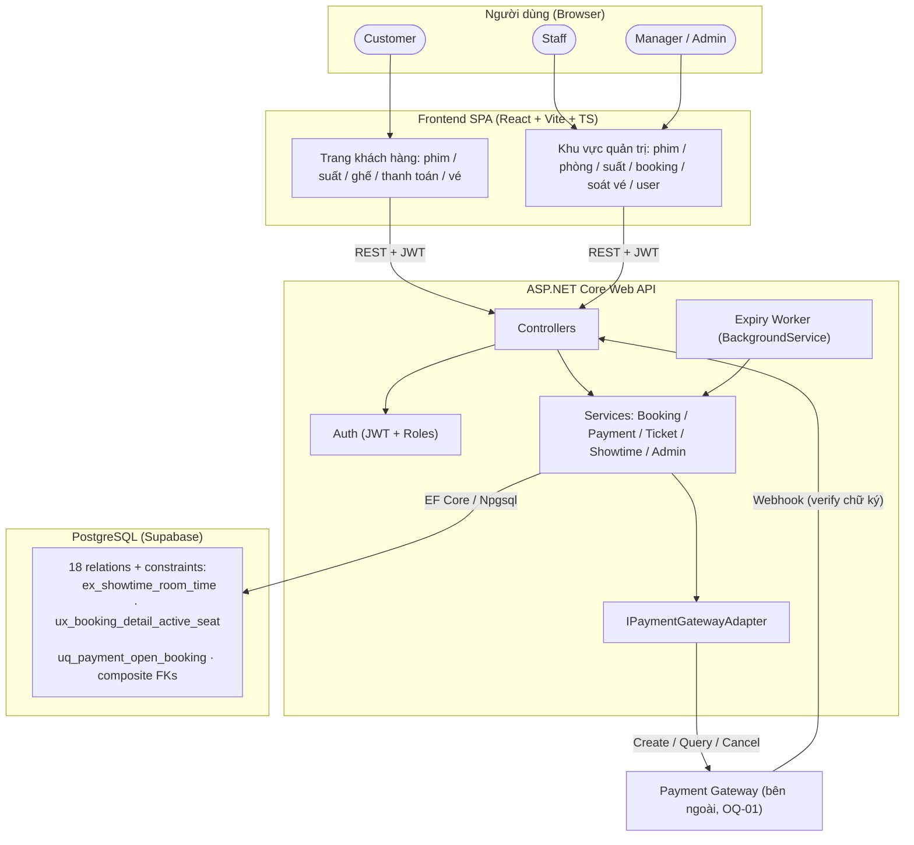

# Architecture — Movie Theater Management and Online Ticket Booking System

> Tài liệu này mô tả kiến trúc của hệ thống MVP/demo. Nó căn cứ vào yêu cầu đã chốt trong
> `docs/requirements/business-system-analysis.md` (FR/BR/AC), use case trong
> `business-system-design.md`, mô hình dữ liệu trong `relational-model.md` và schema vật lý
> trong `database/database-schema.sql`. Tài liệu này **không** tái lập chi tiết nghiệp vụ hay
> ràng buộc dữ liệu — chỉ mô tả cách các thành phần kiến trúc phối hợp để thực hiện chúng.

## 1. Tổng quan kiến trúc

Hệ thống là một **web application** gồm các phần chính:

- **Frontend SPA** (React + Vite + TypeScript) — giao diện cho Customer và khu vực quản trị cho Staff/Manager/Admin.
- **Backend API** (ASP.NET Core Web API) — nắm giữ toàn bộ business logic, authentication/authorization, và là **bộ phận duy nhất** truy cập database.
- **Database** (PostgreSQL, chạy trên Supabase) — nguồn sự thật duy nhất (single source of truth) về phim, suất chiếu, ghế, booking, payment, vé.
- **Payment Gateway** (bên ngoài, cổng cụ thể chưa chốt — OQ-01) — xử lý giao dịch thanh toán, trả kết quả qua webhook và Query API.
- **Expiry Worker** (background job trong backend) — xử lý vòng đời booking hết hạn và grace period theo BR-BOOK-004 / OQ-07.

Nguyên tắc kiến trúc cốt lõi: **mọi quyết định nghiệp vụ và kiểm tra tính toàn vẹn ghế đều nằm ở Backend + Database**. Frontend chỉ hiển thị thông tin phục vụ chọn ghế (FR-SHOW-002) và không bao giờ được tin là điều kiện cuối cùng — backend luôn kiểm tra lại authoritative trong transaction (FR-BOOK-001, BR-BOOK-002).

## 2. Kiến trúc hệ thống

```text
Customer / Staff / Manager / Admin
        ↓ (HTTPS, trình duyệt web)
Frontend SPA — React + Vite + TS
        ↓ (REST + JSON, kèm JWT)
ASP.NET Core Web API
   ├── Controllers (API layer)
   ├── Services (business logic)
   ├── Domain / Entities
   ├── Infrastructure (EF Core + Npgsql)
   ├── Auth (JWT + role-based authorization)
   └── Expiry Worker (background job)
        ↓ (EF Core → Npgsql)
PostgreSQL (Supabase)
        ↑ webhook / Query API
Payment Gateway (hệ thống bên ngoài)
```

## 3. Các thành phần hệ thống

| Thành phần | Trách nhiệm | Ghi chú |
|---|---|---|
| **Frontend SPA** | Duyệt phim, xem lịch chiếu, sơ đồ ghế, tạo booking, thanh toán, xem vé; khu vực quản trị | Không chứa business logic; countdown giữ ghế chỉ là hiển thị (NFR-USE-001) |
| **Backend API** | Xử lý mọi request, kiểm tra quyền sở hữu (BR-AUTH-002), tính giá (BR-BOOK-005), điều phối transaction | Authorization luôn ở backend (NFR-SEC-002) |
| **Business Logic (Services)** | BookTickets, CancelBooking, PaymentApplication, TicketIssuance, ShowtimeManagement, ExpiryWorker | Không đặt logic trong Controller |
| **Database (PostgreSQL)** | Toàn vẹn dữ liệu: exclusion constraint chống chồng lịch (`ex_showtime_room_time`), partial unique index chặn đặt trùng ghế (`ux_booking_detail_active_seat`), transaction | Là lớp phòng thủ cuối cùng (BR-BOOK-006, BR-ST-002) |
| **Authentication** | Đăng ký/đăng nhập, JWT, hash mật khẩu | Đăng ký công khai chỉ cấp CUSTOMER (BR-AUTH-003) |
| **Payment Gateway Adapter** | Đóng gói cổng thanh toán sau một interface trung gian-cổng-độc lập (tạo attempt, verify callback, Query/Cancel API) | Cho phép đổi cổng mà không đụng business logic |
| **Expiry Worker** | Chuyển booking quá hạn `expired` + ghế `released` khi không còn payment attempt đang mở; grace period truy vấn cổng (OQ-07 — chính sách đã chốt, **số liệu 2–3 phút là đề xuất, chưa chốt — OQ-UC-03**) | Chạy nền, không phải request từ client |

## 4. Frontend Architecture

Tổ chức theo phân loại dự kiến trong `PROJECT_STRUCTURE.md`:

- **Pages**: `MovieList`, `MovieDetail` (kèm showtimes), `SeatSelection`, `Checkout` (booking pending + countdown 5 phút), `PaymentResult`, `MyTickets`, `MyBookings`, cùng nhóm admin: `ManageMovies`, `ManageRooms/Seats`, `ManageShowtimes`, `BookingLookup`, `TicketValidation`, `ManageUsers`.
- **Components**: ghế grid (phân biệt STANDARD/VIP/COUPLE — Couple là một đơn vị bán, một detail hai ticket: BR-BOOK-009), countdown timer, QR vé, toast/thông báo lỗi.
- **Services / API Client**: một module `apiClient` tập trung — tự gắn JWT, chuẩn hóa lỗi, không gọi thẳng URL rải rác.
- **State Management**: React Context cho auth state (token, roles) và state chọn ghế cục bộ trong trang đặt vé; không dùng state library nặng trong MVP.
- **Routing**: protected route theo role — route quản trị chặn trước khi chưa đúng role, nhưng backend vẫn kiểm tra lại (frontend check chỉ là UX).
- **Authentication State**: JWT lưu phía client, gửi kèm header `Authorization: Bearer`. Token hết hạn → redirect đăng nhập.

**Ràng buộc với backend:** frontend không truy cập database trực tiếp, không tự tính giá (client gửi danh sách ghế + loại vé; giá do backend tính — FR-BOOK-002).

## 5. Backend Architecture

Single project `CinemaTicketBooking.Api` tổ chức theo layer trong nội bộ (MVP không tách thành nhiều project):

- **Controllers**: mỏng — parse request, gọi service, trả response; không chứa logic nghiệp vụ.
- **Services** (Application layer):
  - `BookingService` — tạo booking all-or-nothing (BR-BOOK-002), tính giá (BR-BOOK-005), hủy pending (FR-BOOK-003).
  - `PaymentService` — tạo attempt (BR-PAY-001/002), xử lý callback 4 khâu: tiếp nhận → xác minh → nghiệp vụ → đánh dấu `processed` (BR-PAY-005/006), áp dụng payment + phát hành vé (BR-PAY-004).
  - `TicketService` — phát hành đúng `capacity_units_snapshot` ticket (Couple = 2 mã: BR-BOOK-009), soát vé một lần (FR-TICKET-002).
  - `ShowtimeService` / catalog services — quản trị theo BR-ST-001..005, BR-ROOM-001..004.
  - `ExpiryWorker` — lifecycle booking (BR-BOOK-004, `database-design.md` mục 34.1).
- **Domain / Entities**: ánh xạ 1-1 với 18 relation trong `relational-model.md` (`Movie`, `Genre`, `Cinema`, `CinemaRoom`, `Seat`, `SeatType`, `TicketType`, `Showtime`, `AppUser`, `Role`, `Booking`, `BookingDetail`, `Ticket`, `Payment`, `PaymentEvent`, `Refund`, `MovieGenre`, `UserRole`).
- **Infrastructure / EF Core**: `ApplicationDbContext` + Fluent API khớp schema; các ràng buộc EF không sinh được (exclusion constraint, partial unique index) được tạo bằng SQL script như `database-schema.sql`.
- **Authentication**: JWT bearer; role hiệu lực đọc từ `user_role` khi đăng nhập.

## 6. Database Architecture

```text
ASP.NET Core
      ↓
EF Core (Npgsql provider)
      ↓
Npgsql driver
      ↓
PostgreSQL (Supabase — session pooler)
```

- Kết nối qua connection string trong `.env` / user-secrets; **không hard-code secret** (NFR-SEC-001).
- Transaction do EF Core quản lý (`BeginTransaction`); các luồng all-or-nothing (tạo booking, áp dụng payment) chạy trong **một transaction**.
- **Nguồn sự thật schema:** `database-schema.sql` là nguồn vật lý ban đầu; EF Core Fluent API phải khớp với nó. Các ràng buộc EF migration không sinh được (exclusion constraint, partial unique index) luôn tạo bằng SQL — không mô tả một constraint là "có trong database" nếu chỉ tồn tại trong tài liệu. Hiện trạng: **chưa có code backend và chưa có migration nào** — mọi ràng buộc đang sống trong SQL script.
- **Lớp bảo vệ dữ liệu cứng** do database giữ, backend chỉ thêm kiểm tra thân thiện trước:
  - `ex_showtime_room_time` — chống chồng lịch phòng (BR-ST-002);
  - `ux_booking_detail_active_seat` — một ghế tối đa một phân bổ `held`/`sold` mỗi suất (BR-BOOK-006);
  - `uq_payment_open_booking` — tối đa một payment attempt đang mở mỗi booking (BR-PAY-002);
  - `ux_payment_applied_booking` — tối đa MỘT payment được áp dụng cho mỗi booking (`WHERE applied_at IS NOT NULL`). Phân biệt với `uq_payment_open_booking`: index này chỉ chặn *retry song song*, index kia chặn *áp dụng hai lần*. Cổng có thể thu tiền hai lần từ hai attempt khác nhau — cả hai được lưu `succeeded`, chỉ một áp dụng (database-design.md §15.2);
  - FK ghép (`booking(id, showtime_id, cinema_room_id)`…) bảo đảm ghế thuộc đúng phòng của suất.
- Mọi cột thời gian lưu UTC; hiển thị theo `Asia/Ho_Chi_Minh` (relational-model.md mục 9.2).

## 7. Authentication & Authorization Architecture

```text
Login (email + password)
   → Backend xác minh hash, kiểm tra status `active` (locked/deactivated bị từ chối, thông báo chung — FR-AUTH-002)
   → Đọc roles hiệu lực từ user_role/role
   → Ký JWT (subject, roles, hạn)
   → Frontend lưu token, gửi kèm mỗi request
   → Backend: [Authorize(Roles = ...)] + kiểm tra quyền sở hữu tài nguyên trong service (BR-AUTH-002)
```

- Đăng ký công khai → chỉ role `CUSTOMER` (BR-AUTH-003).
- Token không thu hồi tức thời trong MVP; role thay đổi có thể không phản ánh ngay vào token đang hiệu lực — giới hạn MVP chấp nhận (BR-AUTH-004).
- Mật khẩu chỉ lưu dạng hash do thư viện xác thực tạo (NFR-SEC-001).

## 8. External Services

| Dịch vụ | Vai trò | Cách tích hợp |
|---|---|---|
| **Payment Gateway** (cổng chưa chốt — OQ-01) | Xử lý thanh toán, gửi webhook, trả kết quả Query/Cancel | Qua `IPaymentGatewayAdapter`: `CreatePayment`, `VerifyCallback`, `QueryStatus`, `CancelPayment` |
| Email/SMTP | (Không thuộc MVP) | Không tích hợp trong demo |

Không dùng AI service trong phạm vi demo. Callback phải xác minh chữ ký/nguồn trước khi ảnh hưởng trạng thái (NFR-SEC-003); sự kiện luôn lưu bền vững trước (`received`) để không mất callback (NFR-REL-001).

## 9. Communication

- **Frontend → Backend**: REST + JSON qua HTTPS, JWT bearer.
- **Backend → PostgreSQL**: EF Core (Npgsql), transaction cho các luồng đa bước.
- **Backend → Payment Gateway**: HTTP (tạo attempt, truy vấn, cancel) — gọi **ngoài** transaction DB; kết quả chỉ chốt sau xác minh.
- **Payment Gateway → Backend**: webhook → endpoint callback lưu event trước, xử lý nghiệp vụ sau (BR-PAY-005); idempotent theo `(payment_id, event_key)` (BR-PAY-006).

## 10. Deployment Architecture

Môi trường **demo**:

```text
Browser (Customer/Staff/Manager/Admin)
   ↓
Frontend: development dùng Vite dev server (HTTP); production build tĩnh,
HTTPS do môi trường triển khai cấu hình (chưa định nghĩa)
   ↓
ASP.NET Core Web API (Kestrel, chạy local / Docker)
   ↓
PostgreSQL trên Supabase (host: aws-0-ap-northeast-1.pooler.supabase.com)
```

- `docker-compose.yml` dùng cho môi trường phát triển/demo; connection string cung cấp qua biến môi trường (`.env`, không commit secret).
- Frontend build tĩnh, có thể host riêng hoặc serve từ backend trong demo.
- Một chi nhánh (`CINEMA_HCM_01`) được seed qua `database/seed-data.sql`; mô hình dữ liệu sẵn sàng nhiều chi nhánh nhưng demo chỉ một (NFR-SCALE-001).

## 11. Project Structure

```text
/frontend   → src/frontend/cinema-ticket-booking-ui    (React + Vite + TS)
/backend    → src/backend/CinemaTicketBooking.Api     (ASP.NET Core Web API)
/database   → database/                               (schema SQL, seed, tài liệu DB)
/docs       → docs/                                   (requirements, analysis & design, test)
```

Cấu trúc chi tiết từng thư mục xem `PROJECT_STRUCTURE.md`.

## 12. Architecture Principles

1. **Frontend không truy cập database trực tiếp**; chỉ giao tiếp với backend qua API.
2. **Business logic không đặt trong Controller** — controller mỏng, service giữ logic; logic test được qua API không cần UI (NFR-MAINT-001).
3. **Database là lớp bảo vệ cuối cùng**: ràng buộc ghế, lịch chiếu, payment attempt được bảo vệ bằng constraint/index ở database; backend kiểm tra lại để báo lỗi thân thiện.
4. **Kiểm tra authoritative trong transaction**: hiển thị sơ đồ ghế/lịch chiếu cho client không bao giờ là điều kiện chốt (FR-BOOK-001).
5. **Không tin dữ liệu do client gửi**: giá, mức giảm, trạng thái luôn do backend tính/xác minh (FR-BOOK-002, NFR-SEC-002).
6. **Authorization ở backend**, dựa trên role + quyền sở hữu tài nguyên; không dựa vào việc "biết" mã công khai (BR-AUTH-001/002).
7. **Idempotency cho mọi luồng thanh toán**: callback lặp chỉ xử lý một lần; payment áp dụng all-or-nothing (BR-PAY-004/006/008).
8. **Kết quả tài chính và trạng thái booking là hai kết quả độc lập** (BR-PAY-007) — payment thành công muộn không chiếm lại ghế.
9. **Secrets không hard-code**; cấu hình qua biến môi trường / user-secrets (NFR-SEC-001).
10. **Trách nhiệm module rõ ràng** — mỗi service một nghiệp vụ; thay đổi cổng thanh toán chỉ đụng adapter, không đụng business logic.
11. **Data-model readiness ≠ triển khai**: các bảng `refund`, nhiều cinema có trong mô hình để mở rộng nhưng không có chức năng trong demo (mục 3.3 của business-system-analysis).

## 12a. Anti-Abuse / Seat-Hoarding Protection (PROPOSED — cần Product Owner duyệt)

> **Tình trạng:** tài liệu nghiệp vụ hiện tại KHÔNG định nghĩa yêu cầu giới hạn booking/ghế.
> Toàn bộ nội dung dưới đây là **đề xuất kỹ thuật, chưa được nhóm chấp thuận**, các con số
> chỉ dùng cho demo/benchmark — không phải quyết định nghiệp vụ (tham khảo audit R2).

Rủi ro: hệ thống cho phép bán sát giờ (không cutoff — OQ-02 OPEN) và giữ ghế 5 phút;
một tài khoản/bot có thể lặp lại tạo booking pending để triệt tiêu sức chứa luân phiên.
Hiện trạng code: **chưa có bất kỳ cơ chế rate limiting nào** (backend chưa có code).

**Phân biệt hai loại giới hạn:** giới hạn tốc độ request (rate limiting — chặn request,
không bảo vệ tài nguyên) và giới hạn tài nguyên đang giữ (quota held — bảo vệ ghế).
Cần cả hai; rate limiting một mình không chống được hoarding vì request hợp lệ vẫn
mở khe mới sau khi booking cũ hết hạn.

| Lớp | Cơ chế | Nơi thực thi | Giá trị đề xuất (chưa chốt) |
|---|---|---|---|
| L1 | Tối đa N booking `pending` đang mở / user | Service, trong transaction tạo booking | N = 2 |
| L2 | Tối đa M ghế `held` / user (tổng các booking pending) | Service, trong transaction | M = 6 |
| L3 | Rate limit endpoint tạo booking | ASP.NET Core rate limiting middleware (built-in) | 10 req/phút/user |
| L4 | Hạn chế mềm theo IP | Middleware | Không dùng IP làm danh tính duy nhất (NAT/chung IP) |
| L5 | Giám sát hành vi bất thường | Log + metrics | Nhận diện tài khoản lặp mẫu hủy/giữ |

**Tính nguyên tử của quota (điểm tuần tự hóa theo user):** kiểm tra L1/L2 bằng
`COUNT(*)` không khóa là KHÔNG an toàn — hai request đồng thời (kể cả hai suất khác
nhau, kể cả user chưa có booking nào để khóa) đều thấy quota còn trống và cùng vượt.
Cần một điểm tuần tự hóa ổn định theo user tồn tại độc lập với booking:

- **Phương án A — khóa dòng `app_user` của user** (`SELECT ... FROM app_user WHERE
  id = :uid FOR UPDATE`) trước khi kiểm quota. Đơn giản, luôn tồn tại. **Nhưng**:
  phá vỡ thứ tự khóa chung `Showtime → Booking → Payment` (§13) — nếu luồng khác
  giữ khóa theo thứ tự cũ và sau đó chạm user, có chu trình chờ → deadlock. Nếu
  chọn phương án này, thứ tự khóa chung phải được thiết kế lại và đồng bộ toàn bộ
  luồng (UC-01..05) — **thay đổi protocol đã chốt, cần phê duyệt riêng**.
- **Phương án B (đề xuất mặc định) — giữ nguyên protocol `Showtime → Booking →
  Payment`, thêm khóa trên booking pending của user khi có, và chặn cạnh tranh
  quota bằng ràng buộc vật lý:** thêm một bảng/nhãn đếm đơn giản hoặc dựa vào
  kiểm tra L1/L2 sau khi đã giữ khóa Showtime (nội bộ hóa xung đột vào cùng suất)
  kết hợp phần dư thừa được chấp nhận ở mức demo: hai request khác suất vẫn có
  thể vượt quota trong cửa sổ rất hẹp — được phát hiện bởi giám sát (L5) và chấp
  nhận như giới hạn MVP đã ghi nhận. Không dùng COUNT(*) không khóa làm cơ chế
  duy nhất.
- **Phương án C — advisory lock per user** (`pg_advisory_xact_lock(hash(uid))`)
  lấy trong transaction trước khi kiểm quota; không phá thứ tự khóa bảng vì
  advisory lock là namespace riêng. Điểm tuần tự hóa ổn định kể cả khi user chưa
  có booking. **Cần benchmark và phê duyệt trước khi triển khai.**

**Frontend:** nhận 429/quota error → hiển thị thông báo rõ + thời gian chờ,
không retry tự động.

**Test bắt buộc trước khi coi L1/L2 là hiệu lực:** N request đồng thời cùng user
(1 booking pending sẵn) → đúng một request vượt; N request đồng thời user chưa có
booking → không vượt quá N quota; hai request khác suất cùng user → hành vi theo
phương án được duyệt (A/B/C).

## 13. Concurrency & Seat Integrity Architecture

Mục này đặc thù cho bài toán đặt vé — điểm rủi ro trung tâm của hệ thống.
Mọi luồng chạm booking/detail/payment đều theo protocol khóa chung
(`database-design.md` §31.1): **READ COMMITTED + khóa tường minh theo thứ tự cố định
`Showtime → Booking → Payment attempts → Event`**, đọc lại trạng thái sau khi có đủ
khóa, **không** dùng kết quả đọc trước khóa, **không** dùng SKIP LOCKED trên booking
rồi quay lại khóa Showtime (đảo thứ tự → deadlock). Các luồng áp dụng: tạo booking
(UC-01, kèm dọn dẹp inline), webhook/reconcile worker (UC-02), expiry worker (UC-03),
đối soát (UC-04), soát vé (UC-05 — khóa Ticket thay Payment).

```text
Hai request giữ cùng ghế đồng thời
   → Backend: mở transaction, khóa theo thứ tự cố định
     (Showtime → Booking → Payment, theo UC-03A)
   → Đọc lại trạng thái (clock_timestamp thực từ DB): suất còn bán? ghế còn trống?
   → INSERT booking + booking_detail (held)
   → COMMIT
   → Nếu chạm ux_booking_detail_active_seat → vi phạm duy nhất → ROLLBACK toàn bộ
     (all-or-nothing: không giữ một phần — BR-BOOK-002)
```

- **Thứ tự khóa cố định** để tránh deadlock: `Showtime → Booking → Payment`
  (đồng bộ cả hai luồng tạo-booking, xác nhận-payment, hủy-booking — UC-03A).
- Worker hết hạn và luồng áp dụng payment cũng đi qua cùng thứ tự khóa, đọc lại
  trạng thái trước khi ghi (BR-BOOK-004, BR-PAY-004).

**Ràng buộc bất di bất dịch — KHÔNG gọi HTTP đến Payment Gateway khi đang giữ khóa
database:** mọi thao tác cần kết quả cổng (Query Status, Cancel) phải **tách hai
transaction** theo UC-03 A1b: (1) transaction đọc trạng thái, thu thập payment cần
truy vấn, kết thúc KHÔNG giữ khóa; (2) gọi cổng ngoài transaction; (3) transaction
mới ghi kết quả — đọc lại toàn bộ điều kiện hai phần trước khi ghi, vì trạng thái
có thể đã đổi giữa hai transaction. Chỉ dùng khóa/transaction không đủ để kết luận
an toàn: phải kiểm chứng từng interleaving (mô phỏng trong `database-design.md`
§31.6 Scenario A/B) và test theo Verification Plan.

## 14. Background Worker / Lifecycle Architecture

`ExpiryWorker` (ví dụ: `BackgroundService` định kỳ quét — chu kỳ 15–30s là cấu hình
triển khai, `database-design.md` §27.2):

```text
Chu kỳ quét:
1. Quét danh sách booking ứng viên qua ix_booking_expiry — KHÔNG khóa ở bước quét.
2. Transaction: khóa Showtime → Booking → Payment attempts, đọc clock_timestamp()
   và ĐỌC LẠI toàn bộ trạng thái sau khóa.
3. Quyết định theo bảng UC-03:
   ├── Không attempt mở (chỉ failed/cancelled) → booking expired + detail released
   │     trong transaction này.
   ├── Còn attempt mở, CHƯA quá grace period (số liệu 2–3 phút là ĐỀ XUẤT,
   │     chưa chốt — OQ-UC-03) → bỏ qua, ghế giữ nguyên.
   └── Quá grace period → KẾT THÚC transaction hiện tại (chỉ thu thập payment cần
         tra cứu), gọi Query Status NGOÀI transaction, vào TRANSACTION MỚI ghi kết
         quả sau khi đọc lại điều kiện:
         - Cổng xác nhận chưa thu → payment failed/cancelled (kết quả từ cổng đã
           xác minh) + booking expired + detail released (một transaction).
         - Cổng báo đã thu → nhánh late-success: giữ succeeded,
           reconciliation_status = refund_required/needs_review; KHÔNG áp dụng,
           KHÔNG phát vé, KHÔNG reclaim ghế (BR-PAY-007).
         - Cổng không xác đáng → giữ unknown + needs_review, ghế giữ nguyên,
           retry lần sau (ngoại lệ có giám sát, không giữ vô hạn tự động).
4. Payment succeeded đến muộn trên booking đã expired/cancelled:
   KHÔNG áp dụng, KHÔNG phát hành ticket, KHÔNG chiếm lại ghế;
   giữ succeeded + reconciliation_status để đối soát (BR-PAY-007).
   refund_required KHÔNG đồng nghĩa tiền đã hoàn — hoàn tiền là UC-04A,
   ngoài phạm vi demo.
```

## 15. Architecture Diagram (tổng quan)



## 16. Rủi ro kiến trúc và giới hạn đã ghi nhận

Cột "Trạng thái": **CONFIRMED** (quyết định đã chốt) / **PROPOSED** (đề xuất, chưa được duyệt) / **OPEN** (chờ quyết định) / **chưa triển khai** (chỉ có trong tài liệu).

| Rủi ro / giới hạn | Trạng thái | Đánh giá | Biện pháp |
|---|---|---|---|
| Token không thu hồi tức thời khi role thay đổi | CONFIRMED (giới hạn MVP) | Chấp nhận (BR-AUTH-004) | Hạn token ngắn; nâng cấp sau |
| Cổng thanh toán chưa chốt | OPEN (OQ-01) | Ảnh hưởng adapter, xác minh callback | Adapter trung gian-cổng-độc lập; giữ `payment_event` |
| Worker grace period phụ thuộc phản hồi cổng | CONFIRMED (chính sách OQ-07); số liệu OPEN (OQ-UC-03) | Ghế có thể giữ lâu hơn 5 phút khi needs_review | Needs_review có giám sát, không giữ vô hạn tự động |
| Race worker/webhook | Đã thiết kế (database-design §31.6); **chưa có code, chưa được test** | An toàn thiết kế, chưa được chứng minh runtime | Verification Plan (mục 17) |
| Seat hoarding / thiếu rate limiting | **PROPOSED** (mục 12a) — chưa được duyệt, chưa có code | Rủi ro thực vì bán sát giờ + giữ 5 phút | L1–L5 sau khi Product Owner duyệt phương án A/B/C |
| Database bottleneck khi tranh chấp ghế | Cần benchmark | Chưa có số liệu; protocol S→B→P tuần tự hóa theo suất là thiết kế chủ ý | Giữ protocol; đo throughput/p95/p99/lock waits trước khi tối ưu (mục 17, TP-6) |
| Phát hành vé Couple thiếu/vượt số vé | Đã thiết kế (đếm-vé-chèn-thiếu trong transaction); **chưa test** | DB không có unique theo `booking_detail_id` (chủ ý) → đúng đắn phụ thuộc service | Test TP-5a/b sau khi có code |
| `refund_required` ≠ đã hoàn tiền | CONFIRMED (UC-04A ngoài phạm vi demo) | Chỉ là nhãn cần hoàn; tiền hoàn khi refund `succeeded` | Phân biệt rõ trong UI/logic |
| Sức chứa suy từ ghế + capacity_units | CONFIRMED (BR-ROOM-001) | Đúng thiết kế | Backend tính khi tạo booking; Couple = 1 detail / 2 ticket |
| Chỉ 1 cinema trong demo | CONFIRMED | Sẵn sàng mở rộng (NFR-SCALE-001) | Schema hỗ trợ nhiều cinema |
| Schema drift SQL ↔ EF | **Rủi ro mới ghi nhận** | Chưa có code/migration; ràng buộc đặc biệt chỉ tồn tại trong SQL script | Mục 6: SQL là nguồn; migration không đụng exclusion/partial index; CI so sánh schema |

## 17. Verification Plan

> Tất cả các test dưới đây **chưa được chạy** — backend chưa có code. Đây là kế hoạch
> bắt buộc thực hiện khi triển khai; nguồn: database-design §31.9, use-cases.md
> (AC-UC01..05), business-system-analysis (AC-BOOK/PAY/SEC/ST/TICKET).

| ID | Kịch bản | Kết quả bắt buộc | Nguồn |
|---|---|---|---|
| TP-1a | Worker release commit trước, webhook success sau | `succeeded` + `refund_required`; không vé; không reclaim ghế | AC-PAY-004 |
| TP-1b | Webhook apply commit trước, worker vào sau | Worker bỏ qua booking `confirmed` | AC-UC03-06 |
| TP-1c | Success đến trong cửa sổ worker đang gọi Query ngoài transaction | Một kết quả duy nhất; không hạ succeeded; không double-apply | §31.4 update có điều kiện |
| TP-1d | Grace period 3 nhánh: cổng chưa thu → release; đã thu → late-success; không phản hồi → `unknown` + `needs_review` | Theo bảng UC-03 | AC-UC03-03/04/05 |
| TP-2a | Webhook trùng cùng `event_key` | Chỉ một tác động nghiệp vụ | AC-UC02-02 |
| TP-2b | Hai event khác `event_key` cùng giao dịch | Không double-issue | UC-02 A2 |
| TP-2c | Event sai chữ ký / sai tiền | Lưu event; không đổi trạng thái nghiệp vụ | AC-UC02-03/05 |
| TP-3a | 2 request đồng thời cùng ghế | Đúng một thành công | AC-BOOK-002 |
| TP-3b | 1 ghế trùng + 1 trống | Không giữ một phần | AC-UC01-05 |
| TP-4a | N request đồng thời cùng user (đã có 1 pending) | Đúng theo quota L1, không vượt | Mục 12a test |
| TP-4b | N request đồng thời user chưa có booking | Không vượt quota (tùy phương án A/B/C được duyệt) | Mục 12a test |
| TP-5a | Couple: phát hành 2 ticket; callback lặp | `COUNT(ticket) == capacity_units_snapshot`; không phát thừa | AC-UC02-06 |
| TP-5b | Commit thành công + response mất, retry | ACK idempotent; không tạo vé thứ hai | UC-05 A7, UC-02 A2 |
| TP-6 | Load: 100 user tranh cùng ghế / 100 user ghế khác nhau / 10 suất song song | Thu thập throughput, p95/p99, lock waits, deadlocks — thiết lập baseline trước khi tối ưu | OQ-09 |
| TP-7 | Đo thời gian giữ khóa khi gọi cổng treo (nếu vi phạm "không gọi trong transaction") | Phát hiện vi phạm ràng buộc mục 13 | UC-01 AC-08 |

## 18. Trạng thái triển khai (Implementation Status)

> Cập nhật: 2026-10-23. Mục này phân biệt rõ **kiến trúc đã thiết kế** (các mục 1–17)
> với **trạng thái triển khai thực tế hiện tại** của repository.

### 18.1 Tổng quan trạng thái

| Thành phần | Trạng thái | Ghi chú |
|---|---|---|
| **Database schema** (`database-schema.sql`) | ✅ Hoàn thiện | 18 relations, constraints, indexes đã có; áp dụng được lên Supabase |
| **Seed data** (`seed-data.sql`) | ✅ Hoàn thiện | 6 phim, 1 cinema, 2 phòng, 82 ghế, 48 suất chiếu |
| **Database documents** | ✅ Hoàn thiện | `database-design.md`, `database-schema.md`, `seed-README.md` |
| **Architecture document** | ✅ Đang cập nhật | File này |
| **Backend source** (`src/backend/CinemaTicketBooking.Api/`) | ⏳ Chưa triển khai | `Program.cs`, `.csproj`, `appsettings.Development.json`, `ApplicationDbContext.cs` đang trống (placeholder) |
| **Frontend source** (`src/frontend/cinema-ticket-booking-ui/`) | ⏳ Chưa triển khai | `package.json`, `vite.config.ts`, `App.tsx`, `main.tsx` đang trống |
| **EF Core Migrations** | ⏳ Chưa tạo | Chờ backend có code; hiện dùng SQL script trực tiếp |
| **Dockerfile backend** | ⏳ Chưa tạo | Xem §5 và §10 của `local-development-setup.md` |
| **Dockerfile frontend** | ⏳ Chưa tạo | Xem §6 và §10 của `local-development-setup.md` |
| **`docker-compose.yml`** | ⏳ Trống | Placeholder; cấu trúc dự kiến mô tả trong `local-development-setup.md` §7 |
| **Controllers / Services / Entities** | ⏳ Chưa tạo | Thư mục dự kiến: `Controllers/`, `Services/`, `Entities/`, `Middleware/`, `Validators/` |
| **Payment Gateway Adapter** | ⏳ Chưa tạo | Interface `IPaymentGatewayAdapter` chưa có code; cổng chưa chốt (OQ-01) |
| **Expiry Worker** | ⏳ Chưa tạo | `BackgroundService` chưa triển khai |
| **JWT Authentication** | ⏳ Chưa tạo | Chờ backend code |
| **API Tests** | ⏳ Chưa tạo | Verification Plan (mục 17) chờ implementation |

### 18.2 Mối quan hệ giữa kiến trúc thiết kế và hiện trạng

```text
Thiết kế (architecture.md §1-17)      Hiện trạng (2026-10-23)
─────────────────────────────────────  ──────────────────────────────────────
Frontend SPA (React + Vite + TS)   →  Khung dự án (files trống)
Backend API (ASP.NET Core)         →  Khung dự án (files trống)
EF Core / Migrations               →  Chưa có (dùng database-schema.sql)
PostgreSQL (18 relations)          →  Schema SQL hoàn thiện ✅
Seed data                          →  seed-data.sql hoàn thiện ✅
docker-compose.yml                 →  Trống (placeholder)
Payment Gateway Adapter            →  Interface chưa định nghĩa
Expiry Worker                      →  Chưa triển khai
JWT Auth                           →  Chưa triển khai
```

### 18.3 Hướng dẫn developer

- **Thiết lập môi trường local:** xem `docs/development/local-development-setup.md`
- **Schema database:** `database/database-schema.sql` — áp dụng lên PostgreSQL trước khi chạy backend
- **Seed data:** `database/seed-data.sql` + `database/seed-README.md`
- **Khi bắt đầu implement backend:** tham chiếu mục 5 (Backend Architecture), mục 13 (Concurrency), mục 14 (ExpiryWorker) và `database/database-design.md` §31 để nắm protocol khóa
- **Khi bắt đầu implement frontend:** tham chiếu mục 4 (Frontend Architecture) và `docs/api/` cho contract API
