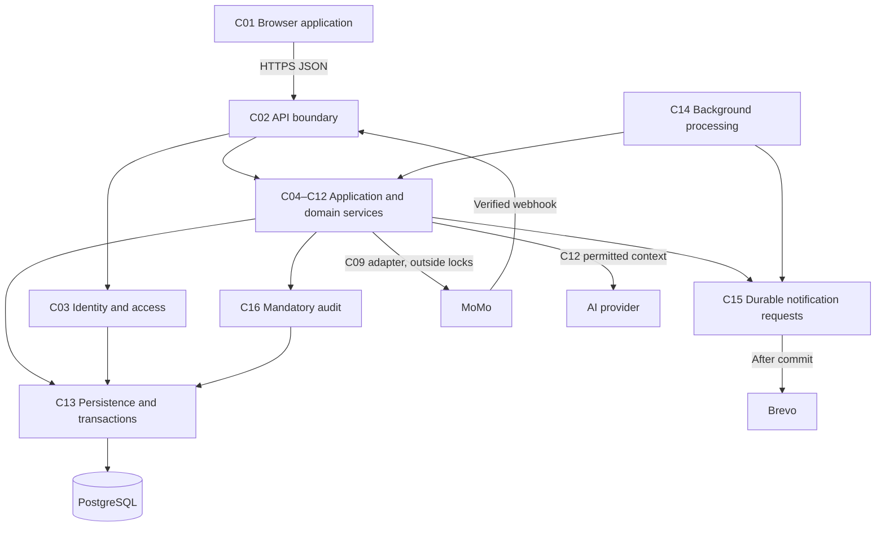

# System Architecture

## Purpose and Source Baseline

This document is a concise implementation-oriented summary of the Software Architecture Document (SAD) for **Promethe-Phos — Movie Theater Management and Online Ticket Booking System**.

The source baseline is:

- `pa/PA3-Group15/rup_sad.docx`
- SAD revision **3.15**; the initial 1.0 revision is not the current document version
- Use-Case Specifications **v2.4**, `rup_ucspec-v2.4_final(5).docx` supplied for this review; corresponding repository baseline must be checked by content/version
- Review date: 9 November 2026

The SAD is the authoritative source for the designed architecture, component boundaries, collaborations, data ownership, and processing rules. This file intentionally does not reproduce the complete SAD, class diagrams, or every basic and alternative use-case flow. The SAD must be consulted for detailed class/interface contracts and full flow definitions.

This revision reviews supplied documents, not the live repository or deployed services. Implementation status must be verified separately from the design. `Designed` means described by the SAD; `Implemented` means supported by repository evidence; `Planned` means an intended organization or implementation not yet present; and `Unconfirmed` means that the available evidence is insufficient.

## System Scope and Architectural Drivers

The architecture covers the 28 use cases grouped into nine functional domains:

| Domain | Name | Scope |
|---|---|---|
| D1 | Customer Booking and Payment | Movie discovery, showtime browsing, reservation, checkout, payment initiation, and chatbot assistance |
| D2 | Customer Booking Management | Customer booking/ticket access, cancellation requests, and authorized operational support |
| D3 | Ticket Validation and Admission | Booking-level QR validation and controlled admission recording |
| D4 | Movie Catalog Management | Movie information, genre definitions, and movie-genre associations |
| D5 | Cinema and Screening Room Setup | Cinemas, rooms, physical seat layouts, and operational seat status |
| D6 | Showtime and Schedule Management | Showtime creation, maintenance, conflict prevention, and controlled rescheduling |
| D7 | Ticket Types and Pricing Management | Seat types, ticket categories, surcharges, and cinema-specific base prices |
| D8 | User and Access Management | Registration, verification, authentication, logout, roles, and cinema assignments |
| D9 | Payment Exception and Recovery | Payment webhooks, expiration, reconciliation, and refunds |

The main customer capabilities are movie and showtime discovery, selection-session management, checkout, guest or customer booking, payment, ticket retrieval, admission, and informational Promethe-Nous assistance. Operational capabilities cover catalog, cinema, seating, showtime, pricing, account, booking, ticket, cancellation, refund, and admission administration.

The principal architectural drivers are:

- concurrent seat selection and reservation without duplicate allocation;
- atomic booking, payment, ticket, notification-request, and audit changes;
- payment safety across browser redirects, webhooks, deadlines, grace periods, reconciliation, retries, and uncertain outcomes;
- backend authorization, current role/cinema-scope checks, guest access rules, and session management;
- booking-level QR admission with remaining-entitlement accounting;
- email delivery after commit with retry and recovery;
- auditable business changes without exposing unnecessary sensitive data.

The quantitative targets stated in the SAD are design and verification targets. They are not measured performance results.

## Architectural Style and Technology Stack

### Layered Modular Monolith

The system has a React frontend separated from an ASP.NET Core backend through an HTTP API. The backend is a **layered modular monolith**: business components have explicit logical responsibilities and interfaces, but they operate inside one backend application rather than as independently deployed services.

Logical layers and business modules are separate concepts. The presentation/API boundary, application coordination, domain policies, and infrastructure mechanisms form layers; C01–C16 are logical components that may span or collaborate across those layers. The functional domains D1–D9 do not map one-to-one to C01–C16.

Backend components primarily collaborate through C# interfaces and dependency injection. Cross-component workflows have an explicit coordinator, and high-level services must not form circular dependencies.

### Technology Stack

| Technology or integration | Responsibility | Source / status |
|---|---|---|
| React / Vite / TypeScript | Browser application and build tooling | Selected design; runtime/version not verified in this review |
| ASP.NET Core Web API / C# | HTTP boundary and modular backend | Selected design; implementation not audited here |
| ASP.NET Core Identity | Passwords, email verification, roles, account integration | Designed in C03; no parallel custom password store |
| JWT access / rotating refresh tokens | Server-session-bound authentication | Designed in C03, including replacement challenges |
| EF Core / Npgsql / PostgreSQL | Persistence, constraints and coordinated transactions | Selected design; migrations and live schema require separate verification |
| Docker PostgreSQL | Local database environment | User-reported development choice; Compose readiness not verified |
| Supabase PostgreSQL | Hosted database | User-selected target; not a decision to replace Identity with Supabase Auth |
| Vercel / Render | Frontend / backend hosting targets | User-selected targets; live deployment and PA4 topology not verified |
| MoMo | Payment adapter | Intended demo integration; user reports not yet tested |
| Brevo HTTPS API | Verification and ticket email transport | User reports a successful API send experiment; end-to-end outbox integration remains unverified |
| External AI provider | Informational assistant | Boundary designed; provider/model/source contracts still to be selected |

Runtime/package versions must be recorded from actual project manifests during implementation; this review does not infer them from document names.

## Architecture Overview

### Overview Diagram

This is a logical architecture diagram, not a deployment diagram. C04–C12 are grouped for readability; the catalogue below retains individual responsibilities. C03 is shown separately for access control. They are not sixteen applications, servers, or microservices. The frontend never accesses PostgreSQL directly and never receives provider secrets.

### Layer Responsibilities

| Layer | Responsibility |
|---|---|
| Presentation | Render customer and operational screens, collect input, maintain local UI state, and display server decisions |
| API boundary | Authenticate requests, apply endpoint-level access requirements, validate transport data, invoke the responsible application service, and return responses |
| Application coordination | Coordinate use-case workflows across components and define transaction boundaries |
| Domain rules | Enforce booking, payment, admission, authorization, scheduling, pricing, cancellation, and refund policies |
| Infrastructure | Persist data, enforce database constraints, call MoMo/Brevo/AI adapters, run background work, and record audit information |

## Component Catalogue

| ID | Component | Main Responsibilities | Key Interfaces or Collaborations | Data Ownership |
|---|---|---|---|---|
| C01 | Web Application | Customer and operational UI, navigation, selection-session display, checkout, ticket display, protected actions | C02 API; session and navigation state; C11 ticket validation views | Owns presentation state only; no business or database ownership |
| C02 | Backend API | HTTP boundary, request authorization, controller-to-service coordination, response mapping | C03–C12 through interfaces and DI | Owns API coordination, not domain records |
| C03 | Identity and Access | Registration, email verification, login, refresh, logout, account state, roles, cinema assignments, active sessions | ASP.NET Core Identity; C15 verification email; C16 audit | Owns identity, account, role, assignment, and session records |
| C04 | Movie Catalogue | Public movie browsing/details, movie and genre administration, associations | C02; C06 showtimes; C12 informational context; C16 audit | Owns movie, genre, and movie-genre information |
| C05 | Cinema and Seating | Cinema/room setup, physical seats, operational status, seat types, surcharges | C06 scheduling; C07 pricing; C08 availability; C16 audit | Owns cinema, room, seat, and seat-type configuration |
| C06 | Showtime Scheduling | Screening creation, conflict checks, maintenance, rescheduling, screening context | C04 movie data; C05 room data; C08 booking impact; C11 admission context; C16 audit | Owns showtime and scheduling state |
| C07 | Ticket Pricing | Ticket categories, cinema base prices, quotation and price revalidation using C05-owned seat-type surcharges | C05 seat types; C08 checkout/reservation; C16 audit | Owns pricing configuration and quotation rules; C08 owns accepted booking snapshots |
| C08 | Booking and Checkout | Selection restoration, reservation, booking lifecycle, checkout, payment initiation coordination, expiration/cancellation effects | C05 availability; C06 screening; C07 quotation; C09 payment; C10 cancellation; C11 tickets; C15 notifications; C16 audit | Owns booking, booking allocations, checkout state, and accepted price snapshots |
| C09 | Payment Processing | Payment initiation, webhook verification, outcome processing, reconciliation, unresolved outcomes | MoMo adapter; C08 booking confirmation; C10 refund obligations; C13 transactions; C16 audit | Owns payment attempts, events, processing state, and payment evidence |
| C10 | Cancellation and Refund | Pending cancellation, review, refund obligation, external refund completion evidence | C08 booking effects; C09 payment outcomes; C11 ticket invalidation; C16 audit | Owns cancellation requests, refund obligations, decisions, and completion evidence |
| C11 | Ticketing and Admission | Booking-level ticket and QR issuance, retrieval/resend, validation, admission counts, invalidation | C08 booking; C06 screening; C10 refund; C15 email; C16 audit | Owns ticket, QR/admission entitlement, and admission records |
| C12 | Promethe-Nous | Informational movie, recommendation, showtime, price, booking, and procedure assistance | C04/C06/C07 read context; external AI adapter | Owns bounded conversation session state in backend memory; it cannot change booking/payment/refund |
| C13 | Persistence and Transactions | Repository/unit-of-work mechanisms, EF Core transaction coordination, constraints, durable notification/audit storage | All owning components; PostgreSQL through Npgsql | Owns persistence mechanisms, not business decisions or all domain ownership |
| C14 | Background Processing | Worker scheduling and coordination for expiration, reconciliation, and notification delivery | C08, C09, C15; durable work stores | Owns execution/claim state only; business state remains with owning components |
| C15 | Notification Delivery | Email request persistence, post-commit delivery, retry/resend, provider interaction | C03/C08/C11 producers; Brevo adapter; C14 worker | Owns notification requests, attempts, claims, and delivery state |
| C16 | Audit Logging | Mandatory business audit records, actor/time/context validation, immutable audit persistence | All privileged/business-changing components; C13 transaction mechanisms | Owns audit records; diagnostic logs do not replace mandatory audit |

## Communication and Dependency Rules

### Frontend and API Communication

C01 communicates with C02 using HTTPS and JSON. C01 displays server-authoritative results and does not access the database, calculate authoritative prices, grant permissions, confirm payment, or decide seat availability.

### Internal Component Communication

C02 invokes application services. C03–C12 collaborate through explicit interfaces and dependency injection. A component that owns a business rule remains responsible for that rule; C13 supplies persistence and transaction mechanisms rather than duplicating business decisions.

Cross-component workflows must have a clear coordinator. High-level components must avoid circular dependencies. C14 coordinates calls to owning components and does not copy their expiration, payment, notification, or reconciliation rules.

### External Service Communication

MoMo is called through the payment adapter. Brevo is called through the email sender after the delivery request has committed. Promethe-Nous uses an external AI provider through an adapter and only supplies bounded, permitted informational context.

External calls must not occur while business locks are held when the SAD flow requires a lock-free provider call. After an external result returns, the owning component reloads and revalidates current state before applying it.

### Dependency Direction and Coordination

API and presentation code depend on application contracts, not on database details. Domain-owning components depend on C13 mechanisms and relevant read contracts. Provider-specific details remain behind adapters. No provider secret is exposed to C01 or stored in this document.

## Critical Business Flows

### Account Registration and Access

Registration and verification begin at C01 and C02; C03 manages the account and verification state. Registration/verification do not implicitly replace an authenticated session. C03 queues verification through C15 and commits the account change with the delivery request. Login uses current account state, role, cinema assignment, and session rules; logout revokes the authenticated session. Protected operations recheck current backend permissions rather than trusting stale client state.

### Movie Discovery and Seat Reservation

The user browses C04 movies, C06 showtimes, and C05 seat context. The first seat selection starts a server-controlled **selection session**; it is not a booking and does not hold a seat. At Checkout Step 2, C08 revalidates the selection, C07 quotation, C06 screening, and C05 availability, then atomically creates a pending booking, held allocations, and accepted price snapshots. The selection deadline is inherited when progressing from Step 1 to Step 2; it does not automatically restart as a new full hold period.

### Payment Confirmation and Ticket Delivery

C08 coordinates checkout, C09 owns the persisted payment attempt and calls MoMo outside the lock-holding business transaction. A browser redirect is not payment proof. A webhook or reconciliation result is verified by C09, then C08 applies an eligible success atomically: payment outcome, booking confirmation, sold allocations, booking-level ticket/QR, notification request, and audit record. C15 sends email after commit; delivery failure does not reverse a confirmed booking.

### Booking Expiration and Payment Reconciliation

C14 asks C08/C09 to process due bookings. Payment deadline, grace period, and reconciliation are distinct. Expiration releases held allocations only when current payment state and protection rules permit it. An unresolved or late result is reconciled by C09; a successful result is applied only if the booking is still eligible. An outcome that cannot be applied becomes a refund obligation or review state rather than reclaiming seats already allocated elsewhere.

### Ticket Retrieval and Admission

C08 supplies booking context to C11; C10 supplies applicable cancellation/refund restrictions. C11 issues one booking-level QR and tracks remaining admission entitlements. Staff with the required cinema assignment validate the QR, current showtime/admission window, booking and ticket state, age/discount eligibility, and requested admission counts. Admission may be recorded in multiple visits while quota remains. Refund completion can invalidate the ticket and release the applicable sold allocations.

### Cancellation and Refund Handling

Explicit pending cancellation is allowed only before committed payment initiation; closing a browser tab is not cancellation. The operation revalidates ownership/Guest authority, pending state and payment safety before releasing held allocations. A confirmed-booking cancellation request caused by qualifying rescheduling is reviewed through C10 and UC-19 operational support. A pending review does not itself block admission; the first successful admission rejects it. Once approved, admission is blocked while awaiting refund completion. External monetary refund execution is outside the demo scope; authorized personnel record the externally completed refund and evidence, For a showtime-rescheduling-origin refund, C10, C08, and C11 then atomically complete the request, cancel the booking, invalidate its QR and release sold allocations. A payment-reconciliation-origin refund resolves its financial obligation without automatically applying those rescheduling transitions or reclaiming released seats.

## Data Ownership, Transactions and Concurrency

### Data Ownership

Each business component owns its domain state and policies as shown in the catalogue. C13 owns persistence mechanisms and transaction coordination, not every business decision. C15 owns delivery requests and attempts; C16 owns audit records; C14 owns worker execution/claim state.

### Atomic Business Operations

The SAD requires all-or-nothing behavior for reservation creation, payment application, booking confirmation, ticket issuance, notification-request creation, cancellation/refund effects, admission recording, and mandatory audit changes where those effects belong to one business transition.

### Locking and Concurrency Protection

The design protects against duplicate seat allocation, stale schedule changes, duplicate payment application, concurrent cancellation/admission conflicts, and repeated worker execution. Where applicable, the baseline lock order is Showtime → Booking → Payment attempts. Additional locks for identity, pricing, cancellation, admission and worker claims must be ordered consistently in the implementation protocol. No external network call is made while business locks are held. SQL isolation levels, index definitions and EF Core mappings remain physical implementation decisions; logical constraints are proposed in relational-model.md.

### Idempotency and Retry

Webhook, reconciliation, reservation, notification, refund, and worker operations use stable keys or current-state checks where specified. The system must not blindly retry when a commit outcome is unknown. A retry reloads state and applies the owning component's idempotency rules.

### Authoritative Time and Price Snapshots

Backend time controls deadlines, payment windows, grace periods, admission windows, and expiration. A price accepted during reservation is stored as a booking snapshot. Later pricing or seat-type changes do not silently change an accepted booking.

## Security and Access Control

### Authentication and Session Management

C03 uses ASP.NET Core Identity for account, password, verification, role, and account-state management. The SAD also defines JWT access/refresh tokens bound to a server-side authenticated session. Where the SAD requires one active authenticated session, session replacement/revocation is handled by C03 rather than by client state.

### Roles and Cinema Scope

The backend checks current roles, account status, and cinema assignments for every protected operation. Manager/Admin authority does not automatically grant Staff admission authority. Cinema-scoped operations are checked against the current assignment; a client-provided role or cinema identifier is not trusted.

### Guest Booking and Ticket Access

Guest access is limited to the permitted booking and ticket lifecycle rules. A booking identifier alone is not sufficient authorization. C02/C08/C11 validate the allowed ownership or guest proof, current booking state, screening context, and operation-specific rules.

### Secrets and Sensitive Data

Provider credentials and signing secrets remain server-side configuration. They are not embedded in C01, committed to documentation, or exposed in API responses. Audit and notification payload policies must avoid unnecessary sensitive data.

## Background Processing, Notifications and Audit

### Background Processing

C14 schedules and coordinates durable work for expiration, payment reconciliation, and notification delivery. It invokes C08, C09, and C15; it does not duplicate their business rules. Worker execution state and durable work are separate from booking/payment business state. Restart recovery reclaims due or expired processing claims according to the owning component's rules.

### Transactional Email Delivery

C15 stores delivery requests and attempts, sends after the business transaction commits, and supports retry/resend. Brevo failure does not undo a confirmed booking, issued ticket, or completed business transition. C14 drives due delivery work.

### Audit Logging

C16 records mandatory business audit events with actor, time, operation, and permitted contextual data. Owning components commit the audit entry with the corresponding state transition where required. Diagnostic logs do not replace mandatory audit records. Audit records are protected from accidental mutation and repeated processing.

## External Integrations and Boundaries

### MoMo Payment Gateway

MoMo is the intended external payment gateway. C09 owns payment verification and outcome processing; the adapter owns provider-specific request, callback, and query details. Browser navigation is not authoritative evidence. External calls occur outside lock-holding transactions when required, followed by state reload and revalidation.

### Brevo Transactional Email

Brevo is the intended transactional email provider. C15 owns delivery requests, attempts, retry, and resend; Brevo only transports the message. Provider failure is represented as delivery failure and does not reverse committed business state.

### Promethe-Nous and AI Provider

C12 supports informational questions, recommendations, showtimes, prices, and booking guidance. It does not create or change bookings, payment, admission, or refunds. Conversation history is bounded backend memory for the session as described by the SAD; this summary does not claim PostgreSQL persistence for that history. Provider identity, detailed source selection, and operational limits remain unconfirmed where the SAD leaves them open.

## Deployment and Implementation Status

### Deployment View Status

The SAD explicitly reserves **Deployment** and **Implementation View** for PA4. This document therefore does not present a completed deployment topology, hosting result, container layout, or production readiness claim.

### Intended Environment and Code Mapping

| Area | Intended placement | Status and verification needed |
|---|---|---|
| C01 | `src/frontend/cinema-ticket-booking-ui/`; Vercel build | User-supplied structure/hosting target; current file contents not inspected here |
| C02–C16 | `src/backend/CinemaTicketBooking.Api/`; Render backend | Logical modules inside one backend; namespaces/folders are not sixteen deployments |
| Local data | Docker PostgreSQL | User-reported choice; Compose configuration and seed reproducibility require checking |
| Hosted data | Supabase PostgreSQL | Connection/TLS/pooling/network configuration must be verified; no browser SQL access |
| Schema artifacts | `database/` | Reconcile with revised relational model; SQL-vs-EF migration source of truth must be chosen |
| API contracts | `docs/api/` | Proposed transport design; source-grounded gaps listed below |
| C14 workers | ASP.NET Core hosted execution, with durable claims | Baseline monolith execution; deployment process uptime/restarts and replica concurrency must be verified |

SAD Sections 5 and 6 remain PA4 deliverables. Hosting choices are additional project context, not proof those views are complete. Do not claim source files are empty, integrations absent, or a deployment successful without inspecting the current repository/environment.

### Identity Lifecycle Detail

A successful credential check does not always create a replacement session. If another active session exists, C03 returns a conflict with a short-lived single-use challenge bound to that expected session. The user may cancel or explicitly confirm replacement. Confirmation atomically consumes the challenge, revokes the expected old session and creates the new session/token pair. A stale challenge cannot revoke a newer session. Access and refresh tokens are bound to the server-side session; refresh rotates hashes atomically and does not create another active session. Logout/account blocking rejects subsequent use; unlocking does not reactivate revoked sessions.

### Timing, Navigation and Scheduling

- The first physical seat selection starts five minutes. Quantity selection alone does not start this clock. Deselect/reselect does not restart it.
- Movie Detail reload resets current selection state under the UC navigation policy; Checkout Step 1/2 reload restores eligible existing state without extending the deadline. Restoration is not a blanket policy for every page.
- A valid initiated payment establishes ten minutes; the configurable safety grace defaults to ten seconds and is neither extra payment time nor an unconditional release deadline.
- Admission uses the current official start, inclusive from five minutes before to twenty minutes after. Previously purchased start remains a separate immutable snapshot.
- Cinema-level minimum turnaround defaults to fifteen minutes. C06 uses scheduled-duration snapshots and current applicable turnaround rules; changes to movie duration do not rewrite existing showtimes.
- Rescheduling unstarted showtimes must preserve bookings' purchased-start snapshots and required notifications. UC-17 rejects cancellation when unresolved booking/payment/refund obligations block it and does not directly cancel paid bookings. Direct reactivation of a cancelled showtime is unsupported in the MVP.

## Alignment Gaps and Implementation Decisions

| Topic | Source-grounded position | Follow-up |
|---|---|---|
| Previous API authentication draft | SAD C03 explicitly includes refresh rotation and user-confirmed replacement challenges | Add refresh/replacement operations and DTOs; remove unconditional session replacement wording. Do not treat this SAD design as undecided |
| Previous API cancellation draft | UC-10/19 states are pending_review, approved_awaiting_refund, rejected, withdrawn, completed | Add withdrawal while pending and preserve these lifecycle distinctions in projections |
| Selection navigation | UC-01 distinguishes Movie Detail reload from Checkout restoration | Adjust API/client recovery wording accordingly |
| Proposed relational mapping | Identity sessions, Guest-safe idempotency, category totals, admission ledger, cancellation, outbox and audit are required concepts | Implement reviewed schema/migrations; proposed table names do not prove deployment |
| Identity physical model | ASP.NET Core Identity remains the account/password/role implementation | Map logical app_user/role relations to Identity; do not create duplicate credential systems |
| Provider protocol | MoMo adapter details and AI provider are not specified by these documents | Verify actual provider contracts before implementation; preserve business invariants |
| Guest transport/recovery | Secure Guest identity required; ID/email/phone alone never sufficient | Finalize credential lifetime, recovery, CSRF/CORS and hosting-dependent transport |
| Quote and concurrency storage | Server-authoritative accepted snapshot required | Decide version/fingerprint storage and test competing price/seat/schedule updates |
| Worker delivery semantics | Durable work with lease fencing and after-commit external calls | Test crash/restart and duplicate provider sends; no unsupported exactly-once email promise |
| PA4 deployment | Vercel/Render/Supabase are user-selected targets | Complete UML deployment and implementation views, verify uptime/connection/security configuration |

The supplied three documents are rewritten together. The previous API files, schema SQL and application code are not edited by this change and require a separate synchronization pass. Source rules take precedence over earlier generated API proposals.

## References

- [Software Architecture Document (PA3)](../../pa/PA3-Group15/rup_sad.docx)
- [Project structure](../../PROJECT_STRUCTURE.md)
- [Use-case specifications](../requirements/use-cases.md)
- [Business system analysis](../requirements/business-system-analysis.md)
- [Relational model](relational-model.md)
- [Database design](../../database/database-design.md)
- [Database schema](../../database/database-schema.md)
- [Backend source tree](../../src/backend/CinemaTicketBooking.Api/)
- [Frontend source tree](../../src/frontend/cinema-ticket-booking-ui/)
