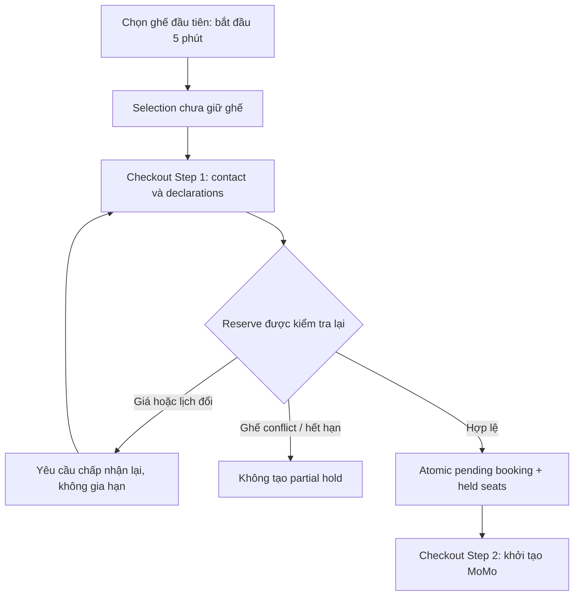

# Business System Design

## Mục đích, baseline và phạm vi

Bản soạn ngày 09/11/2026 mô tả actors, 28 use case, chín functional domain và các luồng phối hợp nghiệp vụ của Promethe-Phos. Nguồn hành vi là **Use-Case Specifications v2.4** (bản đính kèm `rup_ucspec-v2.4_final(5).docx`); nguồn kiến trúc là **SAD v3.15** (`rup_sad(1).docx`). Đường dẫn dự kiến trong repository: `pa/PA3-Group15/`; phải kiểm tra version/nội dung khi đổi tên file.

Đây là tóm lược thiết kế, không thay thế toàn bộ Basic/Alternative Flows của DOCX và không xác nhận implementation. Không dùng các mã cũ “UC-01 Login”, “UC-02 Book Tickets” hoặc “UC-03A Cancel Booking”. Database và API phải dẫn xuất từ baseline này, không giới hạn nghiệp vụ theo schema cũ.

| Chủ đề | Baseline hiện hành |
|---|---|
| Cinema scope | Hỗ trợ cinema assignments theo role; seed/demo một rạp không loại bỏ phân quyền đa rạp |
| Public / Guest | Có Guest Checkout; không bắt đăng nhập chỉ để hoàn tất đặt vé |
| Reservation | Năm phút từ ghế đầu tiên; pending booking tạo ở Step 1 → Step 2 và kế thừa deadline |
| Payment | MoMo, cửa sổ mười phút; grace mặc định mười giây để xác minh; unresolved tiếp tục được bảo vệ |
| Pricing | Hai category Adult/Discounted ở cấp booking; base price theo cinema và surcharge theo physical seat |
| Ticket | Một QR cấp booking, nhiều đợt admission theo quota; không Couple hay QR từng ghế |
| Refund | Quản lý nghĩa vụ, review và ghi nhận verified manual completion trong phạm vi; thực chuyển tiền ngoài app trong demo |
| Operational permission | Quyền cụ thể theo operation/role/cinema; không gộp Staff, Manager, Admin |
| Chat | Informational-only; bounded backend-memory history theo SAD, không lưu PostgreSQL |
| Implementation | Chưa kiểm tra code/live services trong lần soạn; không coi Designed là Implemented |

## Actors và ranh giới hệ thống

| Actor | Trách nhiệm / giới hạn |
|---|---|
| Guest | Duyệt công khai, chọn/đặt/checkout và truy cập booking qua Guest authority an toàn; email/phone/code không đủ quyền |
| Customer | Public/booking capabilities và lịch sử thuộc account; xác thực không tự chứng minh ownership của Guest booking |
| Staff | Admission khi có STAFF role và Staff–Cinema assignment; hỗ trợ booking, gửi lại vé, review cancellation tại cinema được giao |
| Manager | Quyền vận hành cinema được giao, layout/seat state/pricing/showtime/turnaround; ghi verified refund completion; không tự có Staff admission |
| Admin | Các quyền quản trị được UC cho phép; không bypass payment safety, lịch chồng, quota hoặc kiểm tra bằng chứng tài chính |
| Payment Gateway (MoMo) | Nhận yêu cầu thanh toán, cung cấp verified notifications/status; browser return không là chứng cứ tài chính |
| System Worker | Tác nhân thời gian/internal execution cho expiration/reconciliation/delivery; không là public user role |
| Email provider (Brevo) | Vận chuyển email sau commit; hỗ trợ tích hợp, không sở hữu booking/verification outcome |
| External AI provider | Sinh nội dung trong permitted context; không có quyền mutate business records |

Các provider hỗ trợ không làm tăng số numbered UC. Backend/database là thành phần thực hiện hệ thống, không mô hình hóa thành human actor. Nhiều role có thể cùng một account nhưng authority và cinema assignments của từng role phải độc lập.

## Catalogue 28 use case

| ID | Tên chuẩn | Domain | Actor / phạm vi | Kết quả chính | Component |
|---|---|---|---|---|---|
| UC-01 | Reserve Seats | D1 | Guest / Customer | Selection session; atomic pending booking and held seats | C08 |
| UC-02 | Payment Webhook | D9 | Payment Gateway | Verified durable payment outcome/application | C09 |
| UC-03 | Release Expired Bookings | D9 | System Worker | Payment-safe expiration/release | C08, C14 |
| UC-04 | Payment Reconciliation | D9 | System Worker | Resolve uncertain outcomes; route review/refund | C09, C14 |
| UC-04A | Refund | D9 | Manager / Admin; system workflow | Financial obligation and verified external completion | C10 |
| UC-05 | Validate Ticket | D3 | Assigned Staff | Booking QR, partial/group admission, category quotas | C11 |
| UC-06A | Browse Movies | D1 | Guest / Customer | Public catalogue/search/filter | C04 |
| UC-06B | View Movie Details | D1 | Guest / Customer | Movie details and navigation to schedule | C04 |
| UC-07 | Browse Showtimes | D1 | Guest / Customer | Movie/cinema/date schedule discovery | C06 |
| UC-08A | Register Customer Account | D8 | Guest | Create permanent Customer membership | C03 |
| UC-08B | Verify Email Address | D8 | Account holder / verification link holder | Verify/resend/change primary email safely | C03 |
| UC-08C | Login | D8 | Account holder | Credentials, single session, confirmed replacement | C03 |
| UC-08D | Logout | D8 | Authenticated user | Revoke current session | C03 |
| UC-09 | Checkout and Payment | D1 | Guest / Customer | Contact/declarations, invoke reserve, initiate MoMo | C08, C09 |
| UC-10 | Customer Booking Lifecycle | D2 | Guest / Customer with resource authority | Lookup/ticket/pending cancel/rescheduling request/withdrawal | C08, C10, C11 |
| UC-11 | Chat with Promethe-Nous | D1 | Guest / Customer | Informational assistance only | C12 |
| UC-12 | Manage Movie Catalog | D4 | Admin | Metadata, associations, movie lifecycle | C04 |
| UC-13 | Manage Genres | D4 | Admin | Genre definitions and activation | C04 |
| UC-14A | Manage Cinemas | D5 | Admin; scoped Manager; Staff read | Cinema metadata/state; Manager turnaround only | C05 |
| UC-14B | Manage Screening Rooms | D5 | Admin; scoped Manager/Staff read | Room identity/state, parent cinema | C05 |
| UC-15A | Configure Seat Layout | D5 | Admin / scoped Manager; Staff read | Physical labels/positions/type assignment | C05 |
| UC-15B | Change Seat Operational Status | D5 | Admin / scoped Manager; Staff read | Active/out-of-service with obligation checks | C05 |
| UC-15C | Manage Seat Types | D7 | Admin write; permitted operational read | Shared physical types/surcharges | C05 |
| UC-16A | Manage Ticket Types | D7 | Admin write; permitted operational read | Exactly Adult/Discounted descriptions | C07 |
| UC-16B | Configure Cinema Ticket Pricing | D7 | Admin / scoped Manager; Staff read | Cinema Adult/Discounted base prices | C07 |
| UC-17 | Manage Showtimes and Schedules | D6 | Admin / scoped Manager; Staff read | Duration snapshots, overlap, reschedule, restricted cancel | C06 |
| UC-18 | Manage User Accounts and Roles | D8 | Admin; scoped Manager Staff assignments | Roles, account lock/unlock, role-specific cinema assignments | C03 |
| UC-19 | Manage Bookings and Tickets | D2 | Scoped Staff / Manager / Admin | Support, redelivery, cancellation review; restricted refund completion | C08, C10, C11 |

## Functional domain

| Domain | Tên | Số UC | Phân biệt |
|---|---|---:|---|
| D1 | Customer Booking and Payment | 6 | 01, 06A, 06B, 07, 09, 11 |
| D2 | Customer Booking Management | 2 | 10, 19 |
| D3 | Ticket Validation and Admission | 1 | 05 |
| D4 | Movie Catalog Management | 2 | 12, 13 |
| D5 | Cinema and Screening Room Setup | 4 | 14A, 14B, 15A, 15B |
| D6 | Showtime and Schedule Management | 1 | 17 |
| D7 | Ticket Types and Pricing Management | 3 | 15C, 16A, 16B |
| D8 | User and Access Management | 5 | 08A, 08B, 08C, 08D, 18 |
| D9 | Payment Exception and Recovery | 4 | 02, 03, 04, 04A |

Tổng 28. Domain là nhóm chức năng, không là bảng database, project code hoặc service triển khai riêng.

## Ma trận quyền vận hành

Mọi quyền sau yêu cầu current active account/session; internal access yêu cầu verified email. “Assigned” kiểm tra đúng loại role–cinema assignment tại thời điểm protected commit.

| Operation | Staff | Manager | Admin |
|---|---|---|---|
| Movie/genre write | Không | Không | Có |
| Cinema identity/state | Không | Không | Có |
| Cinema minimum turnaround | Read assigned | Write assigned | Có |
| Room identity/state | Read assigned | Read assigned | Write |
| Physical seat layout/state | Read assigned | Write assigned | Write |
| Shared seat types/surcharges | Permitted read | Permitted read | Write |
| Shared ticket categories | Permitted read | Permitted read | Permitted descriptive write |
| Cinema base pricing | Read assigned | Write assigned | Write |
| Showtime schedule | Read assigned | Write assigned | Write |
| Booking support/ticket resend | Assigned | Assigned | Authorized system-wide |
| Cancellation approve/reject | Assigned | Assigned | Authorized system-wide |
| Record verified manual refund completion | Không | Assigned | Có |
| Admission | STAFF + Staff assignment | Không qua MANAGER role | Không qua ADMIN role |
| Grant/revoke internal roles; lock/unlock account | Không | Không | Có; bảo vệ last active Admin |
| Staff–Cinema assignments | Không | Chỉ cinema được giao | Có |
| Manager–Cinema assignments | Không | Không | Có |

## Luồng xuyên use case

### Account access — UC-08A/B/C/D, UC-18

Registration tạo Customer membership, không cấp internal role và không tự đăng nhập. Verification email được queue trong phối hợp transaction rồi gửi sau commit. Customer có thể login trước verified email; internal access vẫn yêu cầu verified email. Primary email mới chỉ thay địa chỉ cũ sau xác minh thành công; giữ nguyên user ID/booking/history. Verification chống reuse/expiry/resend abuse theo DOCX (mặc định 24 giờ, resend ít nhất 60 giây, reservation tuyệt đối 72 giờ theo request gốc).

Login hợp lệ và chưa có session active tạo session/token pair. Nếu đã active, trả conflict + replacement challenge và yêu cầu người dùng lựa chọn; cancel giữ session cũ. Confirm thay thế phải kiểm tra challenge còn gắn đúng expected session, rồi atomically revoke cũ/tạo mới. Refresh rotate token hash atomically trong cùng session; logout/account lock revoke. Role/scope thay đổi được kiểm tra hiện hành, không chờ JWT hết hạn.

### Discovery, selection và reservation — UC-06A/B, UC-07, UC-01, UC-09

1. Guest/Customer xem public movie (coming_soon/now_showing); detail ended vẫn có thể truy cập, archived không public.
2. Chọn cinema/date/showtime còn bán. Lịch và seat map chỉ là snapshot đọc.
3. Chọn Adult/Discounted quantities, tổng 1..configured maximum (mặc định 8). Ghế đầu tiên khởi động selection session năm phút; chưa booking/hold.
4. Chọn physical seats distinct bằng tổng quantity. Không gán category từng ghế/người; không thu danh tính từng attendee.
5. “Đặt vé” vào Checkout Step 1; nhập full name, phone, email, đồng ý terms/age declarations. Deadline không đổi.
6. “Tiếp tục” invokes UC-01: kiểm quyền, session, current showtime/time, quantities/seats và accepted price. Price hoặc official start thay đổi không được áp dụng âm thầm.
7. Atomically tạo pending booking, purchase snapshots và held seat allocations; all-or-nothing, cùng request key không tạo booking thứ hai. Deadline kế thừa selection.
8. Checkout Step 2 hiển thị booking đã commit và cho khởi tạo payment.

Movie Detail reload reset current selection theo navigation policy; Checkout Step 1/2 reload restore eligible existing state, không reset deadline. Deselect/reselect trong cùng session không gia hạn. Backend phải đối chiếu booking hiện tại khi replay, không trả pending giả cho booking đã expired.

### Payment confirmation và delivery — UC-09, UC-02

Persist stable payment attempt trước provider call; không giữ business lock trong lúc gọi MoMo. Initiated payment có deadline mười phút thay thế original selection deadline. Retry không tạo attempt mở thứ hai. Redirect không confirm booking. Verified webhook/reconciliation re-read dưới transaction; eligible application atomically ghi succeeded/applied, confirmed booking, sold allocations, một booking QR, notification request và mandatory audit. Email sau commit; Brevo failure không rollback booking. Success đến muộn/ineligible vẫn lưu evidence và route review/refund, không reclaim ghế.

### Expiration và reconciliation — UC-03, UC-04

Worker đọc candidates rồi lock/re-read state/time. Original selection deadline chỉ govern trước initiated payment. Grace mặc định mười giây sau payment deadline là verification buffer, không payment extension. Nếu chưa rõ outcome, giữ protection và reconcile; không force failed/release chỉ vì timer. Query provider ngoài transaction; mở transaction mới để áp dụng kết quả với state mới nhất. Inline cleanup chỉ release trường hợp đã xác định an toàn; không gọi provider trong reserve transaction. Crash/retry không tạo duplicate effect.

### Ticket/admission — UC-10, UC-05

Một booking QR đại diện toàn entitlement Adult/Discounted. Guest/owner truy cập qua authority riêng; Staff có role/scope mới quét được. Validation đọc QR/context, chưa tiêu quota. Confirmation kiểm current official start trong window [-5,+20] phút inclusive, age/Discounted eligibility và remaining per-category dưới transaction. Cho phép từng người/nhóm đến nhiều đợt; không vượt quota và replay cùng operation không tăng count. Account lock không tự invalidate vé đã trả tiền.

### Pending cancellation, request review và refund — UC-10, UC-19, UC-04A

Pending booking chỉ hủy rõ ràng trước committed payment initiation, sau warning; closing tab không hủy. Confirmed booking chỉ request khi current start khác purchased start (bất kỳ khác biệt, không minimum delta), request trước current start và chưa admission; không hủy một phần.

| Request state | Booking/allocation/admission | Thao tác tiếp |
|---|---|---|
| pending_review | Confirmed, sold; admission còn được xét độc lập | Owner được withdraw; Staff/Manager/Admin scoped review; first successful admission auto reject |
| approved_awaiting_refund | Confirmed, sold; admission blocked | Manager/Admin record verified external completion; không withdraw |
| rejected | Booking giữ nguyên | Không tạo refund chỉ vì bị reject |
| withdrawn | Booking giữ nguyên | Không tạo financial completion |
| completed | Rescheduling refund succeeded; cancelled booking, QR voided, sold allocation released | Giữ history; không cấp lại entitlement |

Refund status pending/unknown/failed/succeeded độc lập request state. Unknown/failed không làm approved request completed. Một payment tối đa một full refund trong MVP; partial/refund nhiều lần không thuộc baseline. Reconciliation-origin không cần Customer cancellation request, không tự chạy các hiệu ứng rescheduling-origin.

Request hợp lệ đã nộp được giữ để review dù current start sau đó trở về purchased snapshot; yêu cầu mới không đủ điều kiện chỉ vì từng có thay đổi trước đây.

### Cinema configuration và scheduling — UC-12..17

Admin quản shared catalogue; Admin/scoped Manager quản các operation cinema được phép. Mặc định cinema turnaround 15 phút, shared cho rooms, không room override. Showtime lấy scheduled-duration snapshot; edit phim không đổi duration lịch đã tạo. Scheduling/rescheduling recheck overlap, turnaround, current room/cinema state và nghĩa vụ booking; bảo toàn purchased-start snapshots, admissions, financial snapshots và enqueue notifications cần thiết. UC-17 không tự hoàn tiền/cancel booking. Cancel showtime bị chặn khi có blocking booking/payment/refund obligations; không reactivate cancelled showtime trực tiếp trong MVP.

### Operational support và informational AI — UC-19, UC-11

Staff/Manager/Admin có operation-level support scope; không có force-confirm payment, sửa seat đã mua, reset admission hoặc arbitrary financial state. Resend dùng QR cũ và booking contact theo source. Manager/Admin mới được ghi verified refund completion.

Promethe-Nous tra cứu permitted movie/showtime/pricing/guidance, nêu giới hạn nguồn, không biến hội thoại thành booking/payment/refund/admission command. Revenue công khai có nguồn khác báo cáo nội bộ; không suy doanh thu thành số lượt xem. History bounded backend memory theo SAD; clear/expiry/restart mất history, session revocation chặn access cũ. Không tự thêm RAG/pgvector/model-training vào baseline.

## UML và cách đọc các hình

Mermaid trên là flowchart nghiệp vụ, không phải UML Use-Case Diagram. Khi nộp UML, dùng các diagram D1–D9 và actor associations trong DOCX; các bước kỹ thuật không được biến thành numbered UC mới.

| Quan hệ | Loại đúng |
|---|---|
| UC-09 → UC-01 | `<<include>>` cho reservation tại transition Step 1 → Step 2 |
| UC-06A → UC-06B → UC-07 | Navigation, không tự include/extend |
| UC-12 ↔ UC-13 | Shared-data dependency |
| UC-14A/14B/15A/15B | Independent management goals, shared cinema/room data |
| UC-16A ↔ UC-16B | Shared category definitions, không include mỗi lần đổi giá |
| UC-02/03/04/04A | Financial/lifecycle dependencies; không suy tất cả thành UML include |
| UC-10 ↔ UC-19 | Customer và operational actor goals riêng |

## Bất biến và kiểm chứng dẫn xuất

| Tình huống | Kết quả phải bảo toàn |
|---|---|
| Hai booking tranh một seat/showtime | Tối đa một active held/sold allocation |
| Reserve fail giữa chừng | Không partial booking/hold |
| Key lặp hoặc response mất | Cùng logical operation; current state được khôi phục |
| Giá/schedule đổi cạnh tranh reserve | Không unaccepted financial total/official start |
| Webhook vs expiration | Không release confirmed booking; không reclaim released seat |
| Email failure | Committed financial/ticket state giữ nguyên |
| Admission vs approval | Không đồng thời admit và approve trái điều kiện zero-admission |
| Refresh/session replacement race | Một active session; stale challenge không revoke session mới |
| Guest biết code/email khác | Không được đọc/chỉnh resource đó |
| Refund unknown | Không đánh dấu completed/resolved |

Đây là tiêu chí cần kiểm thử, không phải kết quả đã chạy.

## Liên kết và chỗ cần đồng bộ

- [Architecture](architecture.md): component ownership, transaction and integration boundaries.
- [Relational model](relational-model.md): logical persistent structures, keys, cardinality and proposed constraints.
- `../requirements/use-cases.md`: bản Markdown phải đối chiếu lại DOCX; không ưu tiên một bản cũ hơn nguồn.
- `../api/`: thêm refresh/replacement challenge, pending-request withdrawal và navigation restoration đúng nguồn. Không dùng bản API đề xuất trước đó để bỏ các hành vi DOCX/SAD đã chốt.
- `../../database/`: cần cập nhật schema/migrations/seed theo mô hình mới; ba file này không thay đổi database thực tế.
