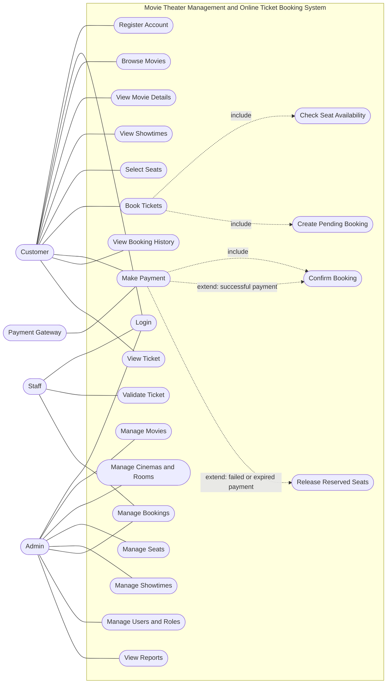

# Business System Design

## 1. Xây dựng Use Case

### 1.1. Mục tiêu

Use Case Diagram mô tả các chức năng mà hệ thống cung cấp cho từng Actor, đồng thời xác định phạm vi tương tác giữa người dùng và hệ thống quản lý rạp chiếu phim, đặt vé trực tuyến.

Các chức năng được chia thành hai nhóm chính:

- **Customer:** tra cứu phim, xem suất chiếu, chọn ghế, đặt vé, thanh toán và tra cứu vé.
- **Admin/Staff:** quản lý phim, phòng chiếu, ghế, suất chiếu, đơn đặt vé, tài khoản và xác thực vé.

### 1.2. Xác định Actor

| Actor | Mô tả | Trách nhiệm chính |
|---|---|---|
| Customer | Khách hàng sử dụng hệ thống | Xem phim, chọn suất chiếu và ghế, đặt vé, thanh toán, xem vé |
| Staff | Nhân viên rạp chiếu phim | Kiểm tra vé, xác thực vé và hỗ trợ nghiệp vụ tại rạp |
| Admin | Quản trị viên hệ thống | Quản lý dữ liệu, tài khoản, phân quyền và cấu hình hệ thống |
| Payment Gateway | Hệ thống thanh toán bên ngoài | Xử lý giao dịch thanh toán và gửi kết quả giao dịch về hệ thống |

`Payment Gateway` là một hệ thống bên ngoài, không phải người dùng trực tiếp. Actor này chỉ tham gia các Use Case có liên quan đến thanh toán.

### 1.3. Xác định Use Case

**Nhóm Customer**

| Use Case | Mô tả |
|---|---|
| Register Account | Đăng ký tài khoản khách hàng |
| Login | Đăng nhập vào hệ thống |
| Browse Movies | Xem danh sách phim |
| View Movie Details | Xem thông tin chi tiết của phim |
| View Showtimes | Xem các suất chiếu có sẵn |
| Select Seats | Chọn ghế cho suất chiếu |
| Book Tickets | Tạo đơn đặt vé |
| Make Payment | Thanh toán đơn đặt vé |
| View Booking History | Xem lịch sử đặt vé |
| View Ticket | Xem thông tin vé đã đặt |

**Nhóm Admin/Staff**

| Use Case | Mô tả |
|---|---|
| Manage Movies | Thêm, sửa, ẩn hoặc cập nhật thông tin phim |
| Manage Cinemas and Rooms | Quản lý rạp và phòng chiếu |
| Manage Seats | Quản lý sơ đồ ghế và loại ghế |
| Manage Showtimes | Tạo, cập nhật hoặc hủy suất chiếu |
| Manage Bookings | Tra cứu và xử lý đơn đặt vé theo quyền hạn |
| Validate Ticket | Kiểm tra tính hợp lệ của vé tại rạp |
| Manage Users and Roles | Quản lý tài khoản và quyền truy cập |
| View Reports | Xem báo cáo hoạt động và doanh thu |

### 1.4. Use Case Diagram

Sơ đồ dưới đây thể hiện các Actor, các chức năng chính và những quan hệ `include` / `extend` cần thiết.

**Lưu ý:** Sơ đồ trên là mô hình chức năng ở mức tổng quan. Khi vẽ lại bằng UML chuyên dụng, cần thể hiện rõ các đường quan hệ và chiều mũi tên của `include` / `extend`. Về nghiệp vụ, việc xác nhận đặt vé chỉ được thực hiện khi kết quả thanh toán hợp lệ; nếu thanh toán thất bại hoặc hết hạn, hệ thống xử lý theo chính sách đặt vé và giải phóng ghế khi phù hợp.

### 1.5. Mô tả các Use Case quan trọng

#### UC-01: Login

| Thuộc tính | Mô tả |
|---|---|
| Use Case Name | Login |
| Actor | Customer, Staff, Admin |
| Preconditions | Người dùng đã có tài khoản hợp lệ |
| Main Flow | 1. Người dùng nhập thông tin đăng nhập. 2. Frontend gửi yêu cầu đến API. 3. Backend kiểm tra thông tin xác thực. 4. Hệ thống trả về kết quả đăng nhập và thông tin quyền truy cập phù hợp. |
| Alternative Flow | Người dùng đã đăng nhập có thể tiếp tục sử dụng phiên hiện tại nếu phiên còn hiệu lực. |
| Exception Flow | Tài khoản hoặc mật khẩu không hợp lệ; tài khoản bị vô hiệu hóa; máy chủ gặp lỗi. Hệ thống trả về thông báo phù hợp mà không tiết lộ thông tin nhạy cảm. |
| Postconditions | Đăng nhập thành công: người dùng được xác thực và có thể truy cập các chức năng theo quyền. Thất bại: không tạo phiên đăng nhập hợp lệ. |

#### UC-02: Book Tickets

| Thuộc tính | Mô tả |
|---|---|
| Use Case Name | Book Tickets |
| Actor | Customer |
| Preconditions | Khách hàng truy cập được hệ thống; suất chiếu còn hiệu lực và cho phép đặt vé. |
| Main Flow | 1. Khách hàng chọn phim và suất chiếu. 2. Hệ thống hiển thị sơ đồ ghế. 3. Khách hàng chọn ghế. 4. Backend kiểm tra lại tình trạng ghế. 5. Hệ thống giữ ghế tạm thời và tạo đơn đặt vé ở trạng thái chờ thanh toán. 6. Khách hàng tiếp tục thanh toán. |
| Alternative Flow | Khách hàng thay đổi lựa chọn ghế trước khi tạo đơn; hệ thống cập nhật danh sách ghế được chọn nếu ghế vẫn còn khả dụng. |
| Exception Flow | Suất chiếu không còn khả dụng; ghế vừa được khách hàng khác đặt; đơn đặt vé không thể được tạo. Hệ thống thông báo lỗi và yêu cầu khách hàng chọn lại. |
| Postconditions | Đơn đặt vé chờ thanh toán được tạo và các ghế liên quan được giữ tạm thời theo thời hạn quy định. Chưa phát hành vé chính thức khi thanh toán chưa được xác nhận. |

#### UC-03: Make Payment

| Thuộc tính | Mô tả |
|---|---|
| Use Case Name | Make Payment |
| Actor | Customer, Payment Gateway |
| Preconditions | Có đơn đặt vé hợp lệ đang chờ thanh toán; đơn chưa hết hạn hoặc bị hủy. |
| Main Flow | 1. Khách hàng chọn phương thức thanh toán. 2. Backend kiểm tra đơn và số tiền phải trả. 3. Hệ thống khởi tạo giao dịch với Payment Gateway. 4. Khách hàng hoàn thành bước thanh toán theo hướng dẫn của cổng thanh toán. 5. Backend xác minh kết quả giao dịch. 6. Hệ thống cập nhật trạng thái thanh toán và xác nhận đơn khi thanh toán thành công. |
| Alternative Flow | Khách hàng quay lại từ cổng thanh toán nhưng kết quả giao dịch chưa rõ ràng. Hệ thống giữ trạng thái chờ xác minh và truy vấn hoặc xử lý thông báo giao dịch sau đó. |
| Exception Flow | Thanh toán thất bại, bị từ chối, quá thời hạn hoặc thông báo giao dịch không hợp lệ. Hệ thống không phát hành vé như một giao dịch đã thanh toán thành công. |
| Postconditions | Thành công: giao dịch được ghi nhận và đơn được xác nhận. Thất bại hoặc hết hạn: trạng thái đơn được xử lý theo chính sách, ghế có thể được giải phóng. |

#### UC-04: Manage Showtimes

| Thuộc tính | Mô tả |
|---|---|
| Use Case Name | Manage Showtimes |
| Actor | Admin |
| Preconditions | Admin đã đăng nhập và có quyền quản lý suất chiếu; phim và phòng chiếu cần thiết đã tồn tại. |
| Main Flow | 1. Admin chọn chức năng quản lý suất chiếu. 2. Nhập phim, phòng chiếu, thời gian bắt đầu và các thông tin liên quan. 3. Backend kiểm tra dữ liệu đầu vào. 4. Hệ thống kiểm tra lịch phòng chiếu và các quy tắc nghiệp vụ. 5. Nếu hợp lệ, hệ thống lưu suất chiếu. |
| Alternative Flow | Admin cập nhật một suất chiếu hiện có nếu thay đổi không vi phạm các ràng buộc nghiệp vụ. |
| Exception Flow | Phòng chiếu bị trùng lịch; dữ liệu không hợp lệ; suất chiếu không thể thay đổi do đã có giao dịch liên quan. Hệ thống từ chối thao tác và trả về lý do. |
| Postconditions | Suất chiếu được tạo hoặc cập nhật thành công, hoặc dữ liệu không thay đổi nếu thao tác thất bại. |

#### UC-05: Validate Ticket

| Thuộc tính | Mô tả |
|---|---|
| Use Case Name | Validate Ticket |
| Actor | Staff |
| Preconditions | Nhân viên đã đăng nhập, có quyền xác thực vé và có thông tin vé cần kiểm tra. |
| Main Flow | 1. Nhân viên quét mã vé hoặc nhập mã vé. 2. Frontend gửi yêu cầu đến API. 3. Backend kiểm tra mã vé, trạng thái vé và suất chiếu liên quan. 4. Hệ thống trả về kết quả xác thực. 5. Nếu vé hợp lệ và chưa sử dụng, hệ thống ghi nhận việc sử dụng vé một cách an toàn. |
| Alternative Flow | Nhân viên tra cứu thông tin vé theo mã khi thiết bị quét không hoạt động. |
| Exception Flow | Mã vé không tồn tại, vé đã sử dụng, vé bị hủy hoặc vé không hợp lệ với quy tắc kiểm tra. Hệ thống từ chối xác thực. |
| Postconditions | Vé hợp lệ được đánh dấu đã sử dụng; vé không hợp lệ không được chấp nhận. Việc cập nhật phải tránh hai lượt quét đồng thời cùng chấp nhận một vé. |

