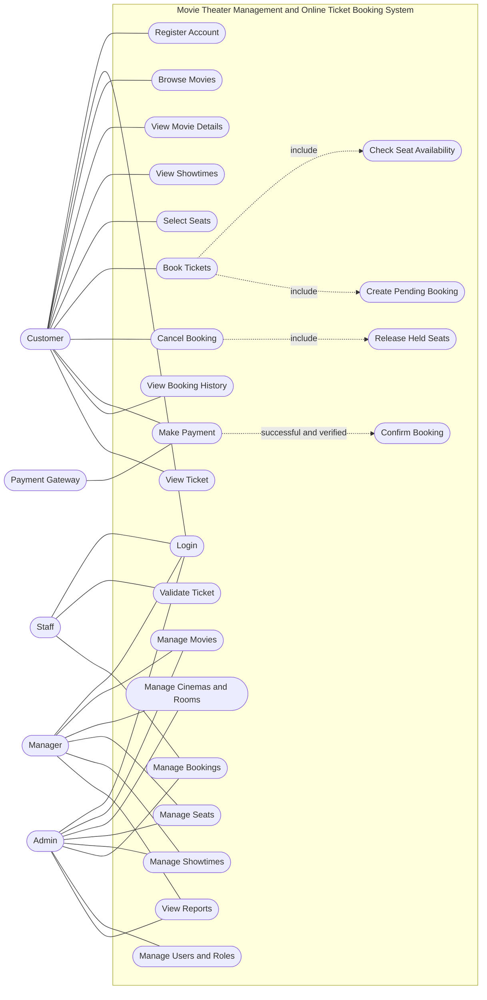

# Business System Design

## 0. Phạm vi và chính sách dùng chung

| Trạng thái | Quyết định |
|---|---|
| **CONFIRMED — MVP/demo** | Hệ thống triển khai một chi nhánh ban đầu; hỗ trợ phim/thể loại, phòng/ghế, suất chiếu, đặt vé, thanh toán, phát hành/soát vé, tài khoản và vai trò cơ bản. |
| **PROPOSED — data-model readiness** | Database có thể chứa nhiều Cinema và CinemaRoom thuộc từng Cinema; demo chỉ vận hành một Cinema. Phân quyền theo chi nhánh chưa nằm trong MVP. |
| **CONFIRMED — booking** | Ghế được giữ khi booking pending được tạo thành công, giữ 5 phút tính từ lúc tạo booking. Hủy trước thanh toán giải phóng ghế. |
| **CONFIRMED — sales** | Không áp dụng cutoff cố định 10/15/30 phút trước giờ chiếu; việc bán sát giờ được cho phép theo mốc vận hành được nhóm chốt. |
| **OUT OF SCOPE — DEMO** | Customer cancellation sau thanh toán, refund, cinema-initiated showtime cancellation, và reconciliation phức tạp cho payment thành công đến muộn sau khi ghế đã được bán lại. |
| **PROPOSED** | `MANAGER` là actor quản trị vận hành với quyền quản lý phim, phòng/ghế, suất chiếu và xem báo cáo; phạm vi quyền chi tiết vẫn cần được nhóm chốt. |
| **OPEN** | Gateway cụ thể, mốc đóng bán cuối cùng, cửa sổ soát vé, điều kiện vé giảm, quyền staff theo chi nhánh và ranh giới chính xác giữa Manager/Admin. |

Tài liệu này mô tả actors, use cases và luồng nghiệp vụ; chi tiết PK/FK, snapshot giá và ràng buộc concurrency nằm trong `database/database-design.md`.

## 1. Xây dựng Use Case

### 1.1. Mục tiêu

Use Case Diagram mô tả các chức năng mà hệ thống cung cấp cho từng Actor, đồng thời xác định phạm vi tương tác giữa người dùng và hệ thống quản lý rạp chiếu phim, đặt vé trực tuyến.

Các chức năng được chia thành hai nhóm chính:

- **Customer:** tra cứu phim, xem suất chiếu, chọn ghế, đặt vé, hủy booking trước thanh toán, thanh toán và tra cứu vé.
- **Staff/Manager/Admin:** vận hành và quản trị dữ liệu theo role được cấp; phạm vi chi tiết của Manager là đề xuất, chưa thay thế authorization policy.

### 1.2. Xác định Actor

| Actor | Mô tả | Trách nhiệm chính |
|---|---|---|
| Customer | Khách hàng sử dụng hệ thống | Xem phim, chọn suất chiếu và ghế, đặt vé, thanh toán, xem vé |
| Staff | Nhân viên rạp chiếu phim | Kiểm tra vé, xác thực vé và hỗ trợ nghiệp vụ tại rạp |
| Manager | Quản lý vận hành | **PROPOSED:** quản lý phim, phòng/ghế, suất chiếu và xem báo cáo; không mặc nhiên có quyền quản trị tài khoản/phân quyền |
| Admin | Quản trị viên hệ thống | Quản lý dữ liệu, tài khoản, phân quyền và cấu hình hệ thống |
| Payment Gateway | Hệ thống thanh toán bên ngoài | Xử lý giao dịch thanh toán và gửi kết quả giao dịch về hệ thống |

`Payment Gateway` là một hệ thống bên ngoài, không phải người dùng trực tiếp. Actor này chỉ tham gia các Use Case có liên quan đến thanh toán.

### 1.3. Xác định Use Case

**Nhóm Customer**

| Use Case | Mô tả |
|---|---|
| Register Account | Đăng ký tài khoản khách hàng |
| Login | Đăng nhập vào hệ thống |
| Browse Movies | Xem danh sách phim |
| View Movie Details | Xem thông tin chi tiết của phim |
| View Showtimes | Xem các suất chiếu có sẵn |
| Select Seats | Chọn ghế cho suất chiếu |
| Book Tickets | Tạo đơn đặt vé |
| Cancel Booking | Hủy booking pending trước khi thanh toán |
| Make Payment | Thanh toán đơn đặt vé |
| View Booking History | Xem lịch sử đặt vé |
| View Ticket | Xem thông tin vé đã đặt |

**Nhóm Admin/Staff**

| Use Case | Mô tả |
|---|---|
| Manage Movies | Thêm, sửa, ẩn hoặc cập nhật thông tin phim |
| Manage Cinemas and Rooms | Quản lý rạp và phòng chiếu |
| Manage Seats | Quản lý sơ đồ ghế và loại ghế |
| Manage Showtimes | Tạo, cập nhật hoặc hủy suất chiếu |
| Manage Bookings | Tra cứu và xử lý đơn đặt vé theo quyền hạn |
| Validate Ticket | Kiểm tra tính hợp lệ của vé tại rạp |
| Manage Users and Roles | Quản lý tài khoản và quyền truy cập |
| View Reports | Xem báo cáo hoạt động và doanh thu |

### 1.4. Use Case Diagram

Sơ đồ dưới đây thể hiện các Actor, các chức năng chính và những quan hệ `include` / `extend` cần thiết.

**Lưu ý:** Sơ đồ trên là mô hình chức năng ở mức tổng quan. Booking chỉ giữ ghế và tạo trạng thái pending; Payment là giao dịch độc lập; Ticket chỉ được phát hành sau payment được xác minh thành công. Payment `failed`/`cancelled` **không** trực tiếp giải phóng ghế: booking vẫn `pending` nếu còn hạn và ghế vẫn `held` (khách có thể thử lại); ghế chỉ được giải phóng khi khách hủy booking pending hoặc worker hết hạn — hết hạn chỉ chuyển `expired` + `released` khi booking quá hạn và không còn payment `created`/`pending`/`unknown` (`database-design.md` mục 31.5/34.1, BR-BOOK-004). Payment pending/unknown không được giải phóng ghế hoặc cho phép bán xung đột. Nếu kết quả vẫn chưa rõ sau khi hết hạn, việc reconciliation nâng cao là **OUT OF SCOPE — DEMO**.

### 1.5. Mô tả các Use Case quan trọng

#### UC-01: Login

| Thuộc tính | Mô tả |
|---|---|
| Use Case Name | Login |
| Actor | Customer, Staff, Admin |
| Preconditions | Người dùng đã có tài khoản hợp lệ |
| Main Flow | 1. Người dùng nhập thông tin đăng nhập. 2. Frontend gửi yêu cầu đến API. 3. Backend kiểm tra thông tin xác thực. 4. Hệ thống trả về kết quả đăng nhập và thông tin quyền truy cập phù hợp. |
| Alternative Flow | Người dùng đã đăng nhập có thể tiếp tục sử dụng phiên hiện tại nếu phiên còn hiệu lực. |
| Exception Flow | Tài khoản hoặc mật khẩu không hợp lệ; tài khoản bị vô hiệu hóa; máy chủ gặp lỗi. Hệ thống trả về thông báo phù hợp mà không tiết lộ thông tin nhạy cảm. |
| Postconditions | Đăng nhập thành công: người dùng được xác thực và có thể truy cập các chức năng theo quyền. Thất bại: không tạo phiên đăng nhập hợp lệ. |

#### UC-02: Book Tickets

| Thuộc tính | Mô tả |
|---|---|
| Use Case Name | Book Tickets |
| Actor | Customer |
| Preconditions | Khách hàng truy cập được hệ thống; suất chiếu còn hiệu lực và cho phép đặt vé. |
| Main Flow | 1. Khách hàng chọn phim và suất chiếu. 2. Hệ thống hiển thị sơ đồ ghế. 3. Khách hàng chọn ghế. 4. Backend khóa/kiểm tra lại tình trạng ghế trong transaction. 5. Hệ thống tạo Booking pending và giữ toàn bộ ghế thành công trong cùng transaction. Countdown 5 phút bắt đầu từ thời điểm tạo booking. 6. Khách hàng tiếp tục Make Payment. |
| Alternative Flow | Khách hàng thay đổi lựa chọn ghế trước khi tạo đơn; hệ thống cập nhật danh sách ghế được chọn nếu ghế vẫn còn khả dụng. Nếu khách đã bấm thanh toán nhưng muốn đổi ghế: dùng luồng "Hủy thanh toán / Đổi ghế" của UC-03A (cổng xác nhận chưa thu thì payment `cancelled`, booking `cancelled`, ghế `released` — đặt lại ngay). |
| Exception Flow | Suất chiếu không còn khả dụng; ghế vừa được khách hàng khác đặt; đơn đặt vé không thể được tạo. Hệ thống thông báo lỗi và yêu cầu khách hàng chọn lại. |
| Postconditions | Booking pending và các detail held được tạo; không có ghế nào được giữ một phần nếu có xung đột. Booking hết hạn hoặc bị khách hủy trước payment thì các ghế được release. Chưa phát hành Ticket khi payment chưa được xác nhận. |

#### UC-03: Make Payment

| Thuộc tính | Mô tả |
|---|---|
| Use Case Name | Make Payment |
| Actor | Customer, Payment Gateway |
| Preconditions | Có Booking pending hợp lệ; booking chưa hết hạn và còn các detail held. Không có customer cancellation sau payment trong demo. |
| Main Flow | 1. Khách hàng chọn phương thức thanh toán. 2. Backend kiểm tra booking và số tiền snapshot. 3. Hệ thống tạo một Payment attempt có idempotency key. 4. Gateway xử lý giao dịch. 5. Backend xác minh callback/truy vấn gateway. 6. Nếu succeeded và còn đủ điều kiện, hệ thống confirm Booking, chuyển detail sang sold và phát hành Ticket trong cùng transaction. |
| Alternative Flow | Kết quả chưa rõ chuyển Payment sang pending/unknown; hệ thống không tự tạo payment mới hoặc bán lại ghế. Callback lặp được nhận diện bằng event key. Reconciliation nâng cao cho late success sau khi ghế đã bán lại là **OUT OF SCOPE — DEMO**. |
| Exception Flow | Thanh toán failed hoặc cancelled: không confirm booking và không phát hành Ticket; nếu booking còn hạn có thể thử lại. Booking hết hạn là một lifecycle event riêng, không phải Payment `expired`: khi đó Booking chuyển `expired` và ghế được release nếu không còn payment `created`, `pending` hoặc `unknown` cần giữ để xử lý. Sai chữ ký, sai số tiền hoặc sai tiền tệ không làm thay đổi booking. |
| Postconditions | Thành công: Payment succeeded, Booking confirmed, detail sold và Ticket valid. Thất bại: Payment giữ lịch sử attempt, Booking không tự thành công. Payment success không đồng nghĩa bản thân nó là Ticket. |

#### UC-03A: Cancel Booking

| Thuộc tính | Mô tả |
|---|---|
| Use Case Name | Cancel Booking |
| Actor | Customer |
| Preconditions | Customer đã đăng nhập và là chủ sở hữu Booking; Booking đang ở trạng thái `pending`, các detail liên quan đang `held`, và chưa có Payment `succeeded` được áp dụng. |
| Main Flow | 1. Customer chọn hủy Booking. 2. Backend xác thực quyền sở hữu và khóa theo thứ tự `Showtime → Booking → Payment attempts` như luồng payment confirmation. 3. Backend đọc lại quyền sở hữu, Booking, Payment và detail sau khi lấy đủ khóa. 4. Nếu Booking vẫn `pending`, chưa có Payment `succeeded` được áp dụng và không có Payment `created`, `pending` hoặc `unknown`, hệ thống chuyển Booking sang `cancelled`, chuyển toàn bộ detail `held` sang `released`, ghi thời điểm/lý do và commit trong một transaction. **Hủy thanh toán để đổi ghế (cập nhật theo yêu cầu UX):** nếu có Payment `created`/`pending`/`unknown`, backend chủ động gọi Cancel/Query API của cổng (ngoài transaction); nếu cổng xác nhận chưa thu tiền, payment chuyển `cancelled` (kết quả từ cổng đã xác minh) rồi Booking `cancelled` + detail `released` — khách đổi ghế ngay không phải chờ hết hạn; nếu cổng báo đã thu hoặc kết quả không chắc chắn, từ chối hủy và giữ allocation. |
| Alternative Flow | Nếu đã có Payment `created`, `pending` hoặc `unknown`, hệ thống từ chối cancellation, không đổi Payment status và không giải phóng ghế. Customer có thể thử lại sau khi Payment có kết quả chắc chắn. Nếu payment confirmation lấy khóa trước, cancellation chờ rồi đọc lại `confirmed`/`applied_at` và bị từ chối. |
| Exception Flow | Booking không thuộc Customer, đã `confirmed`, `expired` hoặc đã `cancelled`; Booking đã được xử lý đồng thời; hoặc có detail không còn `held`. Hệ thống từ chối thao tác và không cập nhật một phần. |
| Postconditions | Thành công: Booking `cancelled`, toàn bộ detail được `released`, không phát hành Ticket và ghế có thể được booking khác sử dụng sau commit. Thất bại: dữ liệu Booking và ghế giữ nguyên. |

Concurrency details and the two execution-order simulations are documented in `database/database-design.md`, section 31.6.

#### UC-04: Manage Showtimes

| Thuộc tính | Mô tả |
|---|---|
| Use Case Name | Manage Showtimes |
| Actor | Admin |
| Preconditions | Admin đã đăng nhập và có quyền quản lý suất chiếu; phim và phòng chiếu cần thiết đã tồn tại. |
| Main Flow | 1. Admin chọn chức năng quản lý suất chiếu. 2. Nhập phim, phòng chiếu, thời gian bắt đầu và các thông tin liên quan. 3. Backend kiểm tra dữ liệu đầu vào. 4. Hệ thống kiểm tra lịch phòng chiếu và các quy tắc nghiệp vụ. 5. Nếu hợp lệ, hệ thống lưu suất chiếu. |
| Alternative Flow | Admin cập nhật một suất chiếu hiện có nếu thay đổi không vi phạm các ràng buộc nghiệp vụ. |
| Exception Flow | Phòng chiếu bị trùng lịch; dữ liệu không hợp lệ; suất chiếu không thể thay đổi do đã có giao dịch liên quan. Hệ thống từ chối thao tác và trả về lý do. |
| Postconditions | Suất chiếu được tạo hoặc cập nhật thành công, hoặc dữ liệu không thay đổi nếu thao tác thất bại. |

#### UC-05: Validate Ticket

| Thuộc tính | Mô tả |
|---|---|
| Use Case Name | Validate Ticket |
| Actor | Staff |
| Preconditions | Nhân viên đã đăng nhập, có quyền xác thực vé và có thông tin vé cần kiểm tra. |
| Main Flow | 1. Nhân viên quét mã vé hoặc nhập mã vé. 2. Frontend gửi yêu cầu đến API. 3. Backend kiểm tra mã vé, Booking confirmed, detail sold, suất chiếu và trạng thái Ticket. 4. Nếu Ticket valid, backend cập nhật có điều kiện `valid → used` trong transaction và ghi thời gian/người soát. 5. Hệ thống trả kết quả xác thực. |
| Alternative Flow | Nhân viên tra cứu thông tin vé theo mã khi thiết bị quét không hoạt động. |
| Exception Flow | Mã vé không tồn tại, vé đã sử dụng, vé bị hủy hoặc vé không hợp lệ với quy tắc kiểm tra. Hệ thống từ chối xác thực. |
| Postconditions | Ticket hợp lệ được đánh dấu used và không thể được chấp nhận lần hai. Vé đã used/voided hoặc không thuộc suất hợp lệ bị từ chối; customer cancellation sau thanh toán và refund không thuộc demo. |
