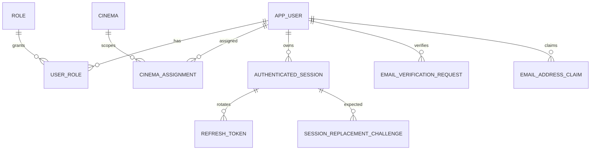
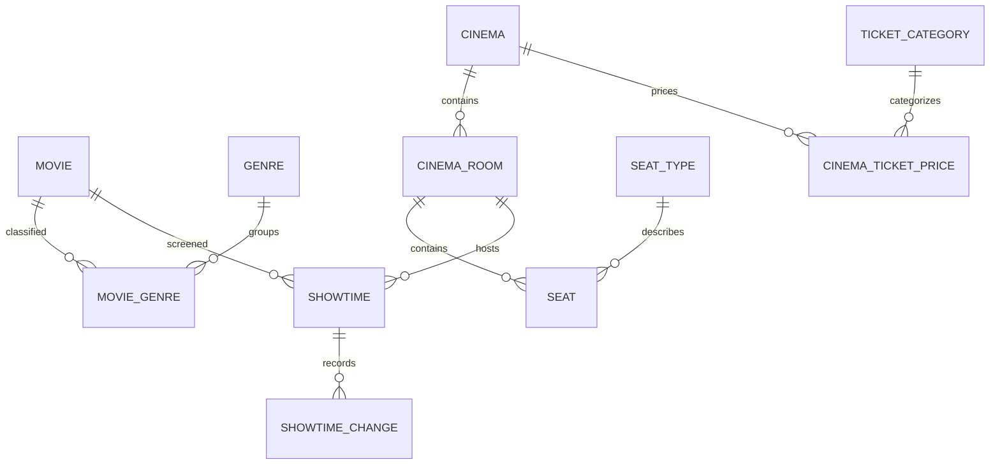
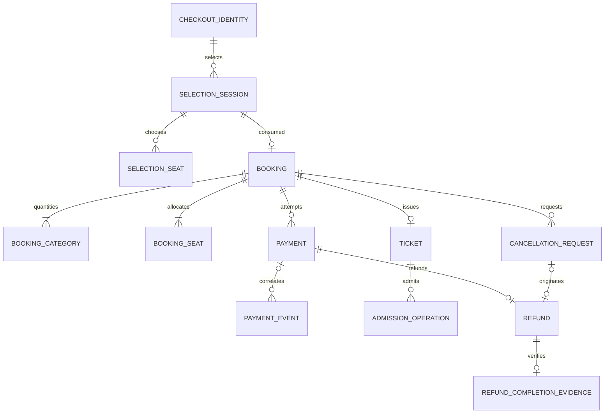

# Relational Model

## Mục đích, baseline và trạng thái

Bản soạn 09/11/2026 chuyển **Use-Case Specifications v2.4** và **SAD v3.15** thành mô hình quan hệ logic phục vụ PostgreSQL/EF Core. Đây là **Proposed logical schema**, chưa là DDL/migration đã chạy; không khẳng định database hiện tại có các bảng dưới đây. Nguồn hành vi ưu tiên DOCX, ownership ưu tiên SAD. Tên bảng/field và cơ chế materialization/index là đề xuất triển khai, phải review trước áp dụng.

[Business system design](business-system-design.md) mô tả actors/28 UC; [Architecture](architecture.md) mô tả C01–C16. Mô hình này không giữ các quy tắc cũ chỉ vì schema cũ đã có field đó. Không có chuyện giữ 18 relations bằng cách bỏ session, admission, notification và audit requirements mới.

## Quy ước

- PK: primary key; UQ: unique toàn phần; UQ-P: unique có điều kiện; UQ-C: unique kỹ thuật làm target FK ghép. UQ-C chứa PK không được gọi là candidate key tối thiểu.
- `?`: nullable; field không có `?` là NOT NULL theo đề xuất. `→` chỉ FK. Các khóa/scopes dùng cho idempotency phải non-null.
- IDs UUID; quantities/durations integer; tiền VND nguyên bằng numeric scale 0 hoặc integer đủ miền; timestamps UTC timezone-aware. Hash/encrypted payload là binary/encoded data không public.
- Tên snake_case là logical naming; physical Identity tables có thể giữ AspNetUsers/AspNetRoles/AspNetUserRoles và map bằng EF Core. Không bắt tạo duplicate app_user password table.
- Business state values dưới đây dùng tên chuẩn của DOCX nơi đã rõ. Physical CHECK/mapping vẫn phải đồng bộ code/schema; không coi arbitrary API display enum là DB enum.
- `version` là concurrency token opaque; không bắt buộc công nghệ rowversion cụ thể. Foreign keys lịch sử mặc định RESTRICT/NO ACTION phù hợp, không cascade-delete tài chính/admission.
- Các constraint cross-table/cross-row không thể được tuyên bố đã bảo đảm chỉ bởi row CHECK. Mỗi phần phân biệt DB constraints với coordinated transaction invariants.

## Catalogue relations

| Relation | Owner | PK | Vai trò |
|---|---|---|---|
| `app_user` | C03 | `id` | Logical view của ASP.NET Core Identity user |
| `role` | C03 | `id` | Seed CUSTOMER, STAFF, MANAGER, ADMIN |
| `user_role` | C03 | `(user_id, role_id)` | Mapping IdentityUserRole; metadata grant/revoke audit có thể extension/audit record |
| `cinema_assignment` | C03 | `(user_id, cinema_id, assignment_role)` | User phải có current role tương ứng khi operation dùng assignment |
| `authenticated_session` | C03 | `id` | Một session chưa revoked/account |
| `refresh_token` | C03 | `id` | Rotation atomically consume cũ + tạo mới cùng session |
| `session_replacement_challenge` | C03 | `id` | Sau credentials hợp lệ và session conflict mới tạo challenge |
| `email_verification_request` | C03 | `id` | Logical persistence đề xuất hỗ trợ Identity confirmation/change-email, không tự triển khai thuật toán token mới |
| `email_address_claim` | C03 | `normalized_email` | Thiết kế đề xuất để unique xuyên primary email và pending reservation |
| `checkout_identity` | C08 | `id` | Identity stable cho reservation idempotency và owner lookup |
| `movie` | C04 | `id` | Title không unique key |
| `genre` | C04 | `id` | Admin write; deactivate thay permanent delete trong MVP |
| `movie_genre` | C04 | `(movie_id, genre_id)` | New association chỉ genre active; association cũ được bảo toàn theo source. |
| `cinema` | C05 | `id` | Mặc định turnaround 15 phút, cinema-level cho mọi room; không room override |
| `cinema_room` | C05 | `id` | Không lưu capacity_units |
| `seat_type` | C05 | `id` | Mỗi seat một admission entitlement |
| `seat` | C05 | `id` | Operational state active/out_of_service; không held/sold |
| `ticket_category` | C07 | `code` | Seed đúng hai dòng và không xóa required rows |
| `cinema_ticket_price` | C07 | `(cinema_id, category_code)` | Một giá hiện hành/category/cinema; default exactly two configured prices khi mở bán |
| `showtime` | C06 | `id` | Không showtime.base_price |
| `showtime_change` | C06 | `id` | Append-only history cho rescheduling/notification trace |
| `selection_session` | C08 | `id` | Persistent selection storage là lựa chọn đề xuất để restart/recovery ổn định, không là hold |
| `selection_seat` | C08 | `(selection_id, seat_id)` | Nhiều Customer được chọn cùng seat trước reserve |
| `booking` | C08 | `id` | Một consumed selection tạo tối đa một booking; owner qua checkout identity, không bắt user_id NN |
| `booking_category` | C08 | `(booking_id, category_code)` | Đề xuất luôn hai rows Adult/Discounted kể cả quantity zero |
| `booking_seat` | C08 | `id` | Không category_id/discount_percent/capacity/unit-price-per-category ở seat row |
| `operation_receipt` | C13 mechanism; caller owns result | `id` | Proposed common idempotency ledger |
| `payment` | C09 | `id` | Expected amount từ booking; received currency/amount lưu evidence thực kể cả mismatch (không CHECK received_currency=VND che mất evidence) |
| `payment_event` | C09 | `id` | Event identity derive theo verified provider contract, không giả MoMo có eventKey |
| `ticket` | C11 | `id` | Một booking một QR; ticket không FK booking_seat |
| `admission_operation` | C11 | `id` | Committed-success ledger append-only; ticket thuộc đúng booking và Staff current cinema scope service verify (có thể thêm composite FK physical) |
| `cancellation_request` | C10 | `id` | States đúng DOCX: pending_review, approved_awaiting_refund, rejected, withdrawn, completed |
| `refund` | C10 | `id` | Origins payment_reconciliation/showtime_rescheduling |
| `refund_completion_evidence` | C10 | `refund_id` | Accepted verified evidence immutable; one successful completion/refund |
| `notification_request` | C15 | `id` | Transactional outbox tạo với business commit |
| `notification_attempt` | C15 | `id` | HTTP send ngoài locks; finalize phải match current claim token |
| `audit_event` | C16 | `id` | Append-only mandatory business audit cùng transaction khi nguồn yêu cầu |

## Chi tiết relations

### app_user

Owner: **C03**. PK: `id`.

| Thuộc tính / FK | Nullable |
|---|---|
| `id` | Không |
| `normalized_email` | Không |
| `primary_email` | Không |
| `email_confirmed` | Không |
| `full_name` | Không |
| `phone` | Có |
| `account_state` | Không |
| `security_stamp` | Không |
| `version` | Không |

**Khóa / domain constraints:** UQ normalized_email (non-null, qua Identity normalizer).

**Bất biến và phạm vi:** Logical view của ASP.NET Core Identity user. Password hash, lockout/security/concurrency fields do Identity quản; không tạo custom password store thứ hai. Active/locked nghiệp vụ được map với Identity lockout/security policy; không coi unlock là khôi phục session revoked.

### role

Owner: **C03**. PK: `id`.

| Thuộc tính / FK | Nullable |
|---|---|
| `id` | Không |
| `code` | Không |
| `name` | Không |

**Khóa / domain constraints:** UQ code.

**Bất biến và phạm vi:** Seed CUSTOMER, STAFF, MANAGER, ADMIN. Không mặc định role inheritance. Mapping IdentityRole; không xóa required roles.

### user_role

Owner: **C03**. PK: `(user_id, role_id)`.

| Thuộc tính / FK | Nullable |
|---|---|
| `user_id → app_user.id` | Không |
| `role_id → role.id` | Không |
| `assigned_at` | Không |
| `assigned_by_user_id → app_user.id` | Có |

**Khóa / domain constraints:** PK ghép ngăn duplicate membership.

**Bất biến và phạm vi:** Mapping IdentityUserRole; metadata grant/revoke audit có thể extension/audit record. Permanent CUSTOMER không bị revoke qua internal-role management. Last active Admin là transaction invariant.

### cinema_assignment

Owner: **C03**. PK: `(user_id, cinema_id, assignment_role)`.

| Thuộc tính / FK | Nullable |
|---|---|
| `user_id → app_user.id` | Không |
| `cinema_id → cinema.id` | Không |
| `assignment_role` | Không |
| `assigned_at` | Không |
| `assigned_by_user_id → app_user.id` | Không |

**Khóa / domain constraints:** CHECK assignment_role IN (STAFF, MANAGER).

**Bất biến và phạm vi:** User phải có current role tương ứng khi operation dùng assignment. Membership revoke không để orphan authority; revoke membership/assignments và audit trong coordinated transaction. Manager chỉ quản Staff assignments trong scope.

### authenticated_session

Owner: **C03**. PK: `id`.

| Thuộc tính / FK | Nullable |
|---|---|
| `id` | Không |
| `user_id → app_user.id` | Không |
| `started_at` | Không |
| `expires_at` | Không |
| `revoked_at` | Có |
| `revocation_reason` | Có |
| `version` | Không |

**Khóa / domain constraints:** UQ-P user_id WHERE revoked_at IS NULL.

**Bất biến và phạm vi:** Một session chưa revoked/account. Không dùng now() trong index. Expired session còn chưa revoked phải được đóng dưới account lock trước tạo session mới; index bảo vệ mạnh hơn active-by-time. Access JWT tham chiếu user và session; protected request kiểm expiry/revocation/current account.

### refresh_token

Owner: **C03**. PK: `id`.

| Thuộc tính / FK | Nullable |
|---|---|
| `id` | Không |
| `session_id → authenticated_session.id` | Không |
| `token_hash` | Không |
| `created_at` | Không |
| `expires_at` | Không |
| `consumed_at` | Có |
| `revoked_at` | Có |
| `replacement_token_id → refresh_token.id` | Có |

**Khóa / domain constraints:** UQ token_hash; CHECK expires_at > created_at.

**Bất biến và phạm vi:** Rotation atomically consume cũ + tạo mới cùng session. Raw refresh không persist/log. Replacement link không tự bảo đảm cùng session; service kiểm. Consumed/revoked/expired token không được renew.

### session_replacement_challenge

Owner: **C03**. PK: `id`.

| Thuộc tính / FK | Nullable |
|---|---|
| `id` | Không |
| `user_id → app_user.id` | Không |
| `expected_session_id → authenticated_session.id` | Không |
| `challenge_hash` | Không |
| `created_at` | Không |
| `expires_at` | Không |
| `consumed_at` | Có |

**Khóa / domain constraints:** UQ challenge_hash.

**Bất biến và phạm vi:** Sau credentials hợp lệ và session conflict mới tạo challenge. Confirm lock account, verify expected session/user/current state; consume/revoke/create atomically. Không tự thay session khi chưa có explicit confirmation; stale challenge không đụng session mới.

### email_verification_request

Owner: **C03**. PK: `id`.

| Thuộc tính / FK | Nullable |
|---|---|
| `id` | Không |
| `user_id → app_user.id` | Không |
| `purpose` | Không |
| `target_email` | Không |
| `normalized_target_email` | Không |
| `token_hash` | Không |
| `original_requested_at` | Không |
| `token_expires_at` | Không |
| `reservation_expires_at` | Không |
| `next_resend_at` | Không |
| `state` | Không |
| `verified_at` | Có |
| `consumed_at` | Có |
| `version` | Không |

**Khóa / domain constraints:** UQ token_hash; UQ-P user_id WHERE state = active.

**Bất biến và phạm vi:** Logical persistence đề xuất hỗ trợ Identity confirmation/change-email, không tự triển khai thuật toán token mới. Purpose initial_verification/email_change; default token 24h, resend ≥60s, absolute reservation 72h từ original request. Resend/replace giữ lineage/deadline chống reset abuse; token cũ vô hiệu. Chỉ verified completion đổi primary email.

### email_address_claim

Owner: **C03**. PK: `normalized_email`.

| Thuộc tính / FK | Nullable |
|---|---|
| `normalized_email` | Không |
| `user_id → app_user.id` | Không |
| `verification_request_id → email_verification_request.id` | Có |
| `claim_kind` | Không |
| `reserved_until` | Có |

**Khóa / domain constraints:** PK normalized_email; claim_kind primary/reservation.

**Bất biến và phạm vi:** Thiết kế đề xuất để unique xuyên primary email và pending reservation. Không dùng hai unique index trên hai bảng rồi cho rằng chặn được cross-table collision. Primary claim không timeout; reservation expiry được reclaim bằng transaction/lock, không index now(). Claim changes + Identity email update + request outcome nguyên tử; user.primary_email tương ứng primary claim là service invariant.

### checkout_identity

Owner: **C08**. PK: `id`.

| Thuộc tính / FK | Nullable |
|---|---|
| `id` | Không |
| `user_id → app_user.id` | Có |
| `guest_credential_hash` | Có |
| `guest_expires_at` | Có |
| `revoked_at` | Có |
| `created_at` | Không |

**Khóa / domain constraints:** CHECK XOR user_id/guest_credential_hash; UQ-P user_id WHERE user_id IS NOT NULL; UQ-P guest_credential_hash WHERE guest_credential_hash IS NOT NULL.

**Bất biến và phạm vi:** Identity stable cho reservation idempotency và owner lookup. Customer identity gắn account, không gắn một login session ngắn hạn. Guest secret chỉ hash, transport/recovery chưa chốt. Login/email trùng không tự chuyển Guest booking ownership. Credential expiry không xóa paid booking hoặc invalidate admission QR.

### movie

Owner: **C04**. PK: `id`.

| Thuộc tính / FK | Nullable |
|---|---|
| `id` | Không |
| `title` | Không |
| `description` | Có |
| `duration_minutes` | Không |
| `release_date` | Có |
| `poster_url` | Có |
| `trailer_url` | Có |
| `language` | Có |
| `age_rating` | Không |
| `status` | Không |
| `version` | Không |

**Khóa / domain constraints:** CHECK duration_minutes > 0; status coming_soon/now_showing/ended/archived.

**Bất biến và phạm vi:** Title không unique key. Public listing chỉ coming_soon/now_showing; ended detail được phép; archived không public. Movie duration edit không cập nhật scheduled-duration snapshots.

### genre

Owner: **C04**. PK: `id`.

| Thuộc tính / FK | Nullable |
|---|---|
| `id` | Không |
| `code` | Không |
| `normalized_name` | Không |
| `name` | Không |
| `description` | Có |
| `is_active` | Không |
| `version` | Không |

**Khóa / domain constraints:** UQ code; UQ normalized_name.

**Bất biến và phạm vi:** Admin write; deactivate thay permanent delete trong MVP. Không cascade xóa movie_genre khi inactive.

### movie_genre

Owner: **C04**. PK: `(movie_id, genre_id)`.

| Thuộc tính / FK | Nullable |
|---|---|
| `movie_id → movie.id` | Không |
| `genre_id → genre.id` | Không |

**Khóa / domain constraints:** PK ghép.

**Bất biến và phạm vi:** New association chỉ genre active; association cũ được bảo toàn theo source.

### cinema

Owner: **C05**. PK: `id`.

| Thuộc tính / FK | Nullable |
|---|---|
| `id` | Không |
| `code` | Không |
| `name` | Không |
| `address` | Không |
| `phone` | Có |
| `timezone` | Không |
| `status` | Không |
| `minimum_turnaround_minutes` | Không |
| `version` | Không |

**Khóa / domain constraints:** UQ code; CHECK minimum_turnaround_minutes >= 0.

**Bất biến và phạm vi:** Mặc định turnaround 15 phút, cinema-level cho mọi room; không room override. Multi-cinema authorization là baseline dù seed một cinema. Đổi turnaround phải serialize với scheduling và kiểm tra unfinished schedules trước commit.

### cinema_room

Owner: **C05**. PK: `id`.

| Thuộc tính / FK | Nullable |
|---|---|
| `id` | Không |
| `cinema_id → cinema.id` | Không |
| `code` | Không |
| `name` | Không |
| `status` | Không |
| `version` | Không |

**Khóa / domain constraints:** UQ (cinema_id, code); UQ-C (id, cinema_id).

**Bất biến và phạm vi:** Không lưu capacity_units. Capacity physical tính số seat; active availability là projection khác. Admin quản identity/state; Manager/Staff permitted read-only. State modifications không bypass unfinished schedules/booking obligations.

### seat_type

Owner: **C05**. PK: `id`.

| Thuộc tính / FK | Nullable |
|---|---|
| `id` | Không |
| `code` | Không |
| `name` | Không |
| `surcharge_amount` | Không |
| `is_active` | Không |
| `version` | Không |

**Khóa / domain constraints:** UQ code; CHECK surcharge_amount >= 0.

**Bất biến và phạm vi:** Mỗi seat một admission entitlement. Không capacity_units/Couple. Shared surcharge do Admin quản; booking snapshot bất biến.

### seat

Owner: **C05**. PK: `id`.

| Thuộc tính / FK | Nullable |
|---|---|
| `id` | Không |
| `cinema_room_id → cinema_room.id` | Không |
| `seat_type_id → seat_type.id` | Không |
| `row_label` | Không |
| `seat_number` | Không |
| `x_position` | Không |
| `y_position` | Không |
| `operational_state` | Không |
| `version` | Không |

**Khóa / domain constraints:** UQ (cinema_room_id, row_label, seat_number); UQ-C (id, cinema_room_id); CHECK seat_number > 0.

**Bất biến và phạm vi:** Operational state active/out_of_service; không held/sold. Coordinate columns là đề xuất layout representation, không chuẩn bắt buộc từ DOCX. Structural edit bị chặn khi có obligations; giữ historical seat IDs referenced bởi booking.

### ticket_category

Owner: **C07**. PK: `code`.

| Thuộc tính / FK | Nullable |
|---|---|
| `code` | Không |
| `display_name` | Không |
| `eligibility_description` | Không |
| `version` | Không |

**Khóa / domain constraints:** PK code; CHECK code IN (Adult, Discounted).

**Bất biến và phạm vi:** Seed đúng hai dòng và không xóa required rows. CHECK chỉ cấm category khác, không bảo đảm tồn tại đủ hai dòng: seed/deployment check và service/restricted DB permission phải bảo đảm. Discounted gồm students/teachers/age≥60; không discount_percent hay Student category riêng.

### cinema_ticket_price

Owner: **C07**. PK: `(cinema_id, category_code)`.

| Thuộc tính / FK | Nullable |
|---|---|
| `cinema_id → cinema.id` | Không |
| `category_code → ticket_category.code` | Không |
| `amount` | Không |
| `currency` | Không |
| `version` | Không |
| `updated_at` | Không |

**Khóa / domain constraints:** CHECK amount >= 0; currency = VND.

**Bất biến và phạm vi:** Một giá hiện hành/category/cinema; default exactly two configured prices khi mở bán. Không future effectiveFrom workflow tự suy. Update giá atomically/version check, coordinated pricing read khi reserve. Zero base price hợp lệ; zero-total booking policy cần explicit check trong source/implementation, không tự dựng free-payment workflow.

### showtime

Owner: **C06**. PK: `id`.

| Thuộc tính / FK | Nullable |
|---|---|
| `id` | Không |
| `movie_id → movie.id` | Không |
| `cinema_room_id → cinema_room.id` | Không |
| `duration_minutes_snapshot` | Không |
| `starts_at` | Không |
| `ends_at` | Không |
| `room_available_at` | Không |
| `turnaround_minutes_applied` | Không |
| `status` | Không |
| `cancelled_at` | Có |
| `cancellation_reason` | Có |
| `version` | Không |

**Khóa / domain constraints:** UQ-C (id, cinema_room_id); CHECK starts_at < ends_at <= room_available_at; exclusion room + occupied range (physical proposal).

**Bất biến và phạm vi:** Không showtime.base_price. Ends_at từ scheduled duration snapshot. Room interval [starts_at, room_available_at), turnaround materialization phải cập nhật các unfinished showtime bị ảnh hưởng dưới cinema/room lock khi configuration đổi; completed history không rewrite. Physical exclusion active intervals phải chọn đúng states theo scheduling policy. Không direct reactivate cancelled trong MVP; cancel bị chặn bởi unresolved obligations.

### showtime_change

Owner: **C06**. PK: `id`.

| Thuộc tính / FK | Nullable |
|---|---|
| `id` | Không |
| `showtime_id → showtime.id` | Không |
| `old_starts_at` | Không |
| `new_starts_at` | Không |
| `changed_by_user_id → app_user.id` | Không |
| `changed_at` | Không |
| `reason` | Không |
| `operation_key` | Không |

**Khóa / domain constraints:** UQ (showtime_id, operation_key).

**Bất biến và phạm vi:** Append-only history cho rescheduling/notification trace. Preserve booking.purchased_start_at. New reservation vs reschedule phải serialize để không bỏ notification hoặc commit unaccepted start.

### selection_session

Owner: **C08**. PK: `id`.

| Thuộc tính / FK | Nullable |
|---|---|
| `id` | Không |
| `checkout_identity_id → checkout_identity.id` | Không |
| `showtime_id → showtime.id` | Không |
| `started_at` | Không |
| `expires_at` | Không |
| `adult_quantity` | Không |
| `discounted_quantity` | Không |
| `state` | Không |
| `accepted_quote_fingerprint` | Có |
| `quoted_adult_price` | Có |
| `quoted_discounted_price` | Có |
| `quoted_total` | Có |
| `quoted_showtime_start` | Có |
| `version` | Không |

**Khóa / domain constraints:** CHECK expires_at = started_at + 5 minutes (design default); nonnegative quantities; UQ-P (checkout_identity_id, showtime_id) WHERE state = active.

**Bất biến và phạm vi:** Persistent selection storage là lựa chọn đề xuất để restart/recovery ổn định, không là hold. First seat khởi động timer; Movie Detail reload resets selection theo UC, Checkout restores. Expired row phải transition trước tạo active session mới; không dùng index now(). Started/expires immutable; configurable duration nếu thay phải snapshot duration để check đúng.

### selection_seat

Owner: **C08**. PK: `(selection_id, seat_id)`.

| Thuộc tính / FK | Nullable |
|---|---|
| `selection_id → selection_session.id` | Không |
| `seat_id → seat.id` | Không |

**Khóa / domain constraints:** PK ghép; KHÔNG unique (showtime_id, seat_id) toàn selections.

**Bất biến và phạm vi:** Nhiều Customer được chọn cùng seat trước reserve. Same-room/membership và quantity bounds do service kiểm. Incomplete selection được tồn tại, reserve mới yêu cầu full count.

### booking

Owner: **C08**. PK: `id`.

| Thuộc tính / FK | Nullable |
|---|---|
| `id` | Không |
| `booking_code` | Không |
| `checkout_identity_id → checkout_identity.id` | Không |
| `selection_session_id → selection_session.id` | Không |
| `showtime_id` | Không |
| `cinema_room_id` | Không |
| `contact_full_name` | Không |
| `contact_phone` | Không |
| `contact_email` | Không |
| `terms_accepted_at` | Không |
| `age_acknowledged_at` | Không |
| `purchased_start_at` | Không |
| `reservation_expires_at` | Không |
| `total_amount` | Không |
| `currency` | Không |
| `status` | Không |
| `created_at` | Không |
| `confirmed_at` | Có |
| `cancelled_at` | Có |
| `cancellation_reason` | Có |
| `version` | Không |

**Khóa / domain constraints:** UQ booking_code; UQ selection_session_id; UQ-C (id, showtime_id, cinema_room_id); FK (showtime_id,cinema_room_id) → showtime(id,cinema_room_id).

**Bất biến và phạm vi:** Một consumed selection tạo tối đa một booking; owner qua checkout identity, không bắt user_id NN. Full contact bắt buộc. Reservation deadline kế thừa selection.expires_at và phải còn tương lai tại commit, KHÔNG created_at+5. Amount snapshot không reprice; categories/seats cross-row invariants dưới transaction. Payment deadline riêng ở payment.

### booking_category

Owner: **C08**. PK: `(booking_id, category_code)`.

| Thuộc tính / FK | Nullable |
|---|---|
| `booking_id → booking.id` | Không |
| `category_code → ticket_category.code` | Không |
| `quantity` | Không |
| `base_price_snapshot` | Không |
| `category_name_snapshot` | Không |
| `admitted_quantity` | Không |

**Khóa / domain constraints:** CHECK quantity >= 0; base_price_snapshot >= 0; 0 <= admitted_quantity <= quantity.

**Bất biến và phạm vi:** Đề xuất luôn hai rows Adult/Discounted kể cả quantity zero. Exactly-two và sum quantity bằng seat count là transaction invariant, không suy từ FK. Admitted counter là materialized projection từ admission ledger cập nhật cùng transaction, không editable độc lập.

### booking_seat

Owner: **C08**. PK: `id`.

| Thuộc tính / FK | Nullable |
|---|---|
| `id` | Không |
| `booking_id` | Không |
| `showtime_id` | Không |
| `cinema_room_id` | Không |
| `seat_id` | Không |
| `seat_label_snapshot` | Không |
| `seat_type_name_snapshot` | Không |
| `surcharge_snapshot` | Không |
| `allocation_status` | Không |
| `released_at` | Có |

**Khóa / domain constraints:** UQ (booking_id,seat_id); UQ-P (showtime_id,seat_id) WHERE allocation_status IN (held,sold); FK (booking_id,showtime_id,cinema_room_id) → booking(id,showtime_id,cinema_room_id); FK (seat_id,cinema_room_id) → seat(id,cinema_room_id).

**Bất biến và phạm vi:** Không category_id/discount_percent/capacity/unit-price-per-category ở seat row. Không UQ (booking_id,showtime_id,cinema_room_id) tại child: constraint đó sai vì sẽ chỉ cho một ghế/booking. Composite unique target nằm ở BOOKING. UQ-P không tự release bằng timer; released history giữ nguyên.

### operation_receipt

Owner: **C13 mechanism; caller owns result**. PK: `id`.

| Thuộc tính / FK | Nullable |
|---|---|
| `id` | Không |
| `actor_scope` | Không |
| `operation_name` | Không |
| `target_scope` | Không |
| `request_key` | Không |
| `request_fingerprint` | Không |
| `processing_state` | Không |
| `result_reference` | Có |
| `created_at` | Không |
| `committed_at` | Có |
| `lease_until` | Có |
| `claim_token` | Có |

**Khóa / domain constraints:** UQ (actor_scope,operation_name,target_scope,request_key); mọi scope NOT NULL.

**Bất biến và phạm vi:** Proposed common idempotency ledger. Guest actor_scope từ checkout identity, authenticated scope từ stable user; scope phải resolve server-side. Polymorphic result_reference không có FK tự động, typed result validation ở application. Terminal business receipt commit cùng business effect; processing claim có fencing. Không lưu raw token/QR/PII response trong receipt; replay read resource/current state hoặc immutable admission outcome đúng UC.

### payment

Owner: **C09**. PK: `id`.

| Thuộc tính / FK | Nullable |
|---|---|
| `id` | Không |
| `booking_id → booking.id` | Không |
| `provider` | Không |
| `merchant_request_id` | Không |
| `provider_transaction_id` | Có |
| `amount` | Không |
| `currency` | Không |
| `received_amount` | Có |
| `received_currency` | Có |
| `status` | Không |
| `initiated_at` | Có |
| `payment_deadline` | Có |
| `grace_until` | Có |
| `verified_at` | Có |
| `paid_at` | Có |
| `applied_at` | Có |
| `reconciliation_status` | Không |
| `next_reconcile_at` | Có |
| `retry_count` | Không |
| `lease_until` | Có |
| `claim_token` | Có |
| `version` | Không |

**Khóa / domain constraints:** UQ merchant_request_id; UQ-C (id,booking_id); UQ-P (provider,provider_transaction_id) WHERE provider_transaction_id IS NOT NULL; UQ-P booking_id WHERE status IN (created,pending,unknown); UQ-P booking_id WHERE applied_at IS NOT NULL.

**Bất biến và phạm vi:** Expected amount từ booking; received currency/amount lưu evidence thực kể cả mismatch (không CHECK received_currency=VND che mất evidence). Succeeded khác applied; one applied constraint không chứng minh đủ eligibility. Initiated deadline 10m, grace default10s snapshot/config; unknown giữ protected. Provider reference only verified; no downgrade succeeded.

### payment_event

Owner: **C09**. PK: `id`.

| Thuộc tính / FK | Nullable |
|---|---|
| `id` | Không |
| `payment_id → payment.id` | Có |
| `provider` | Không |
| `provider_event_identity` | Không |
| `source` | Không |
| `sanitized_payload` | Không |
| `received_at` | Không |
| `verified_at` | Không |
| `processing_status` | Không |
| `processed_at` | Có |
| `retry_count` | Không |
| `next_retry_at` | Có |
| `lease_until` | Có |
| `claim_token` | Có |
| `last_error_code` | Có |

**Khóa / domain constraints:** UQ (provider,provider_event_identity).

**Bất biến và phạm vi:** Event identity derive theo verified provider contract, không giả MoMo có eventKey. Verified but unmatched receipt có payment_id NULL và review; unverified request không đi vào valid queue. Durable ingress trước ACK phù hợp; domain processing + processed marker nguyên tử. Failed processing không phải payment failed. Claim short transaction; release locks trước domain lock order.

### ticket

Owner: **C11**. PK: `id`.

| Thuộc tính / FK | Nullable |
|---|---|
| `id` | Không |
| `booking_id → booking.id` | Không |
| `ticket_code` | Không |
| `qr_lookup_hash` | Không |
| `encrypted_qr_credential` | Không |
| `qr_key_version` | Không |
| `issued_at` | Không |
| `status` | Không |
| `voided_at` | Có |
| `void_reason` | Có |

**Khóa / domain constraints:** UQ booking_id; UQ ticket_code; UQ qr_lookup_hash.

**Bất biến và phạm vi:** Một booking một QR; ticket không FK booking_seat. Proposed encrypted credential cho authorized redelivery cùng QR; chỉ hash không đủ tái hiển thị. Key ngoài DB, encryption/rotation cần detailed design. Status valid/voided, exhausted là derived quota, không one-scan used. Invalidated QR không tạo lại entitlement.

### admission_operation

Owner: **C11**. PK: `id`.

| Thuộc tính / FK | Nullable |
|---|---|
| `id` | Không |
| `booking_id → booking.id` | Không |
| `ticket_id → ticket.id` | Không |
| `staff_user_id → app_user.id` | Không |
| `request_key` | Không |
| `fingerprint` | Không |
| `adult_quantity` | Không |
| `discounted_quantity` | Không |
| `age_verified` | Không |
| `discounted_eligibility_verified` | Không |
| `official_start_at_validation` | Không |
| `admitted_at` | Không |

**Khóa / domain constraints:** UQ (booking_id,request_key); CHECK quantities >=0 AND total>0.

**Bất biến và phạm vi:** Committed-success ledger append-only; ticket thuộc đúng booking và Staff current cinema scope service verify (có thể thêm composite FK physical). Admission/counters/pending-request rejection/audit cùng transaction. Window inclusive -5/+20 current start, not purchase snapshot. Không lưu named attendee/ID-document unnecessarily.

### cancellation_request

Owner: **C10**. PK: `id`.

| Thuộc tính / FK | Nullable |
|---|---|
| `id` | Không |
| `booking_id → booking.id` | Không |
| `requested_by_identity_id → checkout_identity.id` | Không |
| `request_key` | Không |
| `requested_at` | Không |
| `purchased_start_snapshot` | Không |
| `official_start_at_request` | Không |
| `reason` | Không |
| `status` | Không |
| `reviewed_by_user_id → app_user.id` | Có |
| `reviewed_at` | Có |
| `decision_reason` | Có |
| `withdrawn_at` | Có |
| `completed_at` | Có |
| `version` | Không |

**Khóa / domain constraints:** UQ (requested_by_identity_id,request_key); UQ-P booking_id WHERE status IN (pending_review,approved_awaiting_refund).

**Bất biến và phạm vi:** States đúng DOCX: pending_review, approved_awaiting_refund, rejected, withdrawn, completed. Eligibility request current start khác purchased và trước current start, zero admission. Withdrawal chỉ pending; first admission rejects pending. Approved blocks admission, chưa cancel/release. Historical requests được giữ; timing đổi về old start không tự xóa valid submitted request.

### refund

Owner: **C10**. PK: `id`.

| Thuộc tính / FK | Nullable |
|---|---|
| `id` | Không |
| `payment_id` | Không |
| `booking_id` | Không |
| `cancellation_request_id → cancellation_request.id` | Có |
| `origin` | Không |
| `merchant_refund_id` | Không |
| `amount` | Không |
| `currency` | Không |
| `status` | Không |
| `created_at` | Không |
| `completed_at` | Có |
| `version` | Không |

**Khóa / domain constraints:** UQ payment_id; UQ merchant_refund_id; UQ-P cancellation_request_id WHERE cancellation_request_id IS NOT NULL; FK (payment_id,booking_id) → payment(id,booking_id).

**Bất biến và phạm vi:** Origins payment_reconciliation/showtime_rescheduling. CHECK origin rescheduling iff cancellation_request_id NOT NULL; matching request.booking_id service/composite FK ở physical mapping. Full verified collected obligation, no partial/multiple refund per payment. Succeeded only verified completion; financial pending/unknown/failed/succeeded independent of request state. Không giả phải gọi Refund API trong demo.

### refund_completion_evidence

Owner: **C10**. PK: `refund_id`.

| Thuộc tính / FK | Nullable |
|---|---|
| `refund_id → refund.id` | Không |
| `transfer_channel` | Không |
| `external_reference` | Không |
| `amount` | Không |
| `currency` | Không |
| `externally_completed_at` | Không |
| `evidence_note` | Không |
| `recorded_by_user_id → app_user.id` | Không |
| `recorded_at` | Không |
| `operation_key` | Không |

**Khóa / domain constraints:** PK refund_id; UQ (transfer_channel,external_reference) với provider/channel normalization được chốt.

**Bất biến và phạm vi:** Accepted verified evidence immutable; one successful completion/refund. Manager assigned or Admin only; actor/time server ghi. Actual full amount/currency đúng obligation; reference conflict reject/review, không overwrite. Invalid attempts vào audit phù hợp, không ghi như successful evidence. Metadata không gồm raw banking secret/document PII dư thừa.

### notification_request

Owner: **C15**. PK: `id`.

| Thuộc tính / FK | Nullable |
|---|---|
| `id` | Không |
| `deduplication_key` | Không |
| `notification_kind` | Không |
| `booking_id → booking.id` | Có |
| `verification_request_id → email_verification_request.id` | Có |
| `recipient_email` | Không |
| `template_key` | Không |
| `protected_payload` | Không |
| `state` | Không |
| `created_at` | Không |
| `next_attempt_at` | Có |
| `lease_until` | Có |
| `claim_token` | Có |
| `sent_at` | Có |
| `attempt_count` | Không |

**Khóa / domain constraints:** UQ deduplication_key; CHECK source phù hợp notification_kind.

**Bất biến và phạm vi:** Transactional outbox tạo với business commit. Ticket issued notification logical once; explicit resend có request identity mới/rate-limit, vẫn ticket/QR cũ. Verification token phải có protected encrypted delivery material nếu queue cần raw token, không plaintext log; purge sensitive payload sau retention đã duyệt. C15 resend lỗi không rollback business.

### notification_attempt

Owner: **C15**. PK: `id`.

| Thuộc tính / FK | Nullable |
|---|---|
| `id` | Không |
| `request_id → notification_request.id` | Không |
| `attempt_no` | Không |
| `claim_token` | Không |
| `started_at` | Không |
| `finished_at` | Có |
| `provider_message_id` | Có |
| `outcome` | Không |
| `sanitized_error_code` | Có |

**Khóa / domain constraints:** UQ (request_id,attempt_no).

**Bất biến và phạm vi:** HTTP send ngoài locks; finalize phải match current claim token. Provider đã gửi mà crash trước DB update có thể duplicate mail khi retry; không claim exactly-once delivery nếu provider không hỗ trợ. Không duplicate financial/ticket effects.

### audit_event

Owner: **C16**. PK: `id`.

| Thuộc tính / FK | Nullable |
|---|---|
| `id` | Không |
| `operation_identity` | Không |
| `event_type` | Không |
| `actor_kind` | Không |
| `actor_user_id → app_user.id` | Có |
| `actor_scope` | Có |
| `resource_type` | Không |
| `resource_id` | Không |
| `occurred_at` | Không |
| `correlation_id` | Có |
| `sanitized_context` | Không |

**Khóa / domain constraints:** UQ (operation_identity,event_type,resource_type,resource_id) khi event là mandatory once-per-transition.

**Bất biến và phạm vi:** Append-only mandatory business audit cùng transaction khi nguồn yêu cầu. Generic resource ID không có arbitrary FK; caller validate, protected DB permission ngăn mutation. Diagnostics/error logs riêng; không token/password/QR/private contact dư thừa. Reject attempt audit không ghi như successful transition.

## ER diagrams theo nhóm

Các hình là ER logic rút gọn, không liệt kê mọi FK hoặc constraint; bảng chi tiết ở trên là nguồn cho cardinality đầy đủ. Quan hệ một-nhiều không biểu diễn tất cả business minimums (ví dụ confirmed booking bắt buộc ticket) vốn cần transaction validation.

### Identity và phạm vi truy cập

### Cinema, schedule và giá

### Booking, payment và admission

`BOOKING_CATEGORY` phải đúng hai rows; ER `1..n` chỉ gần đúng graphical notation. Payment event có thể chưa map payment tại durable ingress, nên cardinality optional. Ticket 0..1 ở storage; confirmed booking phải có đúng một ticket trong cùng payment application transaction.

## Công thức giá và normalization

Giá chốt của booking:

`total_amount = Σ(booking_category.quantity × base_price_snapshot) + Σ(booking_seat.surcharge_snapshot)`

Hai category rows dùng Adult/Discounted prices riêng theo cinema; không discount_percent, không base_price từ showtime, không chia category cho seat. Không reprice snapshots sau update danh mục. Quantity tổng phải bằng số physical seat rows ban đầu, không chỉ rows còn held/sold; total không thay đổi khi release/refund. Phải kiểm tra free/zero-total eligibility trước payment, không suy ra từ việc base price zero hợp lệ rằng đã có free-checkout workflow.

Các bảng M:N (movie_genre, user_role, cinema_assignment) và child rows tách danh sách; không comma-separated seat/role/genre strings. JSON chỉ dùng sanitized external payload, audit context và protected notification payload, không thay FK/quantity/amount cốt lõi.

Không tuyên bố 3NF tuyệt đối cho toàn mô hình. Denormalization có chủ đích gồm booking/showtime/room composite references, immutable price/seat/showtime snapshots, payment expected amount, booking_category admitted counters, materialized room_available_at. FK/transaction/versioning duy trì sự nhất quán tương ứng. Candidate-key analysis phải xét toàn bộ dependency, không chỉ “PK đơn nên đạt 3NF”.

## Ràng buộc DB và ràng buộc transaction

| Bất biến | DB bảo vệ | Transaction/service bắt buộc |
|---|---|---|
| Đúng room/showtime/seat | Composite FK parent targets | Không đổi room của showtime có protected booking obligations |
| Seat không double-allocate | Partial unique held/sold | Re-read current state; all-or-nothing reserve/release |
| Booking có đủ seat/category rows | FK chỉ child→parent | >=1 seat, exactly two categories, tổng quantity bằng physical seats |
| Total đúng | Nonnegative money domain | Tính theo immutable snapshots trong reserve, accepted total/official start match |
| Session một active/account | Unique chưa revoked | Account lock; expire/revoke old row; explicit replacement challenge |
| Email uniqueness xuyên pending/primary | Email claim PK | Atomic reservation/reclaim/Identity email update; không dùng expired row như free khi chưa reclaim |
| Một open/applied payment | Partial unique | Verified succeeded, correct amount/currency, deadline và booking eligibility |
| Ticket đúng một/booking | Unique booking_id | Issue cùng application transaction; không issue trước verified applicable payment |
| Admission không vượt quota | Counter CHECK cục bộ | Lock booking/category rows, sum ledger/counters và update cùng transaction |
| Cancellation/admission tương thích | Active-request partial unique | Serialise approval/withdrawal/admission, first admission rejects pending |
| Refund một/payment | Unique payment_id | Full amount, correct origin/request/payment, verified external evidence |
| Event xử lý đúng một business effect | Event identity unique | Claim/fence + processed marker cùng business transaction; dedup record không tự bảo đảm outcome |
| Email after commit | Durable request/dedup | External send ngoài locks, fenced attempt finalization; possible duplicate transport khi crash |
| Audit đúng state change | Operation/event unique phù hợp | Mandatory audit commit cùng protected transition |
| Lịch không chồng | Exclusion trên materialized interval là đề xuất | Cinema turnaround changes phải cập nhật/revalidate unfinished occupancy nhất quán |

Không dùng `now()` trong partial index để tự bỏ expired holds/session/claims. Time-based eligibility là thao tác đọc clock authoritative và chuyển state, không là tự động xóa constraint membership.

### Sửa lỗi composite unique của bản cũ

`booking_seat` (trước đây booking_detail) **không** có UNIQUE(booking_id, showtime_id, cinema_room_id): nhiều ghế cùng booking sẽ có cùng bộ ba này. Unique kỹ thuật đó đặt trên **booking(id, showtime_id, cinema_room_id)** để làm target của child FK. Child chỉ unique `(booking_id,seat_id)` và active `(showtime_id,seat_id)`. Phân biệt này phải kiểm khi viết DDL, không chỉ đổi tên bảng.

## Transaction và state coordination

### Reservation

Validate Guest/account authority, selection, current time, accepted quote và showtime. Lock theo protocol Showtime → Booking → Payment attempts khi áp dụng; pricing/config locks theo order tương thích do implementation chi tiết hóa. Reserve creates booking + two category snapshots + all seat allocations + operation receipt + required audit atomically. Failed write không để partial holds. Reservation_expires_at = original selection expires_at, không tạo timer mới.

### Payment application

Durable verified receipt có thể commit riêng ingress. Application transaction rechecks payment/booking/current allocation; writes verified financial state, applied_at, confirmed booking, held→sold, one ticket, notification request, mandatory audit và processed marker. Ineligible success giữ financial evidence, không apply/issue/reclaim; route reconciliation/refund. Missing browser response không chứng minh rollback.

### Expiration/reconciliation

Trước initiated payment dùng original deadline; sau initiated dùng payment deadline + safety process. Payment query ngoài lock; transaction mới re-read. End grace không chứng minh failed. Inline cleanup không tự kết thúc unresolved attempt. Release state + all allocations cùng commit, lịch sử không bị xóa.

### Admission/cancellation

Lock cùng booking coordination point để approval và admission không thắng đồng thời trái nghiệp vụ. Confirm ghi immutable admission operation, increments category counters và auto-reject pending request khi first admission; audit cùng commit. Approved-awaiting-refund giữ sold allocation nhưng block admission. Withdraw chỉ pending_review, giữ history, không financial effect.

### Refund completion

Manager/Admin authority + evidence verified, correct payment/origin/full amount. Commit refund succeeded + accepted evidence + audit. Với showtime_rescheduling: cancellation_request completed, booking cancelled, ticket voided, sold seat release nguyên tử. Với payment_reconciliation: resolve reconciliation khi đủ điều kiện; không tự apply rescheduling effects, restore booking hoặc issue QR. Unknown/failed không completed.

### Identity

Account-level lock serializes session create/replace/refresh/logout/lock. Replacement challenge expected_session binding bảo vệ session mới. Refresh consume và replacement token persist cùng transaction. Email claim/request/Identity email transition phối hợp atomically; email delivery request queued, send sau commit. Không giả hash refresh/token có thể dùng để gửi lại plaintext secret.

## Worker leases, indexes và recovery

C14 không cần bảng “worker” đại diện role người dùng. Durable work nằm trên payment_event/payment/notification_request với due time, lease và claim token. Claim trong short transaction riêng; execution outcome phải match fencing token. Row claim trước domain processing không được phá global business lock order; release claim transaction rồi bắt đầu domain transaction theo protocol.

Physical indexes cần cân nhắc khi implement: pending bookings theo reservation_expires_at, open payments/reconcile_due, received/failed events theo next_retry_at, due notifications, cancellation status+cinema qua booking, booking owner+created_at, showtime movie/date/room, admission booking/time, role/cinema lookup. Đây là workload-oriented proposal, chưa phải benchmark hoặc tên index đã tồn tại.

Network side effects không nằm trong PostgreSQL ACID. Durable outbox bảo vệ ý định gửi, không bảo đảm tuyệt đối email chỉ tới một lần. Stable merchant IDs + provider-supported guarantees/reconciliation bảo vệ payment/refund identity; không retry mù khi outcome chưa rõ.

## Migration mapping từ mô hình cũ

| Cũ | Đích / xử lý |
|---|---|
| app_user/role/user_role custom | Map vào ASP.NET Core Identity; bổ sung sessions/refresh/challenges/assignments, không hai password stores |
| booking.user_id NOT NULL + UQ(user_id,request_key) | Stable checkout_identity + Guest-safe operation scope; preserve existing ownership bằng explicit mapping |
| booking created_at+5 phút | Original selection deadline; legacy record không có selection evidence phải đánh dấu/đối chiếu, không fabricate |
| seat_type.capacity_units / Couple | Loại bỏ khỏi target model; legacy Couple booking không được tự tách/đổi lịch sử mà không conversion plan |
| booking_detail.ticket_type_id / per-seat discount | booking_category quantities/base-price snapshot + booking_seat surcharge; kiểm tổng legacy trước mapping |
| showtime.base_price | cinema_ticket_price Adult/Discounted; giữ purchased snapshots, không reprice lịch sử |
| ticket per booking_detail, valid→used | One booking ticket + admission ledger/quota; migration existing scans cần evidence để preserve admissions |
| Refund ngoài scope, no audit/outbox | Refund financial lifecycle + request/evidence; notification/audit persistent |
| Token quyền cũ đến expiry | Current session/account/roles/assignments checks; revoke semantics |
| Bảng không có entity thực hiện | New logical relation chỉ là proposal; physical names/migrations phải review |

Không chạy destructive migration từ mô tả này. Cần snapshot/backup, phân loại legacy dữ liệu, đối chiếu amounts/seat allocations/admission count, mapping identity, và kiểm FK/UQ/transaction tests trước switch. Không tạo admission/refund evidence giả để thỏa schema mới.

## Gaps và quyết định cần chốt

- Chọn SQL hay EF migrations làm physical schema source of truth; map Identity table/key strategy và existing user IDs.
- Storage cụ thể của selection/quotes, key/fingerprint/lease retention, encryption/key rotation và Guest recovery; đây là implementation decisions, không thay đổi nghiệp vụ đã chốt.
- Provider MoMo verified identity/ACK/query semantics và external refund reference normalization.
- Business validation của zero-total booking cần ghi rõ trước mở luồng free payment; không giữ discount-percent Option B cũ làm căn cứ cho mô hình giá mới.
- Final schedule exclusion predicate/isolation/lock order cho cinema turnaround updates cần migration tests; không tuyên bố constraint SQL đã deploy.
- API draft trước đó thiếu refresh/replacement/withdrawal, giản lược request states và reload policy. Đồng bộ riêng; không sửa model để khớp API sai.
- C12 conversation history **không có relation PostgreSQL** theo SAD; memory expiry/restart là đặc tính đã chốt.

## Kiểm chứng cần thực hiện

1. Two competing reserves, mixed available/conflicting seat payload, same key/different fingerprint, Guest scope collision.
2. Price update/reschedule race vs reserve: accepted total/start và snapshots nhất quán.
3. Webhook duplicate/out-of-order/late success vs expiration; một payment applied và một ticket.
4. Admission replay/concurrent group quota vs cancellation approval/withdrawal; no over-admission.
5. Verified refund completion retry/origin-specific effects; no duplicate release/QR issue.
6. Concurrent login/challenge replacement/refresh/account block; một session, token hashes only.
7. Primary/pending email conflict across accounts, resend expiry/reclaim race, reservation không bị reset abuse.
8. Worker crash/stale lease, notification failure, mandatory audit rollback, provider response lost.
9. Composite FKs cho multi-seat booking: nhiều seats cùng booking hợp lệ, wrong room bị chặn.

Các kiểm chứng này là acceptance targets, chưa có runtime DB/code kết quả trong lần soạn.
