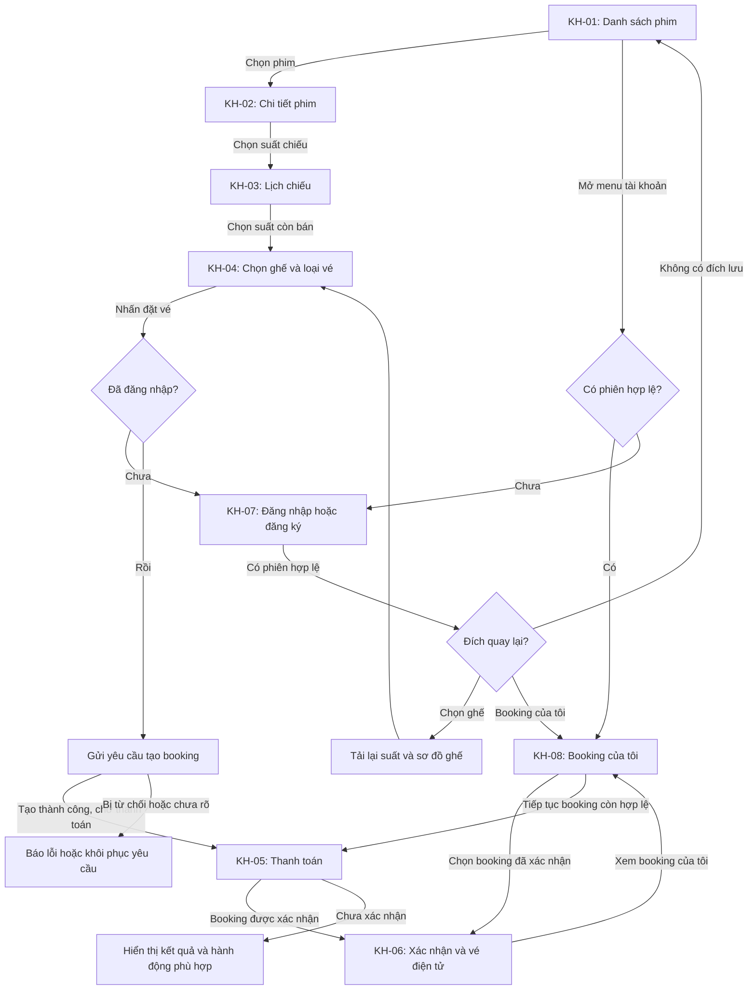
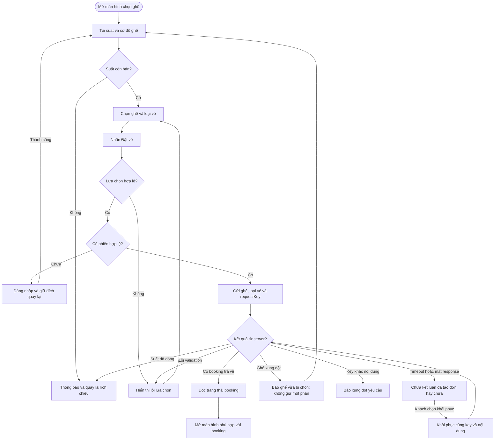
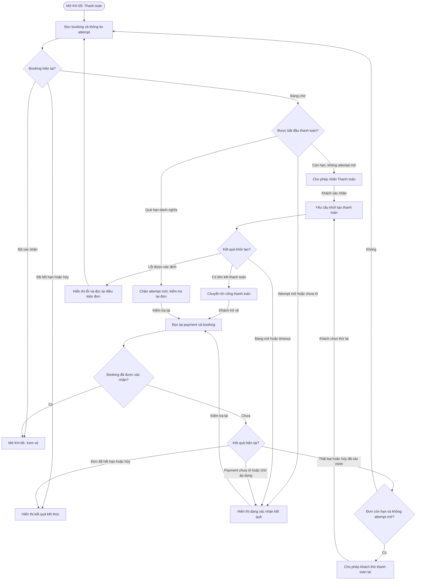

# Đặc tả màn hình khách hàng — Hệ thống quản lý rạp chiếu phim và đặt vé trực tuyến

## 1. Mục đích và cách đọc

Tài liệu mô tả nội dung, dữ liệu hiển thị, thao tác, validation, phản hồi và tiêu chí nghiệm thu của từng màn hình Customer. Phạm vi gồm xem phim → lịch chiếu → chọn ghế và loại vé → tạo booking giữ ghế → thanh toán → xem vé và lịch sử.

Các mã `KH-*` định danh màn hình, `NT-*` định danh tiêu chí nghiệm thu; không phải đường dẫn frontend hoặc mã lỗi API. Tên trường và endpoint là tham chiếu thiết kế, không thay thế hợp đồng API. Các chi tiết ghi **đề xuất UI** hoặc **chờ chốt** cần được thống nhất trước khi triển khai.

Màn hình quản trị, soát vé của nhân viên và công cụ đối soát nội bộ nằm ngoài phạm vi. Các flowchart Mermaid ở mục 4 mô tả hành động và điều hướng của khách hàng; các nhánh xử lý phụ thuộc kết quả backend.

## 2. Phạm vi màn hình và quy tắc dùng chung

### 2.1. Danh mục màn hình

| Mã | Màn hình / nhóm màn hình | Truy cập | Ngữ cảnh đầu vào | Kết quả chính |
|---|---|---|---|---|
| KH-01 | Trang chủ — danh sách phim (Home) | Công khai | Trạng thái phim, phân trang | Chọn phim. |
| KH-02 | Chi tiết phim (Movie Detail) | Công khai | `movieId` | Xem thông tin, chuyển xem lịch. |
| KH-03 | Lịch chiếu (Showtime) | Công khai | Phim, ngày | Chọn suất còn bán. |
| KH-04 | Chọn ghế và loại vé (Seat Selection) | Xem ghế công khai; tạo booking cần đăng nhập | `showtimeId`, lựa chọn cục bộ | Tạo booking, nhận hạn giữ và giá chốt. |
| KH-05 | Thanh toán (Payment) | Chủ booking đã đăng nhập | Booking; payment attempt nếu đã biết | Thanh toán, theo dõi, hủy khi đủ điều kiện. |
| KH-06 | Xác nhận đặt vé và vé điện tử (Booking Confirmation) | Chủ booking đã đăng nhập | Booking | Hiển thị booking confirmed và vé. |
| KH-07 | Đăng nhập / đăng ký | Công khai | Form; đích quay lại nếu có | Tạo tài khoản Customer hoặc phiên. |
| KH-08 | Tài khoản — booking của tôi và chi tiết booking | Customer đã đăng nhập | Phiên, phân trang, booking được chọn | Xem lịch sử, trạng thái, vé cá nhân. |

Chi tiết booking nằm trong KH-08; trang riêng hay vùng chi tiết là **đề xuất UI**, chưa chốt route. Dữ liệu và thao tác hồ sơ cá nhân được nêu tại KH-08.

### 2.2. Phạm vi nghiệp vụ

- MVP/demo vận hành một rạp; không có luồng chọn tỉnh hoặc chuyển booking giữa chi nhánh.
- Khách được duyệt phim/lịch khi chưa đăng nhập. Tạo booking, xem payment và vé cá nhân cần xác thực.
- Ghế chỉ được giữ khi backend tạo booking thành công. Chọn trên trình duyệt chưa tạo quyền giữ ghế.
- Thời hạn giữ danh nghĩa là 5 phút từ lúc tạo booking do backend xác định. Countdown không tự đổi trạng thái booking/payment/ghế.
- Một booking gắn một suất và ít nhất một đơn vị ghế; mỗi đơn vị ghế có một loại vé. Không tách thanh toán từng detail.
- Couple là một đơn vị bán cho hai người: một detail, hai vé độc lập sau xác nhận; không bán riêng hai nửa.
- Demo không có Customer hủy booking đã thanh toán, refund, loyalty, khuyến mãi phức tạp hoặc workflow tự đổi lịch/hoàn tiền khi rạp hủy suất.
- Không đưa đồ ăn/combo, đánh giá phim, định dạng 2D/3D/IMAX, đăng nhập mạng xã hội, OTP hoặc gợi ý AI vào màn hình như chức năng đã chốt: chưa có yêu cầu và contract đầy đủ.

### 2.3. Khung trang và định dạng

Màn hình dùng chung header, main và footer. Header có logo về Home, nhóm phim đang chiếu/sắp chiếu, khu vực tài khoản. Chưa đăng nhập hiện đăng nhập/đăng ký; đã đăng nhập hiện tên, booking của tôi, đăng xuất. Footer dùng thông tin rạp/liên kết tĩnh khi đã có nội dung; không tự tạo địa chỉ, điều khoản hoặc chính sách.

| Dữ liệu | Quy tắc |
|---|---|
| Tên phim/phòng/ghế/loại vé | Dùng API; nội dung lịch sử dùng snapshot backend cung cấp, không thay bằng danh mục hiện tại. |
| Tiền | VND nguyên đồng, ví dụ định dạng `100.000 ₫`. Giá cuối/tổng do server tính; không thêm phí/thuế/giảm giá tự đặt. |
| Mốc thời gian | API truyền UTC ISO 8601; hiển thị `Asia/Ho_Chi_Minh`. **Đề xuất UI:** `dd/MM/yyyy`, `HH:mm`, ghi rõ ngày khi cần. |
| Ngày phát hành | Là `date`, không dịch múi giờ như timestamp. |
| Trạng thái | Nhãn tiếng Việt; xử lý đúng mã API. Booking, payment, ticket, phân bổ ghế độc lập. |
| Mã booking/vé | Hiển thị nguyên mã server; không tự suy cấu trúc, tiền tố hoặc ngày từ mã. |
| Dữ liệu chưa có | Không bịa mô tả, ghế trống, giá, QR hoặc chính sách. Trường tùy chọn có thể ẩn/báo chưa cập nhật; thiếu trường bắt buộc cần báo lỗi dữ liệu. |

Tên trường API dùng `camelCase`, ví dụ `startsAt`, `expiresAt`, `totalAmount`, `bookingCode`, `ticketCode`.

### 2.4. Phản hồi và bảo vệ dữ liệu

| Tình huống | Hành vi UI |
|---|---|
| Tải dữ liệu / đổi điều kiện chính | Loading/skeleton trong main; giữ khung trang, chưa hiện empty. |
| Tải thành công, danh sách rỗng | Thông báo đúng ngữ cảnh; có thao tác đổi điều kiện/quay lại khi phù hợp. |
| Mạng / máy chủ lỗi | Lỗi thân thiện, thử lại request đọc; không lộ stack trace hoặc cấu hình. |
| Validation | Lỗi cạnh input theo `error.details`; giữ dữ liệu không nhạy cảm đã nhập. |
| HTTP 401 | Đăng nhập, giữ đích quay lại; tải lại trạng thái nghiệp vụ sau xác thực. |
| HTTP 403 | Không có quyền; không lộ dữ liệu người khác, không lặp chuyển đăng nhập khi phiên hợp lệ. |
| HTTP 404 | Không tìm thấy tài nguyên theo ngữ cảnh; cho về danh sách. Suất hủy không mặc nhiên là 404. |
| Đang gửi thao tác | Nút loading, chặn gửi trùng trong UI; backend vẫn cần idempotency. |
| Đăng xuất / đổi tài khoản | Xóa dữ liệu riêng tư trên UI và state tài khoản cũ; về Home. Đăng xuất không tự hủy booking server. |

Phân nhánh theo `error.code` khi contract đã chốt, không so chuỗi thông báo để quyết định thanh toán thành công hoặc ghế đã nhả. Danh sách mã lỗi cụ thể cần thống nhất với hợp đồng API.

Không lưu mật khẩu, dữ liệu thẻ, secret cổng vào URL, log hoặc state lưu bền vững. Tài liệu không chốt nơi lưu token, refresh token hay cơ chế thu hồi mới. Backend kiểm tra role/ownership; ẩn nút hoặc biết UUID không thay quyền truy cập.

### 2.5. Responsive và khả năng thao tác

Desktop ≥ 1024px, tablet 768–1023px, mobile < 768px. Grid phim lần lượt 3/2/1 cột. Payment/Confirmation một cột. Ghế cuộn ngang trong khối trên mobile, tránh cuộn ngang toàn trang; vùng bấm ghế tối thiểu 44px. Kích thước kiểm tra: 320px, 768px, 1024px, 1440px.

**Đề xuất UI:** input có nhãn, focus bàn phím rõ, ghế có tên truy cập gồm nhãn/loại/trạng thái; không chỉ dùng màu; modal quản lý focus/hỗ trợ Escape; lỗi quan trọng vẫn đọc được ngoài toast. Countdown không cần được công cụ hỗ trợ đọc lại mỗi giây. Đây không phải tuyên bố đã đạt chứng nhận accessibility.

## 3. Đặc tả từng màn hình

Mỗi màn hình gồm mục tiêu, nội dung, thao tác, phản hồi và tiêu chí nghiệm thu. Trường dữ liệu chưa được xác định đầy đủ được ghi chú tại màn hình tương ứng.

### 3.1. KH-01 — Trang chủ / danh sách phim

#### Mục tiêu và điều kiện vào

Giúp khách tìm phim đang chiếu hoặc sắp chiếu và mở chi tiết phim. Truy cập công khai, không tạo booking hoặc payment khi tải trang.

#### Nội dung và dữ liệu

| Vùng | Nội dung | Nguồn / giới hạn |
|---|---|---|
| Tiêu đề và phân nhóm | “Phim đang chiếu”, “Phim sắp chiếu”; nhóm hiện tại có dấu hiệu được chọn | `now_showing`, `coming_soon` từ query/response. Không tự suy từ ngày phát hành. |
| Danh sách card | Poster, tên phim, nhãn phân loại tuổi, nhãn trạng thái | DTO danh sách: `id`, `title`, `posterUrl`, `ageRating`, `status`; có `durationMinutes` nếu thiết kế hiển thị thời lượng. |
| Phân trang | Chuyển trang hoặc tải thêm | Dùng `pagination.page`, `pageSize`, `totalItems`, `totalPages`; chọn một cách tương tác khi review UI. |
| Ảnh thiếu / hỏng | Khung thay thế có tên phim hoặc mô tả ảnh | **Đề xuất UI**; không lấy poster của phim khác để thay. |
| Banner | Không bắt buộc cho luồng nghiệp vụ | Chỉ hiển thị khi có nội dung được cung cấp; không tạo khuyến mãi giả. |

Dùng định danh phim, không dùng tên phim để điều hướng vì có thể trùng tên. Phim `archived` không xuất hiện trong danh sách Customer; không gom `ended` vào nhóm đang chiếu. Khi truy cập trực tiếp một phim đã ngừng hiển thị, phản hồi theo kết quả backend.

#### Thao tác và trạng thái

1. Vào trang: tải `GET /api/movies?status=...&page=...&pageSize=...` theo nhóm đang xem.
2. Đổi nhóm hoặc trang: cập nhật danh sách, hiển thị loading; không trộn kết quả của nhóm trước vào nhóm mới. **Đề xuất UI:** khi đổi nhóm, trở về trang đầu.
3. Nhấn card / “Xem chi tiết”: mở KH-02 với đúng `id` của phim; không tạo booking.
4. Rỗng: “Hiện chưa có phim trong danh sách này”; vẫn cho đổi nhóm.
5. Lỗi: “Không tải được danh sách phim” và “Thử lại”; giữ nhóm đang xem.

**Chờ chốt:** tìm kiếm theo từ khóa, lọc thể loại và sắp xếp chưa có hợp đồng dữ liệu đầy đủ. Không trình bày tìm kiếm trên một trang dữ liệu như tìm kiếm toàn bộ kho phim.

#### Tiêu chí nghiệm thu

- **NT-01:** API trả danh sách hợp lệ thì card hiển thị đúng dữ liệu và mở đúng phim, kể cả hai phim trùng tên.
- **NT-02:** Đổi nhóm/phân trang không lẫn dữ liệu; loading, rỗng, lỗi được phân biệt; không hiển thị phim archived trong danh sách Customer.
- **NT-03:** Thiếu poster hoặc age rating không làm hỏng trang và không tạo thông tin thay thế sai; grid hoạt động ở các kích thước mục 2.5.

### 3.2. KH-02 — Chi tiết phim

#### Mục tiêu và điều kiện vào

Cung cấp thông tin phim, giúp khách quyết định xem lịch chiếu. Truy cập công khai theo định danh phim; tải lại trực tiếp phải đọc từ API, không phụ thuộc bắt buộc vào card đã bấm trước đó.

#### Nội dung và bố cục

Desktop: poster bên trái, thông tin và hành động bên phải. Trên màn hình hẹp, **đề xuất UI** xếp poster/thông tin thành một cột, ưu tiên tên phim và nút xem lịch.

| Nội dung | Trường DTO dự kiến | Hành vi khi không có |
|---|---|---|
| Tên phim | `title` | Dữ liệu bắt buộc; báo lỗi dữ liệu nếu thiếu. |
| Poster | `posterUrl` | Khung thay thế, giữ tên phim đọc được. |
| Thời lượng | `durationMinutes` | Không tự lấy thời lượng phim khác hoặc mặc định một giá trị. |
| Mô tả | `description` | “Nội dung đang được cập nhật” hoặc ẩn khối theo thiết kế. |
| Ngôn ngữ | `language` | Không suy phụ đề/lồng tiếng hoặc ngôn ngữ suất từ ngôn ngữ gốc. |
| Phân loại tuổi | `ageRating` | Hiển thị đúng nhãn nhận được; không đổi `PG-13` thành `T13`/`T16`. |
| Ngày phát hành | `releaseDate` | Không tự suy thời điểm mở bán. |
| Thể loại | `genres` | Hiển thị tên/mã được API cung cấp; mảng rỗng không phát sinh thể loại giả. |
| Trailer | `trailerUrl` | Chỉ có thao tác xem trailer khi có URL; nhúng hay mở liên kết là đề xuất UI. |
| Trạng thái | `status` | Ánh xạ nhãn theo đúng giá trị; không tự đổi trạng thái theo ngày. |

Không bổ sung đạo diễn, diễn viên, đánh giá sao, doanh thu hay quốc gia như dữ liệu đã có: chưa có hợp đồng dữ liệu cho các trường đó. Nhãn tuổi là thông tin hiển thị; chưa có contract xác minh tuổi khách từ nhãn này.

#### Thao tác và trạng thái

- Tải `GET /api/movies/{movieId}` khi vào trang hoặc đổi phim.
- “Chọn suất chiếu” mở KH-03 với cùng phim. KH-03 có thể trả danh sách rỗng; không giả định `now_showing` luôn có suất hoặc `coming_soon` chắc chắn chưa được bán.
- Nếu thiết kế hiển thị suất ngay trong chi tiết phim, dùng cùng quy tắc KH-03; không tạo bộ quy tắc bán vé thứ hai. Cách gộp trang và route cần được thống nhất khi thiết kế.
- 404: “Không tìm thấy phim”, có hành động về danh sách. Mất mạng/lỗi server có “Thử lại”, không thông báo nhầm là phim không tồn tại.
- Chưa có endpoint lịch chiếu thành công thì không hiển thị số suất hoặc giờ chiếu tự tạo. Backend vẫn quyết định phim/suất có được bán khi tạo booking.

#### Tiêu chí nghiệm thu

- **NT-04:** Vào trực tiếp theo định danh vẫn tải đúng phim; trường tùy chọn thiếu không tạo dữ liệu giả; trailer chỉ xuất hiện khi có dữ liệu.
- **NT-05:** Nút xem lịch giữ đúng phim; 404, lỗi tải và chưa có suất có thông báo khác nhau.

### 3.3. KH-03 — Lịch chiếu

#### Mục tiêu và điều kiện vào

Cho khách xem suất theo phim/ngày và chọn suất còn bán. Công khai; nhận phim đang xem và ngày được chọn.

#### Nội dung và dữ liệu

| Vùng | Nội dung | Nguồn / điều kiện |
|---|---|---|
| Ngữ cảnh phim | Tên phim, có thể kèm poster nhỏ | Chi tiết phim đã tải hợp lệ hoặc API movie. Không suy tên từ UUID. |
| Chọn ngày | Ngày đang xem; tabs/dropdown theo thiết bị | Query `date` của API lịch. Dải ngày mở bán và ngày mặc định chưa được quy định. |
| Suất chiếu | Giờ bắt đầu, ngày, tên phòng, giá cơ sở, tình trạng có thể đặt | DTO: `id`, `cinemaRoomId`, `cinemaRoomName`, `startsAt`, `basePrice`, `currency`, `status`, `bookingAvailable`. |
| Thông tin rạp | Tên/địa chỉ nếu có dữ liệu phù hợp | Cần được cung cấp cùng ngữ cảnh suất; không tự suy địa chỉ hoặc rạp từ tên phòng. |
| Ghi chú giá | Giá cơ sở cho một người; giá cuối tùy loại ghế/loại vé | Không gọi `basePrice` là tổng thanh toán hoặc giá cuối của Couple/VIP. |

Ngày nằm trên danh sách suất; suất xếp theo giờ hoặc nhóm ngày. **Đề xuất UI:** ngày đang chọn luôn đọc được và mỗi nút suất thể hiện đủ giờ/phòng. Không tự chốt cửa sổ 7/14 ngày, nhãn “hôm nay” theo UTC hoặc số ghế còn lại khi API không trả.

#### Điều kiện chọn và tải lại

1. Gọi `GET /api/movies/{movieId}/showtimes?date=...` khi vào trang/đổi ngày. Ngày phải thống nhất với ngày hiển thị tại Việt Nam; ngữ nghĩa lọc ngày cần thống nhất với backend.
2. Chỉ cho chuyển chọn ghế khi suất `scheduled` và `bookingAvailable = true` theo dữ liệu backend. Kiểm tra này phục vụ UI; backend vẫn kiểm tra lại lúc tạo booking.
3. `draft`, `in_progress`, `completed`, `cancelled` không phải suất nhận booking mới. Không tự áp cutoff 10/15/30 phút trước giờ chiếu.
4. Danh sách chỉ có suất còn bán. Nếu API không trả suất đóng/hủy thì không tạo ô suất giả; nếu dữ liệu đã hiển thị bị thay đổi/không còn bán, vô hiệu thao tác và làm mới.
5. Chọn suất hợp lệ: mở KH-04 với `showtimeId`, không chỉ truyền tên phòng/giờ vì các giá trị đó có thể trùng.

#### Loading, rỗng và lỗi

- Đổi ngày: loading cho khối suất, vẫn giữ ngữ cảnh phim. **Đề xuất UI:** bỏ qua response cũ nếu người dùng đã đổi ngày khác.
- Không có suất: “Chưa có suất chiếu cho ngày đã chọn”; cho đổi ngày hoặc về phim.
- 404: xử lý phim/suất không tìm thấy theo tài nguyên được API báo, không mặc định mọi 404 là suất hủy.
- Lỗi mạng: thử lại cùng phim/ngày; không giữ nút đặt có thể bấm dựa trên dữ liệu lỗi thời.
- Hết ghế chỉ được kết luận nếu API có dữ liệu xác nhận; `bookingAvailable` chưa được đặc tả là số ghế tồn kho.

#### Tiêu chí nghiệm thu

- **NT-06:** Đổi ngày gửi đúng ngữ cảnh, hiển thị đúng ngày/giờ Việt Nam và không lẫn response của ngày trước.
- **NT-07:** Chỉ suất được backend cho bán mới dẫn tới chọn ghế; khi suất đóng trong lúc khách đang xem, request tạo booking vẫn bị kiểm tra lại.
- **NT-08:** Danh sách rỗng có cách đổi ngày; giá cơ sở không bị hiển thị thành giá cuối; UI không tự đặt mốc đóng bán.

### 3.4. KH-04 — Chọn ghế và loại vé

#### Mục tiêu, quyền truy cập và hai giai đoạn

Khách chọn các đơn vị ghế cho một suất, chọn loại vé rồi gửi yêu cầu tạo booking.

| Giai đoạn | Dữ liệu và quyền giữ ghế | Hành vi |
|---|---|---|
| Trước khi tạo booking | Lựa chọn cục bộ; API xem ghế công khai | Chọn/bỏ chọn, đổi loại vé. **Chưa chạy countdown giữ ghế.** Yêu cầu đăng nhập trước khi gửi tạo booking. |
| Sau khi tạo thành công | Booking `pending`, toàn bộ detail `held`, có `expiresAt` và giá snapshot | Chuyển KH-05. Nếu quay lại KH-04 trong ngữ cảnh booking cũ, không sửa trực tiếp ghế/loại vé của booking đã tạo. |

Theo navigation hiện tại, API xem ghế là public nhưng chưa chốt riêng guard cho trang ghế. **Đề xuất UI:** cho xem sơ đồ trước đăng nhập và yêu cầu xác thực tại hành động đặt; sau đăng nhập tải lại suất/ghế trước khi tiếp tục. Không tự gửi POST đặt vé chỉ vì hoàn tất đăng nhập.

#### Bố cục và thành phần

- Thông tin đầu trang: tên phim, ngày/giờ suất, phòng và rạp nếu API cung cấp; có hành động quay lại lịch.
- Khối sơ đồ: các hàng `rowLabel`, các ghế `seatNumber`, phân biệt Standard/VIP/Couple, chú thích trạng thái. **Đề xuất UI:** có nhãn “Màn hình” để định hướng; vị trí thực và lối đi phải có dữ liệu phù hợp, không suy từ số ghế.
- Khối lựa chọn: nhãn ghế, loại ghế, số chỗ, loại vé áp dụng và thông tin giá được server cung cấp. Không bắt buộc sơ đồ có số hàng/cột cố định.
- Vùng thông tin liên hệ trước khi tạo booking là nhu cầu còn thiếu contract; xem phần thông tin liên hệ bên dưới.
- Hành động chính “Đặt vé”; hành động quay lại. Desktop hai cột sơ đồ/tóm tắt; tablet tóm tắt dưới sơ đồ; mobile có bottom bar tổng hợp và nút đặt, không che các hàng ghế cuối.

#### Dữ liệu cần dùng

| Dữ liệu | Nguồn hiện có | Giới hạn |
|---|---|---|
| Ngữ cảnh suất | `GET /api/showtimes/{showtimeId}` được liệt kê ở endpoint | Chưa có DTO chi tiết cho endpoint này; cần phim/phòng/giờ/tình trạng bán, không tự bịa response. |
| Sơ đồ và phân bổ | `GET /api/showtimes/{showtimeId}/seats` | DTO có `showtimeId`, `rows[].rowLabel`, `seats[].id`, `seatNumber`, `seatTypeCode`, `capacityUnits`, `surchargeAmount`, `status`. |
| Trạng thái vật lý | Tình trạng ghế: `active`, `maintenance`, `inactive` | Cần phân biệt ghế bảo trì/ngừng hoạt động với trạng thái giữ/bán để khóa thao tác đúng. |
| Loại vé | `GET /api/ticket-types` có trong danh mục endpoint | Chưa có DTO; cần ID, tên/mã, trạng thái áp dụng và điều kiện được backend xác định. |
| Giá trước đặt | Có base price ở lịch và surcharge ở sơ đồ | Chưa có API báo giá chi tiết/tổng cho lựa chọn; không tự tính giá trên frontend. |
| Kết quả booking | `POST /api/bookings` | DTO dự kiến trả booking, giá chốt và hạn giữ; là dữ liệu có thẩm quyền sau tạo. |

Không tự thêm WebSocket, SignalR hoặc tần suất polling cố định. Tải sơ đồ khi vào lại và khi cần cập nhật sau xung đột; cơ chế tự cập nhật định kỳ cần nhóm thống nhất. Sơ đồ đọc trước đó không bảo đảm ghế vẫn trống lúc gửi đặt.

#### Trạng thái ghế và thao tác

| Trạng thái / đặc tính | Hiển thị và điều kiện thao tác |
|---|---|
| Khả dụng | Có thể chọn khi ghế hoạt động, suất còn bán và chưa có phân bổ hiệu lực theo server. |
| Đang chọn | Đánh dấu lựa chọn trong phiên, có thể bỏ chọn trước tạo booking. Đây không phải `held` trong database. |
| `held` | Hiện đang được giữ, không cho người khác chọn. Không lộ danh tính chủ giữ. |
| `sold` | Hiện đã bán, không cho chọn. |
| `maintenance` / `inactive` | Không cho chọn dù không có detail held/sold; contract phải cung cấp cách phân biệt với ghế khả dụng. |
| Couple | Chọn/bỏ chọn nguyên đơn vị; một `seatId`, một `ticketTypeId`, sức chứa 2. Không gửi hai item trùng ghế. |

Một ghế Couple hiển thị rộng hơn theo đặc tả component; không suy rằng nó luôn nằm ở hàng cuối hoặc phải ghép hai ghế liên tiếp. Số ghế đang chọn và số chỗ/người phải phân biệt: chọn một ghế Standard và một Couple là hai đơn vị ghế, ba chỗ, dự kiến ba vé sau xác nhận.

Mỗi đơn vị ghế có một loại vé; các detail của cùng booking có thể khác loại vé. Couple bản đầu dùng `ADULT`; không tự cho hai người trên Couple dùng hai loại vé khác nhau. Điều kiện áp dụng vé trẻ em/sinh viên và cách xác minh cần được chốt trước khi cho chọn.

**Giới hạn giá:** phụ thu tính một lần trên mỗi đơn vị ghế; giảm theo loại vé chỉ tính trên phần giá cơ sở. UI cần giải thích “Mức giảm áp dụng trên giá cơ sở, không áp dụng cho phụ thu ghế”. Frontend không tự tính một con số rồi hiển thị như báo giá chính thức. Khi chưa có contract báo giá, có thể hiện các thành phần tham khảo đã nhận và thông báo “Giá chốt được trả về khi tạo booking”; cách cung cấp và hiển thị tổng tạm tính cần được thống nhất.

#### Thông tin liên hệ

Thông tin liên hệ gồm email và điện thoại tùy chọn. Cần thống nhất lấy từ tài khoản hay cho khách nhập riêng, thời điểm xác nhận và các trường trao đổi với backend.

**Đề xuất UI chờ contract:** xác nhận email và điện thoại tùy chọn trước POST tạo booking; có thể điền từ hồ sơ nếu API cung cấp và chính sách cho phép. Cần nhóm chốt lấy tự động từ tài khoản hay cho nhập riêng. Không tự thêm field request hoặc giả định sửa liên hệ sau tạo đã được hỗ trợ. Không hiển thị thông báo đã gửi email khi chưa có kết quả gửi được xác nhận; gửi vé qua email không thuộc MVP.

#### Validation và gửi yêu cầu

1. Chưa có ghế: nút đặt disabled. Khi đang gửi: khóa lựa chọn và ngăn gửi trùng. Cần có loại vé hợp lệ cho từng ghế trước khi gửi.
2. Ghế không lặp, thuộc phòng của cùng suất, đang hoạt động; loại vé phải được backend kiểm tra. Không đặt giới hạn tối đa 6/8/10 vé, không tự cấm ghế lẻ hoặc ép ghế liền kề khi chưa có business rule.
3. Khi chưa đăng nhập: đi đăng nhập và giữ ngữ cảnh phù hợp; quay lại phải kiểm tra sơ đồ mới vì ghế có thể đã bị chiếm.
4. Gửi đúng cấu trúc dự kiến: `showtimeId`, `requestKey`, `items[]` gồm `seatId`, `ticketTypeId`. Không gửi giá, mức giảm, tổng tiền, status hay snapshot.
5. Dùng cùng `requestKey` và cùng nội dung cho retry của cùng một ý định đặt. Không sinh key mới sau timeout khi chưa biết request trước đã tạo booking hay chưa.
6. Cùng key/cùng nội dung trả booking cũ (HTTP 200 khi replay); tạo mới trả 201. Phải xử lý trạng thái booking trả về hiện tại, kể cả đã expired/confirmed; không luôn coi replay là một lần giữ ghế mới.
7. Nếu khách đổi nội dung, đó là ý định mới; không sửa payload dưới key cũ. Chuẩn hóa nội dung yêu cầu theo hợp đồng đã thống nhất; frontend không tự đặt quy tắc fingerprint.
8. Thành công: lấy `bookingId`, `bookingCode`, `status`, `expiresAt`, `totalAmount`, `currency`, `details` từ response và chuyển KH-05. Countdown tính từ hạn server, không bắt đầu lại 5 phút ở trang mới.

#### Xung đột, timeout và đổi lựa chọn

| Tình huống | Phản hồi |
|---|---|
| `SEAT_ALREADY_TAKEN` | Thông báo ghế vừa bị giữ/bán; làm mới sơ đồ và nêu ghế xung đột nếu API cung cấp. Không báo các ghế còn lại đã được giữ: transaction từ chối toàn bộ. |
| `SHOWTIME_CLOSED` | Chặn tạo booking, thông báo suất không còn nhận đặt; cho về KH-03. |
| `REQUEST_KEY_CONFLICT` | Báo yêu cầu đặt bị xung đột nội dung; không âm thầm coi là thành công hoặc tạo nhiều key để thử liên tục. |
| Timeout / mất response POST | Kết quả chưa biết; cho khôi phục bằng cùng key/payload, không coi như chưa có đơn. Cơ chế khôi phục yêu cầu sau reload cần được thống nhất. |
| Loại vé không hợp lệ | Hiển thị lỗi nghiệp vụ, yêu cầu chọn lại loại vé được backend cho phép; không tự bỏ giảm giá mà vẫn giữ tổng hiển thị cũ. |
| Back trước tạo booking | Có thể giữ lựa chọn cục bộ, nhưng tải lại suất/ghế và đối chiếu trước khi gửi. |
| Back sau tạo booking | Không tự hủy; không tự gia hạn hoặc sửa booking cũ. Muốn đổi ghế phải qua luồng hủy hợp lệ rồi đặt mới. |

#### Tiêu chí nghiệm thu

- **NT-09:** Chọn ghế không làm countdown chạy và không thể hiện quyền giữ trước response thành công; ghế held/sold/bảo trì không chọn được.
- **NT-10:** Couple được chọn nguyên đơn vị; một Couple tạo một item, hiển thị hai chỗ và hai vé dự kiến; không cho tách loại vé cho hai nửa.
- **NT-11:** Hai khách gửi cùng ghế: chỉ một booking giữ được; request chứa một ghế xung đột và một ghế trống không giữ một phần.
- **NT-12:** Timeout/retry cùng key không tạo đơn thứ hai, không reset hạn; payload khác dưới key cũ được báo xung đột.
- **NT-13:** Giá chốt chỉ lấy từ server; không gửi giá/giảm/trạng thái; thông tin liên hệ và báo giá trước đặt phải được chốt contract trước khi nghiệm thu tích hợp đầy đủ.

### 3.5. KH-05 — Thanh toán

#### Mục tiêu và điều kiện vào

Cho chủ booking xem số tiền đã chốt, bắt đầu thanh toán khi hợp lệ và theo dõi kết quả thực tế. Truy cập bằng định danh booking, không tạo booking mới khi mở trang.

Khi vào trực tiếp, reload, quay lại từ cổng hoặc quay lại bằng Back/Forward, đọc lại booking từ backend. Không dùng query string “thành công”, local state hoặc đồng hồ trên thiết bị làm bằng chứng đã thanh toán.

#### Nội dung hiển thị

| Khối | Nội dung | Nguồn / giới hạn |
|---|---|---|
| Tóm tắt | Mã booking, phim, ngày/giờ, phòng, các ghế, loại ghế/vé | `GET /api/bookings/{bookingId}`; Cần có đủ ngữ cảnh phim/suất/phòng để khách kiểm tra trước thanh toán. |
| Chi tiết giá | Giá chốt mỗi đơn vị ghế và tổng tiền VND | `details[].unitPrice`, `totalAmount`, `currency`; phân rã base/phụ thu/giảm còn thiếu DTO. Không lấy bảng giá hiện tại tính lại. |
| Hạn giữ | Countdown theo `expiresAt`, nhãn thời gian còn lại | Không khởi động lại khi reload hoặc chuyển trang. Khi bằng 0, xác minh trạng thái server trước khi hiển thị đã expired. |
| Thanh toán | Cổng/phương thức đang được hỗ trợ, trạng thái đang xử lý | Chỉ hiện cổng/phương thức được cấu hình; chưa chốt cổng cụ thể nên không tự dựng danh sách ví/ngân hàng. |
| Kết quả | Trạng thái booking và attempt đang theo dõi | DTO payment: `paymentId`, `bookingId`, `status`, `amount`, `currency`; Không suy booking đã xác nhận chỉ từ payment thành công. |
| Hành động | Thanh toán, kiểm tra lại, hủy booking/đổi ghế khi hợp lệ | Điều kiện theo bảng dưới; backend chốt cuối cùng. |

Một cột, tóm tắt phía trên form/thao tác. **Đề xuất UI:** tổng tiền và cảnh báo hết hạn đặt gần nút chính; trạng thái đang xác nhận nằm ngay trong nội dung trang, không chỉ là toast.

#### Luồng bắt đầu thanh toán

1. Tải booking, kiểm tra ownership và trạng thái. Nếu đã confirmed, mở KH-06; nếu expired/cancelled, hiện trạng thái kết thúc, không tạo attempt mới.
2. Chỉ bắt đầu khi booking pending còn hạn theo server và không có attempt `created`/`pending`/`unknown`. Nút “Thanh toán” disabled trong lúc gửi hoặc có attempt mở.
3. Gọi `POST /api/payments` với `bookingId`, `provider` theo cấu hình được chốt. Client không gửi `amount`, `currency`, mức giảm hoặc trạng thái để quyết định số tiền thu.
4. Response dự kiến có `paymentId`, `status`, `amount`, `currency`, `payUrl`. Lưu liên hệ giữa attempt và booking trong ngữ cảnh UI; khi cần, điều hướng đến `payUrl` do backend cung cấp. Kiểu chuyển trang và return URL còn phụ thuộc cổng, không tự chốt popup hoặc form thu dữ liệu thẻ trong website.
5. Sau khi khách trở về hoặc khi kiểm tra kết quả: đọc `GET /api/payments/{paymentId}` và booking. Không gọi `POST /api/payments/callback` từ frontend để tự xác nhận giao dịch; webhook là tương tác của cổng với backend.
6. Chỉ chuyển kết quả thành công KH-06 khi backend xác nhận booking `confirmed`. `payment.status = succeeded` riêng lẻ chưa chứng minh payment đã được áp dụng hoặc vé đã phát hành.
7. Cách polling, chu kỳ, điều kiện dừng và return route chưa có contract đầy đủ. **Đề xuất UI:** có “Kiểm tra lại” gọi API đọc; không biến nó thành thao tác tạo attempt mới.

Không tự bổ sung `requestKey` cho API payment: DTO hiện chưa có field này. Cách khôi phục attempt sau timeout/reload phải theo hợp đồng API được thống nhất.

#### Ma trận trạng thái và hành động

| Dữ liệu backend / tình huống | Hiển thị | Thanh toán mới / retry |
|---|---|---|
| Pending còn hạn, xác định không có attempt mở | “Đang chờ thanh toán”, countdown còn lại | Cho tạo attempt khi backend chấp nhận. |
| Attempt `created` | “Đang khởi tạo thanh toán” | Chặn tạo attempt song song. Không hiện nút bấm lại chỉ vì chưa có `payUrl`. |
| Attempt `pending` | “Thanh toán đang được xử lý” | Chặn attempt mới, tiếp tục kiểm tra trạng thái. |
| Attempt `unknown` / timeout khởi tạo | “Kết quả thanh toán đang được xác nhận” | Không tự kết luận thất bại, không tự retry thu tiền; đọc/khôi phục attempt hiện tại theo contract. |
| Attempt `failed` / `cancelled`, booking vẫn pending còn hạn, không còn attempt mở | Thông báo thất bại/hủy của lần thử, giữ thông tin đơn | Cho thử lại khi backend xác nhận điều kiện; không reset `expiresAt`. |
| Payment succeeded, booking chưa confirmed | “Đang kiểm tra kết quả đặt vé” hoặc thông báo cần kiểm tra khi server cung cấp bằng chứng phù hợp | Không phát QR, không báo đặt vé thành công, không mời trả tiền lần nữa chỉ vì chưa có vé. |
| Booking confirmed | Hiển thị xác nhận, mở vé | Không thanh toán lại. |
| Countdown = 0 nhưng booking vẫn pending | “Đã qua hạn giữ ghế; đang kiểm tra trạng thái đơn” | Chặn bắt đầu thanh toán mới; không tự đổi booking thành expired. |
| Pending quá hạn, attempt còn mở / cần đối soát | “Kết quả thanh toán đang được xác nhận” | Không tự giải phóng ghế hoặc mở lại lượt thanh toán. |
| Booking expired / cancelled | Hiện kết quả kết thúc của đơn; cho xem lịch/chọn lại qua booking mới | Không tái mở booking cũ, không nhận thanh toán cho đơn cũ. |

Countdown hiển thị hạn giữ danh nghĩa. Khi hết giờ, giao diện kiểm tra kết quả server; nếu payment còn chưa rõ, hiển thị đang xác nhận và không tự công bố ghế đã nhả. Không hứa một thời gian chờ cố định khi chưa có cam kết xử lý.

Giao diện chỉ chuyển sang xác nhận khi server trả booking `confirmed`; không tự quyết định xác nhận hoặc hết hạn từ kết quả thanh toán riêng lẻ.

#### Hủy booking / hủy thanh toán để đổi ghế

| Điều kiện | Thao tác và kết quả mong đợi |
|---|---|
| Chủ booking, pending, chưa có payment áp dụng và không còn attempt mở | Hiện “Hủy booking”; xác nhận hủy, gửi `POST /api/bookings/{bookingId}/cancel`; chỉ báo thành công sau response và trạng thái cập nhật. |
| Có attempt created/pending/unknown | Yêu cầu backend kiểm tra/hủy với cổng: cổng xác nhận chưa thu thì mới hủy payment, booking và nhả ghế. Không coi đóng cửa sổ cổng là hủy thành công. |
| Cổng báo đã thu / chưa rõ | Backend từ chối hủy; UI giữ thông tin booking/payment và hướng dẫn đợi kiểm tra, không điều hướng như đã được giải phóng ghế. |
| Confirmed / expired / cancelled hoặc không phải chủ | Không cho thực hiện hủy theo luồng Customer này. Backend vẫn kiểm tra nếu request bị gửi trực tiếp. |

**Đề xuất UI:** nhãn “Hủy thanh toán / Đổi ghế” với giải thích phải chờ hệ thống xác nhận, modal xác nhận và loading cho yêu cầu. Trong khi một request đang gửi, chặn nhấn lặp. Kết quả đang xử lý/từ chối/thành công và mã lỗi cần được thống nhất với backend; không tự tạo endpoint hủy payment mới.

Khi hủy thành công, cho trở về chọn ghế/lịch và tạo booking mới. Ghế được nhả không đồng nghĩa sẽ tiếp tục khả dụng cho khách cũ; người khác có thể giữ sau đó. Không hủy một phần hoặc sửa ghế trong booking cũ.

#### Lỗi và kết quả không chắc chắn

- `PAYMENT_ATTEMPT_OPEN`: đọc/khôi phục attempt hiện tại khi API hỗ trợ; không lặp POST để vượt ràng buộc. Điều kiện attempt mở gồm cả `created`, dù một số ví dụ lỗi chỉ nhắc pending/unknown.
- `BOOKING_EXPIRED`: tải lại booking, hiển thị hết hạn theo server; không tự đặt mọi payment của đơn thành failed.
- `BOOKING_ALREADY_CONFIRMED`: đọc lại booking và vé, không tạo thanh toán khác.
- `BOOKING_NOT_CANCELLABLE`: tải lại trạng thái; giải thích theo thông tin server đã lọc; không chuyển màn hình như hủy xong.
- GET payment lỗi mạng: đây là lỗi đọc trạng thái, không phải kết quả tài chính failed. POST payment timeout cũng không đủ chứng minh chưa tạo attempt.
- Payment thành công muộn trên booking expired/cancelled: không hiện vé giả, không chiếm lại ghế, không tự hứa hoàn tiền hoặc thời hạn hoàn. `refund_required` nếu sau này được API cung cấp chỉ biểu thị hồ sơ cần xử lý, không phải đã hoàn tiền.
- Tổng/tiền tệ payment khác booking trong response: thông báo không thể tiếp tục xác nhận và yêu cầu kiểm tra lại; không tự sửa giá đơn hoặc đánh dấu payment failed. Cách trả trạng thái an toàn cần contract backend.

Nếu không có `paymentId` sau reload và booking response không cho biết attempt đang mở, UI chưa thể khôi phục đầy đủ trạng thái thanh toán. Không thể kết luận “không có attempt” chỉ vì state trình duyệt trống. Cần có cách khôi phục thông tin attempt từ server trước khi quyết định thao tác tiếp theo.

#### Tiêu chí nghiệm thu

- **NT-14:** Mã, ghế, giá chốt và countdown lấy từ booking server; reload/chuyển trang không gia hạn và không tạo booking mới.
- **NT-15:** Chặn attempt song song cho cả created/pending/unknown; timeout đọc/ghi không biến thành kết luận failed hoặc tự thu lần hai.
- **NT-16:** Chỉ booking confirmed dẫn tới xác nhận thành công; query string của cổng hoặc payment succeeded riêng lẻ không đủ.
- **NT-17:** Countdown về 0 không tự nhả ghế hoặc hủy payment; UI phân biệt quá hạn danh nghĩa, backend expired và kết quả đang đối soát.
- **NT-18:** Hủy/đổi ghế chỉ hoàn tất theo backend; khi cổng xác nhận chưa thu thì có thể hủy, khi đã thu/chưa rõ thì không báo đã nhả ghế.
- **NT-19:** Payment thành công sau booking expired/cancelled không tạo vé hoặc hứa hoàn tiền tự động; retry hợp lệ giữ nguyên giá và hạn booking.

### 3.6. KH-06 — Xác nhận đặt vé và vé điện tử

#### Mục tiêu và điều kiện hiển thị thành công

Xác nhận booking của khách đã `confirmed`, hiển thị các vé được backend phát hành.

Trang được mở sau KH-05, từ lịch sử hoặc bằng truy cập trực tiếp theo định danh hợp lệ. Mọi trường hợp phải tải `GET /api/bookings/{bookingId}`; không dựng vé từ danh sách ghế đã chọn hoặc từ kết quả redirect của cổng.

#### Bố cục và dữ liệu

Một cột: thông báo xác nhận → mã booking → thông tin phim/suất/phòng/ghế → các thẻ vé → điều hướng. Không tiếp tục chạy countdown giữ ghế trên booking đã confirmed.

| Khối | Nội dung | Nguồn / giới hạn |
|---|---|---|
| Kết quả | “Đặt vé thành công” khi booking confirmed | `status`, `confirmedAt` theo DTO booking dự kiến. |
| Booking | `bookingCode`, tổng tiền, tiền tệ, thời điểm xác nhận | Không tự format lại mã thành cấu trúc `BK-ngày-số`. |
| Suất và ghế | Phim, ngày/giờ Việt Nam, phòng, ghế, loại ghế/vé | Nội dung lịch sử do backend cung cấp; cần đủ ngữ cảnh để khách nhận diện đúng vé. |
| Mỗi vé | Mã riêng, QR riêng, nhãn ghế, trạng thái vé | `tickets[]` hiện có `ticketCode`, `seatLabel`, `qrCodeUrl`, `status`. Cách cấp ảnh và nội dung QR phải thống nhất với backend. |
| Hướng dẫn | Xuất trình mã vé/QR khi vào rạp, mỗi người dùng vé của mình | Thời gian được phép soát vé chưa chốt; không tự đưa ra một mốc trước/sau giờ chiếu. |

Mỗi Standard/VIP sức chứa 1 có một vé; Couple sức chứa 2 có hai vé với mã độc lập. Hai vé Couple có thể cùng nhãn ghế nhưng phải là hai mã khác nhau. **Đề xuất UI:** gom theo ghế Couple và ghi “Vé 1/2”, “Vé 2/2” để phân biệt; không tạo hậu tố mới trong `ticketCode` hoặc tách thành hai seatId.

| Ticket status | Nhãn hiển thị | Hành vi |
|---|---|---|
| `valid` | “Chưa sử dụng” | Hiển thị mã/QR đã phát hành; không suy vé chắc chắn được chấp nhận ở mọi thời điểm vì cửa sổ soát còn OPEN. |
| `used` | “Đã sử dụng” | Giữ lịch sử, không hiện như vé mới chưa dùng. Thời điểm sử dụng chỉ hiện khi API cung cấp. |
| `voided` | “Đã vô hiệu hóa” | Không hiện như vé có thể dùng; lý do chỉ khi API cung cấp. Có status không đồng nghĩa Customer được hủy vé sau thanh toán. |

Đọc trạng thái vé không thay đổi vé thành used; Customer không gọi API validate dành cho nhân viên. Hai vé Couple được soát độc lập; một vé used không làm UI tự đổi vé còn lại thành used.

#### Trạng thái chưa đủ điều kiện và lỗi

- Booking pending: không hiển thị thông báo đặt thành công hoặc QR giả; cho trở về KH-05/kiểm tra trạng thái theo dữ liệu thực.
- Booking expired/cancelled: hiển thị kết quả tương ứng và hành động xem lịch/booking của tôi; không biến trang thành xác nhận thành công.
- Booking confirmed nhưng `tickets` rỗng/thiếu: báo chưa tải đủ dữ liệu vé và cho đọc lại. Theo nghiệp vụ, confirm và phát hành vé là một transaction; đây là lỗi dữ liệu/tích hợp cần kiểm tra, không phải trạng thái nghiệp vụ mới “confirmed chưa phát hành” đã được chốt.
- Ảnh QR không tải: vẫn hiện mã vé dạng chữ và thử tải lại QR; không tự tạo QR từ bookingCode hoặc ghép chung hai vé Couple. Dùng đúng nội dung QR đã thống nhất với backend.
- 401/403/404/lỗi mạng xử lý theo mục 2.4; không để lại dữ liệu vé của người khác trên màn hình khi đổi phiên.

Hành động chính: “Về trang chủ”, “Booking của tôi”. Không cam kết nút tải PDF, in vé, gửi email hoặc chia sẻ liên kết công khai vì chưa có contract/phạm vi tương ứng.

#### Tiêu chí nghiệm thu

- **NT-20:** Chỉ booking confirmed hiển thị thành công; tải trực tiếp vẫn kiểm tra quyền và đọc dữ liệu server.
- **NT-21:** Số vé theo tổng sức chứa đã chốt của các đơn vị ghế; Couple có hai mã/QR khác nhau, callback lặp và reload không tạo thẻ vé trùng.
- **NT-22:** Hiển thị đúng valid/used/voided; đọc vé không validate; lỗi QR không làm mất mã vé chữ hoặc biến bookingCode thành mã vé.

### 3.7. KH-07 — Đăng nhập / đăng ký

#### Mục tiêu và phạm vi

Khách tạo tài khoản Customer hoặc xác thực để tiếp tục hành trình. Đây là hai form trong một nhóm màn hình, không bắt buộc chung route.

#### Form đăng nhập

| Trường / thành phần | Nội dung | Validation / giới hạn |
|---|---|---|
| Email | Nhãn, input email | Bắt buộc, định dạng email; quy tắc chuẩn hóa tài khoản do backend thực hiện thống nhất. |
| Mật khẩu | Input password | Bắt buộc; không áp quy tắc mật khẩu mới lên mật khẩu đăng nhập, không tự trim/đổi nội dung. |
| Nút chính | “Đăng nhập” | Loading khi gửi, chặn nhấn lặp. |
| Chuyển form | “Chưa có tài khoản? Đăng ký” | Giữ ngữ cảnh quay lại phù hợp; không mang mật khẩu sang URL. |

Gửi `POST /api/auth/login` với `email`, `password`. Response DTO dự kiến có `token`, `user.id`, `user.email`, `user.fullName`. Không tự giả định có refresh token, roles, ảnh đại diện hoặc profile đầy đủ trong response. Thông tin sai/tài khoản locked/deactivated hiển thị thông báo chung, ví dụ “Không thể đăng nhập bằng thông tin đã cung cấp”; không tiết lộ tài khoản tồn tại hay mật khẩu đúng/sai riêng lẻ.

#### Form đăng ký

| Trường | Dữ liệu | Validation / điểm cần thống nhất |
|---|---|---|
| Họ tên | `fullName`; bắt buộc, tối đa 150 ký tự | Không rỗng sau trim; giới hạn nhập phải thống nhất với API. |
| Email | `email`; tối đa 254 ký tự, không trùng theo quy tắc tài khoản | Bắt buộc, định dạng email; xử lý lỗi trùng theo contract. Không gộp dấu chấm/dấu cộng theo nhà cung cấp email. |
| Mật khẩu | DTO `password` | Bắt buộc; độ dài tối thiểu/tối đa và độ phức tạp chưa được định nghĩa, không tự ghi thành quy tắc 8 ký tự/ký tự đặc biệt. |
| Điện thoại | `phone`; tùy chọn, tối đa 20 ký tự | Không tự bắt buộc hoặc ép định dạng chỉ số Việt Nam khi chưa chốt validation API. |
| Nhập lại mật khẩu | Không có trong DTO | **Đề xuất UI** nếu nhóm chọn dùng: kiểm tra khớp cục bộ, không tự thêm field request. |

Gửi `POST /api/auth/register` với các field theo contract được chốt. Client không gửi role; backend chỉ cấp CUSTOMER. Response đăng ký 201 hiện chỉ có thông tin user và `createdAt`, **không có token**.

**Đề xuất UI:** đăng ký thành công chuyển tới đăng nhập và giữ đích quay lại; chỉ tiếp tục trang được bảo vệ sau khi có phiên hợp lệ. Nếu response đăng ký không có token thì không coi khách đã đăng nhập.

#### Điều hướng, lỗi và trạng thái

1. Nếu đến từ hành động đặt vé/trang được bảo vệ, lưu đích cần quay lại; nếu vào trực tiếp, đăng nhập thành công về Home.
2. **Đề xuất UI:** chỉ chấp nhận đích nội bộ hợp lệ; sau đăng nhập kiểm tra lại quyền, booking, suất và ghế. Không tự gửi lại thao tác thanh toán hoặc đặt vé chưa được người dùng xác nhận.
3. Validation hiển thị cạnh field sau blur/gửi form. Backend vẫn kiểm tra mọi đầu vào; lỗi mạng khác lỗi thông tin xác thực.
4. Login 401 `INVALID_CREDENTIALS`: lỗi chung; lỗi phiên 401 của API được bảo vệ theo `UNAUTHENTICATED`, không nhầm hai ngữ cảnh.
5. Register 409 `EMAIL_ALREADY_EXISTS` theo DTO dự kiến: thông báo phù hợp contract; không gắn thành công hoặc tiếp tục như đã đăng nhập.
6. Khi lỗi, giữ dữ liệu không nhạy cảm để sửa; không log/persist mật khẩu. Không khẳng định tài khoản được tạo hay chưa chỉ từ timeout; kiểm tra qua luồng đăng nhập/response phù hợp, không tự cấp phiên.

Quên mật khẩu, đổi mật khẩu, xác minh email, OTP, refresh token và ghi nhớ đăng nhập chưa có luồng API trong đặc tả hiện tại. Không thêm nút dẫn tới chức năng giả hoặc yêu cầu OTP như điều kiện đặt vé đã chốt.

#### Tiêu chí nghiệm thu

- **NT-23:** Form gửi đúng field, không gửi role/giá hoặc dữ liệu không thuộc auth; đăng ký công khai không cấp role quản trị.
- **NT-24:** Sai thông tin/locked/deactivated dùng lỗi chung; validation đúng vị trí; không lộ hoặc lưu bền vững mật khẩu.
- **NT-25:** Đăng nhập từ trang được bảo vệ quay lại đúng ngữ cảnh và tải lại dữ liệu; đăng ký không bị hiểu là đã có phiên khi response chưa trả token.

### 3.8. KH-08 — Tài khoản / booking của tôi

#### Mục tiêu và truy cập

Khách xem các booking và vé của chính mình, tiếp tục thanh toán/hủy booking khi còn hợp lệ.

#### Danh sách booking

Tải `GET /api/users/me/bookings?page=...&pageSize=...` khi vào trang hoặc đổi trang. Mỗi item cần đủ mã, phim/suất, giá và trạng thái để nhận diện booking. Không tự đặt query lọc theo trạng thái, ngày hoặc mã booking khi chưa có contract.

| Nội dung mỗi booking | Quy tắc |
|---|---|
| Mã booking | Mã server, dùng đúng định danh đã chốt để mở chi tiết. |
| Phim, suất, phòng | Dữ liệu backend cung cấp cho booking lịch sử; không thay bằng phim/phòng đang chọn ở phiên hiện tại. |
| Ghế và loại vé | Nội dung snapshot, vẫn giữ khi booking đã expired/cancelled. |
| Tổng tiền | Giá gốc của booking; không đổi về 0 vì detail đã released. |
| Trạng thái | Pending “Chờ thanh toán”; confirmed “Đã xác nhận”; expired “Đã hết hạn”; cancelled “Đã hủy”. Pending quá hạn danh nghĩa vẫn phản ánh đúng trạng thái server kèm giải thích nếu cần. |
| Thời điểm tạo/xác nhận | Chỉ hiển thị khi có dữ liệu; chuyển múi giờ đúng quy ước. |
| Hành động | Xem chi tiết; thanh toán/hủy/xem vé tùy trạng thái đã được xác minh. |

**Đề xuất UI:** danh sách thẻ dễ đọc trên mobile; desktop có thể dùng bảng hoặc thẻ. Sắp xếp/phân trang phải theo kết quả API, không khẳng định đã có server-side sort tùy chọn. Danh sách rỗng: “Bạn chưa có booking nào” và “Xem phim”. Lỗi tải có thử lại; 401 chuyển đăng nhập.

#### Chi tiết booking và hành động theo trạng thái

Chọn booking gọi `GET /api/bookings/{bookingId}` để đọc lại trạng thái. **Đề xuất UI:** tái sử dụng khối tóm tắt của KH-05 và thẻ vé của KH-06; không tạo thêm mô hình trạng thái độc lập.

| Booking | Nội dung / hành động |
|---|---|
| Pending còn hạn | Chi tiết đơn, giá, hạn giữ; “Tiếp tục thanh toán” mở KH-05. Nút hủy chỉ theo điều kiện backend và luồng mục 3.5. |
| Pending quá hạn hoặc đang xác nhận payment | Cho kiểm tra trạng thái; không tạo payment mới chỉ vì danh sách ghi pending, không tự coi là expired. |
| Confirmed | Xem vé và thông tin đã mua; không cho Customer đổi ghế, hủy sau thanh toán hoặc hoàn tiền trong demo. |
| Expired / cancelled | Giữ lịch sử ghế/giá/lý do nếu API cung cấp; có thể xem phim để tạo booking mới, không tái mở đơn cũ. |

Nếu cần đọc một vé riêng, dùng `GET /api/tickets/{ticketCode}` theo quyền. DTO vé riêng có mã, nhãn ghế, status, bookingCode, showtimeStartsAt nhưng chưa có QR/phòng đầy đủ; không giả định nó thay thế toàn bộ booking detail. Không cung cấp chức năng Customer validate vé.

Không đưa công cụ đối soát thủ công vào màn hình Customer. Chỉ hiển thị thông tin payment mà API cho phép chủ booking xem. Tên chủ booking, dữ liệu tài khoản và vé riêng phải được xóa khỏi UI khi đăng xuất/đổi tài khoản.

#### Hồ sơ cá nhân

Khách chỉ được xem/sửa hồ sơ của chính mình. Các trường được phép sửa, quy tắc đổi email, kiểm tra email trùng và endpoint hồ sơ cần được thống nhất trước khi đưa form cập nhật vào màn hình.

**Đề xuất UI chờ thống nhất dữ liệu:** vùng hồ sơ có thông tin được phép xem/sửa sau khi nhóm chốt field, quyền, validation và response. Không tự thêm ngày sinh, giới tính, địa chỉ, ảnh đại diện, đổi mật khẩu hoặc sửa email như đã được hỗ trợ.

#### Tiêu chí nghiệm thu

- **NT-26:** Endpoint me chỉ trả booking của phiên hiện tại; truy cập mã booking/vé người khác bị backend từ chối và UI không lộ dữ liệu.
- **NT-27:** Empty/loading/error/phân trang đúng; chi tiết được tải lại, không mở quyền thanh toán/hủy chỉ từ bản summary cũ.
- **NT-28:** Giá/snapshot lịch sử không đổi khi danh mục thay đổi hoặc ghế released; vé used/voided không bị hiển thị thành valid.
- **NT-29:** Pending được xử lý theo hạn và attempt, confirmed không có hủy/refund Customer; hồ sơ cá nhân chỉ nghiệm thu tích hợp sau khi thống nhất dữ liệu và thao tác cập nhật.

## 4. Luồng tương tác giữa các màn hình

### 4.1. Luồng và điều kiện chuyển bước

| Từ → đến | Điều kiện | Không đạt điều kiện |
|---|---|---|
| KH-01 → KH-02 | Phim được chọn bằng đúng định danh | Hiện lỗi không tìm thấy hoặc lỗi tải, không tự chọn phim khác. |
| KH-02 → KH-03 | Giữ ngữ cảnh phim | KH-03 có thể rỗng; không giả có lịch. |
| KH-03 → KH-04 | Suất được backend cho bán | Làm mới lịch, yêu cầu chọn suất khác khi không còn khả dụng. |
| KH-04 → KH-07 → KH-04 | Chưa xác thực khi đặt | Giữ ngữ cảnh, kiểm tra lại ghế/suất sau đăng nhập, không tự giữ ghế lúc chuyển form. |
| KH-04 → KH-05 | Tạo booking thành công hoặc replay trả booking pending phù hợp | Xung đột từ chối toàn bộ; timeout khôi phục cùng key. Booking replay đã confirmed/expired/cancelled xử lý theo trạng thái thực. |
| KH-05 → KH-06 | Backend xác nhận booking confirmed và trả dữ liệu vé | Pending/unknown tiếp tục kiểm tra; expired/cancelled không hiển thị thành công. |
| KH-08 → KH-05 / KH-06 | Chủ booking, trạng thái hiện tại phù hợp | Tải lại chi tiết; không dùng summary cũ để cho phép mutation. |
| KH-05 → KH-04 khi đổi ghế | Booking cũ đã hủy hợp lệ nếu muốn thay nội dung đơn | Chưa xác nhận hủy thì giữ ngữ cảnh đơn cũ; không coi các ghế đã nhả. |

Back/Forward không tự hủy booking, không chặn lịch sử trình duyệt và không tự gửi lại form thanh toán. Rời luồng khi pending có cảnh báo về hạn giữ; đây không phải thao tác cancel server. Đăng nhập lại, reload hoặc mở nhiều tab không kéo dài `expiresAt` và không tạo quyền sở hữu ghế mới.

### 4.2. Luồng tổng quan của khách hàng

Sơ đồ thể hiện các điểm vào và điều hướng chính. Các nhánh tạo booking, thanh toán, hủy và xác thực được mô tả chi tiết ở các phần tiếp theo. Chuyển sang thanh toán chỉ khi tạo booking thành công; chuyển sang vé chỉ khi backend xác nhận booking.

Sau đăng nhập, chỉ quay về đích đã lưu; không tự mở cả trang ghế và lịch sử. Nếu khách đổi ý hoặc chưa đăng nhập thành công, giữ họ tại luồng xác thực. Back/Forward không tạo yêu cầu đặt vé hoặc thu tiền mới.

### 4.3. Luồng chọn ghế và tạo booking

Trước khi server tạo booking, chọn ghế chỉ là lựa chọn trên giao diện. Thử lại sau timeout phải giữ cùng `requestKey` và nội dung; thay đổi ghế là một ý định đặt khác. Nhánh khôi phục không có nghĩa là tự gửi lại yêu cầu liên tục.

Booking trả về `pending` còn phù hợp thì mở KH-05; `confirmed` thì mở KH-06; `expired`/`cancelled` thì hiển thị kết quả kết thúc, không tái mở đơn. Việc đăng nhập hoặc tải lại sơ đồ không tự gửi lại hành động “Đặt vé”. Nếu ghế đã thay đổi sau đăng nhập, khách phải kiểm tra và chọn lại.

Một Couple gửi một item cho cả ghế đôi, không gửi hai item trùng `seatId`. Countdown chỉ bắt đầu hiển thị sau khi có booking và `expiresAt` từ server.

### 4.4. Luồng thanh toán và kiểm tra kết quả

Mỗi lần vào trang hoặc trở về từ cổng đều đọc lại booking. Thông báo của cổng, timeout và countdown không thay thế kết quả xác nhận của backend. Nút “Kiểm tra lại” chỉ đọc trạng thái; nút “Thử thanh toán lại” chỉ được mở khi đơn còn hợp lệ và không còn attempt đang mở.

Nếu không đọc được thông tin attempt sau reload, giữ trạng thái chưa xác định và khôi phục từ server trước khi cho phép thanh toán. Nếu API kiểm tra kết quả bị lỗi mạng, hiển thị lỗi tải trạng thái và cho đọc lại; không chuyển payment thành thất bại.

Khi countdown bằng 0 nhưng booking vẫn pending, giao diện không tự giải phóng ghế. Payment thành công mà booking chưa confirmed cũng không tạo QR hoặc tự mở trang xác nhận thành công. Thời gian chờ và khả năng xác nhận sau hạn do backend quyết định theo chính sách đã được thống nhất.

## 5. Tiêu chí nghiệm thu tổng hợp

Các tiêu chí dưới đây dùng để chuẩn bị kiểm thử màn hình; không phải báo cáo kiểm thử đã hoàn thành.

| Nhóm tiêu chí | Kịch bản | Kết quả cần kiểm chứng |
|---|---|---|
| NT-01..05 | Danh sách phim, phân trang, phim trùng tên, thiếu poster, lỗi tải chi tiết | Đúng phim/nhóm, không lẫn dữ liệu, phân biệt rỗng và lỗi. |
| NT-06..08 | Đổi ngày nhanh, giờ Việt Nam, suất vừa đóng/hủy | Đúng ngày/giờ, dữ liệu mới nhất, không chọn suất đã đóng bán. |
| NT-09/10 | Ghế trống/giữ/bán/bảo trì, ghế Couple | Đúng khả năng chọn, một Couple là một đơn vị hai chỗ. |
| NT-11 | Hai khách cùng ghế; lựa chọn có một ghế xung đột | Chỉ một booking giữ được; không giữ một phần lựa chọn bị từ chối. |
| NT-12 | Timeout tạo booking, retry cùng key, đổi payload | Không tạo trùng, không gia hạn, báo xung đột nội dung. |
| NT-13/14/28 | Giá thay đổi sau tạo, nhiều loại vé, Couple, chi tiết giá 0 | Dùng giá chốt của server, không tính lại lịch sử hoặc thanh toán booking tổng 0. |
| NT-14/17 | Reload, Back/Forward, countdown về 0 | Không tự gia hạn/hủy/nhả ghế; đọc lại kết quả server. |
| NT-15/19 | Attempt đang mở, unknown, lỗi mạng, thất bại còn hạn | Không thu trùng; chỉ retry khi kết quả cũ và điều kiện đơn cho phép. |
| NT-16/19 | Payment thành công nhưng booking chưa confirmed | Không báo đặt thành công hoặc tạo QR giả. |
| NT-18 | Hủy/đổi ghế khi chưa thu, đã thu hoặc chưa rõ | Chỉ báo hủy khi backend xác nhận; không nhả ghế từ thao tác đóng cổng. |
| NT-20..22 | Couple, tải lại vé, QR lỗi, một vé đã dùng | Đủ vé, mã độc lập, trạng thái đúng từng vé, còn mã chữ khi QR lỗi. |
| NT-23..25 | Validation, email trùng, đăng ký không token, đăng nhập quay lại | Không cấp phiên sai; lỗi đúng vị trí, không lộ mật khẩu. |
| NT-26/27/29 | Lịch sử rỗng/phân trang, mã người khác, đổi tài khoản | Chỉ xem dữ liệu của mình; không lưu dữ liệu riêng tư tài khoản trước trên UI. |
| Xuyên màn hình | 320/768/1024/1440px, bàn phím, modal, bottom bar | Không che ghế/nút; đọc được lỗi và thao tác được ở từng kích thước. |
