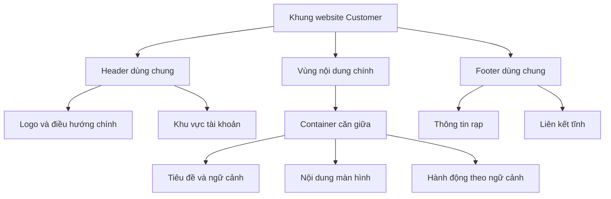

# Bố cục website khách hàng — Hệ thống đặt vé xem phim

## 1. Mục đích và cách đọc

Tài liệu mô tả cách sắp xếp các khối giao diện của website Customer: khung trang, header, footer, vùng nội dung, lưới, thứ tự đọc, bố cục từng màn hình và cách thích ứng với thiết bị. Trọng tâm là **nội dung nằm ở đâu và thay đổi bố cục như thế nào**.

Mã `KH-01` đến `KH-08` tương ứng các nhóm màn hình trong [đặc tả màn hình khách hàng](customer-screen-specification.md). Tài liệu này không định nghĩa lại API, quy tắc tính tiền hoặc điều kiện chuyển trạng thái booking/payment.

Các phần ghi **đề xuất bố cục** là hướng thiết kế cần review; các kích thước minh họa không phải token đã được phê duyệt. Chưa chốt màu thương hiệu, font, kích thước logo, tỉ lệ poster và hệ thống giá trị z-index cụ thể.

Sơ đồ Mermaid biểu diễn quan hệ giữa các vùng hoặc cách chọn bố cục; khung chữ minh họa vị trí tương đối. Chúng không phải bản vẽ theo tỉ lệ pixel và không quy định tên component trong mã nguồn.

## 2. Khung trang dùng chung

### 2.1. Cấu trúc tổng thể

Mỗi màn hình nằm trong một khung thống nhất gồm header, main và footer. Nội dung chính thay đổi theo màn hình; các thành phần điều hướng toàn cục giữ cách tổ chức nhất quán.

```text
┌────────────────────────────────────────────────────┐
│ Header: logo — menu chính — tài khoản               │
├────────────────────────────────────────────────────┤
│ Main                                               │
│ ┌────────────────────────────────────────────────┐ │
│ │ Container căn giữa                             │ │
│ │ Tiêu đề và thông tin ngữ cảnh                   │ │
│ │ Nội dung màn hình                              │ │
│ │ Hành động theo ngữ cảnh                         │ │
│ └────────────────────────────────────────────────┘ │
├────────────────────────────────────────────────────┤
│ Footer: thông tin rạp và liên kết tĩnh              │
└────────────────────────────────────────────────────┘
```



Các mũi tên trong sơ đồ trên thể hiện quan hệ chứa, không phải trình tự thao tác hay gọi API. Hành động theo ngữ cảnh có thể nằm trong khối nội dung tương ứng; không bắt buộc mọi màn hình có một thanh nút riêng ở cuối.

### 2.2. Header bám đầu trang và footer cuối trang

| Vùng | Cách bố trí | Giới hạn |
|---|---|---|
| Header | Nằm đầu trang, sticky khi cuộn | Có vùng nền đủ rõ; không che nội dung hoặc điểm focus bên dưới. Chiều cao cụ thể cần chốt khi thiết kế. |
| Main | Chiếm phần chiều cao còn lại khi nội dung ngắn; tăng theo nội dung khi dài | Không ép chiều cao cố định làm mất nội dung; không biến toàn bộ màn hình thành khung cuộn nhỏ trong main. |
| Footer | Sau main; ở đáy viewport nếu nội dung ngắn, ở cuối tài liệu nếu nội dung dài | Không cố định đè lên nội dung khi cuộn. “Sticky footer layout” không có nghĩa footer luôn phủ đáy màn hình. |
| Thanh hành động chọn ghế trên mobile | Bám đáy màn hình theo bố cục KH-04 | Phải có phần chừa chỗ tương ứng để không che ghế, ghi chú hoặc footer; xem mục 5.4. |
| Modal / menu dạng ngăn kéo | Lớp tạm thời phía trên khung trang | Không thay thế cấu trúc main/header/footer; quy tắc xếp lớp tại mục 7. |

**Đề xuất bố cục:** dùng khung dọc có chiều cao tối thiểu bằng vùng nhìn thấy, để main co giãn giữa header và footer. Khi chiều cao trình duyệt thay đổi, đặc biệt trên điện thoại, ưu tiên giữ nội dung và nút trong vùng có thể tiếp cận thay vì ép trang theo một chiều cao màn hình cố định.

### 2.3. Thứ tự đọc và phạm vi cuộn

- Thứ tự đọc mặc định: header → tiêu đề trang → thông tin ngữ cảnh → nội dung chính → hành động liên quan → footer.
- Chỉ có một vùng cuộn dọc chính của trang. Cho phép cuộn cục bộ với sơ đồ ghế, bộ chọn ngày hoặc lớp phủ khi nội dung thật sự vượt vùng chứa.
- Không để body và một khối main có chiều cao cố định cùng cuộn dọc cho cùng nội dung.
- Không phát sinh cuộn ngang ở mức trang. Nếu sơ đồ ghế rộng hơn màn hình, cuộn trong chính khối sơ đồ và giữ các vùng còn lại theo chiều rộng trang.
- Thứ tự focus bàn phím cần theo thứ tự đọc; đổi từ nhiều cột thành một cột không làm nút đặt nằm trước thông tin cần kiểm tra.
- **Đề xuất bố cục:** có một tiêu đề trang rõ ràng; các khối con dùng tiêu đề cấp dưới. Không dùng cỡ chữ lớn thay cho cấu trúc tiêu đề có nghĩa.

### 2.4. Nội dung ngắn, dài và dữ liệu thay đổi

Khung trang phải dùng được với danh sách ít phim, mô tả nhiều đoạn, tên phim dài, nhiều vé và lỗi không tải được dữ liệu. Không căn giữa dọc toàn bộ main chỉ để một màn hình ít nội dung trông đầy; cách căn giữa đó dễ khiến các trang dài thay đổi vị trí tiêu đề.

Nếu ảnh đang tải hoặc không tải được, giữ vùng ảnh theo cách bố trí đã chọn để tránh đẩy các nút sang vị trí bất ngờ. Khi thêm lỗi validation hoặc thông báo nghiệp vụ, khối có thể tăng chiều cao; không cắt thông báo để giữ bố cục bằng nhau.
