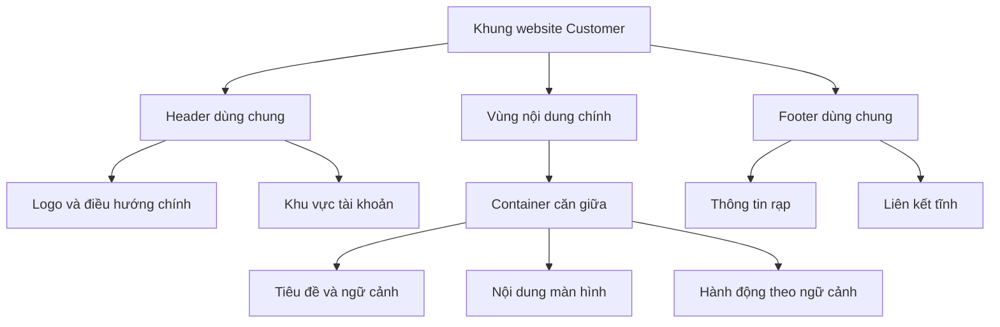

# Bố cục website khách hàng — Hệ thống đặt vé xem phim

## 1. Mục đích và cách đọc

Tài liệu mô tả cách sắp xếp các khối giao diện của website Customer: khung trang, header, footer, vùng nội dung, lưới, thứ tự đọc, bố cục từng màn hình và cách thích ứng với thiết bị. Trọng tâm là **nội dung nằm ở đâu và thay đổi bố cục như thế nào**.

Mã `KH-01` đến `KH-08` tương ứng các nhóm màn hình trong [đặc tả màn hình khách hàng](customer-screen-specification.md). Tài liệu này không định nghĩa lại API, quy tắc tính tiền hoặc điều kiện chuyển trạng thái booking/payment.

Các phần ghi **đề xuất bố cục** là hướng thiết kế cần review; các kích thước minh họa không phải token đã được phê duyệt. Chưa chốt màu thương hiệu, font, kích thước logo, tỉ lệ poster và hệ thống giá trị z-index cụ thể.

Sơ đồ Mermaid biểu diễn quan hệ giữa các vùng hoặc cách chọn bố cục; khung chữ minh họa vị trí tương đối. Chúng không phải bản vẽ theo tỉ lệ pixel và không quy định tên component trong mã nguồn.

## 2. Khung trang dùng chung

### 2.1. Cấu trúc tổng thể

Mỗi màn hình nằm trong một khung thống nhất gồm header, main và footer. Nội dung chính thay đổi theo màn hình; các thành phần điều hướng toàn cục giữ cách tổ chức nhất quán.

```text
┌────────────────────────────────────────────────────┐
│ Header: logo — menu chính — tài khoản               │
├────────────────────────────────────────────────────┤
│ Main                                               │
│ ┌────────────────────────────────────────────────┐ │
│ │ Container căn giữa                             │ │
│ │ Tiêu đề và thông tin ngữ cảnh                   │ │
│ │ Nội dung màn hình                              │ │
│ │ Hành động theo ngữ cảnh                         │ │
│ └────────────────────────────────────────────────┘ │
├────────────────────────────────────────────────────┤
│ Footer: thông tin rạp và liên kết tĩnh              │
└────────────────────────────────────────────────────┘
```



Các mũi tên trong sơ đồ trên thể hiện quan hệ chứa, không phải trình tự thao tác hay gọi API. Hành động theo ngữ cảnh có thể nằm trong khối nội dung tương ứng; không bắt buộc mọi màn hình có một thanh nút riêng ở cuối.

### 2.2. Header bám đầu trang và footer cuối trang

| Vùng | Cách bố trí | Giới hạn |
|---|---|---|
| Header | Nằm đầu trang, sticky khi cuộn | Có vùng nền đủ rõ; không che nội dung hoặc điểm focus bên dưới. Chiều cao cụ thể cần chốt khi thiết kế. |
| Main | Chiếm phần chiều cao còn lại khi nội dung ngắn; tăng theo nội dung khi dài | Không ép chiều cao cố định làm mất nội dung; không biến toàn bộ màn hình thành khung cuộn nhỏ trong main. |
| Footer | Sau main; ở đáy viewport nếu nội dung ngắn, ở cuối tài liệu nếu nội dung dài | Không cố định đè lên nội dung khi cuộn. “Sticky footer layout” không có nghĩa footer luôn phủ đáy màn hình. |
| Thanh hành động chọn ghế trên mobile | Bám đáy màn hình theo bố cục KH-04 | Phải có phần chừa chỗ tương ứng để không che ghế, ghi chú hoặc footer; xem mục 5.4. |
| Modal / menu dạng ngăn kéo | Lớp tạm thời phía trên khung trang | Không thay thế cấu trúc main/header/footer; quy tắc xếp lớp tại mục 7. |

**Đề xuất bố cục:** dùng khung dọc có chiều cao tối thiểu bằng vùng nhìn thấy, để main co giãn giữa header và footer. Khi chiều cao trình duyệt thay đổi, đặc biệt trên điện thoại, ưu tiên giữ nội dung và nút trong vùng có thể tiếp cận thay vì ép trang theo một chiều cao màn hình cố định.

### 2.3. Thứ tự đọc và phạm vi cuộn

- Thứ tự đọc mặc định: header → tiêu đề trang → thông tin ngữ cảnh → nội dung chính → hành động liên quan → footer.
- Chỉ có một vùng cuộn dọc chính của trang. Cho phép cuộn cục bộ với sơ đồ ghế, bộ chọn ngày hoặc lớp phủ khi nội dung thật sự vượt vùng chứa.
- Không để body và một khối main có chiều cao cố định cùng cuộn dọc cho cùng nội dung.
- Không phát sinh cuộn ngang ở mức trang. Nếu sơ đồ ghế rộng hơn màn hình, cuộn trong chính khối sơ đồ và giữ các vùng còn lại theo chiều rộng trang.
- Thứ tự focus bàn phím cần theo thứ tự đọc; đổi từ nhiều cột thành một cột không làm nút đặt nằm trước thông tin cần kiểm tra.
- **Đề xuất bố cục:** có một tiêu đề trang rõ ràng; các khối con dùng tiêu đề cấp dưới. Không dùng cỡ chữ lớn thay cho cấu trúc tiêu đề có nghĩa.

### 2.4. Nội dung ngắn, dài và dữ liệu thay đổi

Khung trang phải dùng được với danh sách ít phim, mô tả nhiều đoạn, tên phim dài, nhiều vé và lỗi không tải được dữ liệu. Không căn giữa dọc toàn bộ main chỉ để một màn hình ít nội dung trông đầy; cách căn giữa đó dễ khiến các trang dài thay đổi vị trí tiêu đề.

Nếu ảnh đang tải hoặc không tải được, giữ vùng ảnh theo cách bố trí đã chọn để tránh đẩy các nút sang vị trí bất ngờ. Khi thêm lỗi validation hoặc thông báo nghiệp vụ, khối có thể tăng chiều cao; không cắt thông báo để giữ bố cục bằng nhau.

## 3. Header, điều hướng và footer

### 3.1. Header trên desktop và tablet

| Vùng | Nội dung | Căn chỉnh và xử lý tràn |
|---|---|---|
| Trái | Logo, dẫn về trang chủ | Giữ tỉ lệ ảnh; không kéo giãn logo để lấp khoảng trống. Nếu chưa có tài sản logo, cách thay bằng tên ứng dụng là đề xuất thiết kế. |
| Giữa / cạnh logo | “Phim đang chiếu”, “Sắp chiếu” | Các mục nằm cùng hàng nếu đủ rộng; đánh dấu mục hiện tại theo thông tin đang xem. |
| Phải, chưa đăng nhập | “Đăng nhập”, “Đăng ký” | Nhóm thao tác rõ ràng, không chèn giữa các mục phim. |
| Phải, đã đăng nhập | Tên người dùng và menu tài khoản | Menu có “Booking của tôi”, “Đăng xuất”; không tự thêm mục quản trị vào header Customer. |

Header dùng cùng trục căn trái/phải với container nội dung. Nếu nền header trải toàn chiều rộng, phần nội dung bên trong vẫn căn theo container để logo và tiêu đề trang không lệch trục.

Trên tablet, giữ menu chính khi đủ chỗ; nếu tràn, thu gọn mục vào menu theo đặc tả responsive. Không giảm cỡ chữ đến mức khó đọc hoặc ép logo và tài khoản đè lên nhau để giữ một hàng.

**Đề xuất bố cục:** tên tài khoản dài được giới hạn vùng hiển thị và dùng ellipsis khi cần; tên đầy đủ có thể đọc trong menu mở. Không để chuỗi tên dài làm các nút xác thực hoặc menu phim ra ngoài viewport.

### 3.2. Header trên mobile

Header thu gọn thành logo và nút menu. Menu mở dưới dạng ngăn kéo (drawer); bên trong có điều hướng phim và khu vực tài khoản tương ứng với phiên hiện tại.

**Đề xuất bố cục cho drawer:**

1. Phần đầu có tiêu đề menu và nút đóng dễ nhận biết.
2. Phần điều hướng chứa nhóm phim đang chiếu/sắp chiếu, giữ cùng ý nghĩa với desktop.
3. Phần tài khoản chứa đăng nhập/đăng ký hoặc tên tài khoản, booking của tôi và đăng xuất.
4. Nếu nội dung dài hơn chiều cao thiết bị, cuộn trong drawer; nút đóng luôn tiếp cận được.

Không đưa form đăng ký, thông tin thanh toán hoặc toàn bộ lịch sử booking vào drawer toàn cục. Drawer là nơi điều hướng; dữ liệu và thao tác chính nằm tại màn hình tương ứng.

Khi đổi từ mobile sang kích thước lớn hơn, **đề xuất bố cục** đóng drawer và khôi phục cuộn nền nếu nó không còn được dùng. Việc đổi kích thước không làm đăng xuất hoặc mất booking đang xem.

### 3.3. Footer

Footer gồm thông tin rạp được cung cấp và các liên kết tĩnh có nội dung thực, chẳng hạn giới thiệu hoặc điều khoản khi đã có trang đích. Không tạo số điện thoại, địa chỉ, liên kết mạng xã hội hoặc chính sách giả để làm đầy footer.

- Desktop/tablet: các nhóm thông tin có thể nằm cùng hàng nếu đủ rộng; nhãn nhóm và liên kết căn theo cùng container.
- Mobile: xếp dọc, cho địa chỉ hoặc tên dài xuống dòng; khoảng cách giữa các liên kết đủ để không bấm nhầm.
- Footer không chứa nút “Đặt vé” hoặc “Thanh toán” bắt buộc của màn hình; các hành động đó nằm gần dữ liệu cần xác nhận.
- Footer không phải menu đáy cố định. Nếu có bottom bar ở KH-04, vẫn phải cuộn tới được nội dung footer.
- Nếu thiếu một nhóm thông tin tùy chọn, bỏ nhóm hoặc hiển thị thông báo phù hợp; không giữ nhiều cột rỗng gây mất cân đối.

## 4. Container, lưới và căn chỉnh

### 4.1. Chiều rộng và khoảng đệm

Main dùng container căn giữa, có giới hạn chiều rộng và padding hai bên. Bề rộng thực tế không vượt vùng nhìn thấy; các khối con phải co được trong container, kể cả khi chứa mã booking hoặc tên phim dài.

| Thông số | Quy tắc / đề xuất |
|---|---|
| Chiều rộng tối đa | Có giới hạn thống nhất. **Đề xuất để review:** `1200px`, là giá trị minh họa, không phải token đã chốt. |
| Padding ngang | Luôn có ở mọi thiết bị. **Đề xuất để review:** khoảng `16px` trên mobile, `24px` khi có nhiều chỗ hơn. |
| Nhịp khoảng cách | Dùng thang nhất quán giữa các khối. Các giá trị `4/8/16/24/32px` là ví dụ để review; không tự coi là toàn bộ hệ token. |
| Khoảng cách với header | Tiêu đề và điểm focus đầu trang không bị header sticky che; tính theo chiều cao header thực. |
| Khoảng cách cuối main | Đủ tách nội dung khỏi footer; nếu có bottom bar, chừa thêm đúng phần không gian thanh này chiếm. |

Không bắt mọi loại nội dung phải trải rộng bằng container. Form đăng nhập, thanh toán và thẻ vé có thể nằm trong vùng hẹp hơn, căn giữa. Chiều rộng hẹp cụ thể cần review, không tự áp một con số pixel cho mọi form.

### 4.2. Lưới trang và các cột nội dung

Lưới 12 cột là cơ sở căn chỉnh vùng nội dung trên màn hình rộng; nó không có nghĩa hiển thị 12 card phim trong một hàng. Danh sách phim có 3 card/hàng desktop, 2 tablet và 1 mobile.

| Kiểu nội dung | Tổ chức desktop | Quy tắc co giãn |
|---|---|---|
| Danh sách phim | Grid 3 cột | Các card có chiều rộng tương đương; hàng cuối có ít card vẫn giữ cùng trục. |
| Chi tiết phim | Poster trái, thông tin phải | Cột thông tin nhận phần diện tích còn lại; không ép mô tả vào một cột quá hẹp. |
| Chọn ghế | Sơ đồ chiếm phần lớn, tóm tắt bên phải | Sơ đồ có thể rộng hơn vùng nhìn; khi cần cuộn thì cuộn trong khối. |
| Form / thanh toán / vé | Một cột hẹp hơn container khi phù hợp | Chiều rộng co theo viewport, không vượt padding hai bên. |
| Tài khoản có điều hướng phụ | Nếu dùng sidebar, bên trái hẹp và nội dung bên phải rộng | Sidebar là tùy chọn; trên mobile chuyển thành nhóm chọn ngang hoặc menu phù hợp. |

Tỉ lệ cột poster/thông tin hoặc sơ đồ/tóm tắt là **đề xuất bố cục cần review**. Không áp tỉ lệ cố định khiến nội dung dài bị cắt hoặc ghế trở nên quá nhỏ. Cùng một nội dung không bị nhân đôi chỉ để lấp đủ cột.

### 4.3. Căn chữ, giá, nhãn và nút

- Văn bản tiếng Việt căn trái; cho phép xuống dòng ở tên phim, mô tả, địa chỉ và thông báo lỗi.
- Nhãn và số tiền trong một hàng giá có thể đặt hai phía; khi nhiều hàng, số tiền căn cùng trục để dễ so sánh.
- Tổng tiền, ngày/giờ suất và mã ghế phải đọc đầy đủ. Không dùng ellipsis cho số tiền hoặc cắt mất phần ngày khiến khách nhầm suất.
- Mã booking/vé dài được ngắt dòng phù hợp, không kéo rộng container và không mất ký tự. Cách hiển thị không được thay đổi giá trị mã.
- Nút chính nằm gần khối dữ liệu nó xác nhận. Nút hủy có vùng riêng hoặc khoảng cách phân biệt để tránh bấm nhầm.
- **Đề xuất bố cục:** thứ bậc chữ gồm tiêu đề trang, tiêu đề khối, nội dung, nhãn và ghi chú; không tự chốt font hoặc bảng cỡ chữ khi chưa có thiết kế được duyệt.

### 4.4. Ảnh, card và chiều cao

Poster trong danh sách dùng khung có tỉ lệ nhất quán để grid không bị lệch; tỉ lệ cụ thể cần review. Giữ đúng tỉ lệ ảnh gốc khi hiển thị, không kéo giãn hoặc cắt phần quan trọng để ép khớp một chiều cao. Cách đặt ảnh trong khung cần nhất quán giữa các card.

Card cần dành chỗ cho tiêu đề và nhãn; tên dài được xuống dòng hoặc có cách đọc đầy đủ. Không ép toàn bộ card có chiều cao cố định nếu điều đó cắt mất nội dung quan trọng. **Đề xuất bố cục:** có thể căn hàng nút cùng đáy trong một hàng grid nếu vẫn cho vùng chữ giãn tự nhiên.

Ảnh thay thế khi thiếu poster giữ kích thước khối tương đương. QR được giữ nguyên tỉ lệ vuông và vùng trắng quanh mã; không dùng cách cắt ảnh poster cho QR, không phủ badge hoặc icon lên phần mã cần quét.
