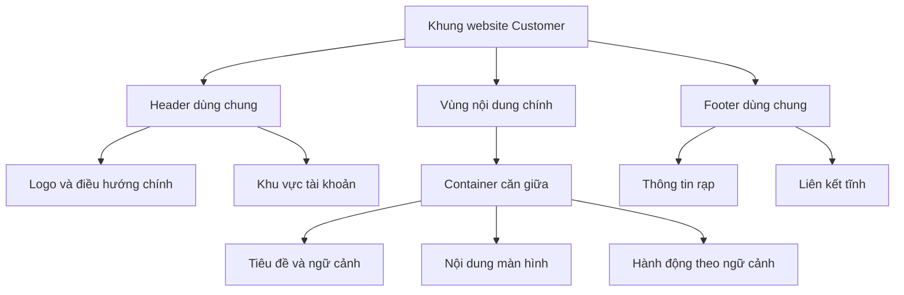
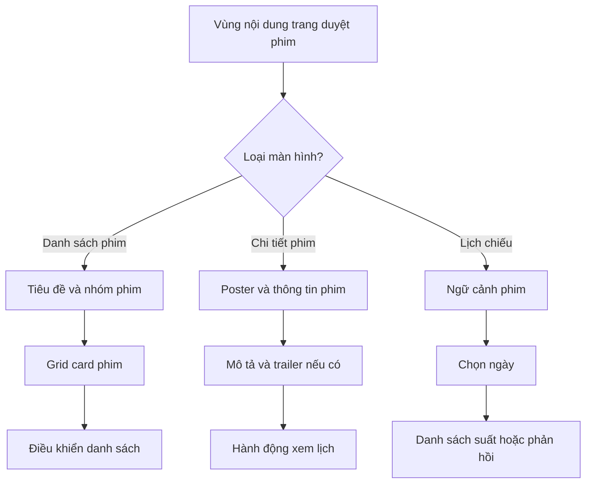
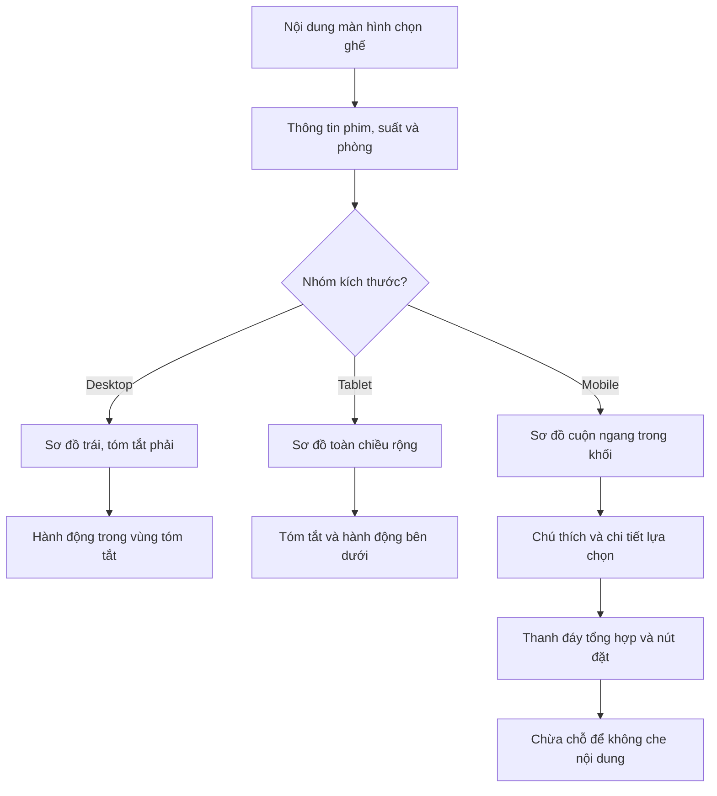
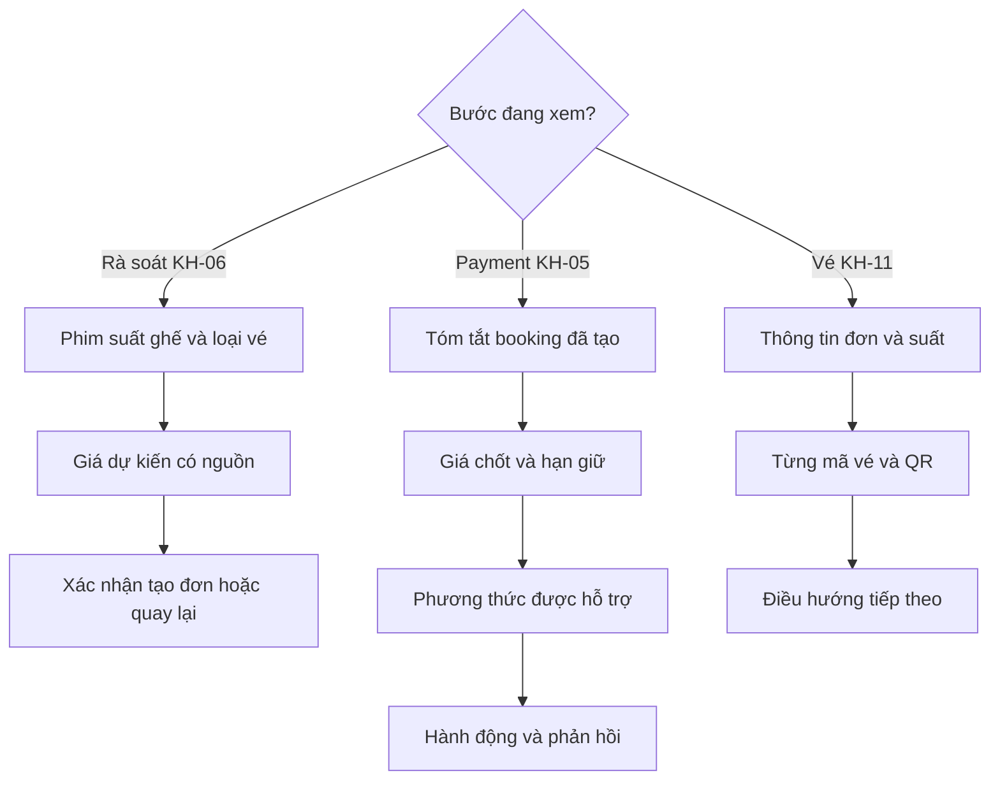
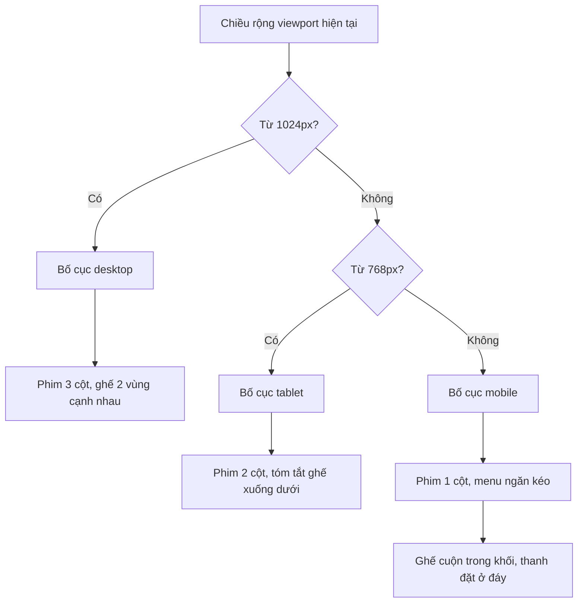
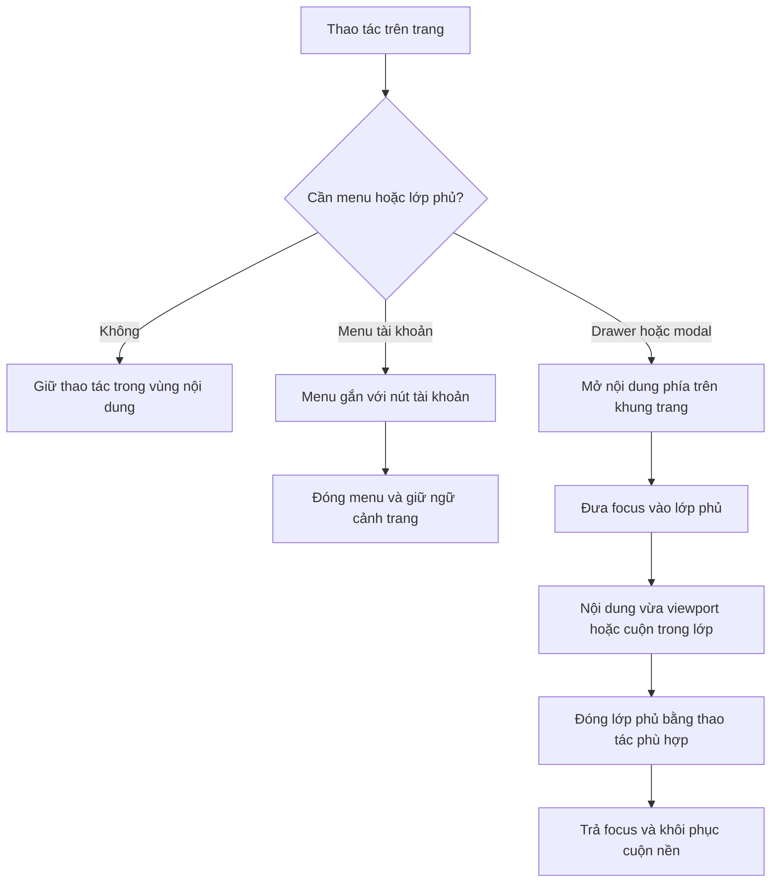

# Bố cục website khách hàng — Hệ thống đặt vé xem phim

## 1. Mục đích và cách đọc

Tài liệu mô tả cách sắp xếp các khối giao diện của website Customer: khung trang, header, footer, vùng nội dung, lưới, thứ tự đọc, bố cục từng màn hình và cách thích ứng với thiết bị. Trọng tâm là **nội dung nằm ở đâu và thay đổi bố cục như thế nào**.

Mã `KH-01` đến `KH-08` tương ứng các nhóm màn hình trong [đặc tả màn hình khách hàng](customer-screen-specification.md). Tài liệu này không định nghĩa lại API, quy tắc tính tiền hoặc điều kiện chuyển trạng thái booking/payment.

Các phần ghi **đề xuất bố cục** là hướng thiết kế cần review; các kích thước minh họa không phải token đã được phê duyệt. Chưa chốt màu thương hiệu, font, kích thước logo, tỉ lệ poster và hệ thống giá trị z-index cụ thể.

Sơ đồ Mermaid biểu diễn quan hệ giữa các vùng hoặc cách chọn bố cục; khung chữ minh họa vị trí tương đối. Chúng không phải bản vẽ theo tỉ lệ pixel và không quy định tên component trong mã nguồn.

## 2. Khung trang dùng chung

### 2.1. Cấu trúc tổng thể

Mỗi màn hình nằm trong một khung thống nhất gồm header, main và footer. Nội dung chính thay đổi theo màn hình; các thành phần điều hướng toàn cục giữ cách tổ chức nhất quán.

```text
┌────────────────────────────────────────────────────┐
│ Header: logo — menu chính — tài khoản               │
├────────────────────────────────────────────────────┤
│ Main                                               │
│ ┌────────────────────────────────────────────────┐ │
│ │ Container căn giữa                             │ │
│ │ Tiêu đề và thông tin ngữ cảnh                   │ │
│ │ Nội dung màn hình                              │ │
│ │ Hành động theo ngữ cảnh                         │ │
│ └────────────────────────────────────────────────┘ │
├────────────────────────────────────────────────────┤
│ Footer: thông tin rạp và liên kết tĩnh              │
└────────────────────────────────────────────────────┘
```



Các mũi tên trong sơ đồ trên thể hiện quan hệ chứa, không phải trình tự thao tác hay gọi API. Hành động theo ngữ cảnh có thể nằm trong khối nội dung tương ứng; không bắt buộc mọi màn hình có một thanh nút riêng ở cuối.

### 2.2. Header bám đầu trang và footer cuối trang

| Vùng | Cách bố trí | Giới hạn |
|---|---|---|
| Header | Nằm đầu trang, sticky khi cuộn | Có vùng nền đủ rõ; không che nội dung hoặc điểm focus bên dưới. Chiều cao cụ thể cần chốt khi thiết kế. |
| Main | Chiếm phần chiều cao còn lại khi nội dung ngắn; tăng theo nội dung khi dài | Không ép chiều cao cố định làm mất nội dung; không biến toàn bộ màn hình thành khung cuộn nhỏ trong main. |
| Footer | Sau main; ở đáy viewport nếu nội dung ngắn, ở cuối tài liệu nếu nội dung dài | Không cố định đè lên nội dung khi cuộn. “Sticky footer layout” không có nghĩa footer luôn phủ đáy màn hình. |
| Thanh hành động chọn ghế trên mobile | Bám đáy màn hình theo bố cục KH-04 | Phải có phần chừa chỗ tương ứng để không che ghế, ghi chú hoặc footer; xem mục 5.4. |
| Modal / menu dạng ngăn kéo | Lớp tạm thời phía trên khung trang | Không thay thế cấu trúc main/header/footer; quy tắc xếp lớp tại mục 7. |

**Đề xuất bố cục:** dùng khung dọc có chiều cao tối thiểu bằng vùng nhìn thấy, để main co giãn giữa header và footer. Khi chiều cao trình duyệt thay đổi, đặc biệt trên điện thoại, ưu tiên giữ nội dung và nút trong vùng có thể tiếp cận thay vì ép trang theo một chiều cao màn hình cố định.

### 2.3. Thứ tự đọc và phạm vi cuộn

- Thứ tự đọc mặc định: header → tiêu đề trang → thông tin ngữ cảnh → nội dung chính → hành động liên quan → footer.
- Chỉ có một vùng cuộn dọc chính của trang. Cho phép cuộn cục bộ với sơ đồ ghế, bộ chọn ngày hoặc lớp phủ khi nội dung thật sự vượt vùng chứa.
- Không để body và một khối main có chiều cao cố định cùng cuộn dọc cho cùng nội dung.
- Không phát sinh cuộn ngang ở mức trang. Nếu sơ đồ ghế rộng hơn màn hình, cuộn trong chính khối sơ đồ và giữ các vùng còn lại theo chiều rộng trang.
- Thứ tự focus bàn phím cần theo thứ tự đọc; đổi từ nhiều cột thành một cột không làm nút đặt nằm trước thông tin cần kiểm tra.
- **Đề xuất bố cục:** có một tiêu đề trang rõ ràng; các khối con dùng tiêu đề cấp dưới. Không dùng cỡ chữ lớn thay cho cấu trúc tiêu đề có nghĩa.

### 2.4. Nội dung ngắn, dài và dữ liệu thay đổi

Khung trang phải dùng được với danh sách ít phim, mô tả nhiều đoạn, tên phim dài, nhiều vé và lỗi không tải được dữ liệu. Không căn giữa dọc toàn bộ main chỉ để một màn hình ít nội dung trông đầy; cách căn giữa đó dễ khiến các trang dài thay đổi vị trí tiêu đề.

Nếu ảnh đang tải hoặc không tải được, giữ vùng ảnh theo cách bố trí đã chọn để tránh đẩy các nút sang vị trí bất ngờ. Khi thêm lỗi validation hoặc thông báo nghiệp vụ, khối có thể tăng chiều cao; không cắt thông báo để giữ bố cục bằng nhau.

## 3. Header, điều hướng và footer

### 3.1. Header trên desktop và tablet

| Vùng | Nội dung | Căn chỉnh và xử lý tràn |
|---|---|---|
| Trái | Logo, dẫn về trang chủ | Giữ tỉ lệ ảnh; không kéo giãn logo để lấp khoảng trống. Nếu chưa có tài sản logo, cách thay bằng tên ứng dụng là đề xuất thiết kế. |
| Giữa / cạnh logo | “Phim đang chiếu”, “Sắp chiếu” | Các mục nằm cùng hàng nếu đủ rộng; đánh dấu mục hiện tại theo thông tin đang xem. |
| Phải, chưa đăng nhập | “Đăng nhập”, “Đăng ký” | Nhóm thao tác rõ ràng, không chèn giữa các mục phim. |
| Phải, đã đăng nhập | Tên người dùng và menu tài khoản | Menu có “Booking của tôi”, “Đăng xuất”; không tự thêm mục quản trị vào header Customer. |

Header dùng cùng trục căn trái/phải với container nội dung. Nếu nền header trải toàn chiều rộng, phần nội dung bên trong vẫn căn theo container để logo và tiêu đề trang không lệch trục.

Trên tablet, giữ menu chính khi đủ chỗ; nếu tràn, thu gọn mục vào menu theo đặc tả responsive. Không giảm cỡ chữ đến mức khó đọc hoặc ép logo và tài khoản đè lên nhau để giữ một hàng.

**Đề xuất bố cục:** tên tài khoản dài được giới hạn vùng hiển thị và dùng ellipsis khi cần; tên đầy đủ có thể đọc trong menu mở. Không để chuỗi tên dài làm các nút xác thực hoặc menu phim ra ngoài viewport.

### 3.2. Header trên mobile

Header thu gọn thành logo và nút menu. Menu mở dưới dạng ngăn kéo (drawer); bên trong có điều hướng phim và khu vực tài khoản tương ứng với phiên hiện tại.

**Đề xuất bố cục cho drawer:**

1. Phần đầu có tiêu đề menu và nút đóng dễ nhận biết.
2. Phần điều hướng chứa nhóm phim đang chiếu/sắp chiếu, giữ cùng ý nghĩa với desktop.
3. Phần tài khoản chứa đăng nhập/đăng ký hoặc tên tài khoản, booking của tôi và đăng xuất.
4. Nếu nội dung dài hơn chiều cao thiết bị, cuộn trong drawer; nút đóng luôn tiếp cận được.

Không đưa form đăng ký, thông tin thanh toán hoặc toàn bộ lịch sử booking vào drawer toàn cục. Drawer là nơi điều hướng; dữ liệu và thao tác chính nằm tại màn hình tương ứng.

Khi đổi từ mobile sang kích thước lớn hơn, **đề xuất bố cục** đóng drawer và khôi phục cuộn nền nếu nó không còn được dùng. Việc đổi kích thước không làm đăng xuất hoặc mất booking đang xem.

### 3.3. Footer

Footer gồm thông tin rạp được cung cấp và các liên kết tĩnh có nội dung thực, chẳng hạn giới thiệu hoặc điều khoản khi đã có trang đích. Không tạo số điện thoại, địa chỉ, liên kết mạng xã hội hoặc chính sách giả để làm đầy footer.

- Desktop/tablet: các nhóm thông tin có thể nằm cùng hàng nếu đủ rộng; nhãn nhóm và liên kết căn theo cùng container.
- Mobile: xếp dọc, cho địa chỉ hoặc tên dài xuống dòng; khoảng cách giữa các liên kết đủ để không bấm nhầm.
- Footer không chứa nút “Đặt vé” hoặc “Thanh toán” bắt buộc của màn hình; các hành động đó nằm gần dữ liệu cần xác nhận.
- Footer không phải menu đáy cố định. Nếu có bottom bar ở KH-04, vẫn phải cuộn tới được nội dung footer.
- Nếu thiếu một nhóm thông tin tùy chọn, bỏ nhóm hoặc hiển thị thông báo phù hợp; không giữ nhiều cột rỗng gây mất cân đối.

## 4. Container, lưới và căn chỉnh

### 4.1. Chiều rộng và khoảng đệm

Main dùng container căn giữa, có giới hạn chiều rộng và padding hai bên. Bề rộng thực tế không vượt vùng nhìn thấy; các khối con phải co được trong container, kể cả khi chứa mã booking hoặc tên phim dài.

| Thông số | Quy tắc / đề xuất |
|---|---|
| Chiều rộng tối đa | Có giới hạn thống nhất. **Đề xuất để review:** `1200px`, là giá trị minh họa, không phải token đã chốt. |
| Padding ngang | Luôn có ở mọi thiết bị. **Đề xuất để review:** khoảng `16px` trên mobile, `24px` khi có nhiều chỗ hơn. |
| Nhịp khoảng cách | Dùng thang nhất quán giữa các khối. Các giá trị `4/8/16/24/32px` là ví dụ để review; không tự coi là toàn bộ hệ token. |
| Khoảng cách với header | Tiêu đề và điểm focus đầu trang không bị header sticky che; tính theo chiều cao header thực. |
| Khoảng cách cuối main | Đủ tách nội dung khỏi footer; nếu có bottom bar, chừa thêm đúng phần không gian thanh này chiếm. |

Không bắt mọi loại nội dung phải trải rộng bằng container. Form đăng nhập, thanh toán và thẻ vé có thể nằm trong vùng hẹp hơn, căn giữa. Chiều rộng hẹp cụ thể cần review, không tự áp một con số pixel cho mọi form.

### 4.2. Lưới trang và các cột nội dung

Lưới 12 cột là cơ sở căn chỉnh vùng nội dung trên màn hình rộng; nó không có nghĩa hiển thị 12 card phim trong một hàng. Danh sách phim có 3 card/hàng desktop, 2 tablet và 1 mobile.

| Kiểu nội dung | Tổ chức desktop | Quy tắc co giãn |
|---|---|---|
| Danh sách phim | Grid 3 cột | Các card có chiều rộng tương đương; hàng cuối có ít card vẫn giữ cùng trục. |
| Chi tiết phim | Poster trái, thông tin phải | Cột thông tin nhận phần diện tích còn lại; không ép mô tả vào một cột quá hẹp. |
| Chọn ghế | Sơ đồ chiếm phần lớn, tóm tắt bên phải | Sơ đồ có thể rộng hơn vùng nhìn; khi cần cuộn thì cuộn trong khối. |
| Form / thanh toán / vé | Một cột hẹp hơn container khi phù hợp | Chiều rộng co theo viewport, không vượt padding hai bên. |
| Tài khoản có điều hướng phụ | Nếu dùng sidebar, bên trái hẹp và nội dung bên phải rộng | Sidebar là tùy chọn; trên mobile chuyển thành nhóm chọn ngang hoặc menu phù hợp. |

Tỉ lệ cột poster/thông tin hoặc sơ đồ/tóm tắt là **đề xuất bố cục cần review**. Không áp tỉ lệ cố định khiến nội dung dài bị cắt hoặc ghế trở nên quá nhỏ. Cùng một nội dung không bị nhân đôi chỉ để lấp đủ cột.

### 4.3. Căn chữ, giá, nhãn và nút

- Văn bản tiếng Việt căn trái; cho phép xuống dòng ở tên phim, mô tả, địa chỉ và thông báo lỗi.
- Nhãn và số tiền trong một hàng giá có thể đặt hai phía; khi nhiều hàng, số tiền căn cùng trục để dễ so sánh.
- Tổng tiền, ngày/giờ suất và mã ghế phải đọc đầy đủ. Không dùng ellipsis cho số tiền hoặc cắt mất phần ngày khiến khách nhầm suất.
- Mã booking/vé dài được ngắt dòng phù hợp, không kéo rộng container và không mất ký tự. Cách hiển thị không được thay đổi giá trị mã.
- Nút chính nằm gần khối dữ liệu nó xác nhận. Nút hủy có vùng riêng hoặc khoảng cách phân biệt để tránh bấm nhầm.
- **Đề xuất bố cục:** thứ bậc chữ gồm tiêu đề trang, tiêu đề khối, nội dung, nhãn và ghi chú; không tự chốt font hoặc bảng cỡ chữ khi chưa có thiết kế được duyệt.

### 4.4. Ảnh, card và chiều cao

Poster trong danh sách dùng khung có tỉ lệ nhất quán để grid không bị lệch; tỉ lệ cụ thể cần review. Giữ đúng tỉ lệ ảnh gốc khi hiển thị, không kéo giãn hoặc cắt phần quan trọng để ép khớp một chiều cao. Cách đặt ảnh trong khung cần nhất quán giữa các card.

Card cần dành chỗ cho tiêu đề và nhãn; tên dài được xuống dòng hoặc có cách đọc đầy đủ. Không ép toàn bộ card có chiều cao cố định nếu điều đó cắt mất nội dung quan trọng. **Đề xuất bố cục:** có thể căn hàng nút cùng đáy trong một hàng grid nếu vẫn cho vùng chữ giãn tự nhiên.

Ảnh thay thế khi thiếu poster giữ kích thước khối tương đương. QR được giữ nguyên tỉ lệ vuông và vùng trắng quanh mã; không dùng cách cắt ảnh poster cho QR, không phủ badge hoặc icon lên phần mã cần quét.

## 5. Bố cục theo từng màn hình

### 5.1. KH-01 — Trang chủ / danh sách phim

Thứ tự trong main: tiêu đề danh sách → nhóm đang chiếu/sắp chiếu → vùng danh sách phim → điều khiển phân trang hoặc tải thêm. Nếu có banner với nội dung hợp lệ, banner là vùng giới thiệu tùy chọn; không thay thế danh sách phim và không che menu phân nhóm.

```text
┌───────────────────────────────────────────────────┐
│ Tiêu đề danh sách phim                            │
│ [Đang chiếu] [Sắp chiếu]                           │
├────────────────┬────────────────┬─────────────────┤
│ Poster         │ Poster         │ Poster          │
│ Tên phim       │ Tên phim       │ Tên phim        │
│ Nhãn tuổi      │ Nhãn tuổi      │ Nhãn tuổi       │
│ Xem chi tiết   │ Xem chi tiết   │ Xem chi tiết    │
├────────────────┴────────────────┴─────────────────┤
│ Phân trang hoặc tải thêm                          │
└───────────────────────────────────────────────────┘
```

Khung trên minh họa desktop. Tablet có 2 card/hàng; mobile có 1 card/hàng, giữ thứ tự đọc và thao tác xem chi tiết. Đây không phải yêu cầu luôn phải đủ ba phim hoặc có một nút tách khỏi vùng card.

| Vùng | Quy tắc bố trí |
|---|---|
| Tiêu đề và phân nhóm | Cùng trục với grid; nhóm đang chọn rõ ràng. Trên mobile cho nhãn đủ chỗ, không đẩy tab ra ngoài trang. |
| Poster | Cùng hệ khung ảnh giữa các card; giữ vị trí khi loading hoặc ảnh lỗi. |
| Tên và nhãn | Tên có ưu tiên đọc trước; badge tuổi/trạng thái không phủ lên tên hoặc nút. Nếu đặt badge trên poster thì không che nội dung cần nhận diện. |
| Hành động xem chi tiết | Toàn card có thể là vùng điều hướng theo thiết kế; tránh các vùng bấm lồng nhau gây khó thao tác. |
| Điều khiển danh sách | Nằm sau grid và trước footer; không nổi cố định che hàng phim cuối. Chỉ chọn một kiểu phân trang/tải thêm được thống nhất. |

Không có phim hoặc lỗi tải: thay vùng grid bằng thông báo và hành động phù hợp, vẫn giữ tiêu đề/phân nhóm. Không lấp card bằng dữ liệu giả để giữ số cột. Tìm kiếm/lọc nâng cao chỉ có vùng riêng khi đã chốt dữ liệu và chức năng; không tự thêm thanh tìm kiếm chỉ để lấp khoảng trắng.

### 5.2. KH-02 — Chi tiết phim

Desktop chia hai vùng: poster bên trái; thông tin và nút “Chọn suất chiếu” bên phải. Tiêu đề phim nằm trong vùng thông tin, không dùng tiêu đề trùng ở cả hai cột.

```text
┌───────────────────┬───────────────────────────────┐
│ Poster            │ Tên phim                      │
│                   │ Tuổi · Thời lượng · Thể loại  │
│                   │ Ngày phát hành · Ngôn ngữ     │
│                   │ Mô tả                         │
│                   │ Xem trailer khi có dữ liệu    │
│                   │ [Chọn suất chiếu]             │
└───────────────────┴───────────────────────────────┘
```

- Poster không tự kéo cao theo một mô tả rất dài; phần mô tả có thể giãn xuống theo luồng trang.
- Thông tin ngắn được nhóm gần tên phim; mô tả là một khối văn bản riêng, không trộn với nhãn tuổi hoặc giá.
- Trailer chỉ có vùng hiển thị khi có dữ liệu. Nhúng video hay dùng liên kết/nút mở trailer là **đề xuất bố cục cần review**; không để khung video trống lớn nếu chưa có trailer.
- Nút xem lịch nằm cạnh vùng thông tin quyết định; không chỉ đặt ở footer hoặc một banner khác.
- Mobile: poster, thông tin và hành động xếp một cột; giữ tên phim đầy đủ và không co poster làm chữ/nút bị chen sang hai bên.
- **Đề xuất bố cục:** tablet có thể dùng một hoặc hai cột tùy độ dài nội dung và bề rộng thực, miễn nút và mô tả vẫn đọc được; không tạo breakpoint mới để mô tả lựa chọn này như quy định đã chốt.

Nếu chi tiết phim và lịch chiếu được gộp trong một trang, khối lịch nằm sau thông tin phim và tuân thủ KH-03. Cách gộp trang là lựa chọn thiết kế; không hiển thị hai bộ chọn lịch khác nhau cùng điều khiển một nội dung mà không có lý do.

### 5.3. KH-03 — Lịch chiếu

Thứ tự đọc: phim đang xem → ngày đang chọn → danh sách suất → phản hồi không có suất/lỗi nếu có. Thông tin rạp chỉ đặt khi có dữ liệu phù hợp; không tạo bộ chọn chuỗi rạp/tỉnh cho bố cục một rạp.

| Vùng | Desktop / tablet | Mobile |
|---|---|---|
| Ngữ cảnh phim | Tên phim, có thể kèm poster thu nhỏ | Giữ tên phim rõ; poster thu nhỏ là tùy chọn. |
| Chọn ngày | Tabs nằm trên danh sách, có nhãn ngày đọc đầy đủ | Dropdown hoặc hàng ngày cuộn ngang trong khối; ngày đang chọn luôn nhận biết được. |
| Suất | Danh sách xếp dọc theo giờ; mỗi item nhóm giờ, phòng và giá cơ sở | Item đủ rộng cho chữ; nếu cần, xuống dòng trong item thay vì ép thành hàng nút nhỏ. |
| Phản hồi | Ngay dưới vùng ngày, tại vị trí danh sách suất | Giữ điều khiển ngày để khách đổi ngày khi danh sách rỗng. |

Một item suất phải nhận diện được ngày/giờ, phòng và giá cơ sở nếu có. Không dùng màu hoặc chỉ ghi một giờ mà thiếu ngữ cảnh khi danh sách gồm nhiều ngày. Không hiển thị “còn X ghế” chỉ để điền vào item khi không có dữ liệu.

**Đề xuất bố cục:** các suất có cùng thông tin có thể dùng nhịp căn chỉnh thống nhất để so sánh giờ/phòng/giá; trạng thái không thể chọn đi kèm nhãn giải thích nếu item đó đang được hiển thị. Không phải yêu cầu tải và dựng thêm suất đóng bán.

#### 5.3.1. Sơ đồ thứ tự đọc của các trang duyệt phim



Sơ đồ mô tả thứ tự nhóm nội dung bên trong từng màn hình. Nó không yêu cầu poster desktop phải nằm trên thông tin thay vì bên trái; khi chia hai cột, thứ tự đọc vẫn phải có nghĩa khi trở thành một cột.

### 5.4. KH-04 — Chọn ghế và loại vé

#### 5.4.1. Desktop

Thông tin phim/suất/phòng nằm đầu main. Bên dưới là hai cột: sơ đồ ghế bên trái chiếm phần lớn chiều rộng, tóm tắt lựa chọn bên phải. Chú thích ghế đi cùng sơ đồ, không nằm riêng ở footer.

```text
┌───────────────────────────────────────────────────┐
│ Phim — ngày/giờ — phòng — quay lại lịch            │
├────────────────────────────────┬──────────────────┤
│ Hướng màn hình                 │ Ghế đang chọn    │
│ Nhãn hàng và sơ đồ ghế         │ Loại vé từng ghế │
│                                │ Số ghế / số chỗ  │
│                                │ Giá có dữ liệu   │
│ Chú thích loại / trạng thái    │ [Đặt vé]         │
└────────────────────────────────┴──────────────────┘
```

Khối tóm tắt rộng đủ cho nhãn ghế, loại vé và tiền xuống dòng hợp lý. Không cho nó chiếm gần hết chiều rộng làm sơ đồ còn một dải hẹp. Cách cho tóm tắt bám theo cuộn trên desktop là **đề xuất bố cục**, chưa bắt buộc; nếu dùng, không làm các dòng cuối hoặc nút hủy bị khuất dưới header.

#### 5.4.2. Tablet và mobile

- Tablet: sơ đồ toàn chiều rộng container, tóm tắt nằm dưới; không tiếp tục ép hai cột như desktop.
- Mobile: thứ tự là thông tin suất → sơ đồ → chú thích → chi tiết lựa chọn; thanh đáy chứa tổng tiền khi có dữ liệu và nút “Đặt vé”.
- Thanh đáy là nơi tóm tắt hành động, không chứa toàn bộ danh sách ghế hoặc form loại vé. Những nội dung dài vẫn nằm trong luồng cuộn của trang.
- Nếu chưa có giá từ server, vùng giá hiển thị thông báo phù hợp theo đặc tả màn hình; không tự tính tổng để lấp chỗ trống trong thanh đáy.
- Chừa khoảng trống ở cuối nội dung bằng phần chiều cao thanh đáy thực tế và khoảng cách cần thiết; không dùng một padding cố định quá nhỏ khi nhãn nút hoặc ghi chú xuống dòng.
- **Đề xuất bố cục:** tính cả vùng an toàn ở mép dưới thiết bị; khi bàn phím ảo mở cho input, thanh đáy không che trường nhập, lỗi hoặc nút đang focus.

#### 5.4.3. Bố trí trong sơ đồ ghế

| Thành phần | Quy tắc bố trí |
|---|---|
| Nhãn hàng / số ghế | Đọc rõ, gắn đúng vị trí; giữ thứ tự hàng và ghế theo dữ liệu bố trí được cung cấp. |
| Standard và VIP | Cùng đơn vị ghế một chỗ; hình thức phân biệt theo component, không thu hẹp vùng bấm để vừa trang. |
| Couple | Biểu diễn nguyên một đơn vị hai chỗ, rộng hơn ghế đơn theo thiết kế; không vẽ thành hai nút chọn nửa ghế. |
| Chú thích | Phân biệt loại ghế và khả năng chọn; không chỉ dựa vào màu. Khi nhiều mục, cho xuống dòng trong vùng chú thích. |
| Hướng màn hình / lối đi | Dựa trên bố trí đã được cung cấp. Nhãn hướng màn hình là đề xuất UI; không suy lối đi hoặc hàng Couple từ số ghế. |
| Vùng cuộn ngang | Chỉ bao sơ đồ cần thiết; có dấu hiệu cho biết còn nội dung ngang. Không kéo thông tin suất và bảng tóm tắt đi theo sơ đồ. |

Vùng bấm ghế trên mobile tối thiểu 44px theo đặc tả responsive; không giảm xuống chỉ để hiển thị toàn phòng cùng lúc. Khi cuộn ngang, tên hàng và ghế phải còn nhận diện được; cách giữ nhãn hàng ở mép trái là **đề xuất bố cục cần review**.

Thông tin liên hệ nếu được chốt đưa vào bước này nằm cùng vùng xác nhận lựa chọn, không chen giữa các hàng ghế. Countdown chỉ dành cho booking đã được tạo; không chừa một đồng hồ “giữ ghế” đang chạy ngay khi khách mới chọn cục bộ. Khi quay lại ngữ cảnh booking đã có, vùng thời gian và thông báo đặt cạnh tóm tắt đơn.

#### 5.4.4. Sơ đồ chọn bố cục ghế



### 5.5. KH-05 — Thanh toán

Thanh toán dùng một cột, có thể hẹp hơn container chính và căn giữa. Không bổ sung một sidebar quảng cáo hoặc một bố cục nhiều cổng để lấp phần chiều rộng còn lại.

| Thứ tự | Khối nội dung | Quy tắc bố trí |
|---|---|---|
| 1 | Tiêu đề thanh toán và mã booking | Mã có thể xuống dòng; không đẩy tiêu đề hoặc nút ra ngoài khung. |
| 2 | Tóm tắt phim/suất/phòng/ghế | Xếp theo nhóm dễ kiểm tra, trước thao tác xác nhận tiền. |
| 3 | Chi tiết giá và tổng tiền | Nhãn/giá căn cùng trục; tổng nổi bật, đủ chỗ cho VND và số dài. |
| 4 | Hạn giữ và thông báo liên quan | Nằm gần hành động; khi nội dung dài, không bị đẩy vào tooltip hoặc toast duy nhất. |
| 5 | Cổng/phương thức đang hỗ trợ | Chỉ có thành phần thực được cung cấp; không tự dựng form nhập số thẻ hoặc danh sách ngân hàng. |
| 6 | Hành động theo điều kiện | Thanh toán, kiểm tra lại hoặc hủy/đổi ghế theo đặc tả màn hình; phân biệt nút hủy với nút chính. |
| 7 | Phản hồi sau thao tác | Đặt gần nút hoặc trong vùng thông báo ổn định, không làm biến mất tóm tắt đơn cần đối chiếu. |

Trên mobile vẫn giữ một cột. Hàng giá hoặc thông tin ghế dài có thể xuống dòng; không biến tổng thanh toán thành một ô cuộn ngang. Không mặc định dùng thanh hành động bám đáy của trang chọn ghế cho trang thanh toán.

Khi kết quả đang được xác nhận hoặc đã qua hạn danh nghĩa, vùng phản hồi có đủ diện tích cho lời giải thích và thao tác được phép. Bố cục không tự chuyển sang kiểu “thành công” chỉ vì có thông báo từ cổng; dữ liệu quyết định nội dung theo đặc tả màn hình.

### 5.6. KH-06 — Rà soát và xác nhận tạo đơn

Theo Customer User Flow mới trên master, KH-06 đứng sau Ticket Type và trước Payment. Bố cục một cột: tiêu đề rà soát → phim/rạp/phòng/ngày giờ → ghế và loại vé → tiền dự kiến có nguồn → liên hệ nếu contract được chốt → xác nhận tạo đơn và quay lại chỉnh sửa. Có thể dùng chung container với Payment nhưng phải là hai bước rõ ràng.

| Khối | Quy tắc bố trí |
|---|---|
| Thông tin lựa chọn | Nhóm theo phim/suất và từng ghế; thông tin dài xuống dòng. Chưa có mã booking, countdown hoặc QR trước tạo đơn. |
| Giá trước tạo | Nhãn dự kiến nếu có nguồn server; thiếu contract báo giá thì có lời giải thích, không dựng giá chốt để lấp layout. |
| Liên hệ | Nằm trong vùng rà soát nếu được chốt; lỗi cạnh field, không thêm field chưa được API cho phép. |
| Hành động | “Xác nhận tạo đơn” và “Quay lại chỉnh sửa” rõ ràng; submitting khóa nhấn lặp nhưng vẫn giữ nội dung đang xác nhận. |
| Kết quả tạo | Thành công chuyển KH-05 với snapshot server và hạn giữ; lỗi ghế/validation hiển thị gần ngữ cảnh, timeout là chưa rõ kết quả. |
| Quay lại khi đã có đơn | Hiện tham chiếu đơn và hướng tới Payment/chi tiết; không mở draft cũ thành form sửa snapshot hoặc tạo đơn lần hai. |

Kết quả thanh toán thuộc KH-10; đơn đã confirmed và vé thuộc KH-08/KH-11. Không dùng tiêu đề Booking Confirmation cho cả bước rà soát lẫn trang vé thành công. Bảng điều hướng cũ cần người phụ trách Navigation đồng bộ theo thứ tự này.

#### 5.6.1. Sơ đồ thứ tự nội dung theo bước



Sơ đồ chỉ thể hiện thứ tự đọc nội dung, không phải quy trình áp dụng payment. Với từng bước, lỗi/đang chờ/không đủ quyền thay phần nội dung liên quan bằng phản hồi phù hợp; khung header/main/footer vẫn giữ nguyên.

### 5.7. KH-07 — Đăng nhập / đăng ký

Hai form cùng cách căn chỉnh, nằm trong vùng hẹp căn giữa main. Giữ header/footer dùng chung; không tự thêm ảnh nền, hình nhân vật hoặc mảng quảng cáo chiếm nửa màn hình như yêu cầu bắt buộc.

| Vùng | Quy tắc bố trí |
|---|---|
| Tiêu đề và hướng dẫn | Nằm trên form; phân biệt rõ đăng nhập hay đăng ký. Thông tin quay lại bước đặt vé nếu có chỉ là một đoạn ngắn. |
| Nhãn và input | Mỗi trường một nhóm, nhãn rõ và lỗi ngay bên dưới; không chỉ dùng placeholder thay nhãn. |
| Thứ tự đăng nhập | Email → mật khẩu → nút đăng nhập → liên kết đăng ký. |
| Thứ tự đăng ký | **Đề xuất bố cục:** họ tên → email → mật khẩu → điện thoại tùy chọn → nút đăng ký → liên kết đăng nhập. Nhập lại mật khẩu chỉ khi thiết kế được chọn dùng. |
| Lỗi chung | Ngay trên nhóm nút hoặc đầu form, không đẩy lên một toast xa trường nhập duy nhất. |
| Nút chính | Cùng trục form, đủ chỗ cho nhãn và loading; không thay vị trí khi đổi từ bình thường sang đang gửi. |

Form đăng ký dài được cuộn cùng trang; không ép toàn bộ form vào một thẻ có chiều cao cố định. Trên mobile, form dùng chiều rộng container có padding; bàn phím ảo không làm input đang focus hoặc lỗi phía dưới bị thanh cố định che.

Nếu chỉ có vài trường, không cần bố trí hai cột input. **Đề xuất bố cục:** giữ một cột trên desktop để thứ tự đọc thống nhất và tránh nhầm field khi hiển thị lỗi. Không thêm một vùng “Quên mật khẩu”, OTP hoặc mạng xã hội khi chức năng chưa được chốt.

### 5.8. KH-08 — Booking History / chi tiết booking

Vùng chính gồm tiêu đề “Booking của tôi”, danh sách booking, điều khiển phân trang và cách mở chi tiết. Bố cục phải cho khách nhận diện được mã đơn, phim/suất, tổng tiền và thao tác phù hợp mà không phải đọc qua nhiều khối trang trí.

**Đề xuất bố cục:** desktop dùng danh sách thẻ hoặc bảng; mobile ưu tiên thẻ xếp dọc. Nếu chọn bảng, các cột quan trọng không bị giấu chỉ để vừa chiều rộng; chuyển sang thẻ hoặc xử lý tràn trong khối khi thực sự cần.

| Vùng | Nội dung và bố trí |
|---|---|
| Tiêu đề tài khoản | Cùng trục nội dung, không đặt ở sidebar như tiêu đề duy nhất của trang. |
| Mỗi booking | Mã, phim, ngày/giờ, ghế/phòng nếu có, trạng thái, tổng tiền; hành động gắn với đúng đơn. |
| Danh sách nhiều đơn | Xếp dọc trong main; phân trang sau danh sách, không cuộn riêng một vùng thấp giữa trang. |
| Chi tiết booking | Mã/khối thông tin/giá/vé theo thứ tự phù hợp; có thể dùng lại cách bố trí tóm tắt và thẻ vé của KH-05/06. Trang riêng hay vùng chi tiết là lựa chọn thiết kế. |
| Hồ sơ | Điều hướng sang KH-12; không gộp form hồ sơ với lịch sử booking. |
| Điều hướng phụ | Sidebar tùy chọn nếu có đủ mục thực cần điều hướng; không tạo các mục rỗng để lấp bố cục. |

Nếu dùng sidebar: desktop bên trái hẹp, main chi tiết bên phải; mobile chuyển thành tabs ngang hoặc menu phù hợp. Tabs dài được cuộn trong khối và vẫn chỉ rõ mục đang xem. Không có sidebar thì nội dung dùng container bình thường, không giữ một cột trống bên trái.

Mã dài, nhiều ghế và tên phim dài được xuống dòng trong thẻ. Nút hủy/thanh toán/xem vé không chồng lên badge hoặc số tiền. Khi danh sách rỗng, thông báo và nút xem phim nằm trong vùng danh sách; không loại bỏ toàn bộ khung tài khoản.

### 5.9. KH-09 — Ticket Type

Ticket Type dùng vùng chọn loại vé cạnh danh sách ghế đã chọn hoặc bước liền sau sơ đồ; không tự chốt route mới. Mỗi đơn vị ghế có một hàng: nhãn ghế, loại ghế/sức chứa, bộ chọn loại vé và giá do server cung cấp nếu có.

- Desktop có thể đặt trong bảng tóm tắt; mobile dùng thẻ/hàng xếp dọc dưới sơ đồ, không nhồi toàn bộ bộ chọn vào bottom bar.
- Một Couple là một đơn vị chọn với hai chỗ; không tách thành hai bộ chọn cho hai nửa. Bản đầu áp dụng Adult theo phạm vi hiện có.
- Ghi chú điều kiện vé giảm và cách tính phụ thu đặt cạnh lựa chọn. Chưa có báo giá thì hiện ghi chú chờ giá, không dùng tổng tự tính để lấp layout.
- Nút quay lại chọn ghế và tiếp tục đặt ở cuối khối, giữ được lựa chọn khi đổi cách bố trí.

### 5.10. KH-10 — Payment Result

Một cột: tiêu đề kết quả → mã booking và thông tin payment được phép xem → thông báo giải thích → hành động tiếp theo. Nội dung có thể là thành công, thất bại, đang xử lý hoặc chưa xác định; không chỉ dùng màu hoặc icon.

- Luôn phân biệt kết quả payment và tình trạng booking. Chỉ hiện nút xem vé như kết quả đặt thành công khi server trả booking confirmed.
- Đang chờ/unknown cần thông báo đọc được và nút kiểm tra lại khi hỗ trợ; không thêm một nút thanh toán mới luôn bật.
- Thất bại còn được retry thì hành động dẫn về KH-05 để kiểm tra điều kiện hiện tại. Đơn hết hạn/hủy có hành động xem lịch sử hoặc đặt đơn mới.
- Khu vực thông báo đủ chỗ cho tên phim, mã dài và lý do đã lọc; giữ cùng khung trang khi tải lại kết quả.

### 5.11. KH-11 — My Tickets

Một danh sách vé thuộc tài khoản hiện tại, ưu tiên nhóm theo booking/suất và hiển thị từng thẻ vé. Khác KH-08, không dùng đơn pending/expired như một thẻ vé đã phát hành.

- Mỗi vé có mã chữ, ghế, suất/phòng khi có dữ liệu, QR và trạng thái; khi mở chi tiết giữ đúng vé được chọn.
- Couple có hai vé riêng trong cùng nhóm ghế, không dùng carousel giấu vé thứ hai.
- Mobile xếp dọc, giữ vùng mã/QR không bị cắt; lỗi ảnh vẫn có mã chữ.
- Tải lần đầu, rỗng và lỗi nằm trong vùng danh sách. Chưa có API danh sách vé đầy đủ thì thể hiện giới hạn dữ liệu, không bố trí bộ lọc hoặc tổng số vé chưa được trả.

Thẻ vé đặt mã chữ, nhãn ghế, QR và trạng thái trong cùng khối; thông tin booking nhóm riêng với mã từng vé. **Đề xuất bố cục:** hai vé Couple được nhóm cùng ghế, xếp dọc và có số thứ tự 1/2, 2/2 nếu nguồn dữ liệu hỗ trợ.

QR có diện tích đủ để nhìn và quét ở thiết bị kiểm tra; kích thước cụ thể cần review cùng cách sinh QR, không tự chốt chuẩn pixel. Không đặt hai mã chồng nhau, ghép thành QR chung hoặc để badge che vùng mã. Danh sách dài dùng cuộn dọc chính; không nhốt vé trong carousel/khung nhỏ. Used/voided vẫn có mã và nhãn chữ theo dữ liệu, không chỉ đổi màu. Không bổ sung in/PDF/gửi email nếu chức năng chưa được chốt.

### 5.12. KH-12 — Profile

Vùng hẹp trong main hoặc vùng nội dung tài khoản, tách khỏi lịch sử đơn. Thông tin được phép xem và form được phép sửa cần thống nhất với API; phần chưa có contract ghi TBD.

- Nhãn, giá trị, trường nhập và lỗi xếp một cột; chỉ thêm nút lưu khi dữ liệu/thao tác cập nhật đã được chốt.
- Họ tên/điện thoại là nhóm dữ liệu đề xuất cần xác nhận; email hiển thị không đồng nghĩa được đổi email. Không tự thêm form đổi mật khẩu, ngày sinh hay ảnh đại diện.
- Thông báo lưu thành công/lỗi nằm cạnh form. Khi có lỗi, không thu gọn hoặc đóng form làm mất nội dung chưa lưu.
- Mobile không để sidebar hoặc bàn phím che input/lỗi/nút; quay lại lịch sử không tự kích hoạt lưu.

## 6. Bố cục thích ứng theo thiết bị

### 6.1. Nhóm kích thước

| Nhóm | Chiều rộng viewport | Cách tổ chức chính |
|---|---|---|
| Desktop | Từ 1024px | Header ngang, grid phim 3 cột; trang ghế hai cột. |
| Tablet | Từ 768px đến 1023px | Grid phim 2 cột; trang ghế chuyển tóm tắt xuống dưới; menu thu gọn nếu tràn. |
| Mobile | Dưới 768px | Header thu gọn và drawer; grid phim 1 cột; các khối dài xếp dọc. |

Chiều rộng được tính theo viewport, không theo tên dòng điện thoại hay độ phân giải phần cứng. Không tạo nhóm “tablet nhỏ” hoặc “mobile lớn” mới như breakpoint đã thống nhất nếu chưa review thiết kế.

### 6.2. Ma trận thay đổi bố cục

| Khối / màn hình | Desktop | Tablet | Mobile |
|---|---|---|---|
| Header | Logo, menu, tài khoản cùng hàng | Giữ menu khi đủ rộng, thu gọn mục nếu tràn | Logo và nút menu; điều hướng/tài khoản trong drawer. |
| Danh sách phim | 3 cột | 2 cột | 1 cột. |
| Chi tiết phim | Poster trái, thông tin phải | Một hoặc hai cột là đề xuất theo không gian thực | Poster và thông tin xếp dọc. |
| Lịch chiếu | Bộ chọn ngày trên danh sách suất | Giữ nhóm ngày đọc được | Dropdown hoặc cuộn ngày trong khối; suất xuống dòng khi cần. |
| Chọn ghế | Sơ đồ trái, tóm tắt phải | Sơ đồ trên, tóm tắt dưới | Sơ đồ cuộn ngang cục bộ; chi tiết dưới, thanh đặt ở đáy. |
| Thanh toán | Một cột gọn, căn giữa | Một cột | Một cột vừa container, không tự thêm bottom bar. |
| Rà soát KH-06 | Một cột, thông tin draft trước nút xác nhận | Một cột | Một cột; không có countdown/QR trước tạo đơn. |
| Đăng nhập / đăng ký | Form một cột, vùng hẹp là đề xuất | Form trong vùng hẹp vừa viewport | Form toàn bề rộng container, có padding. |
| Booking của tôi | Bảng hoặc thẻ là đề xuất | Thẻ/bảng theo bề rộng thực | Thẻ xếp dọc là đề xuất ưu tiên. |
| Ticket Type | Vùng chọn theo ghế trong tóm tắt | Đặt dưới sơ đồ | Các hàng/thẻ dọc, bottom bar chỉ tổng hợp. |
| Payment Result | Một cột, thông báo và hành động | Một cột | Một cột, không che thông báo dài. |
| My Tickets | Nhóm booking và thẻ vé dọc | Thẻ vé dọc | Thẻ vé dọc, QR không cắt. |
| Profile | Vùng form hẹp | Một cột | Một cột, input và nút tiếp cận được. |

### 6.3. Sơ đồ chọn bố cục



Đổi kích thước chỉ thay cách bố trí. Lựa chọn ghế, ngày đang xem, form đang nhập và booking hiện tại không được tự reset vì component đổi từ hai cột thành một cột. Cùng một hành động phải có một cách thực hiện rõ ràng; không tạo hai nút gửi độc lập cùng lúc chỉ để phục vụ hai breakpoint.

### 6.4. Kích thước kiểm tra và nội dung tràn

Kiểm tra tối thiểu ở 320px, 768px, 1024px và 1440px. **Đề xuất bổ sung khi review:** kiểm tra sát ranh giới 767/768px và 1023/1024px, xoay thiết bị và viewport thấp để phát hiện header, drawer hoặc thanh đáy che nội dung.

- Màn hình hẹp: cho chữ xuống dòng, không thu nhỏ toàn bộ trang bằng phép scale để vừa viewport.
- Sơ đồ ghế rộng: giữ kích thước vùng bấm, cho cuộn trong khối; các vùng header/tóm tắt/footer vẫn nằm gọn trong trang.
- Ngày và tabs nhiều: cuộn trong vùng điều khiển hoặc chuyển kiểu đã thống nhất; không kéo giãn toàn bộ body.
- Mã đơn/vé hoặc tên không có dấu cách: có cách ngắt dòng trong container, giữ đủ giá trị để đọc.
- Thiết bị có bàn phím ảo: vẫn tiếp cận input, lỗi và nút gửi; không bắt khách đóng bàn phím mới thấy thông báo lỗi.

## 7. Lớp phủ, thông báo và khả năng tiếp cận

### 7.1. Thứ tự xếp lớp

Các lớp cần có thứ tự nhất quán để không xảy ra menu nằm sau poster, toast che modal hoặc thanh đáy che nút đóng. Bảng sau là **đề xuất bố cục cần review**, mô tả quan hệ ưu tiên; không đặt các giá trị z-index cụ thể như token đã chốt.

| Lớp | Vị trí và quan hệ |
|---|---|
| Nội dung trang | Nền của các lớp nổi, vẫn là nơi đọc và cuộn dọc chính. |
| Header sticky / thanh đặt mobile | Cao hơn nội dung cần đi phía dưới khi cuộn; mỗi thanh chỉ chiếm vùng của mình. |
| Menu tài khoản | Nổi phía trên header/nội dung, gắn gần nút mở; không tràn khỏi viewport. |
| Thông báo ngắn | Thông thường góc trên bên phải dưới header; trên mobile phải vừa bề rộng an toàn, không che thao tác chính. |
| Nền và nội dung modal/drawer | Cao hơn các điều khiển nền; không để header, thanh đặt hoặc toast của trang đè lên nội dung lớp phủ. |

Modal dùng cho xác nhận hủy hoặc thông báo cần tập trung; kích thước vừa nội dung và viewport. Chỉ một modal mở tại một thời điểm. Nếu nội dung dài, cuộn trong modal và vẫn tiếp cận nút đóng/các hành động; không để toàn bộ khung vượt ra ngoài màn hình.

**Đề xuất bố cục và focus:** khi mở modal/drawer, chuyển focus vào nội dung phù hợp, giữ thao tác trong lớp đang mở, chặn cuộn nền khi lớp phủ chặn tương tác nền và trả focus về nút mở sau khi đóng. Nút X/Escape đóng lớp phủ; không đồng nghĩa khách đã xác nhận hủy booking.



Sơ đồ là đề xuất phối hợp lớp giao diện; không yêu cầu mở modal cho mọi lỗi hoặc mọi lần chuyển trang. Khi đã có vùng lỗi đọc được trong trang, không cần thêm một lớp phủ chỉ để lặp lại cùng thông báo.

### 7.2. Vị trí loading, rỗng và lỗi

Đây là quy tắc đặt nội dung phản hồi, không phải phân tích vòng đời booking hoặc payment. Header/footer và trục căn chỉnh chính không thay đổi chỉ vì đang tải dữ liệu.

| Tình huống | Vị trí và cách giữ bố cục |
|---|---|
| Tải danh sách phim | Skeleton trong vùng grid, giữ số cột theo thiết bị; không thêm card phim giả. |
| Tải lịch / đổi ngày | Phản hồi trong vùng suất; giữ tên phim và điều khiển ngày. |
| Tải sơ đồ ghế | Phản hồi trong khối sơ đồ, không tạo các ghế có thể chọn khi chưa có dữ liệu thật. |
| Danh sách rỗng | Thông báo và hành động phù hợp trong vùng danh sách; không phủ toàn bộ trang hoặc xóa menu chọn nhóm/ngày. |
| Lỗi tải toàn bộ nội dung chính | Khối lỗi trong main, có thông báo và nút thử lại/quay lại theo đặc tả màn hình. |
| Validation form | Ngay dưới input liên quan; form giãn theo lỗi, không cắt chữ hoặc phủ lên trường kế tiếp. |
| Lỗi tạo booking / thanh toán | Gần khối tóm tắt và hành động; thông tin quan trọng không chỉ tồn tại trong toast tự đóng. |
| QR không tải | Giữ mã vé dạng chữ và vùng thông báo trong cùng thẻ; không làm các vé còn lại mất bố cục. |
| Thao tác đang gửi | Loading trong nút, giữ kích thước nút đủ ổn định để không xô các hành động bên cạnh. |

Không dùng một khối loading toàn màn hình để che thông báo lỗi đã có. Không tạo nhãn kết quả “đặt vé thành công” chỉ để giữ cấu trúc trang xác nhận khi chưa có dữ liệu hợp lệ.

### 7.3. Thứ tự đọc và thao tác hỗ trợ

Các hướng dẫn sau là **đề xuất thiết kế cần review**:

- Có thể đi tới nội dung chính bằng bàn phím; vùng focus không bị header sticky hoặc thanh đặt mobile che.
- Logo, nút menu, nút đóng và nút biểu tượng có tên truy cập rõ, không chỉ có hình ảnh không nhãn.
- Quan hệ nhãn–input–lỗi được giữ khi form đổi chiều rộng hoặc hiện thêm thông báo.
- Ghế có thể nhận biết bằng nhãn hàng/số, loại và tình trạng có thể chọn; dùng chữ/hình thức bổ sung cho màu.
- Trong một thẻ vé, mã chữ và QR gắn cùng nhãn ghế; không dựa vào vị trí trái/phải để phân biệt hai vé Couple.
- Tên phim, tổng tiền và thông báo quan trọng vẫn đọc được khi chữ tăng kích thước; không dùng chiều cao cố định để cắt phần tăng thêm.
- Drawer/modal có điểm đóng dễ tiếp cận; nếu cuộn trong lớp phủ, không làm mất đường quay lại thao tác đóng.

## 8. Tiêu chí nghiệm thu bố cục

Các mã `BL-*` dùng để kiểm tra tài liệu và thiết kế layout, không phải mã lỗi API. Đây là danh sách cần kiểm chứng khi có giao diện; không phải báo cáo đã chạy kiểm thử ứng dụng.

| Mã | Nội dung kiểm tra | Kết quả cần đạt |
|---|---|---|
| BL-01 | Khung chung trên cả 12 nhóm màn hình | Header, main, footer nhất quán; không tạo header/footer riêng gây lệch trục không cần thiết. |
| BL-02 | Nội dung ít và nhiều | Main co giãn; footer ở đáy khi trang ngắn và sau nội dung khi trang dài, không đè nội dung. |
| BL-03 | Header desktop/tablet | Logo, menu, tài khoản không chồng nhau; tên dài không kéo trang tràn ngang. |
| BL-04 | Menu mobile | Drawer có đầy đủ điều hướng và tài khoản cần thiết, mở/đóng được, nội dung dài vẫn tiếp cận được nút đóng. |
| BL-05 | Container và trục căn chỉnh | Header/main/footer căn thống nhất, có padding; nội dung không vượt viewport. |
| BL-06 | Grid phim theo thiết bị | 3/2/1 cột desktop/tablet/mobile; ít card hoặc thiếu ảnh không làm lệch hệ căn chỉnh. |
| BL-07 | Chi tiết phim dài / thiếu trailer | Poster không méo; mô tả và nút đọc được, không có vùng video trống bắt buộc. |
| BL-08 | Bộ chọn ngày và item suất | Ngày đang chọn rõ; giờ/phòng/giá không bị cắt mất ý; rỗng vẫn đổi ngày được. |
| BL-09 | Trang ghế desktop/tablet | Desktop hai vùng cạnh nhau; tablet tóm tắt xuống dưới; không ép sơ đồ thành dải quá hẹp. |
| BL-10 | Sơ đồ ghế mobile | Cuộn ngang trong khối, vùng bấm tối thiểu 44px; không cuộn ngang toàn trang. |
| BL-11 | Couple và chú thích | Couple là nguyên một đơn vị; nhãn/chú thích rõ, không chỉ phân biệt bằng màu hoặc vị trí. |
| BL-12 | Thanh đặt mobile | Tổng hợp/nút đọc được; không che hàng ghế cuối, lỗi, ghi chú, input hoặc footer. |
| BL-13 | Trang thanh toán | Một cột; tóm tắt/giá/hạn giữ đặt trước hoặc gần hành động; hủy tách rõ với thanh toán. |
| BL-14 | Vé và QR | Mỗi vé có mã/QR riêng; không cắt hoặc phủ mã; Couple hiển thị đủ hai vé, mã chữ còn đọc khi QR lỗi. |
| BL-15 | Form xác thực | Nhãn, input, lỗi, nút theo một thứ tự đọc; form dài không bị ép vào khung cố định. |
| BL-16 | Tài khoản và lịch sử | Booking dài/mã dài xuống dòng đúng, thao tác gắn đúng đơn; không giữ sidebar rỗng hoặc giấu cột quan trọng. |
| BL-17 | Loading / rỗng / lỗi | Phản hồi đúng vùng, giữ khung trang; lỗi quan trọng không chỉ có trong toast. |
| BL-18 | Modal, drawer và menu | Đúng thứ tự lớp; không bị header/thanh đặt che; đóng được và không đồng nghĩa tự xác nhận thao tác nghiệp vụ. |
| BL-19 | Thay đổi kích thước và bàn phím | Không làm mất lựa chọn/form/booking; focus/input/nút không bị lớp cố định che. |
| BL-20 | Nội dung khó và kích thước kiểm tra | Kiểm tra 320/768/1024/1440px với tên dài, mã dài, nhiều ghế/vé, thiếu ảnh, lỗi dài; không mất thông tin cốt lõi. |

Các mục bổ sung của CIN-SUB-049:

| Mã | Nội dung kiểm tra | Kết quả cần đạt |
|---|---|---|
| BL-21 | Ticket Type | Chọn theo từng đơn vị ghế; không tách Couple hoặc chen form vào bottom bar. |
| BL-22 | Payment Result | Phân biệt payment và booking; thông báo đủ chỗ, hành động theo điều kiện. |
| BL-23 | My Tickets | Danh sách vé khác danh sách đơn; từng QR/mã độc lập, rỗng/lỗi đúng vùng. |
| BL-24 | Profile | Form tách lịch sử, chỉ trường đã chốt được sửa, lỗi/lưu ở gần thao tác. |

Các phần cần review thiết kế trước khi triển khai chi tiết: max-width/padding/spacing, tỉ lệ poster, tỉ lệ hai cột, kiểu phân trang, cách bố trí tablet cho chi tiết phim, vị trí thông tin liên hệ, sidebar tài khoản tùy chọn và kích thước QR. Review này chỉ chốt cách trình bày, không tự thêm chức năng hoặc thay quy tắc nghiệp vụ.

## 9. Tài liệu UI phối hợp

- [Đặc tả màn hình](customer-screen-specification.md): nội dung, thao tác và điều kiện của từng màn hình; layout sắp xếp những nội dung đó.
- [Đặc tả responsive](customer-responsive-specification.md): breakpoint và thay đổi theo thiết bị; layout mô tả vùng nội dung ở từng kích thước.
- [Đặc tả component](customer-component-specification.md): thành phần tái sử dụng; layout quyết định vị trí và quan hệ giữa các thành phần.
- [Điều hướng Customer](customer-navigation.md): đích của logo/menu/nút; layout xác định nơi đặt các điều khiển.
